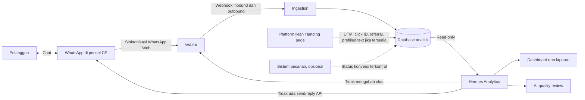
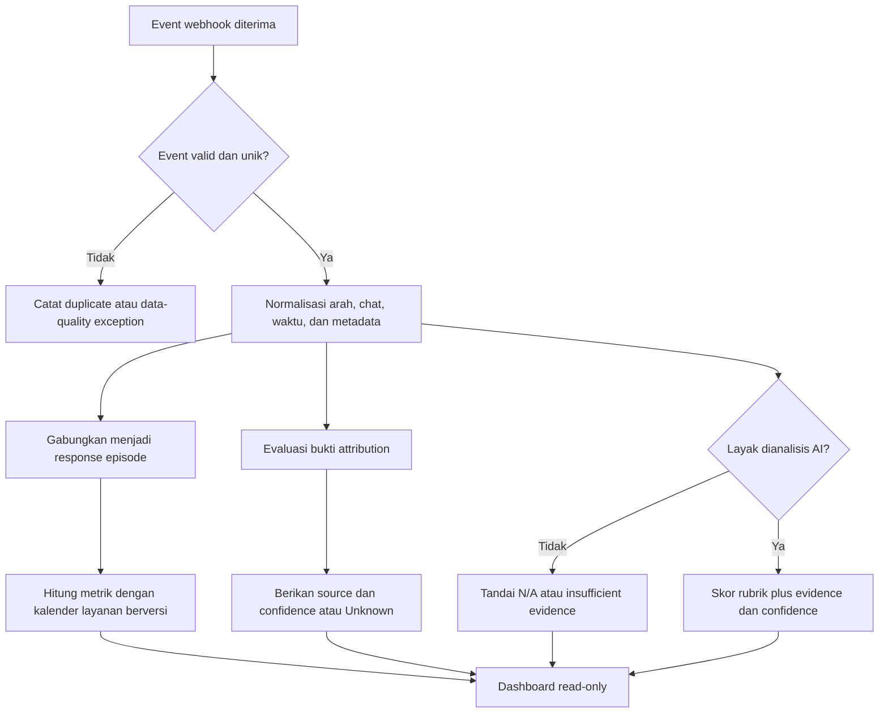
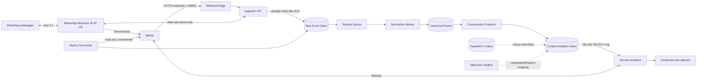
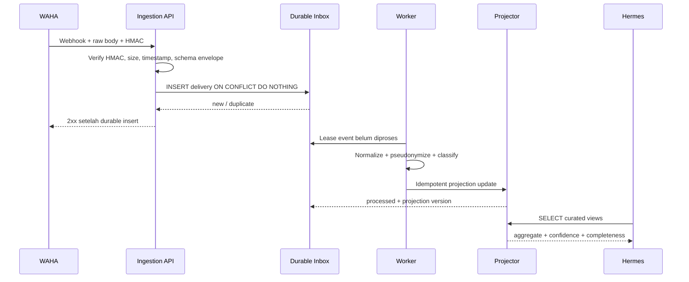
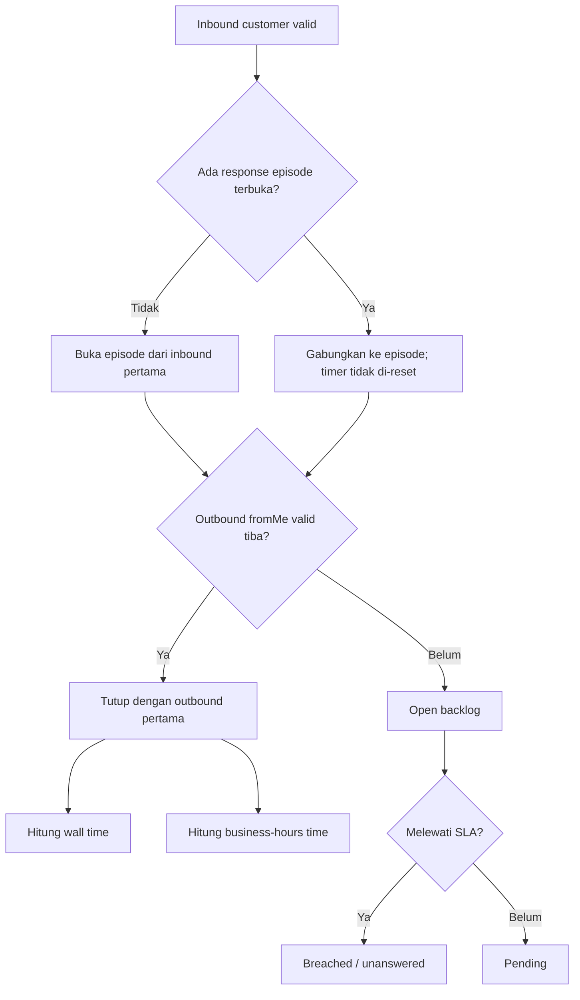
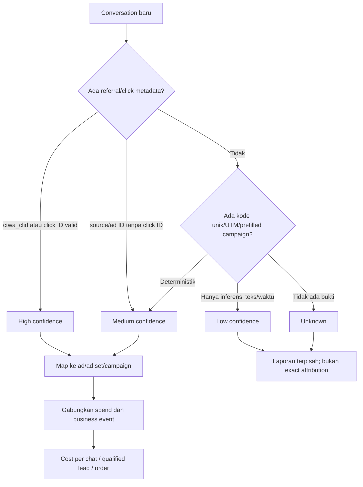

# PRD — AqiqahPro Hermes Passive WhatsApp Analytics

> **Dokumen:** Product Requirements Document (PRD)  
> **Produk:** AqiqahPro — Hermes WhatsApp & Ads Intelligence  
> **Versi:** 1.0 Draft  
> **Tanggal:** 21 Oktober 2026  
> **Owner:** AqiqahPro  
> **Status:** Siap untuk review produk, legal/privacy, dan teknis  
> **Arsitektur MVP:** CS tetap membalas dari HP; WAHA hanya ingestion; Hermes read-only  

## 1. Ringkasan

AqiqahPro Hermes adalah produk analitik WhatsApp pasif untuk membantu manajemen memahami sumber prospek, kecepatan respons, kualitas percakapan, dan peluang perbaikan layanan pelanggan tanpa mengubah cara kerja CS di ponsel.

WAHA hanya mengirimkan webhook pesan masuk dan keluar ke basis data. WAHA mendokumentasikan event `message` untuk inbound dan `message.any` untuk seluruh pesan termasuk pesan sendiri, serta mendukung HMAC dan retry webhook.[1] Hermes hanya membaca data tersebut untuk analisis dan visualisasi. Hermes tidak mengirim pesan, tidak membuat balasan otomatis, tidak mengubah percakapan, dan tidak mengendalikan akun WhatsApp.

Attribution iklan melalui WhatsApp Web bersifat best-effort karena metadata kampanye atau identitas pengirim pesan keluar tidak selalu tersedia. Migrasi masa depan ke WhatsApp Cloud API Coexistence dipertimbangkan untuk meningkatkan kelengkapan attribution dan stabilitas integrasi. Meta mendokumentasikan bahwa Coexistence memungkinkan nomor yang sama tetap digunakan untuk chat 1:1 di WhatsApp Business App sekaligus terhubung ke Cloud API, dengan sinkronisasi pesan melalui webhook terkait.[3]

## 2. Tujuan Produk

1. Menyediakan gambaran volume dan tren percakapan WhatsApp.
2. Mengukur waktu tunggu pelanggan secara konsisten dan dapat diaudit.
3. Mengidentifikasi prospek yang belum ditanggapi atau membutuhkan tindak lanjut.
4. Mengestimasi sumber iklan atau kampanye tanpa mengklaim kepastian yang tidak didukung data.
5. Menilai kualitas percakapan dengan AI sebagai alat coaching, bukan sebagai dasar hukuman otomatis.
6. Menjaga privasi pelanggan dan membatasi akses terhadap isi percakapan.
7. Menyiapkan model data dan definisi produk yang dapat dilanjutkan ke Cloud API Coexistence.

## 3. Non-Tujuan

- Mengirim atau menjadwalkan pesan WhatsApp.
- Menghasilkan atau mengirim auto-reply.
- Mengubah, menghapus, menandai, atau meneruskan chat.
- Menentukan komisi, sanksi, pemecatan, atau penilaian kinerja hanya dari skor AI.
- Mengklaim attribution iklan pasti ketika hanya tersedia bukti tidak langsung.
- Mengukur waktu kerja aktif CS, karena selisih waktu pesan bukan bukti durasi pengerjaan aktif.
- Menggantikan CRM, helpdesk, WhatsApp, atau sistem pemesanan.
- Membaca kontak, media, atau histori di luar data yang secara sah diterima melalui webhook yang disetujui.

## 4. Pengguna dan Kebutuhan

### 4.1 Pemilik/Manajemen

- Melihat tren prospek dan layanan.
- Mengetahui distribusi waktu respons dan percakapan yang berisiko terlewat.
- Membandingkan periode, kanal, dan kampanye secara wajar.

### 4.2 Supervisor CS

- Menemukan antrean yang belum dijawab.
- Meninjau contoh percakapan dengan bukti yang jelas.
- Menggunakan hasil AI untuk coaching dan kalibrasi tim.

### 4.3 CS

- Memahami ekspektasi layanan.
- Menerima umpan balik yang dapat dijelaskan dan dikoreksi.
- Tidak dinilai atas waktu di luar jadwal, gangguan sistem, atau chat yang tidak dapat diatribusikan kepadanya.

### 4.4 Admin Privasi/Sistem

- Mengatur hak akses, retensi, masking, dan audit penggunaan data.
- Menangani permintaan koreksi atau penghapusan sesuai kebijakan perusahaan dan hukum yang berlaku.

## 5. Prinsip Produk

1. **Pasif:** Hermes tidak mempunyai jalur pengiriman pesan.
2. **Read-only:** analisis Hermes tidak boleh memutasi data sumber percakapan.
3. **Evidence-first:** setiap metrik dan skor dapat ditelusuri ke pesan serta timestamp sumber.
4. **Unknown is valid:** data yang tidak lengkap dilabeli tidak diketahui, bukan ditebak secara diam-diam.
5. **Fair by design:** metrik memperhitungkan jadwal kerja, kualitas data, dan confidence attribution.
6. **Aggregate before individual:** dashboard tim menjadi default; tampilan individual memerlukan alasan bisnis dan hak akses khusus.
7. **Human oversight:** AI memberi rekomendasi, bukan keputusan ketenagakerjaan otomatis.

## 6. Batas Sistem

### Kontrak batas produk

- WAHA berperan sebagai sumber ingestion saja.
- Webhook masuk dan keluar disimpan sebagai event sumber yang dapat diaudit.
- Hermes hanya memiliki akses baca ke data analitik yang diperlukan.
- Tidak ada fitur, tombol, tool, kredensial, atau endpoint Hermes untuk mengirim pesan.
- Kegagalan analitik tidak boleh mengganggu aktivitas chat CS di ponsel.

## 7. Ruang Lingkup Fungsional

### 7.1 Ingestion dan Integritas Data

Produk menerima event inbound dan outbound beserta metadata yang tersedia, seperti timestamp, ID pesan, ID chat pseudonim, arah pesan, tipe pesan, status grup, dan metadata referral.

Persyaratan produk:

- Event duplikat tidak boleh menggandakan volume atau metrik.
- Event terlambat tetap dapat memperbarui hasil analitik dengan penanda waktu pembaruan.
- Event yang tidak dapat diproses dicatat sebagai data-quality exception.
- Dashboard menampilkan freshness data dan periode terakhir yang lengkap.
- Pesan sistem, status, broadcast, dan grup dikeluarkan secara default dari metrik layanan, kecuali dikonfigurasi sebagai kanal yang relevan.

### 7.2 Inbox Analytics

Dashboard minimum:

- jumlah percakapan dan pelanggan unik;
- pesan inbound dan outbound;
- response episode yang menunggu jawaban;
- umur antrean belum terjawab;
- first-response time dan subsequent-response time;
- distribusi P50, P75, P90, dan P95;
- kepatuhan SLA;
- volume menurut tanggal, jam, sumber attribution, dan status data;
- perbandingan periode dengan denominator dan coverage yang terlihat.

### 7.3 Conversation Review

Supervisor dapat:

- memfilter periode, status, kampanye, dan kategori kualitas;
- membuka percakapan sesuai hak akses;
- melihat pesan yang menjadi bukti metrik atau skor;
- mencatat hasil review manusia;
- mengoreksi label AI tanpa mengubah chat sumber;
- mengekspor ringkasan teragregasi sesuai izin.

### 7.4 Deteksi Tindak Lanjut

Hermes dapat menandai:

- inbound yang belum memperoleh outbound valid;
- pelanggan yang menunggu melebihi ambang SLA;
- pertanyaan yang tampak belum terjawab;
- janji tindak lanjut yang diduga belum terpenuhi.

Semua tanda bersifat analitik. Hermes tidak mengirim pengingat kepada pelanggan dan tidak mengeksekusi tindak lanjut.

## 8. Definisi Metrik

### 8.1 Unit Dasar

- **Event pesan valid:** pesan inbound atau outbound pelanggan yang lolos deduplikasi dan bukan event sistem, status, pesan grup yang dikecualikan, atau event pengujian.
- **Percakapan:** kumpulan event valid untuk satu chat/pelanggan dalam periode pelaporan.
- **Response episode:** interval tunggu yang dimulai oleh satu atau beberapa inbound berurutan dan ditutup oleh outbound valid pertama setelahnya.
- **Episode terjawab:** response episode yang mempunyai outbound penutup.
- **Episode terbuka:** response episode yang belum mempunyai outbound penutup pada waktu evaluasi.
- **Jam layanan:** kalender operasional yang telah disetujui, termasuk zona waktu, hari kerja, jam buka, libur, dan pengecualian.

Jika beberapa inbound datang sebelum outbound pertama, semuanya tetap satu response episode. Waktu mulai episode adalah timestamp inbound pertama. Hal ini mencegah satu rangkaian pesan pelanggan dihitung sebagai beberapa kegagalan respons.

### 8.2 First Response Time

First Response Time atau FRT mengukur waktu dari inbound pertama pelanggan pada sebuah percakapan baru sampai outbound valid pertama.

Percakapan dianggap baru jika tidak terdapat event valid pada chat tersebut selama **24 jam kalender** sebelum inbound pembuka. Nilai 24 jam harus menjadi konfigurasi berversi; perubahan tidak boleh mengubah laporan historis tanpa proses rekalkulasi yang terlihat.

- **FRT elapsed:** `timestamp outbound pertama - timestamp inbound pembuka`.
- **FRT business-hours:** jumlah menit yang berada di dalam jam layanan antara kedua timestamp tersebut.
- Jika belum ada outbound, episode berstatus terbuka dan tidak dimasukkan ke distribusi FRT terjawab; episode tetap masuk metrik backlog dan unanswered rate.

### 8.3 Subsequent Response Time

Subsequent Response Time atau SRT menggunakan response episode setelah balasan pertama dalam percakapan yang sama.

- **SRT elapsed:** `timestamp outbound penutup - timestamp inbound pertama episode lanjutan`.
- **SRT business-hours:** menit yang hanya dihitung di dalam jam layanan.
- Inbound tambahan sebelum jawaban tidak membuka episode baru.

### 8.4 Statistik Distribusi

Untuk kumpulan episode terjawab yang valid:

- **P50:** nilai persentil ke-50 dari waktu respons.
- **P90:** nilai persentil ke-90; 90% episode terjawab memiliki waktu respons sama dengan atau lebih rendah.
- Rata-rata boleh ditampilkan, tetapi tidak boleh menjadi satu-satunya ringkasan karena sensitif terhadap outlier.
- Setiap statistik wajib menampilkan jumlah episode valid `n`, rentang waktu, jenis clock, dan coverage data.

### 8.5 SLA Compliance

`SLA compliance = episode terjawab dalam ambang SLA / seluruh episode eligible × 100%`

Episode eligible mencakup episode yang dimulai dalam periode pengukuran dan telah mencapai waktu evaluasi yang cukup untuk dinilai. Episode terbuka yang telah melewati ambang SLA dihitung gagal. Episode terbuka yang belum melewati ambang SLA dilabeli pending dan belum masuk denominator final.

Dashboard wajib menyebutkan:

- ambang SLA;
- elapsed atau business-hours clock;
- jumlah lulus, gagal, pending, dan dikecualikan;
- jadwal layanan yang digunakan.

### 8.6 Unanswered Rate

`Unanswered rate = episode terbuka yang telah melewati ambang unanswered / seluruh episode eligible × 100%`

Ambang unanswered terpisah dari SLA dan harus dinyatakan eksplisit. Episode yang masih berada dalam grace period berstatus pending.

### 8.7 Backlog Age

`Backlog age = waktu evaluasi - timestamp inbound pertama episode terbuka`

Dashboard menampilkan elapsed age dan, jika digunakan untuk evaluasi layanan, business-hours age.

### 8.8 Volume dan Pelanggan Unik

- **Inbound volume:** jumlah event inbound valid.
- **Outbound volume:** jumlah event outbound valid.
- **Pelanggan unik:** jumlah ID chat pelanggan terdeduplikasi dalam periode.
- Volume tidak boleh dipakai sebagai proksi produktivitas tanpa mempertimbangkan kompleksitas, pembagian tugas, dan atribusi agen.

### 8.9 Coverage dan Kualitas Data

`Webhook coverage = event valid yang berhasil diproses / seluruh event webhook yang diterima × 100%`

Metrik kualitas minimum:

- tingkat duplikasi;
- event gagal diproses;
- event tanpa arah atau timestamp valid;
- keterlambatan event P50/P95;
- gap koneksi sumber;
- persentase outbound dengan identitas agen diketahui;
- persentase percakapan dengan attribution diketahui.

Periode dengan gap sumber wajib diberi peringatan dan tidak boleh dibandingkan seolah-olah datanya lengkap.

## 9. Attribution Iklan

### 9.1 Tujuan

Menghubungkan percakapan atau pelanggan dengan sumber akuisisi yang paling mungkin berdasarkan bukti yang tersedia, tanpa memaksakan attribution ketika metadata tidak memadai.

### 9.2 Hirarki Attribution

Urutan bukti dari paling kuat:

1. referral/click metadata platform yang tervalidasi dan terikat ke event pembuka;
2. click ID unik yang dibawa dari landing page atau prefilled WhatsApp message;
3. kode kampanye unik yang cocok secara deterministik;
4. UTM yang terhubung melalui identifier sesi/pelanggan yang diizinkan;
5. nomor masuk, landing page, atau pola teks khusus kampanye;
6. self-reported source dari isi percakapan, dengan label hasil klasifikasi;
7. unknown/unattributed.

Last-touch dapat menjadi model pelaporan awal, tetapi hasil harus menyimpan model attribution, bukti, timestamp touchpoint, attribution window, dan confidence.

### 9.3 Confidence Attribution

- **High:** bukti deterministik unik, misalnya click ID tervalidasi.
- **Medium:** bukti kuat tetapi tidak unik sempurna, misalnya kode kampanye atau pola referral yang konsisten.
- **Low:** inferensi teks, nomor, waktu, atau klasifikasi AI.
- **Unknown:** tidak ada bukti memadai atau terdapat konflik yang tidak dapat diselesaikan.

Laporan tidak boleh menggabungkan Low dan Unknown ke attributed conversions tanpa label terpisah.

### 9.4 Attribution Window

Default rekomendasi:

- click-to-chat: 7 hari sejak touchpoint;
- repeat conversion: dilaporkan terpisah dari new-customer conversion;
- konflik beberapa touchpoint diselesaikan berdasarkan model pelaporan yang dipilih dan ditampilkan secara eksplisit.

Window adalah kebijakan produk yang berversi, bukan fakta universal. Perubahan model/window tidak boleh diam-diam menulis ulang laporan historis.

### 9.5 Konversi

Konversi hanya dianggap terverifikasi jika terdapat event bisnis eksplisit, seperti pesanan valid atau pembayaran, dari sumber data yang disetujui.

- Chat dimulai bukan konversi penjualan.
- Pernyataan minat bukan pesanan.
- Klasifikasi AI atas niat beli dilabeli sebagai signal, bukan revenue.
- Revenue attribution hanya ditampilkan jika hubungan pesanan-pelanggan memenuhi aturan linkage dan confidence yang disetujui.

### 9.6 Keterbatasan WhatsApp Web

WhatsApp Web/WAHA diperlakukan sebagai sumber best-effort: payload internal berbeda menurut engine dan tidak menjadi kontrak attribution resmi. Sebagai pembanding, kontrak resmi Cloud API mendefinisikan `referral` dengan `source_id`, `source_url`, dan `ctwa_clid` pada pesan Click-to-WhatsApp.[2] WhatsApp Web/WAHA mungkin tidak menyediakan metadata tersebut secara konsisten, histori klik lintas perangkat, atau identitas agen pengirim. Produk wajib:

- menampilkan coverage attribution;
- menyediakan bucket Unknown;
- menyebutkan bahwa attribution bersifat best-effort;
- melarang klaim ROAS presisi jika denominator biaya atau linkage conversion tidak lengkap;
- tidak mengisi data yang hilang dengan tebakan tersembunyi.

## 10. Attribution Agen dan Keadilan Penilaian CS

Outbound dari akun WhatsApp bersama tidak selalu membuktikan siapa CS yang mengetik pesan. Identitas agen hanya boleh disebut diketahui jika terdapat bukti eksplisit dan tervalidasi.

Status attribution agen:

- **verified:** identitas agen berasal dari mekanisme assignment/login/device yang disetujui dan dapat diaudit;
- **inferred:** identitas diperkirakan dari jadwal, pola, atau metadata tidak langsung;
- **unknown:** tidak ada bukti memadai.

Aturan keadilan:

1. Metrik inferred atau unknown tidak boleh digunakan untuk ranking individu, insentif, sanksi, atau keputusan ketenagakerjaan.
2. Episode lintas shift tidak otomatis dibebankan kepada CS yang aktif saat episode dibuka atau ditutup.
3. Waktu di luar jadwal individu tidak boleh dinilai sebagai keterlambatan individu.
4. Downtime, event terlambat, dan gap ingestion dikecualikan atau diberi peringatan.
5. Kesulitan kasus, kebutuhan eskalasi, dan ketergantungan pada tim lain harus dapat dicatat sebagai konteks.
6. CS memiliki mekanisme koreksi/keberatan dan riwayat perubahan review.
7. Dashboard default menampilkan tim/shift, bukan leaderboard individu.

## 11. AI Quality Scoring

### 11.1 Tujuan

AI membantu menemukan pola dan contoh coaching pada percakapan yang sudah terjadi. AI tidak membuat keputusan otomatis tentang pelanggan atau pegawai.

### 11.2 Rubrik Awal

Setiap dimensi diberi skor 0–4 hanya jika bukti cukup:

- **Ketepatan kebutuhan:** CS memahami dan merespons kebutuhan yang dinyatakan pelanggan.
- **Kelengkapan informasi:** informasi penting seperti paket, proses, syarat, atau langkah berikutnya dijelaskan saat relevan.
- **Kejelasan:** jawaban mudah dipahami, tidak kontradiktif, dan tidak menimbulkan ambiguitas material.
- **Empati dan kesopanan:** nada profesional serta menghargai pelanggan.
- **Progression:** terdapat langkah berikutnya yang relevan tanpa pemaksaan.
- **Kepatuhan:** tidak ada janji, klaim, atau permintaan data yang melanggar kebijakan yang telah disediakan kepada model.

Skala:

- 0: kegagalan jelas dengan bukti kuat;
- 1: banyak kekurangan material;
- 2: sebagian memenuhi tetapi ada kekurangan penting;
- 3: memenuhi standar;
- 4: melampaui standar secara relevan;
- N/A: tidak relevan atau bukti tidak cukup.

Skor total hanya dihitung dari dimensi applicable dan wajib menampilkan dimensi N/A. Bobot, versi rubrik, versi model, bahasa, confidence, dan kutipan bukti disimpan bersama hasil.

### 11.3 Guardrail AI

- AI wajib menyertakan evidence span berupa pesan yang mendukung temuan.
- AI harus mengembalikan insufficient evidence bila konteks tidak cukup.
- Skor rendah tidak boleh menghasilkan sanksi otomatis.
- Percakapan sensitif, konflik, bahasa campuran, media tanpa transkrip, atau confidence rendah diarahkan ke review manusia.
- Review manusia dapat mengoreksi hasil; koreksi dicatat untuk kalibrasi, bukan mengubah chat sumber.
- Model tidak boleh menebak identitas, agama, kesehatan, kondisi ekonomi, atau atribut sensitif pelanggan.
- Ringkasan dan contoh untuk pelatihan harus dimasking atau dipseudonimkan.

### 11.4 Validasi Kualitas AI

Sebelum digunakan pada coaching rutin:

- sampel berstrata ditinjau oleh minimal dua reviewer manusia;
- rubrik dan pedoman reviewer terdokumentasi;
- agreement antarreviewer dihitung;
- precision temuan risiko material dan tingkat false positive dilaporkan;
- performa diperiksa menurut bahasa, panjang chat, kategori kasus, dan ketersediaan konteks;
- target kualitas disetujui pemilik produk sebelum perluasan rollout.

Tidak ada leaderboard individu sampai attribution agen tervalidasi dan audit fairness selesai.

## 12. Alur Analitik

## 13. Dashboard dan Pelaporan

### Ringkasan Eksekutif

- volume percakapan dan pelanggan unik;
- backlog terbuka dan umur backlog;
- FRT/SRT business-hours P50 dan P90;
- SLA compliance beserta numerator/denominator;
- attribution coverage menurut confidence;
- conversion terverifikasi, jika integrasi bisnis tersedia;
- data freshness dan peringatan kelengkapan.

### Operasional Supervisor

- episode menunggu berdasarkan umur;
- distribusi respons menurut jam/shift;
- tren unanswered rate;
- percakapan yang ditandai untuk review;
- hasil AI per dimensi secara agregat;
- daftar exception dan confidence rendah.

### Ketentuan Tampilan

- Setiap grafik menyebutkan definisi, clock, periode, zona waktu, `n`, dan filter aktif.
- Perbandingan periode harus menggunakan definisi metrik yang sama.
- Data parsial diberi label jelas.
- Nilai kecil yang berisiko mengidentifikasi individu dapat disembunyikan atau diagregasi.
- Drill-down ke isi chat mengikuti least privilege dan dicatat di audit log.

## 14. Privasi, Keamanan, dan Tata Kelola

### Privasi

- Hanya data yang diperlukan untuk tujuan analitik yang dikumpulkan.
- Nomor telepon dan identifier pelanggan dipseudonimkan untuk tampilan umum.
- Isi chat tidak ditampilkan kepada pengguna yang hanya membutuhkan statistik agregat.
- Media tidak dianalisis secara default; transkripsi/OCR memerlukan persetujuan dan kebijakan terpisah.
- Data sensitif dalam prompt atau output AI dimasking sejauh memungkinkan.
- Tujuan pemrosesan, dasar pemrosesan, retensi, dan hak subjek data didokumentasikan sesuai kebijakan dan hukum yang berlaku, termasuk UU PDP Indonesia.

### Keamanan

- Akses menggunakan role-based access control dan prinsip least privilege.
- Akses ke isi chat, ekspor, perubahan kebijakan, dan review skor dicatat dalam audit log.
- Data dilindungi saat transit dan tersimpan.
- Kredensial sumber tidak tersedia bagi Hermes jika tidak diperlukan untuk akses baca analitik.
- Lingkungan analitik tidak mempunyai kredensial pengiriman WhatsApp.
- Ekspor dibatasi, diberi masa berlaku bila relevan, dan tidak memuat PII tanpa izin khusus.
- Insiden akses tidak sah mempunyai prosedur deteksi, pencabutan akses, investigasi, dan pemberitahuan.

### Retensi

Kebijakan awal yang harus disetujui bisnis:

- event mentah dan isi chat: retensi terbatas berdasarkan kebutuhan operasional/legal;
- metrik agregat tanpa isi chat: dapat disimpan lebih lama;
- audit log: mengikuti kebutuhan keamanan dan kepatuhan;
- penghapusan harus mencakup salinan analitik serta turunan yang masih dapat dikaitkan, kecuali wajib dipertahankan secara hukum.

Angka retensi final tidak ditetapkan tanpa persetujuan legal, bisnis, dan keamanan.

## 15. Indikator Keberhasilan Produk

### Adopsi

- Persentase hari kerja ketika supervisor membuka dashboard.
- Persentase alert/flag analitik yang direview manusia.
- Persentase review yang menghasilkan tindakan coaching terdokumentasi.

### Kualitas Data

- Webhook processing coverage memenuhi target yang disetujui.
- Data freshness berada dalam target untuk mayoritas periode operasional.
- Persentase periode dengan gap ingestion menurun.
- Coverage attribution dan attribution agen dilaporkan, bukan disembunyikan.

### Outcome Layanan

- Penurunan P90 FRT business-hours dengan volume dan coverage yang sebanding.
- Penurunan unanswered rate.
- Penurunan backlog yang melewati SLA.
- Peningkatan kualitas pada dimensi rubrik yang telah tervalidasi manusia.

Perbaikan tidak boleh dinyatakan kausal hanya karena terjadi setelah peluncuran. Laporan harus membedakan korelasi, eksperimen, dan observasi operasional.

## 16. Rollout

### Fase 0 — Definisi dan Governance

- Menyetujui jam layanan, SLA, episode, pengecualian, dan attribution window.
- Menetapkan peran akses, retensi, dan kebijakan review karyawan.
- Menguji sampel data untuk memahami keterbatasan WAHA.

**Gate:** definisi metrik ditandatangani Product, CS Operations, Security/Privacy, dan perwakilan pengguna.

### Fase 1 — Shadow Data Quality

- Ingestion dan perhitungan berjalan tanpa dashboard evaluasi individu.
- Memvalidasi deduplikasi, arah pesan, timestamp, gap, dan rekonsiliasi sampel.
- Tidak ada notifikasi pelanggan atau perubahan workflow CS.

**Gate:** kualitas dan freshness data memenuhi ambang yang disetujui selama periode stabil.

### Fase 2 — Dashboard Tim

- Meluncurkan volume, backlog, FRT/SRT, SLA, dan attribution coverage tingkat tim.
- Menampilkan warning data parsial dan confidence.
- Mengumpulkan feedback supervisor serta CS.

**Gate:** pengguna memahami definisi; tidak ditemukan penggunaan metrik yang menyesatkan.

### Fase 3 — AI Coaching Pilot

- Menggunakan sampel terbatas dan reviewer manusia.
- Mengukur agreement, false positive, bias, dan usefulness.
- Tidak ada ranking atau konsekuensi otomatis.

**Gate:** kualitas AI dan prosedur keberatan memenuhi ambang yang disetujui.

### Fase 4 — Attribution dan Outcome

- Mengaktifkan laporan attribution berdasarkan hirarki bukti.
- Menghubungkan konversi hanya dari event bisnis tervalidasi.
- Memisahkan High, Medium, Low, dan Unknown.

### Fase 5 — Evaluasi Cloud API Coexistence

- Menilai kelayakan migrasi untuk metadata referral yang lebih baik, identitas agen, stabilitas, dan dukungan resmi.
- Membandingkan manfaat, biaya, dampak operasional, kebijakan Meta, serta kontinuitas nomor.
- Migrasi merupakan keputusan terpisah dan bukan prasyarat MVP pasif.

## 17. Risiko dan Mitigasi

| Risiko | Dampak | Mitigasi produk |
|---|---|---|
| Sesi WhatsApp Web/WAHA terputus | Data hilang atau terlambat | Freshness indicator, gap detection, periode incomplete, rekonsiliasi |
| Webhook duplikat atau tidak berurutan | Volume dan waktu respons salah | Deduplikasi, event-time semantics, rekalkulasi terkontrol |
| Identitas CS tidak tersedia | Penilaian individu salah | Status verified/inferred/unknown; larang ranking tanpa verified attribution |
| Metadata iklan tidak lengkap | ROAS atau source menyesatkan | Confidence, Unknown bucket, coverage, klaim best-effort |
| AI hallucination atau bias | Coaching tidak adil | Evidence span, confidence, human review, audit dan kalibrasi |
| Isi chat mengandung data sensitif | Pelanggaran privasi | Minimisasi, masking, RBAC, retensi, audit ekspor |
| Metrik mendorong jawaban cepat tetapi buruk | Penurunan kualitas layanan | Pasangkan response-time dengan quality review; hindari target tunggal |
| Perbandingan shift tidak setara | Evaluasi tidak adil | Business-hours clock, konteks shift, volume/kompleksitas, minimum sample |
| Dashboard dianggap real-time saat data terlambat | Keputusan salah | Timestamp freshness dan status kelengkapan jelas |
| Perubahan struktur WhatsApp/WAHA | Ingestion terganggu | Monitoring kontrak data dan rencana Cloud API Coexistence |
| Scope berkembang menjadi auto-reply | Risiko operasional dan kepatuhan | Guardrail produk eksplisit: tanpa send capability |

## 18. Acceptance Criteria

### AC-01 — Batas Pasif dan Read-Only

**Given** WAHA menerima pesan inbound atau outbound, **when** event tersedia untuk analitik, **then** event dapat tersimpan dan dianalisis tanpa Hermes mengirim, mengedit, menghapus, atau memberi reaksi pada pesan.

**Given** pengguna membuka dashboard, **when** melakukan seluruh aksi yang tersedia, **then** tidak ada aksi yang menghasilkan pesan WhatsApp atau perubahan pada chat sumber.

### AC-02 — Deduplikasi

**Given** webhook dengan ID pesan yang sama diterima lebih dari sekali, **when** metrik dihitung, **then** pesan hanya dihitung satu kali dan duplikat terlihat dalam data-quality metrics.

### AC-03 — Event Terlambat

**Given** event valid tiba setelah laporan awal dihitung, **when** sistem memperbarui analitik, **then** hasil terkoreksi secara idempotent dan waktu pembaruan data terlihat.

### AC-04 — Response Episode

**Given** pelanggan mengirim tiga inbound sebelum ada outbound, **when** response episode dibentuk, **then** hanya satu episode dibuat dengan awal pada inbound pertama dan akhir pada outbound valid pertama.

**Given** inbound baru datang setelah outbound penutup, **when** belum melewati batas percakapan baru, **then** inbound tersebut membuka subsequent-response episode.

### AC-05 — First Response Time

**Given** percakapan baru mempunyai inbound pada 09:00 dan outbound pertama pada 09:12, **when** seluruh interval berada dalam jam layanan, **then** FRT elapsed dan business-hours bernilai 12 menit.

**Given** inbound terjadi di luar jam layanan, **when** FRT business-hours dihitung, **then** menit sebelum jam layanan berikutnya tidak dihitung dan FRT elapsed tetap tersedia secara terpisah.

### AC-06 — Episode Belum Dijawab

**Given** episode belum memiliki outbound, **when** laporan FRT terjawab dihitung, **then** episode tidak masuk distribusi FRT tetapi masuk backlog.

**Given** episode terbuka telah melewati ambang unanswered, **when** unanswered rate dihitung, **then** episode masuk numerator dan denominator eligible.

### AC-07 — Transparansi SLA

**Given** pengguna melihat SLA compliance, **then** dashboard menampilkan ambang, jenis clock, lulus, gagal, pending, dikecualikan, denominator, kalender layanan, dan periode.

### AC-08 — Data Parsial

**Given** terdapat gap ingestion dalam suatu periode, **when** periode ditampilkan atau dibandingkan, **then** dashboard memberi label incomplete dan tidak menyajikannya sebagai perbandingan setara tanpa peringatan.

### AC-09 — Attribution Iklan

**Given** click ID unik dan tervalidasi tersedia, **when** percakapan diatribusikan, **then** sumber memperoleh confidence High dan bukti dapat diaudit.

**Given** hanya terdapat dugaan dari teks percakapan, **when** sumber diklasifikasikan, **then** confidence maksimal Low dan hasil tidak diperlakukan sebagai attribution deterministik.

**Given** tidak ada bukti memadai, **when** attribution dijalankan, **then** hasil adalah Unknown, bukan sumber yang ditebak.

### AC-10 — Konversi

**Given** chat hanya menunjukkan minat tanpa event pesanan, **when** conversion report dibuat, **then** chat tidak dihitung sebagai penjualan terverifikasi.

**Given** pesanan valid dapat ditautkan menurut aturan linkage, **when** laporan konversi dibuat, **then** status sumber, confidence, attribution window, dan model attribution ditampilkan.

### AC-11 — Attribution Agen

**Given** outbound berasal dari akun bersama tanpa bukti agen, **when** laporan individu dibuka, **then** event dilabeli Unknown dan tidak dibebankan kepada individu.

**Given** attribution agen hanya inferred, **when** pengguna mencoba membuat ranking atau keputusan kompensasi, **then** produk tidak menyajikan hasil sebagai verified individual performance.

### AC-12 — Skor AI yang Dapat Dijelaskan

**Given** AI memberikan skor suatu dimensi, **then** hasil memuat rubrik, versi, evidence span, confidence, dan alasan ringkas.

**Given** konteks tidak cukup, **when** AI mengevaluasi dimensi, **then** hasil adalah N/A atau insufficient evidence, bukan skor spekulatif.

### AC-13 — Human Review dan Keberatan

**Given** reviewer tidak setuju dengan hasil AI, **when** koreksi disimpan, **then** nilai review manusia, alasan, reviewer, timestamp, dan riwayat perubahan tercatat tanpa mengubah chat sumber.

**Given** CS mengajukan koreksi, **when** kasus ditinjau, **then** tersedia status proses dan keputusan yang dapat diaudit.

### AC-14 — Larangan Keputusan Otomatis

**Given** skor AI rendah atau SLA individu tampak buruk, **when** laporan dibuat, **then** sistem tidak otomatis menghasilkan sanksi, perubahan kompensasi, atau tindakan ketenagakerjaan.

### AC-15 — Privasi dan Hak Akses

**Given** pengguna hanya memiliki akses statistik, **when** membuka dashboard, **then** nomor telepon dan isi chat tidak terlihat.

**Given** pengguna berwenang membuka isi chat, **when** akses dilakukan, **then** kejadian tercatat dalam audit log.

### AC-16 — Ekspor

**Given** pengguna tidak memiliki izin ekspor PII, **when** mengekspor laporan, **then** data pelanggan dimasking atau agregat dan ekspor ditolak jika masking tidak dapat dipenuhi.

### AC-17 — Auditability

**Given** angka atau skor dipertanyakan, **when** reviewer melakukan drill-down, **then** sistem dapat menunjukkan definisi metrik, versi konfigurasi, event sumber, pengecualian, dan waktu perhitungan.

### AC-18 — Ketahanan Operasional

**Given** Hermes atau dashboard tidak tersedia, **when** CS melanjutkan chat melalui ponsel, **then** aktivitas WhatsApp tetap dapat berjalan karena jalur analitik tidak berada pada jalur pengiriman pesan.

### AC-19 — Minimum Sample dan Perbandingan

**Given** sampel terlalu kecil atau coverage tidak memenuhi ambang yang disetujui, **when** perbandingan tim/shift ditampilkan, **then** produk menyembunyikan ranking, menampilkan warning, atau menandai hasil tidak konklusif.

### AC-20 — Kesiapan Rollout

**Given** sebuah fase belum memenuhi gate kualitas, privasi, atau fairness, **when** evaluasi rollout dilakukan, **then** fase berikutnya tidak diaktifkan dan analitik dapat dikembalikan ke mode agregat/shadow tanpa memengaruhi chat.

## 19. Pertanyaan Terbuka Sebelum Baseline

1. Berapa jam layanan, zona waktu, jadwal libur, dan SLA resmi AqiqahPro?
2. Apakah nomor digunakan bersama oleh beberapa CS, dan adakah assignment yang dapat dipercaya?
3. Tipe pesan mana yang dianggap membutuhkan jawaban?
4. Berapa batas percakapan baru dan unanswered yang disetujui?
5. Sumber iklan mana yang menyediakan click/referral metadata aktual?
6. Sistem apa yang menjadi sumber kebenaran pesanan dan pembayaran?
7. Berapa retensi isi chat, event mentah, skor AI, dan audit log?
8. Siapa yang boleh membaca isi chat, melihat data individu, dan mengekspor data?
9. Bahasa, kategori kasus, dan kebijakan layanan apa yang harus tercakup dalam rubrik AI?
10. Ambang kualitas apa yang wajib dicapai sebelum AI dipakai untuk coaching rutin?

## 20. Keputusan Produk Utama

- MVP adalah analitik pasif tingkat tim, bukan otomasi percakapan.
- WAHA hanya menjadi jalur ingestion; Hermes hanya membaca basis data analitik.
- Response-time dilaporkan dengan elapsed dan business-hours clock, tetapi evaluasi layanan memakai business-hours sebagai default.
- Attribution WhatsApp Web selalu menyertakan confidence dan Unknown bucket.
- Skor AI memerlukan bukti, confidence, human review, dan hak koreksi.
- Penilaian individu dinonaktifkan bila attribution agen tidak verified.
- WhatsApp Cloud API Coexistence menjadi jalur migrasi masa depan, bukan asumsi kemampuan MVP.

---

## Lampiran A — Arsitektur Teknis Rekomendasi

### A.1 Prinsip arsitektur

1. **No-send invariant:** ingestion, worker, dashboard, dan Hermes tidak memiliki credential maupun jalur jaringan ke endpoint WAHA untuk send, typing, presence, atau campaign.
2. **Durable before ACK:** webhook baru diberi respons sukses setelah delivery tersimpan secara transaksional; analisis dilakukan asynchronous.
3. **Append-only source:** edit, revoke, dan perubahan ACK menjadi event baru, bukan menimpa bukti historis.
4. **Replayable projection:** conversation, response episode, dan aggregate dapat dibangun ulang secara deterministik dari canonical events.
5. **Completeness-aware:** laporan membawa status lengkap, belum direkonsiliasi, atau memiliki gap.
6. **Content is untrusted:** isi pesan pelanggan adalah data, bukan instruksi bagi Hermes.

### A.2 Urutan pemrosesan webhook

### A.3 Komponen minimum

- **Webhook Edge:** TLS, HMAC atas raw body, request-size limit, rate limit, correlation ID.
- **Ingestion API:** validasi envelope, idempotency, durable inbox, fast ACK.
- **Queue/worker:** retry terbatas, dead-letter queue, partition berdasarkan `account_id + chat_id`.
- **Normalizer:** menerjemahkan variasi payload engine WAHA menjadi canonical schema; unknown schema masuk quarantine, bukan ditebak.
- **Projector:** membentuk message current-state, timeline, response episode, attribution, dan aggregate.
- **History Reconciler:** membaca history secara incremental setelah reconnect atau terjadwal untuk menemukan pesan yang tidak masuk webhook.
- **Analytics views:** PII-minimized, read-only, mempunyai statement timeout dan row limit untuk Hermes.
- **Dashboard:** memisahkan KPI bisnis, kualitas data, attribution confidence, dan health integration.

## Lampiran B — Model Data Logis

### B.1 Entitas inti

| Entitas | Fungsi dan field penting |
|---|---|
| `waha_accounts` | Tenant/session, timezone, status koneksi, `last_event_at` |
| `webhook_deliveries` | Request ID, event type, payload hash, HMAC status, retry, processing status |
| `raw_events` | Payload terenkripsi, schema version, expiry; tidak dapat dibaca Hermes |
| `canonical_events` | Event append-only: account, chat, message ID, direction, occurred/observed time, type, quality flags |
| `message_current` | Projection kondisi terbaru, edit/revoke state, direction, effective timestamp |
| `contacts` | `phone_hmac`, identifier terenkripsi opsional, lifecycle penghapusan |
| `conversations` | Chat pseudonim, first/last activity, data-quality status |
| `response_episodes` | Trigger inbound, first outbound, wall/business seconds, status, calendar version |
| `ad_attributions` | Source/ad/campaign IDs, evidence type, confidence, model/window version |
| `business_events` | Lead qualified, quotation, order, paid, cancelled; sumber kebenaran AqiqahPro |
| `ai_reviews` | Rubric/model/prompt version, per-dimension score, evidence spans, confidence |
| `human_reviews` | Override, alasan, reviewer, timestamp, appeal status |
| `business_calendars` | Timezone, weekly schedule, holidays, effective version |
| `ingestion_watermarks` | `complete_through`, gap count, reconciliation status |
| `audit_logs` | Actor, purpose, action, resource, timestamp; tanpa raw message body |

### B.2 Idempotency key

Prioritas identitas event:

1. `account_id + provider_event_id`, jika unik dan stabil;
2. `account_id + message_external_id + event_kind + event_version`;
3. fallback `account_id + canonical_payload_hash + bounded_time_bucket`.

Database unique constraint menjadi pengaman race-condition terakhir. Event history dan webhook yang merujuk pesan sama tidak boleh menggandakan message atau response episode. Event edit/revoke tetap diterima sebagai event baru.

### B.3 Status kualitas data

- `complete_confirmed`
- `complete_by_reconciliation`
- `webhook_only_unverified`
- `gap_detected`
- `identity_uncertain`
- `timestamp_uncertain`

Setiap laporan wajib menampilkan data window, timezone, algorithm version, calendar version, completeness, attribution confidence, dan excluded count.

## Lampiran C — Algoritma Waktu Respons

### C.1 Aturan deterministik

- Urutkan berdasarkan `occurred_at`, lalu `observed_at`, lalu canonical event ID.
- Beberapa inbound berurutan sebelum outbound adalah satu episode, dimulai dari inbound pertama.
- Outbound pertama menutup episode; outbound tanpa episode terbuka adalah `proactive_or_unmatched`.
- FRT berlaku pada percakapan baru menurut inactivity window berversi; response episode berikutnya menjadi SRT.
- Simpan `wall_seconds` dan `business_seconds` bersamaan.
- Contoh: pesan Jumat 21:00, operasional berikutnya Senin 08:00, dibalas 08:10 → wall time mencakup akhir pekan; business time 10 menit.
- Edit/revoke dan late event memicu bounded recomputation serta `metric_correction` audit record.
- Jangan menerbitkan SLA final setelah completeness watermark atau pada interval gap yang belum direkonsiliasi.

### C.2 Aturan anti-bias

- `fromMe` membuktikan arah tim, **bukan identitas individu CS**.
- Jika satu nomor dipakai beberapa CS, default actor adalah `team/shared_number`.
- Ranking individual dilarang sampai terdapat mapping operator/device yang stabil, tervalidasi, dan dapat diaudit.
- Waktu di luar shift, libur, downtime, atau interval data gap tidak boleh dibebankan sebagai kegagalan individu.
- Metrik utama adalah P50/P90/P95 dan compliance; rata-rata tidak boleh berdiri sendiri.

## Lampiran D — Spesifikasi Attribution Iklan

### D.1 Source of truth dan confidence

- **High:** click ID unik tervalidasi pada event pembuka.
- **Medium:** Ad ID/source ID/kode kampanye deterministik tetapi linkage click tidak lengkap.
- **Low:** inferensi dari teks, creative, waktu, atau self-report pelanggan.
- **Unknown:** tidak ada bukti atau bukti konflik.

MVP tidak boleh menyebut ROAS akurat jika spend, order linkage, atau attribution coverage tidak lengkap. Chat masuk adalah lead signal, bukan penjualan. Revenue hanya berasal dari order/payment event AqiqahPro yang tervalidasi.

### D.2 KPI iklan

- Spend, impression, click, dan Click-to-WhatsApp conversation dari sumber Ads Insights.
- Captured chat dan unique contact dari canonical events.
- Qualified lead berdasarkan status bisnis eksplisit atau review manusia.
- Quotation/order/paid/cancelled dari AqiqahPro.
- Cost per captured chat, qualified lead, order, dan paid order.
- Conversion rate chat → qualified → order → paid.
- Attribution coverage per confidence tier.

## Lampiran E — Penilaian Kualitas CS

### E.1 Dua skor yang harus dipisahkan

1. **Service metrics deterministik:** FRT/SRT, SLA, unanswered, backlog; bersumber dari timestamp.
2. **Conversation quality review:** AI menilai rubrik dengan evidence span dan confidence.

Jangan membuat satu angka gabungan yang menyembunyikan kualitas data. Jika dibutuhkan indeks manajemen, tampilkan komponennya dan jangan gunakan untuk kompensasi/sanksi otomatis.

### E.2 Contoh scorecard coaching

| Dimensi | Bobot awal | Bukti wajib |
|---|---:|---|
| Memahami kebutuhan | 20% | Pertanyaan/konfirmasi kebutuhan pelanggan |
| Ketepatan dan kelengkapan informasi | 25% | Jawaban terkait paket, proses, syarat, harga saat relevan |
| Kejelasan komunikasi | 15% | Tidak kontradiktif dan mudah dipahami |
| Empati dan kesopanan | 15% | Kutipan nada/respons relevan |
| Progression/next step | 15% | CTA atau langkah lanjutan yang sesuai |
| Kepatuhan kebijakan | 10% | Tidak ada janji/klaim/permintaan data terlarang |

Skala per dimensi `0–4` atau `N/A`. Setiap hasil menyimpan model version, rubric version, prompt version, confidence, alasan, dan kutipan pesan. Confidence rendah, chat sensitif, media tanpa transkrip, bahasa campuran, atau temuan risiko diarahkan ke human review.

## Lampiran F — Keamanan, Privasi, dan Threat Model

### F.1 Kontrol P0

- HMAC webhook atas raw body, TLS, replay/idempotency protection, size/depth limit.
- Tidak ada send-capable credential pada ingestion, worker, maupun Hermes.
- Reverse proxy/network policy menolak endpoint WAHA send, typing, presence, campaign.
- Hermes memakai DB role `SELECT` pada curated views; `INSERT/UPDATE/DELETE/DDL` harus gagal.
- Raw event terenkripsi dan tidak tersedia bagi Hermes.
- Nomor telepon untuk lookup menggunakan keyed HMAC, bukan hash biasa.
- Message body, nomor, nama, media URL, token, QR/session secret dilarang masuk log.
- Media tidak diunduh secara default; bila dibutuhkan gunakan sandbox, host allowlist, private-IP block, size/MIME limit, timeout, dan malware scan.
- Isi chat dilabeli untrusted agar prompt injection tidak dapat memicu tool atau query mutasi.

### F.2 Threat matrix

| Ancaman | Kontrol utama |
|---|---|
| Webhook palsu/replay | HMAC, TLS, timestamp window, idempotency, audit counter |
| WAHA compromise | Segmentasi, secret rotation, least privilege, tidak percaya payload mentah |
| Pengiriman tidak sengaja | No-send code path, network deny, static/runtime test, critical alert |
| SQL/query berlebihan | Parameterized query, curated view, read-only role, timeout/row limit |
| Prompt injection chat | Treat as data, no mutation tools, PII minimization |
| Insider exfiltration | RBAC, MFA admin, masked export, access audit, break-glass terbatas |
| Data loss diam-diam | Session heartbeat, gap alert, history reconciliation, watermark |
| Penilaian pegawai tidak adil | Team-level default, confidence, human review, appeal mechanism |

### F.3 Retensi awal — perlu persetujuan legal/privacy

- Raw encrypted webhook: 30 hari.
- Message text canonical: maksimal 90 hari untuk operasional/quality review.
- Media binary: tidak disimpan secara default; jika wajib, 7–30 hari.
- Metadata pseudonim dan SLA: 12 bulan.
- Aggregate yang benar-benar tidak dapat direidentifikasi: sesuai kebijakan bisnis.
- Security audit log: 90–180 hari dan PII-minimized.

Penghapusan harus meliputi identifier langsung, message content, media, index, cache, export, serta lifecycle expiry backup. Nilai di atas adalah default desain, bukan keputusan legal final.

## Lampiran G — Observability dan SLO

### G.1 SLO usulan

- 99,9% webhook valid di-ACK setelah durable insert dalam ≤1 detik.
- 99% canonical message masuk projection dalam ≤2 menit.
- Gap yang terdeteksi direkonsiliasi ≤30 menit setelah koneksi pulih.
- 100% laporan membawa periode, timezone, algorithm/calendar version, completeness, confidence, dan exclusions.

### G.2 Alert utama

- **Critical:** ada percobaan akses endpoint outbound WAHA.
- **Critical:** session logout/disconnected melebihi grace period.
- **High:** oldest unprocessed event melewati SLO.
- **High:** reconciliation menemukan missing message.
- **High:** lonjakan HMAC/signature failure.
- **Medium:** unknown schema atau unresolved identity meningkat.

## Lampiran H — Testing dan Release Gate

### H.1 Functional/data tests

- Duplicate webhook 100 kali menghasilkan satu canonical event dan satu projection.
- History + webhook untuk pesan sama tidak menggandakan pesan.
- Out-of-order event menghasilkan state akhir identik setelah replay.
- Beberapa inbound sebelum outbound menghasilkan satu response episode.
- After-hours, weekend, hari libur, timezone boundary, dan calendar version teruji deterministik.
- Edit/revoke memicu recompute dan correction flag.
- Shared-number outbound tetap `team` kecuali mapping operator verified.
- Pesan yang ditemukan reconciler memperbaiki episode tanpa menggandakan data.

### H.2 Security tests

- Valid HMAC diterima; missing/malformed/invalid ditolak.
- Oversized/deep JSON/decompression bomb dibatasi.
- SQL injection fixture tidak mengubah query.
- Prompt injection pada message tidak dapat memanggil WAHA atau write query.
- Media URL ke localhost/private/link-local/DNS rebinding diblok.
- PII/secrets tidak muncul dalam log dan trace.
- Cross-tenant ID tidak dapat dibaca.
- DB role Hermes gagal pada semua mutasi.
- Percobaan outbound memicu critical alert.

### H.3 Blocker rilis

- Webhook tidak memiliki HMAC atau compensating private-network control.
- Endpoint send masih dapat dicapai dari komponen analytics.
- Outbound dari HP tidak dapat diamati/direkonsiliasi tetapi laporan mengklaim lengkap.
- Ranking individu aktif tanpa verified identity mapping.
- Raw PII masuk ke log atau unrestricted Hermes context.
- Retention/deletion dan restore backup belum pernah diuji.

## Lampiran I — Backlog Implementasi yang Disarankan

### Epic 1 — Governance dan baseline

- Finalisasi jam kerja, SLA, inactivity window, unanswered threshold, timezone, hari libur.
- Finalisasi role, notice/consent, retention, akses chat, export, dan appeal.
- Capture sampel payload WAHA inbound/outbound/edit/revoke/referral tanpa PII.

### Epic 2 — Passive ingestion

- Webhook Edge, HMAC, idempotency, durable inbox, queue, DLQ.
- Canonical schema, pseudonymization, projector, health monitoring.
- No-send network invariant dan CI gate.

### Epic 3 — Data-quality shadow mode

- History reconciliation, completeness watermark, gap dashboard.
- Jalankan 2–4 minggu tanpa score/target CS.
- Bandingkan sampel DB dengan chat di HP untuk mengukur capture rate.

### Epic 4 — Team SLA dashboard

- Business calendar, response episodes, FRT/SRT, P50/P90/P95, unanswered/backlog.
- Drill-down dengan RBAC dan audit akses.
- Daily/weekly executive summary oleh Hermes.

### Epic 5 — Ads attribution

- Extract raw referral best-effort dan confidence tiers.
- Sinkronisasi Meta Ads mapping/spend secara read-only.
- Hubungkan lead ke order/payment AqiqahPro.
- Tampilkan coverage dan unknown bucket sebelum cost/ROAS claims.

### Epic 6 — AI quality coaching

- Versioned rubric + evidence spans.
- Human review, calibration set, inter-reviewer agreement, correction/appeal.
- Pilot terbatas; tidak ada ranking individu otomatis.

### Epic 7 — Migration option

- Evaluasi WhatsApp Cloud API Coexistence untuk kontrak webhook resmi, attribution CTWA, dan stabilitas.[2][3]
- Pertahankan canonical event/analytics layer agar perubahan connector tidak menulis ulang produk.

## Lampiran J — Definition of Done MVP

MVP dinyatakan selesai hanya bila:

1. CS tetap dapat bekerja dari HP tanpa ketergantungan pada dashboard/Hermes.
2. Tidak ada jalur teknis bagi Hermes/analytics untuk mengirim WhatsApp.
3. Event tersimpan idempoten dan dapat direplay.
4. Inbound dan outbound dari HP terukur capture rate-nya dan gap ditampilkan.
5. FRT/SRT business-hours lulus test kalender dan edge cases.
6. Dashboard tim menampilkan denominator, coverage, confidence, dan exclusions.
7. Attribution memiliki High/Medium/Low/Unknown, bukan satu klaim pasti.
8. AI score memiliki evidence dan human override; tidak digunakan untuk sanksi otomatis.
9. RBAC, audit access, PII masking, retention, deletion, backup restore teruji.
10. Operasional memiliki runbook disconnect, backlog, DLQ, gap, dan forbidden outbound attempt.

---

## Sources

[1] https://waha.devlike.pro/docs/how-to/events — WAHA Events and Webhooks  
[2] https://developers.facebook.com/docs/whatsapp/cloud-api/webhooks/components — Meta WhatsApp Webhook Payload Reference  
[3] https://developers.facebook.com/documentation/business-messaging/whatsapp/embedded-signup/onboarding-business-app-users — Meta WhatsApp Business App Coexistence
