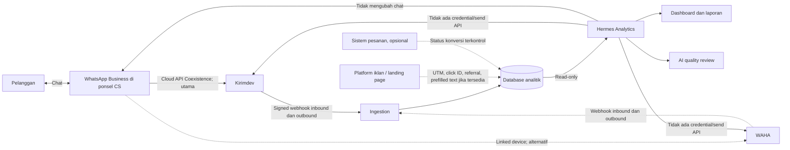
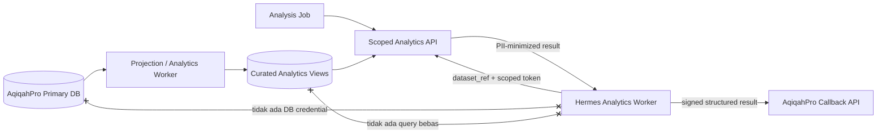
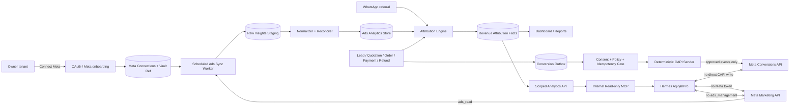
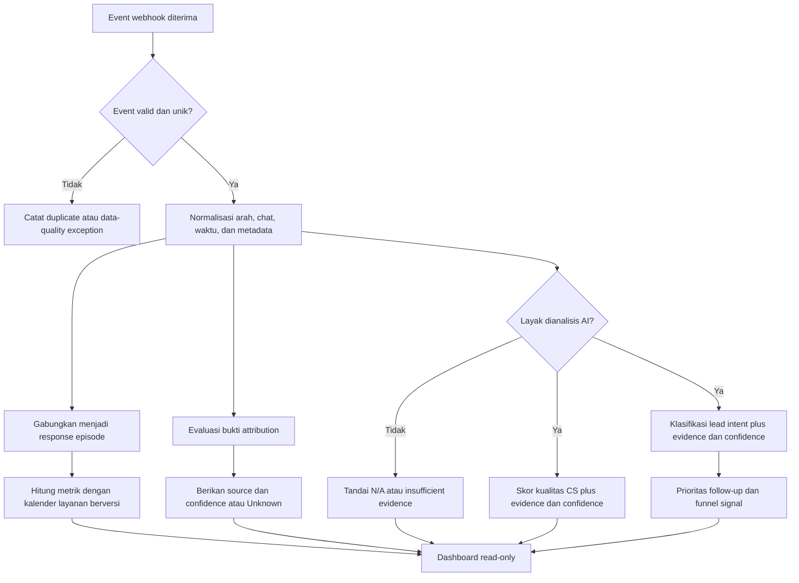
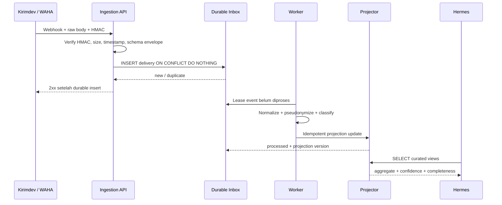
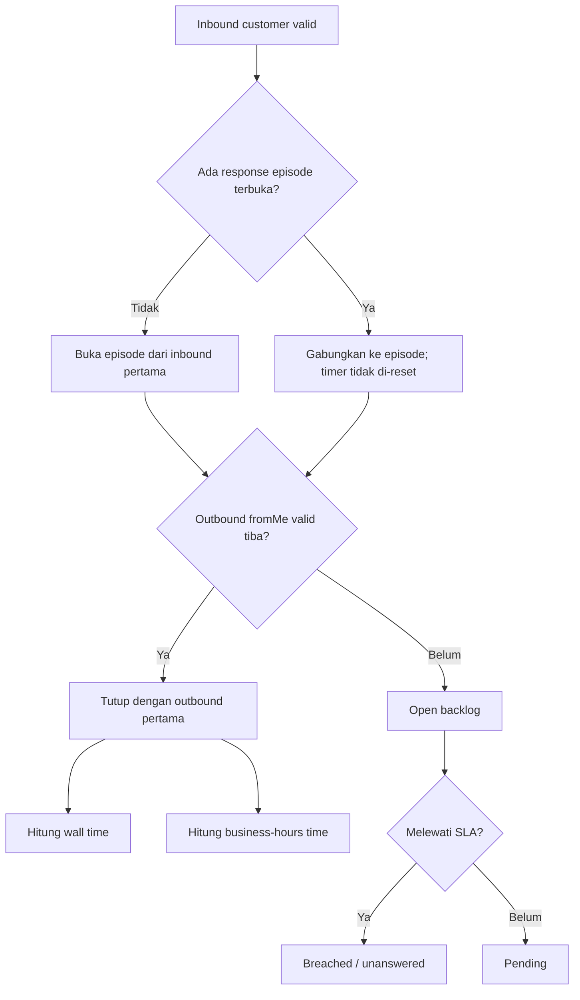
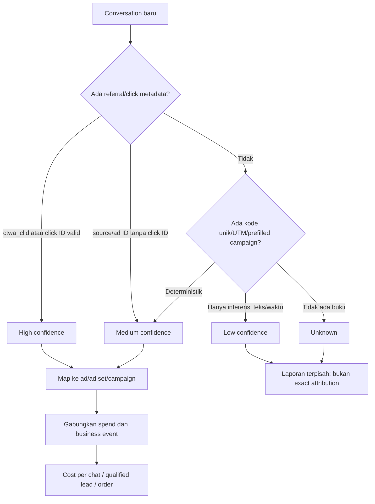
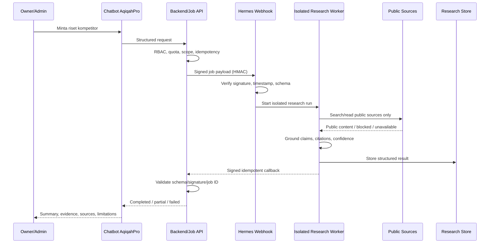
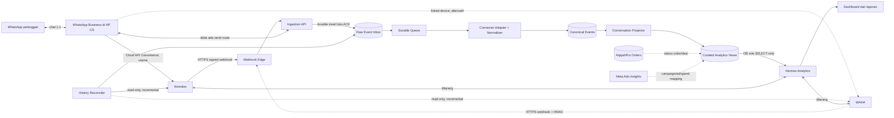

```mermaid
flowchart LR
    P[WhatsApp pelanggan] <-->|chat 1:1| HP[WhatsApp Business di HP CS]
    HP -->|Cloud API Coexistence; utama| K[Kirimdev]
    HP -.->|linked device; alternatif| W[WAHA]
    K -->|HTTPS signed webhook| E[Webhook Edge]
    W -.->|HTTPS webhook + HMAC| E
    E --> I[Ingestion API]
    I -->|durable insert lalu ACK| R[(Raw Event Inbox)]
    R --> Q[Durable Queue]
    Q --> N[Connector Adapter + Normalizer]
    N --> C[(Canonical Events)]
    C --> CP[Conversation Projector]
    CP --> AV[(Curated Analytics Views)]
    HR[History Reconciler] -->|read-only, incremental| K
    HR -.->|read-only, incremental| W
    HR --> R
    AV -->|DB role SELECT-only| H[Hermes Analytics]
    H --> D[Dashboard dan laporan]
    O[(AqiqahPro Orders/Payments)] -.->|order paid refund cancel| AV
    MA[Meta Marketing API] -->|ads_read only| MS[Meta Sync Worker]
    MS --> MIR[(Meta Raw Insights Staging)]
    MIR --> MN[Meta Normalizer/Reconciler]
    MN --> AV
    AV --> MCP[Read-only Analytics MCP]
    MCP --> H
    O --> CO[(Conversion Outbox)]
    CO --> CG[Consent/Policy/Dedupe Gate]
    CG --> CS[Deterministic CAPI Sender]
    CS -->|approved events| CAPI[Meta Conversions API]

    H x--x|no Meta token/direct Graph| MA
    H x--x|no CAPI send| CAPI
    H x--x|dilarang| K
    H x--x|dilarang| W
    I x--x|tidak ada send route| HP
```

# PRD — AqiqahPro Revenue CRM: WhatsApp, AI, CS, Lead, dan Meta Ads

> **Dokumen:** Product Requirements Document (PRD)  
> **Produk:** AqiqahPro Revenue CRM  
> **Versi:** 2.1 Draft  
> **Tanggal:** 21 Oktober 2026  
> **Owner:** AqiqahPro  
> **Status:** Siap untuk review produk, legal/privacy, dan teknis  
> **Arsitektur rekomendasi:** CRM vertikal Aqiqah multi-tenant; CS tetap dapat membalas dari HP; Kirimdev Cloud API Coexistence sebagai konektor utama; AqiqahPro menjadi source of truth customer, lead, order, pembayaran, produksi, dan pengiriman; Hermes production profile menjadi intelligence layer read-only  


## 1. Ringkasan

AqiqahPro Revenue CRM adalah CRM vertikal untuk bisnis aqiqah yang menghubungkan percakapan WhatsApp, lead, kinerja CS, Meta Ads, order, pembayaran, produksi, dan pengiriman dalam satu alur yang dapat diaudit. Produk mempertahankan passive ingestion agar CS tetap dapat bekerja dari WhatsApp Business di ponsel, sambil menjadikan AqiqahPro sebagai source of truth dari percakapan pertama sampai pembayaran terverifikasi.

**Positioning:** *AqiqahPro membantu bisnis aqiqah mengubah percakapan WhatsApp menjadi lead yang terukur, follow-up yang tertib, order yang terlacak, dan laporan iklan sampai pembayaran.*

Produk tidak dibangun sebagai CRM WhatsApp horizontal. Diferensiasinya adalah model data dan workflow aqiqah yang native: anak putra/putri, tanggal acara, jumlah hewan, paket/menu, jumlah box, area kirim, penyembelihan, dokumentasi, produksi, invoice, pembayaran, dan pengiriman.

Produk mendukung dua opsi konektor ingestion. Opsi yang direkomendasikan adalah **Kirimdev melalui WhatsApp Cloud API Coexistence**, yaitu jalur resmi Meta yang memungkinkan nomor tetap digunakan oleh CS di WhatsApp Business App pada HP. Dokumentasi Kirimdev menyatakan event `message.received` untuk inbound, `message.sent` untuk outbound—termasuk *phone-app echo* dengan `source: app`—serta `message.status` untuk delivery/read status.[4][5] Opsi alternatif adalah WAHA melalui WhatsApp Web, dengan event `message` dan `message.any`, HMAC, serta retry webhook.[1]

Hermes hanya membaca data hasil ingestion untuk analisis dan visualisasi. Hermes tidak mengirim pesan, membuat auto-reply, mengubah percakapan, maupun memegang kredensial konektor yang memiliki kemampuan kirim. Attribution WAHA tetap best-effort; Kirimdev/Cloud API diprioritaskan untuk stabilitas dan metadata referral yang lebih terstruktur. Status “official” pada dokumen ini berarti **transport WhatsApp Business Platform/Cloud API resmi Meta**, bukan pernyataan bahwa Kirimdev telah diverifikasi sebagai Meta Business Partner/BSP. Meta mendokumentasikan bahwa Coexistence memungkinkan nomor yang sama tetap digunakan untuk chat 1:1 di WhatsApp Business App sekaligus terhubung ke Cloud API.[3]

## 2. Tujuan Produk

1. Menyediakan gambaran volume dan tren percakapan WhatsApp.
2. Mengukur waktu tunggu pelanggan secara konsisten dan dapat diaudit.
3. Mengidentifikasi prospek yang belum ditanggapi atau membutuhkan tindak lanjut.
4. Mengestimasi sumber iklan atau kampanye tanpa mengklaim kepastian yang tidak didukung data.
5. Menilai kualitas percakapan dengan AI sebagai alat coaching, bukan sebagai dasar hukuman otomatis.
6. Menjaga privasi pelanggan dan membatasi akses terhadap isi percakapan.
7. Menyiapkan model data dan definisi produk yang dapat dilanjutkan ke Cloud API Coexistence.
8. Membantu owner melakukan riset kompetitor berbasis sumber publik melalui modul Competitor Intelligence.
9. Menyatukan customer profile, lead pipeline, follow-up, order, pembayaran, produksi, dan pengiriman dalam Customer 360.
10. Menghubungkan campaign/ad dengan qualified lead, order, pembayaran, revenue, CAC, dan ROAS sesuai confidence attribution.
11. Memberikan owner dan supervisor daftar tindakan yang jelas, bukan hanya dashboard deskriptif.
12. Menjadi roadmap modular dari passive intelligence menuju Revenue CRM vertikal tanpa memaksa shared inbox atau AI auto-reply pada MVP.

## 3. Non-Tujuan

- Mengirim atau menjadwalkan pesan WhatsApp.
- Menghasilkan atau mengirim auto-reply.
- Mengubah, menghapus, menandai, atau meneruskan chat.
- Menentukan komisi, sanksi, pemecatan, atau penilaian kinerja hanya dari skor AI.
- Mengklaim attribution iklan pasti ketika hanya tersedia bukti tidak langsung.
- Mengukur waktu kerja aktif CS, karena selisih waktu pesan bukan bukti durasi pengerjaan aktif.
- Menggantikan WhatsApp Business sebagai kanal pelanggan, atau membangun CRM horizontal generik untuk seluruh industri.
- Membaca kontak, media, atau histori di luar data yang secara sah diterima melalui webhook yang disetujui.
- Memberikan browser, shell, atau akses riset Hermes secara langsung dan tanpa batas kepada pelanggan.
- Mengakses akun, halaman login, data privat, atau sistem kompetitor tanpa izin.
- Mengklaim budget iklan, jumlah lead, conversion, revenue, atau performa internal kompetitor dari iklan/sumber publik.
- Menjadikan shared inbox, broadcast, chatbot pelanggan, call center, atau omnichannel enterprise sebagai kewajiban MVP.
- Menganggap label AI `Hot` sebagai order atau pembayaran.
- Mengambil keputusan HR otomatis dari response time, conversion, atau quality score.
- Menyalin konten kompetitor secara massal atau melanggar robots.txt, ToS, hak cipta, rate limit, maupun kontrol akses.

## 4. Pengguna dan Kebutuhan

### 4.1 Pemilik/Manajemen

- Melihat tren prospek dan layanan.
- Mengetahui distribusi waktu respons dan percakapan yang berisiko terlewat.
- Membandingkan periode, kanal, dan kampanye secara wajar.

### 4.2 Supervisor CS

- Menemukan antrean yang belum dijawab.
- Meninjau contoh percakapan dengan bukti yang jelas.
- Menggunakan hasil AI untuk coaching dan kalibrasi tim.

### 4.3 CS

- Memahami ekspektasi layanan.
- Menerima umpan balik yang dapat dijelaskan dan dikoreksi.
- Tidak dinilai atas waktu di luar jadwal, gangguan sistem, atau chat yang tidak dapat diatribusikan kepadanya.

### 4.4 Admin Privasi/Sistem

- Mengatur hak akses, retensi, masking, dan audit penggunaan data.
- Menangani permintaan koreksi atau penghapusan sesuai kebijakan perusahaan dan hukum yang berlaku.

### 4.5 Sales/CS Agent

- Melihat lead yang menjadi tanggung jawabnya, next action, due time, conversation summary, dan riwayat pelanggan.
- Memperbarui stage, hasil follow-up, lost reason, serta mengoreksi rekomendasi AI.
- Tetap dapat membalas dari WhatsApp Business di HP pada fase passive CRM.

### 4.6 Marketing/Performance Ads

- Melihat campaign/ad mana yang menghasilkan chat, qualified lead, order, pembayaran, revenue, CAC, dan ROAS.
- Memahami attribution coverage, confidence, serta perbedaan angka CRM dengan Meta Ads Manager.

### 4.7 Operasional Aqiqah

- Menerima order yang sudah dikonfirmasi tanpa mengetik ulang detail pelanggan, paket, tanggal, produksi, dan pengiriman.
- Melihat perubahan order dan handoff dari sales secara terversi.

## 5. Prinsip Produk

1. **Pasif:** Hermes tidak mempunyai jalur pengiriman pesan.
2. **Read-only:** analisis Hermes tidak boleh memutasi data sumber percakapan.
3. **Evidence-first:** setiap metrik dan skor dapat ditelusuri ke pesan serta timestamp sumber.
4. **Unknown is valid:** data yang tidak lengkap dilabeli tidak diketahui, bukan ditebak secara diam-diam.
5. **Fair by design:** metrik memperhitungkan jadwal kerja, kualitas data, dan confidence attribution.
6. **Aggregate before individual:** dashboard tim menjadi default; tampilan individual memerlukan alasan bisnis dan hak akses khusus.
7. **Human oversight:** AI memberi rekomendasi, bukan keputusan ketenagakerjaan otomatis.

## 6. Batas Sistem



### Kontrak batas produk

- Kirimdev atau WAHA hanya berperan sebagai sumber ingestion.
- Webhook masuk dan keluar disimpan sebagai event sumber yang dapat diaudit.
- Hermes hanya memiliki akses baca ke curated analytics views.
- API key, MCP, dashboard credential, serta endpoint send konektor tidak diberikan kepada Hermes.
- Tidak ada fitur, tombol, tool, kredensial, atau endpoint Hermes untuk mengirim pesan.
- Kegagalan analitik tidak boleh mengganggu aktivitas chat CS di ponsel.

## 7. Ruang Lingkup Fungsional

### 7.1 Ingestion dan Integritas Data

Produk menerima event inbound dan outbound beserta metadata yang tersedia, seperti timestamp, ID pesan, ID chat pseudonim, arah pesan, tipe pesan, status grup, dan metadata referral.

Persyaratan produk:

- Event duplikat tidak boleh menggandakan volume atau metrik.
- Event terlambat tetap dapat memperbarui hasil analitik dengan penanda waktu pembaruan.
- Event yang tidak dapat diproses dicatat sebagai data-quality exception.
- Dashboard menampilkan freshness data dan periode terakhir yang lengkap.
- Pesan sistem, status, broadcast, dan grup dikeluarkan secara default dari metrik layanan, kecuali dikonfigurasi sebagai kanal yang relevan.

### 7.2 Inbox Analytics

Dashboard minimum:

- jumlah percakapan dan pelanggan unik;
- pesan inbound dan outbound;
- response episode yang menunggu jawaban;
- umur antrean belum terjawab;
- first-response time dan subsequent-response time;
- distribusi P50, P75, P90, dan P95;
- kepatuhan SLA;
- volume menurut tanggal, jam, sumber attribution, dan status data;
- perbandingan periode dengan denominator dan coverage yang terlihat.

### 7.3 Conversation Review

Supervisor dapat:

- memfilter periode, status, kampanye, dan kategori kualitas;
- membuka percakapan sesuai hak akses;
- melihat pesan yang menjadi bukti metrik atau skor;
- mencatat hasil review manusia;
- mengoreksi label AI tanpa mengubah chat sumber;
- mengekspor ringkasan teragregasi sesuai izin.

### 7.4 Deteksi Tindak Lanjut

Hermes dapat menandai:

- inbound yang belum memperoleh outbound valid;
- pelanggan yang menunggu melebihi ambang SLA;
- pertanyaan yang tampak belum terjawab;
- janji tindak lanjut yang diduga belum terpenuhi.

Semua tanda bersifat analitik. Hermes tidak mengirim pengingat kepada pelanggan dan tidak mengeksekusi tindak lanjut.

### 7.5 AI Lead Intent dan Prioritas Follow-up

Hermes menganalisis isi percakapan untuk membantu CS memprioritaskan lead. Hasil klasifikasi merupakan **signal probabilistik**, bukan fakta, penjualan terverifikasi, atau alasan untuk mengabaikan pelanggan.

Label awal:

- **Hot:** terdapat sinyal pembelian kuat, misalnya pelanggan menyebut tanggal acara, lokasi, jumlah porsi, paket tertentu, total harga, ketersediaan, pembayaran, atau meminta langkah pemesanan.
- **Warm:** tertarik dan relevan, tetapi kebutuhan, waktu, anggaran, atau keputusan belum cukup jelas; termasuk pelanggan yang sedang membandingkan pilihan.
- **Cold / eksplorasi:** pertanyaan masih umum dan belum menunjukkan kebutuhan atau waktu pembelian yang jelas.
- **Tidak relevan / suspected spam:** isi tidak berkaitan dengan layanan, berulang secara tidak wajar, atau menunjukkan pola spam dengan bukti memadai.
- **Unknown / insufficient evidence:** konteks belum cukup, hanya sapaan, media belum dianalisis, bahasa tidak dipahami, atau confidence di bawah ambang.

Istilah **“iseng”** tidak digunakan sebagai label sistem karena bersifat menghakimi dan sulit dibuktikan. Kasus tersebut dilabeli `cold/exploratory`, `not_relevant`, `suspected_spam`, atau `unknown` sesuai bukti.

Setiap hasil wajib menyimpan:

- label dan confidence;
- alasan singkat;
- evidence span dari pesan yang relevan;
- sinyal positif, sinyal penghambat, dan informasi yang belum tersedia;
- versi model, prompt, taxonomy, dan waktu analisis;
- status review manusia dan riwayat koreksi.

Output prioritas minimum:

- `priority_now`: layak segera ditindaklanjuti oleh CS;
- `follow_up`: berpotensi tetapi membutuhkan informasi/keputusan lanjutan;
- `nurture`: belum siap membeli, tetap dapat dilayani tanpa tekanan;
- `review`: confidence rendah, indikasi spam, konflik konteks, atau memerlukan supervisor.

Produk boleh menampilkan rekomendasi tindakan internal seperti “konfirmasi tanggal”, “tanyakan jumlah porsi”, atau “kirim rincian paket”, tetapi Hermes tidak mengeksekusi tindakan tersebut dan tidak mengirim pesan WhatsApp.

### 7.6 Competitor Intelligence melalui Hermes

Owner/admin dapat meminta riset kompetitor dari chatbot internal AqiqahPro. Chatbot hanya menjadi antarmuka; pekerjaan browsing, ekstraksi sumber publik, analisis, dan penyusunan hasil dilakukan oleh Hermes Research Worker melalui job asynchronous.

Contoh cakupan riset:

- kompetitor berdasarkan kota atau area layanan;
- rating dan jumlah ulasan publik;
- paket, harga, promo, fasilitas, dan area pengiriman yang dipublikasikan;
- positioning, pesan pemasaran, CTA, serta diferensiasi;
- jejak iklan publik yang dapat diverifikasi, termasuk Meta Ad Library bila dapat diakses;
- perubahan dibanding snapshot riset sebelumnya;
- peluang eksperimen untuk AqiqahPro tanpa menyalin materi kompetitor.

Hasil riset wajib memisahkan:

- **verified:** didukung sumber publik yang dapat dibuka dan bukti yang sesuai;
- **partial:** sumber tersedia, tetapi detail atau akses tidak lengkap;
- **unavailable:** sumber gagal diakses, membutuhkan login/CAPTCHA, atau tidak dapat diverifikasi;
- **inference:** interpretasi analitis yang bukan fakta langsung dan harus diberi alasan.

Jumlah iklan publik tidak boleh dianggap sebagai budget, jumlah lead, conversion, revenue, atau keberhasilan iklan kompetitor. Hermes tidak boleh melewati login, CAPTCHA, paywall, kontrol akses, atau larangan teknis situs.

#### Step-by-step alur pengguna

1. Owner/admin membuka menu **Competitor Intelligence** atau chatbot internal.
2. Pengguna memilih wilayah, jenis riset, kompetitor opsional, periode, dan pertanyaan bisnis.
3. AqiqahPro memvalidasi role, quota, scope, domain policy, serta estimasi biaya/waktu.
4. Backend membuat `research_job` dengan status `queued` dan `idempotency_key`.
5. Backend mengirim payload minimal ke webhook Hermes menggunakan HTTPS dan HMAC; credential internal AqiqahPro tidak ikut dikirim.
6. Hermes memvalidasi signature, event ID, timestamp window, schema, dan batas ukuran payload.
7. Route webhook memuat prompt serta skill riset yang telah diizinkan, lalu menjalankan Hermes Research Worker dalam lingkungan terisolasi.
8. Worker mencari dan membaca sumber publik, memperlakukan isi halaman sebagai data tidak tepercaya, mencatat URL serta waktu akses, dan tidak mengikuti instruksi dari halaman.
9. Worker menghasilkan output terstruktur: temuan, bukti, sumber, status verifikasi, confidence, keterbatasan, dan rekomendasi.
10. Hasil divalidasi terhadap JSON schema, batas ukuran, daftar sumber, dan aturan keamanan sebelum disimpan.
11. Hermes mengirim hasil ke callback AqiqahPro yang telah di-allowlist atau AqiqahPro mengambil hasil melalui job-result store; callback menggunakan signature dan idempotency.
12. Backend mengubah status menjadi `completed`, `partial`, atau `failed`, menyimpan audit trail, lalu chatbot/dashboard menampilkan hasil kepada owner/admin.
13. Untuk job lama, sistem dapat membandingkan snapshot dan hanya menampilkan perubahan yang memiliki bukti.
14. Pengguna dapat meminta koreksi atau riset ulang; hasil lama tetap append-only agar perubahan dapat diaudit.

#### Kontrak request minimum

```json
{
  "job_id": "research_01J...",
  "tenant_id": "tenant_pseudonym",
  "requested_by": "user_pseudonym",
  "scope": {
    "city": "Bekasi",
    "competitors": [],
    "topics": ["rating", "packages", "promotions", "public_ads", "positioning"]
  },
  "language": "id",
  "max_sources": 20,
  "deadline_at": "ISO-8601",
  "callback_ref": "registered-callback-id",
  "idempotency_key": "opaque-key"
}
```

Payload tidak boleh berisi password, token, cookie browser, API key, raw customer chat, nomor telepon pelanggan, atau callback URL arbitrer.

#### Kontrak hasil minimum

```json
{
  "job_id": "research_01J...",
  "status": "completed",
  "generated_at": "ISO-8601",
  "summary": "...",
  "findings": [
    {
      "claim": "...",
      "verification": "verified",
      "confidence": 0.91,
      "source_ids": ["src_01"]
    }
  ],
  "sources": [
    {
      "id": "src_01",
      "url": "https://example.com",
      "title": "...",
      "accessed_at": "ISO-8601"
    }
  ],
  "limitations": [],
  "recommendations": []
}
```

#### Batas akses

- Hanya role owner/admin yang dapat membuat job pada MVP.
- Pelanggan dan CS tidak memperoleh akses langsung ke Hermes, browser, shell, filesystem, atau webhook secret.
- Tool yang diizinkan untuk worker riset dibatasi pada web search, browser/extractor, citation tooling, dan penyimpanan hasil terkontrol.
- Tidak ada akses ke credential WhatsApp, Kirimdev, Meta Ads milik tenant, database operasional, atau endpoint pengiriman pesan.
- Callback hanya menuju endpoint AqiqahPro yang terdaftar; URL dari payload tidak boleh langsung dipanggil.
- Setiap tenant memiliki quota, concurrency limit, timeout, source limit, dan cost budget.

### 7.7 Akses Data Analytics oleh Hermes

Untuk production multi-tenant, Hermes **tidak terhubung langsung ke primary database AqiqahPro** dan tidak menerima host, username, atau password database. Jalur default adalah Analytics API yang menerapkan scope tenant dan job di sisi backend.



#### Step-by-step akses analytics

1. Kirimdev/WAHA mengirim webhook pesan ke AqiqahPro; backend memverifikasi dan menyimpan event secara idempoten.
2. Worker AqiqahPro membentuk canonical events, response episodes, lead intent, attribution, dan curated analytics views.
3. Owner/admin atau scheduler meminta analisis, misalnya rekap harian CS dan lead.
4. Backend membuat `analysis_job` dengan `tenant_id`, periode, jenis analisis, konfigurasi metrik, dan `dataset_ref` yang opaque.
5. Backend menerbitkan service token berumur pendek yang hanya berlaku untuk `job_id + dataset_ref + tenant`, endpoint, dan periode tersebut.
6. AqiqahPro mengirim `job_id`, `dataset_ref`, jenis analisis, dan reporting window ke webhook Hermes; tidak mengirim database credential atau raw customer dataset.
7. Hermes memanggil Analytics API menggunakan scoped token. API menentukan tenant dari grant server-side, bukan dari `tenant_id` bebas pada query/prompt.
8. Analytics API membaca curated views, menerapkan tenant isolation, masking, row/field limit, pagination, dan audit log.
9. Hermes menganalisis respons API dan menghasilkan output terstruktur; raw data tidak dimasukkan ke memory global.
10. Hermes mengirim hasil ke callback AqiqahPro yang terdaftar menggunakan signature dan idempotency.
11. Backend memvalidasi signature, schema, `job_id`, tenant binding, dan payload hash sebelum menyimpan hasil.
12. Token/dataset grant kedaluwarsa atau dicabut setelah job selesai, timeout, gagal, atau dibatalkan.

#### Endpoint minimum

```text
GET /internal/analytics/jobs/{job_id}/summary
GET /internal/analytics/jobs/{job_id}/response-times
GET /internal/analytics/jobs/{job_id}/lead-intents
GET /internal/analytics/jobs/{job_id}/ad-attributions
GET /internal/analytics/jobs/{job_id}/conversions
GET /internal/analytics/jobs/{job_id}/conversation-evidence/{conversation_ref}
```

Endpoint evidence hanya tersedia bila job dan role memang membutuhkan isi chat. Default summary tidak mengembalikan nomor telepon, nama pelanggan, media, raw webhook payload, token, atau field sensitif yang tidak diperlukan.

#### Kontrak job ke Hermes

```json
{
  "job_id": "analysis_01J...",
  "dataset_ref": "dataset_01J...",
  "analysis_type": "daily_cs_and_leads",
  "reporting_window": {
    "from": "ISO-8601",
    "to": "ISO-8601",
    "timezone": "Asia/Jakarta"
  },
  "metric_version": "v1",
  "callback_ref": "aqiqahpro-analysis-result"
}
```

`tenant_id` boleh hadir sebagai label pseudonim untuk observability, tetapi otorisasi tidak boleh bergantung pada nilai tersebut. Tenant binding berasal dari job grant yang ditandatangani backend.

#### Kontrol Analytics API

- token scoped, short-lived, audience-bound, dan dapat dicabut;
- server-side tenant binding serta authorization setiap request;
- endpoint dan kolom allowlist, pagination, maximum date range, row/result size limit;
- TLS, rate limit, timeout, query budget, audit access, dan anomaly alert;
- PII masking/pseudonymization sebelum response;
- raw message hanya melalui endpoint evidence yang lebih ketat dan purpose-bound;
- response tidak menyertakan SQL, database topology, internal primary key, atau secret;
- tidak ada endpoint mutasi, endpoint connector, maupun endpoint pengiriman WhatsApp;
- dataset/job expiry dan deletion lifecycle yang dapat diuji.

#### Opsi database read-only

Koneksi database langsung hanya menjadi opsi internal/lanjutan pada analytics replica terpisah. Jika digunakan, wajib memakai role `SELECT`-only pada curated views, `default_transaction_read_only`, TLS, network allowlist, statement/idle timeout, row limit, audit query, PII minimization, serta pengujian bahwa `INSERT`, `UPDATE`, `DELETE`, DDL, dan `EXECUTE` gagal. Koneksi langsung ke primary production tetap dilarang.

### 7.8 Topologi Hermes Production

Satu layanan Hermes dapat melayani banyak bisnis aqiqah melalui worker pool, tetapi setiap job harus memiliki session/context baru, dataset grant terpisah, quota, temporary workspace, dan callback binding per tenant/job.

Untuk production, gunakan **profile/instance Hermes khusus AqiqahPro**, bukan session Hermes pribadi/operasional owner. Pemisahan ini diperlukan agar memory, skill, tool, secret, log, quota, dan lifecycle deployment AqiqahPro tidak bercampur dengan pekerjaan pribadi atau proyek lain.

```text
Hermes pribadi/Lead Engineer
└── desain, audit, debugging, dan pengembangan

Hermes AqiqahPro Production
├── analytics-worker pool
├── competitor-research worker pool
├── profile/memory/skills khusus AqiqahPro
├── webhook dan callback secret khusus production
└── tanpa akses personal, SSH umum, atau tool mutasi production
```

Rekomendasi tahapan:

1. **Development:** Hermes saat ini boleh dipakai untuk spike dengan data sintetis/anonim dan tanpa credential production.
2. **Staging:** buat profile/instance `aqiqahpro` terisolasi, Analytics API staging, webhook/callback secret staging, quota kecil, dan no-send tool policy.
3. **Production pilot:** deploy satu AqiqahPro Hermes worker dengan concurrency rendah; hanya owner/admin dan beberapa analysis type allowlisted.
4. **Scale-out:** tambah worker dari queue yang sama saat volume naik; tetap satu layanan secara produk, bukan satu Hermes per tenant.
5. **Dedicated tenant:** sediakan worker/instance terpisah hanya jika pelanggan enterprise membutuhkan isolasi kontraktual, credential privat, SLA, model, lokasi data, atau retensi khusus.

### 7.9 History Interaksi Agent dan Pemakaian Token

AqiqahPro menyimpan history interaksi owner/admin dengan agent agar percakapan dapat dilanjutkan, hasil dapat diaudit, dan biaya AI dapat dikendalikan. History agent berbeda dari raw chat pelanggan WhatsApp dan tidak boleh dicampur ke memory global Hermes.

History yang disimpan per tenant dan thread:

- `thread_id`, `tenant_id`, `user_id`, role, timestamp, serta jenis agent;
- pesan pengguna dan jawaban agent yang telah melewati masking;
- referensi `job_id`, `dataset_ref`, report, finding, dan source yang digunakan;
- model/provider, prompt/template version, skill/tool yang dipanggil, status, latency, dan error class;
- jumlah input, output, cached, reasoning, dan total token bila provider menyediakannya;
- estimasi/aktual biaya, mata uang, pricing version, dan billing source;
- feedback, koreksi, rerun, parent message, serta audit access;
- retention class, expiry, deletion status, dan legal hold bila berlaku.

**“Token” memiliki dua arti yang wajib dipisahkan:**

1. **Usage token:** jumlah token LLM untuk metering dan kontrol biaya; boleh disimpan sebagai angka agregat per run/job/tenant.
2. **Secret/access token:** API key, bearer token, OAuth token, scoped dataset token, webhook secret, serta refresh token; nilai mentahnya **dilarang disimpan dalam history chat, prompt, output, database aplikasi umum, log, trace, atau audit event**.

Secret hanya berada di secret manager/vault atau credential store Hermes yang sesuai. Database boleh menyimpan metadata non-rahasia seperti `secret_ref`, token hash/JTI, scope, audience, issued/expiry/revoked time, dan last-used timestamp.

#### Context dan memory policy

- Setiap thread memiliki riwayat sendiri dan selalu terikat tenant serta authorized user.
- Setiap job background menggunakan context baru; history thread hanya dimuat secara eksplisit dan minimal sesuai kebutuhan.
- Sebelum dikirim ke model, context builder mengambil window terbatas, summary terversi, dan artifact reference; bukan seluruh history tanpa batas.
- Raw WhatsApp conversation tidak otomatis menjadi history chatbot. Bukti percakapan dimuat melalui `conversation_ref` yang scoped dan purpose-bound.
- History tenant A tidak boleh digunakan untuk tenant B, fine-tuning bersama, prompt example, atau memory global.
- Memory jangka panjang hanya menyimpan preferensi bisnis yang disetujui dan tidak menyimpan PII pelanggan, secret, atau raw chat.
- Penghapusan thread harus menghapus atau menganonimkan pesan, summary, embeddings/index, cache, export, dan artifact turunan sesuai retention policy.

#### Metering dan budget

- Catat token pada setiap `agent_run`, lalu agregasikan per job, thread, user, tenant, analysis type, model, dan periode billing.
- Jika provider tidak mengembalikan usage lengkap, simpan `usage_status = estimated|partial|unavailable` dan jangan menampilkan angka sebagai aktual.
- Pricing menggunakan tabel berversi berdasarkan provider/model/effective date; perubahan harga tidak menulis ulang invoice historis.
- Terapkan soft warning dan hard limit per tenant, job, hari, dan bulan.
- Job yang diperkirakan melewati hard limit ditolak atau meminta approval owner sebelum berjalan.
- Retry, failed run, cache hit, dan tool-only run dicatat terpisah agar biaya dapat direkonsiliasi.
- Dashboard menampilkan token/biaya bersama denominator: jumlah job, thread, analisis, sumber, dan periode.

#### Retensi awal

- History chatbot owner/admin: default 90 hari, configurable per tenant setelah keputusan legal/privacy.
- Summary thread dan metadata job: default 12 bulan jika sudah PII-minimized.
- Usage token dan cost ledger: sesuai kebutuhan billing/audit, tanpa prompt atau isi chat mentah.
- Tool trace yang mengandung konten: retensi pendek dan dimasking; secret tidak pernah ditulis.
- Retensi final, legal hold, ekspor, dan hak penghapusan wajib disetujui sebelum production.

### 7.10 Customer 360

Satu customer profile menjadi pusat seluruh riwayat hubungan dan tidak bergantung pada perangkat CS. Identitas harus dideduplikasi dengan normalisasi nomor telepon dan aturan merge yang dapat diaudit.

Customer 360 minimum memuat:

- identitas dan kontak, consent, opt-out, cabang, owner/agent;
- conversation timeline dan channel/source;
- campaign, ad set, ad, referral/click identifier, serta confidence attribution;
- data kebutuhan aqiqah: putra/putri, tanggal acara, jumlah hewan, paket/menu, jumlah box, area dan alamat pengiriman;
- lead stage, intent, evidence, next action, due time, quotation, objection, dan lost reason;
- order, invoice, pembayaran, produksi, penyembelihan, dokumentasi, dan pengiriman;
- komplain, feedback, correction, dan audit trail;
- field sensitif dengan masking dan akses berbasis tujuan.

Identity resolution tidak boleh merge dua orang hanya karena kemiripan nama. Merge otomatis memerlukan identifier kuat; kasus ambigu masuk antrean review dan merge harus dapat dibatalkan.

### 7.11 Lead Pipeline Vertikal Aqiqah

Pipeline default:

```text
New Inquiry
→ Contacted
→ Qualified
→ Package Discussed
→ Quotation Sent
→ Follow-up
→ Awaiting Decision
→ Order Created
→ Awaiting Payment
→ Paid / Won
```

Status terminal alternatif adalah `Lost`, `Disqualified`, atau `Duplicate`. Tenant dapat menambah stage, tetapi makna tahap inti untuk funnel reporting harus tetap terversi dan dapat dipetakan.

Setiap lead menyimpan:

- tenant, customer, source/referral, campaign/ad, cabang, dan agent owner;
- kebutuhan, nilai potensial, event date, lead intent, confidence, dan evidence;
- stage sekarang, stage history, next action, due time, last inbound/outbound, dan follow-up count;
- quotation/order/payment references;
- lost reason, lost notes, actor, dan timestamp;
- AI recommendation terpisah dari keputusan manusia.

Taksonomi lost reason minimum:

- harga/anggaran;
- area tidak terjangkau;
- tanggal atau kapasitas tidak tersedia;
- paket/menu tidak sesuai;
- memilih kompetitor;
- tidak merespons setelah follow-up wajar;
- acara batal atau ditunda;
- belum siap/masih eksplorasi;
- duplikat;
- tidak relevan/spam;
- alasan lain dengan catatan.

`Hot` tidak memindahkan lead otomatis ke `Won`. Hanya event order dan pembayaran AqiqahPro yang boleh menjadi conversion truth.

### 7.12 Follow-up Workspace

Workspace harian CS harus bersifat actionable dan dipisahkan dari dashboard manajemen. Queue minimum:

- `priority_now`: lead relevan dengan intent kuat, event date dekat, atau inbound menunggu melewati ambang;
- `unanswered`: belum pernah memperoleh outbound valid;
- `follow_up_due`: next action jatuh tempo atau terlewat;
- `quotation_pending`: quotation belum memperoleh keputusan;
- `awaiting_payment`: order ada tetapi pembayaran belum terverifikasi;
- `nurture`: relevan tetapi belum waktunya ditindaklanjuti;
- `supervisor_review`: confidence rendah, complaint, assignment ambiguity, atau risiko kualitas;
- `reactivation_candidate`: lead lama yang memenuhi consent dan aturan kontak kembali.

Setiap kartu menampilkan alasan prioritas, evidence, owner, due time, tanggal acara, nilai potensial, stage, serta status freshness data. AI hanya merekomendasikan urutan; aturan deterministic, hak akses, dan keputusan manusia tetap berlaku. Fase MVP tidak mengirim pesan atau mengubah chat secara otomatis.

### 7.13 Owner dan Supervisor Copilot

Owner/supervisor dapat bertanya dengan bahasa alami, misalnya:

- lead panas mana yang belum ditindaklanjuti;
- alasan conversion turun pada periode tertentu;
- campaign mana yang menghasilkan pembayaran;
- objection pelanggan yang paling sering muncul;
- percakapan mana yang perlu coaching;
- perbandingan cabang, tim, atau periode.

Jawaban wajib membawa reporting window, timezone, metric version, completeness, exclusions, evidence/reference, dan confidence. Copilot menggunakan Analytics API scoped per tenant/job; tidak boleh menjalankan SQL bebas, mengakses tenant lain, atau menulis ke database operasional.

### 7.14 Meta Ads Revenue Attribution

Funnel produk:

```text
Campaign → Ad Set → Ad → WhatsApp Conversation → Qualified Lead
→ Quotation → Order → Payment → Revenue
```

KPI minimum:

- conversations/leads dari ads;
- qualified leads dan qualification rate;
- cost per conversation dan cost per qualified lead;
- quotation, order, paid conversion, serta conversion rate tiap tahap;
- cost per order/customer acquisition cost;
- paid revenue dan ROAS;
- median time chat-to-order dan chat-to-payment;
- lost reason dan response/SLA menurut campaign/ad;
- attribution coverage dan bucket `Unknown`.

CRM dan Meta Ads Manager dapat berbeda karena eligibility dan attribution window berbeda. Produk harus menjelaskan perbedaan dan tidak memaksakan kecocokan. Angka ROAS hanya ditampilkan sebagai verified CRM revenue bila payment berstatus terverifikasi; refund/cancellation harus mengoreksi revenue sesuai aturan terversi. Produk seperti WATI dan Respond.io sudah menawarkan CTWA analytics, lifecycle attribution, dan/atau conversion feedback ke Meta.[12][13] Karena itu, diferensiasi AqiqahPro bukan dashboard iklan generik, melainkan hubungan langsung dengan order dan pembayaran aqiqah.

### 7.15 Modul Produk dan Batas Fase

| Modul | MVP | Fase 2 | Fase 3 |
|---|---:|---:|---:|
| Passive WhatsApp sync dan connector health | Ya | Perluasan | Mature |
| Customer 360 dan identity resolution | Ya | Perluasan | Mature |
| Lead pipeline, next action, lost reason | Ya | Automasi terbatas | Mature |
| AI lead intent dengan evidence | Ya | Kalibrasi lanjutan | Mature |
| Follow-up workspace | Ya | Rules/notification internal | Automasi terkontrol |
| CS response/SLA analytics | Ya | Quality coaching | Mature |
| Meta Ads → order → payment attribution | Ya | CAPI/optimization pilot | Mature |
| Nightly owner report | Dasar | Interaktif | Mature |
| Owner/supervisor AI copilot | Tidak | Ya | Mature |
| Shared team inbox | Tidak | Evaluasi | Opsional |
| Suggested reply untuk CS | Tidak | Pilot human approval | Opsional |
| Broadcast/campaign outbound | Tidak | Evaluasi consent/template | Opsional |
| AI auto-reply pelanggan | Tidak | Tidak | Hanya FAQ berisiko rendah setelah gate |
| Omnichannel selain WhatsApp | Tidak | Tidak | Berdasarkan demand |
| Competitor Intelligence | Internal/owner | Ya | Terjadwal |

Prinsip prioritas: bangun visibility, lead recovery, dan conversion intelligence sebelum broadcast, omnichannel, atau autonomous reply.

## 8. Definisi Metrik

### 8.1 Unit Dasar

- **Event pesan valid:** pesan inbound atau outbound pelanggan yang lolos deduplikasi dan bukan event sistem, status, pesan grup yang dikecualikan, atau event pengujian.
- **Percakapan:** kumpulan event valid untuk satu chat/pelanggan dalam periode pelaporan.
- **Response episode:** interval tunggu yang dimulai oleh satu atau beberapa inbound berurutan dan ditutup oleh outbound valid pertama setelahnya.
- **Episode terjawab:** response episode yang mempunyai outbound penutup.
- **Episode terbuka:** response episode yang belum mempunyai outbound penutup pada waktu evaluasi.
- **Jam layanan:** kalender operasional yang telah disetujui, termasuk zona waktu, hari kerja, jam buka, libur, dan pengecualian.

Jika beberapa inbound datang sebelum outbound pertama, semuanya tetap satu response episode. Waktu mulai episode adalah timestamp inbound pertama. Hal ini mencegah satu rangkaian pesan pelanggan dihitung sebagai beberapa kegagalan respons.

### 8.2 First Response Time

First Response Time atau FRT mengukur waktu dari inbound pertama pelanggan pada sebuah percakapan baru sampai outbound valid pertama.

Percakapan dianggap baru jika tidak terdapat event valid pada chat tersebut selama **24 jam kalender** sebelum inbound pembuka. Nilai 24 jam harus menjadi konfigurasi berversi; perubahan tidak boleh mengubah laporan historis tanpa proses rekalkulasi yang terlihat.

- **FRT elapsed:** `timestamp outbound pertama - timestamp inbound pembuka`.
- **FRT business-hours:** jumlah menit yang berada di dalam jam layanan antara kedua timestamp tersebut.
- Jika belum ada outbound, episode berstatus terbuka dan tidak dimasukkan ke distribusi FRT terjawab; episode tetap masuk metrik backlog dan unanswered rate.

### 8.3 Subsequent Response Time

Subsequent Response Time atau SRT menggunakan response episode setelah balasan pertama dalam percakapan yang sama.

- **SRT elapsed:** `timestamp outbound penutup - timestamp inbound pertama episode lanjutan`.
- **SRT business-hours:** menit yang hanya dihitung di dalam jam layanan.
- Inbound tambahan sebelum jawaban tidak membuka episode baru.

### 8.4 Statistik Distribusi

Untuk kumpulan episode terjawab yang valid:

- **P50:** nilai persentil ke-50 dari waktu respons.
- **P90:** nilai persentil ke-90; 90% episode terjawab memiliki waktu respons sama dengan atau lebih rendah.
- Rata-rata boleh ditampilkan, tetapi tidak boleh menjadi satu-satunya ringkasan karena sensitif terhadap outlier.
- Setiap statistik wajib menampilkan jumlah episode valid `n`, rentang waktu, jenis clock, dan coverage data.

### 8.5 SLA Compliance

`SLA compliance = episode terjawab dalam ambang SLA / seluruh episode eligible × 100%`

Episode eligible mencakup episode yang dimulai dalam periode pengukuran dan telah mencapai waktu evaluasi yang cukup untuk dinilai. Episode terbuka yang telah melewati ambang SLA dihitung gagal. Episode terbuka yang belum melewati ambang SLA dilabeli pending dan belum masuk denominator final.

Dashboard wajib menyebutkan:

- ambang SLA;
- elapsed atau business-hours clock;
- jumlah lulus, gagal, pending, dan dikecualikan;
- jadwal layanan yang digunakan.

### 8.6 Unanswered Rate

`Unanswered rate = episode terbuka yang telah melewati ambang unanswered / seluruh episode eligible × 100%`

Ambang unanswered terpisah dari SLA dan harus dinyatakan eksplisit. Episode yang masih berada dalam grace period berstatus pending.

### 8.7 Backlog Age

`Backlog age = waktu evaluasi - timestamp inbound pertama episode terbuka`

Dashboard menampilkan elapsed age dan, jika digunakan untuk evaluasi layanan, business-hours age.

### 8.8 Volume dan Pelanggan Unik

- **Inbound volume:** jumlah event inbound valid.
- **Outbound volume:** jumlah event outbound valid.
- **Pelanggan unik:** jumlah ID chat pelanggan terdeduplikasi dalam periode.
- Volume tidak boleh dipakai sebagai proksi produktivitas tanpa mempertimbangkan kompleksitas, pembagian tugas, dan atribusi agen.

### 8.9 Coverage dan Kualitas Data

`Webhook coverage = event valid yang berhasil diproses / seluruh event webhook yang diterima × 100%`

Metrik kualitas minimum:

- tingkat duplikasi;
- event gagal diproses;
- event tanpa arah atau timestamp valid;
- keterlambatan event P50/P95;
- gap koneksi sumber;
- persentase outbound dengan identitas agen diketahui;
- persentase percakapan dengan attribution diketahui.

Periode dengan gap sumber wajib diberi peringatan dan tidak boleh dibandingkan seolah-olah datanya lengkap.

## 9. Attribution Iklan

### 9.1 Tujuan

Menghubungkan percakapan atau pelanggan dengan sumber akuisisi yang paling mungkin berdasarkan bukti yang tersedia, tanpa memaksakan attribution ketika metadata tidak memadai.

### 9.2 Hirarki Attribution

Urutan bukti dari paling kuat:

1. referral/click metadata platform yang tervalidasi dan terikat ke event pembuka;
2. click ID unik yang dibawa dari landing page atau prefilled WhatsApp message;
3. kode kampanye unik yang cocok secara deterministik;
4. UTM yang terhubung melalui identifier sesi/pelanggan yang diizinkan;
5. nomor masuk, landing page, atau pola teks khusus kampanye;
6. self-reported source dari isi percakapan, dengan label hasil klasifikasi;
7. unknown/unattributed.

Last-touch dapat menjadi model pelaporan awal, tetapi hasil harus menyimpan model attribution, bukti, timestamp touchpoint, attribution window, dan confidence.

### 9.3 Confidence Attribution

- **High:** bukti deterministik unik, misalnya click ID tervalidasi.
- **Medium:** bukti kuat tetapi tidak unik sempurna, misalnya kode kampanye atau pola referral yang konsisten.
- **Low:** inferensi teks, nomor, waktu, atau klasifikasi AI.
- **Unknown:** tidak ada bukti memadai atau terdapat konflik yang tidak dapat diselesaikan.

Laporan tidak boleh menggabungkan Low dan Unknown ke attributed conversions tanpa label terpisah.

### 9.4 Attribution Window

Default rekomendasi:

- click-to-chat: 7 hari sejak touchpoint;
- repeat conversion: dilaporkan terpisah dari new-customer conversion;
- konflik beberapa touchpoint diselesaikan berdasarkan model pelaporan yang dipilih dan ditampilkan secara eksplisit.

Window adalah kebijakan produk yang berversi, bukan fakta universal. Perubahan model/window tidak boleh diam-diam menulis ulang laporan historis.

### 9.5 Konversi

Konversi hanya dianggap terverifikasi jika terdapat event bisnis eksplisit, seperti pesanan valid atau pembayaran, dari sumber data yang disetujui.

- Chat dimulai bukan konversi penjualan.
- Pernyataan minat bukan pesanan.
- Klasifikasi AI atas niat beli dilabeli sebagai signal, bukan revenue.
- Revenue attribution hanya ditampilkan jika hubungan pesanan-pelanggan memenuhi aturan linkage dan confidence yang disetujui.

### 9.6 Keterbatasan WhatsApp Web

WhatsApp Web/WAHA diperlakukan sebagai sumber best-effort: payload internal berbeda menurut engine dan tidak menjadi kontrak attribution resmi. Sebagai pembanding, kontrak resmi Cloud API mendefinisikan `referral` dengan `source_id`, `source_url`, dan `ctwa_clid` pada pesan Click-to-WhatsApp.[2] WhatsApp Web/WAHA mungkin tidak menyediakan metadata tersebut secara konsisten, histori klik lintas perangkat, atau identitas agen pengirim. Produk wajib:

- menampilkan coverage attribution;
- menyediakan bucket Unknown;
- menyebutkan bahwa attribution bersifat best-effort;
- melarang klaim ROAS presisi jika denominator biaya atau linkage conversion tidak lengkap;
- tidak mengisi data yang hilang dengan tebakan tersembunyi.

### 9.7 Pilihan Konektor: Kirimdev vs WAHA

Untuk kebutuhan AqiqahPro—CS tetap chat melalui HP, connector hanya mengirim data ke database, dan Hermes read-only—**Kirimdev Cloud API Coexistence menjadi pilihan utama**, sedangkan WAHA menjadi alternatif pilot/rollback. Kirimdev mendokumentasikan Cloud API, onboarding melalui Meta Embedded Signup, webhook bertanda tangan, deduplikasi event, serta *phone-app echo* untuk pesan yang dikirim dari aplikasi HP.[4][5][6]

| Kriteria | Kirimdev + Cloud API Coexistence | WAHA + WhatsApp Web |
|---|---|---|
| Status jalur WhatsApp | **Official transport:** WhatsApp Business Platform/Cloud API Meta; status BSP/Meta Business Partner vendor belum diklaim tanpa bukti direktori resmi | **Unofficial transport:** otomasi/linked device WhatsApp Web |
| Cara koneksi | Meta Embedded Signup dan Coexistence | Pairing QR sebagai linked device |
| CS tetap memakai nomor yang sama di HP | Ya, jika nomor lolos onboarding Coexistence | Ya, selama linked-device session aktif |
| Stabilitas kontrak | Lebih kuat karena mengikuti kontrak Cloud API | Lebih rentan terhadap perubahan WhatsApp Web/engine |
| Risiko logout/block dari connector | Lebih rendah; tetap tunduk kebijakan Meta dan quality controls | Lebih tinggi dan tidak nol walau hanya ingestion |
| Inbound webhook | `message.received` | `message`/event engine terkait |
| Outbound dari HP | `message.sent` dengan `source: app` menurut katalog event; wajib dibuktikan lewat pilot | `message.any`/`fromMe`; kelengkapan wajib dibuktikan lewat pilot |
| Delivery/read status | `message.status` (`sent`, `delivered`, `read`, `failed`, dan jenis terkait) | Bergantung engine dan payload WAHA |
| Metadata Click-to-WhatsApp Ads | Mengikuti payload referral Cloud API; capture aktual `source_id`/`ctwa_clid` tetap wajib diuji | Best-effort dari payload internal, dapat hilang/berubah |
| Akurasi attribution | Potensial lebih tinggi dan lebih terstruktur; tetap memerlukan confidence/coverage | Lebih rendah; selalu tampilkan best-effort dan Unknown |
| History/reconciliation | API conversation/history dan retention mengikuti paket/vendor; kemampuan import/replay harus diuji | History sync lebih fleksibel tetapi bergantung session/engine |
| Attribution operator | Pesan dapat diketahui berasal dari app, tetapi siapa CS yang mengetik belum otomatis diketahui | `fromMe` menunjukkan akun bisnis, bukan identitas individual CS |
| Webhook security | HMAC/signature, event ID, retry/delivery log menurut dokumentasi vendor | HMAC dan retry tersedia; konfigurasi/deployment dikelola sendiri |
| Biaya | Langganan Kirimdev mulai dari harga publik vendor; biaya Meta dapat terpisah dan harus diverifikasi saat pembelian[4] | WAHA Core dapat self-host; WAHA Plus/infrastruktur/operasional dapat menambah biaya |
| Vendor lock-in | Sedang: kontrak API/event Kirimdev dan retention vendor | Lebih rendah untuk data lokal, tetapi lock-in pada format/engine WAHA tetap ada |
| Kontrol raw payload/data | Bergantung kontrak vendor, paket, retention, export, dan deletion | Lebih besar bila self-hosted |
| Compliance/privacy | Jalur resmi Meta, tetapi DPA, lokasi data, subprocessor, retention, export dan deletion tetap harus direview | Tanggung jawab self-hosting lebih besar; jalur tidak resmi menambah risiko kebijakan |
| Beban operasional | Lebih rendah; vendor mengelola connector | Lebih tinggi: hosting, session health, reconnect, upgrade, dan monitoring |
| Jalur migrasi | Canonical event model harus memungkinkan pindah vendor Cloud API langsung | Canonical event model memungkinkan migrasi ke Kirimdev/Cloud API |

**Plus Kirimdev:** jalur resmi Cloud API, cocok untuk nomor bisnis utama, Coexistence mempertahankan workflow HP, event inbound/outbound/status terdokumentasi, security webhook lebih terstruktur, dan peluang attribution iklan lebih baik.

**Minus Kirimdev:** ketergantungan vendor, biaya paket dan kemungkinan biaya Meta, retention/export/data residency harus dikonfirmasi, API key umum berpotensi send-capable, dan identitas CS individual tetap tidak otomatis tersedia hanya dari *phone-app echo*.

**Plus WAHA:** biaya awal dan kontrol self-hosting berpotensi lebih rendah, raw payload lebih mudah dikuasai, deployment cepat, dan cocok untuk eksperimen terisolasi.

**Minus WAHA:** bukan jalur resmi Meta, risiko disconnect/perubahan engine/block lebih tinggi, metadata Ads dan history tidak dijamin stabil, serta membutuhkan operasi connector sendiri.

### 9.8 Keputusan dan Gate Pilot

1. Gunakan Kirimdev Coexistence sebagai kandidat default untuk nomor produksi AqiqahPro.
2. Pertahankan WAHA sebagai alternatif pilot, nomor non-kritis, atau rollback—bukan sebagai sumber attribution presisi.
3. Sebelum keputusan final, jalankan pilot 7–14 hari dan buktikan capture outbound dari HP (`source: app`), media, reply, edit/revoke, status delivery/read, referral Ads, retry/dedup, reconnect, history, retention, export, dan deletion.
4. Validasi dokumen komersial/privasi: harga final, biaya Meta, fair-use/rate limit, SLA/support, DPA, lokasi data, subprocessor, retensi, prosedur ekspor, dan penghapusan.
5. Bila `source_id` atau `ctwa_clid` tidak hadir pada payload aktual, turunkan attribution ke Partial/Unknown; jangan mengandalkan klaim marketing atau menebak dengan AI.
6. Jangan berikan API key atau MCP Kirimdev kepada Hermes. Ingestion menerima signed webhook; Hermes hanya memakai DB role `SELECT` pada curated views.
7. Kelulusan pilot tidak membuktikan identitas CS individual. Ranking individu tetap dilarang sampai ada assignment/login yang verified.

### 9.9 Integrasi Meta Ads End-to-End

Integrasi Meta Ads dibagi menjadi tiga boundary terpisah:

1. **Meta Ads Read Sync:** backend AqiqahPro menarik struktur dan metrik iklan melalui Marketing/Ads Insights API menggunakan akses baca minimum. Ads Insights tersedia pada level ad account, campaign, ad set, dan ad serta memerlukan aplikasi dan permission `ads_read`.[16]
2. **Hermes Analytics:** Hermes tidak memegang token Meta. Hermes membaca curated data melalui Analytics API atau MCP internal read-only dengan tool allowlist.
3. **Conversions API Sender:** service deterministic terpisah mengirim business outcome yang memenuhi policy ke Meta. CAPI memang dirancang untuk menghubungkan data server/CRM—termasuk business messaging dan offline conversion—ke sistem Meta untuk measurement dan optimization.[18]



#### 9.9.1 Tenant Onboarding dan Authorization

Setiap tenant menghubungkan Meta Business/ad account miliknya melalui alur OAuth/onboarding yang dikendalikan AqiqahPro.

Alur minimum:

1. Owner tenant memilih **Connect Meta Ads**.
2. Backend membuat OAuth state/PKCE nonce yang terikat tenant, actor, intended redirect, dan expiry.
3. Owner melakukan authorization pada halaman Meta, bukan memberikan access token melalui chat/form AqiqahPro.
4. Callback memverifikasi state, code, app, redirect URI, actor, dan tenant binding.
5. Backend mengambil daftar asset yang benar-benar diizinkan dan owner memilih ad account.
6. Backend menyimpan `ad_account_id`, business reference, scopes, token reference, expiry/status, bukan token mentah di tabel aplikasi umum.
7. Token disimpan terenkripsi di secret vault/credential store; akses hanya dimiliki Meta integration service.
8. Jalankan canary read untuk identity/ad-account dan satu window Insights kecil.
9. Tampilkan status `connected`, `degraded`, `reauth_required`, `revoked`, atau `disabled`.
10. Owner dapat revoke/disconnect; job berhenti dan token dihapus/dinonaktifkan sesuai kebijakan.

Untuk server-to-server, Meta mendokumentasikan system-user access token sebagai opsi yang tidak terikat pengguna individual. Namun token tetap secret berisiko tinggi; gunakan scoped/expiring token ketika memungkinkan, rotasi, dan validasi berkala.[17]

MVP hanya meminta `ads_read`. `ads_management` dan `business_management` tidak boleh diminta kecuali use case terpisah telah disetujui, menjalani review keamanan, dan tidak diberikan kepada Hermes.

#### 9.9.2 Scheduled Pull dari Ads Insights API

AqiqahPro menjalankan scheduled pull, bukan meminta Hermes membaca Meta secara langsung.

Urutan sinkronisasi:

1. Scheduler memilih connection aktif berdasarkan `next_sync_at`, quota, dan backoff.
2. Worker mengambil struktur account/campaign/ad set/ad yang dibutuhkan.
3. Worker mengambil Insights pada grain harian untuk configurable lookback window.
4. Raw response disimpan sementara dengan request hash, Graph API version, fields, breakdowns, time range, attribution setting, source timestamp, dan fetch timestamp.
5. Normalizer mengubah angka/string/currency/timezone menjadi canonical schema tanpa kehilangan nilai raw untuk audit terbatas.
6. Upsert menggunakan natural key tenant + ad account + object + date + breakdown + attribution version.
7. Reconciler mengulang lookback agar late attribution/perubahan Meta dapat mengoreksi snapshot secara terversi.
8. Watermark dan completeness dicatat; partial page, rate-limit, invalid token, atau field deprecation tidak dianggap complete.
9. Aggregate/views dibangun untuk dashboard, Analytics API, dan Hermes.

Data minimum:

- account/campaign/ad set/ad ID dan nama;
- effective status dan configured objective bila tersedia;
- date range, account timezone, currency;
- spend, impressions, reach, clicks/link clicks, CTR, CPC, CPM;
- actions/results yang relevan beserta action type dan attribution setting;
- CTWA/messaging metrics yang tersedia dan tervalidasi pada API version aktif;
- raw completeness, API version, fetch time, correction version, dan error state.

Frekuensi awal:

- current day: setiap 30–60 menit;
- 7 hari terakhir: rekonsiliasi harian;
- 28–35 hari terakhir: rekonsiliasi berkala untuk late attribution;
- historical backfill: asynchronous, per-tenant quota, chunked, resumable.

Field/metric Meta berubah menurut Graph API version. Daftar fields tidak boleh di-hardcode tanpa version manifest, compatibility test, deprecation monitoring, dan contract fixture.

#### 9.9.3 Attribution dari Iklan sampai Revenue

Join end-to-end:

```text
Meta ad account/campaign/ad set/ad + spend
→ WhatsApp referral/click evidence
→ conversation
→ customer/lead
→ qualification
→ quotation
→ order
→ payment
→ refund/cancellation
→ gross/refunded/net revenue, CAC, ROAS
```

Attribution engine wajib:

- memakai hirarki bukti dan confidence pada §9.2–§9.4;
- menyimpan attribution model/window/version dan evidence reference;
- mempertahankan `Unknown` untuk data yang tidak dapat dipetakan;
- tidak menganggap Meta-reported action sama dengan paid order internal;
- menghitung revenue hanya dari payment terverifikasi;
- mengoreksi refund/cancellation secara idempoten;
- memisahkan new-customer dan repeat-order analysis;
- menampilkan perbedaan coverage dan eligibility terhadap Ads Manager.

#### 9.9.4 MCP Internal Read-Only untuk Hermes

MCP adalah wrapper sempit di atas curated Ads/CRM analytics, **bukan proxy bebas ke Graph API**. Tool awal:

- `meta_ads.get_campaign_summary`
- `meta_ads.get_ad_performance`
- `meta_ads.compare_campaigns`
- `meta_ads.get_attribution_coverage`
- `meta_ads.get_revenue_funnel`
- `meta_ads.get_data_freshness`

Kontrak kontrol:

- `tenant_id`, `ad_account_id`, dan data scope berasal dari server-side job grant, bukan argumen bebas agent;
- input hanya reporting window, allowed grouping/filter, pagination, dan metric set yang diizinkan;
- hard date/window/row/cardinality limit;
- tidak ada arbitrary URL, raw Graph query, access-token field, atau mutation tool;
- tidak tersedia create/update/pause/delete campaign, ad set, ad, budget, audience, creative, atau CAPI event;
- output membawa currency, timezone, attribution setting/version, freshness, completeness, confidence, dan exclusions;
- seluruh call diaudit per tenant/job/run/tool tanpa secret atau PII mentah;
- grant short-lived, revocable, rate-limited, dan otomatis berakhir bersama analysis job.

Dashboard deterministik membaca store yang sama tanpa MCP. MCP hanya diperlukan untuk pertanyaan dinamis dan synthesis oleh Hermes, bukan sebagai dependency scheduled sync.

#### 9.9.5 Conversions API Sender Terpisah

CAPI bukan tool Hermes. Pengiriman event dilakukan oleh service deterministic berbasis outbox setelah business event memenuhi aturan produk, privacy, dan consent.

Candidate mapping awal:

| Business event AqiqahPro | Candidate Meta event | Gate |
|---|---|---|
| Conversation dari referral yang valid | `Lead` atau event business-messaging yang didukung | Consent/policy, source evidence, schema/version valid |
| Qualified lead | `QualifiedLead`/custom event yang disetujui | Rule bisnis deterministik atau human-confirmed; bukan label AI semata |
| Pembayaran terverifikasi | `Purchase` | Payment settled, currency/value valid, order tidak dibatalkan |
| Refund/cancellation | Correction/reversal sesuai kontrak API aktif | Finance source of truth dan reconciliation rule |

Outbox menyimpan:

- tenant, dataset/pixel reference, business event reference;
- event name/version, stable `event_id`, event time, action source;
- consent/policy decision dan data-minimization status;
- canonical payload hash, status, attempt, response/error category;
- test/live mode, delivery/reconciliation timestamps.

Kontrol wajib:

- explicit per-tenant enablement; default off;
- owner/admin authorization dan privacy/legal review;
- deterministic mapping/version; AI tidak boleh memilih `Purchase`;
- stable `event_id` untuk retry/deduplication;
- hashing/normalization user data sesuai requirement aktif;
- batch limit, retry with backoff, DLQ, kill switch;
- Test Events/canary sebelum live;
- audit, delivery dashboard, dropped-event handling, dan reconciliation;
- tidak menggunakan data yang tidak memiliki dasar pemrosesan/consent yang sesuai.

#### 9.9.6 Failure Modes dan Runbook

| Failure | Perilaku aman |
|---|---|
| Token expired/revoked | Stop sync, status `reauth_required`, alert owner; jangan retry tanpa batas |
| Rate limit | Respect retry/backoff headers, kurangi concurrency, pertahankan checkpoint |
| Partial pagination | Jangan advance completeness watermark; resume cursor secara idempoten |
| Metric/field deprecated | Quarantine response, alert compatibility, fallback hanya jika tervalidasi |
| Currency/timezone mismatch | Pisahkan series; jangan agregasi ROAS lintas currency tanpa conversion policy |
| Missing spend | Tampilkan revenue/funnel tetapi CAC/ROAS `Unavailable` |
| Missing referral | Lead masuk Unknown; jangan cocokkan dengan tebakan tersembunyi |
| Late payment/refund | Recompute bounded attribution/revenue dan catat correction version |
| CAPI timeout/ambiguous response | Lookup/audit sebelum retry; stable event ID mencegah duplicate semantics |
| MCP tenant/job swap | Deny tanpa membocorkan resource; security event dan revoke grant bila perlu |
| OAuth state/tenant substitution | Reject callback, invalidate flow, security alert; jangan menyimpan connection |
| Token bocor ke log/history/Hermes | Redact/block persistence, revoke/rotate token, incident workflow |
| CAPI salah kirim Purchase dari label AI | Arsitektur melarang agent sender; hanya payment source of truth melewati deterministic gate |

## 10. Attribution Agen dan Keadilan Penilaian CS

Outbound dari akun WhatsApp bersama tidak selalu membuktikan siapa CS yang mengetik pesan. Identitas agen hanya boleh disebut diketahui jika terdapat bukti eksplisit dan tervalidasi.

Status attribution agen:

- **verified:** identitas agen berasal dari mekanisme assignment/login/device yang disetujui dan dapat diaudit;
- **inferred:** identitas diperkirakan dari jadwal, pola, atau metadata tidak langsung;
- **unknown:** tidak ada bukti memadai.

Aturan keadilan:

1. Metrik inferred atau unknown tidak boleh digunakan untuk ranking individu, insentif, sanksi, atau keputusan ketenagakerjaan.
2. Episode lintas shift tidak otomatis dibebankan kepada CS yang aktif saat episode dibuka atau ditutup.
3. Waktu di luar jadwal individu tidak boleh dinilai sebagai keterlambatan individu.
4. Downtime, event terlambat, dan gap ingestion dikecualikan atau diberi peringatan.
5. Kesulitan kasus, kebutuhan eskalasi, dan ketergantungan pada tim lain harus dapat dicatat sebagai konteks.
6. CS memiliki mekanisme koreksi/keberatan dan riwayat perubahan review.
7. Dashboard default menampilkan tim/shift, bukan leaderboard individu.

## 11. AI Quality Scoring

### 11.1 Tujuan

AI membantu menemukan pola dan contoh coaching pada percakapan yang sudah terjadi. AI tidak membuat keputusan otomatis tentang pelanggan atau pegawai.

### 11.2 Rubrik Awal

Setiap dimensi diberi skor 0–4 hanya jika bukti cukup:

- **Ketepatan kebutuhan:** CS memahami dan merespons kebutuhan yang dinyatakan pelanggan.
- **Kelengkapan informasi:** informasi penting seperti paket, proses, syarat, atau langkah berikutnya dijelaskan saat relevan.
- **Kejelasan:** jawaban mudah dipahami, tidak kontradiktif, dan tidak menimbulkan ambiguitas material.
- **Empati dan kesopanan:** nada profesional serta menghargai pelanggan.
- **Progression:** terdapat langkah berikutnya yang relevan tanpa pemaksaan.
- **Kepatuhan:** tidak ada janji, klaim, atau permintaan data yang melanggar kebijakan yang telah disediakan kepada model.

Skala:

- 0: kegagalan jelas dengan bukti kuat;
- 1: banyak kekurangan material;
- 2: sebagian memenuhi tetapi ada kekurangan penting;
- 3: memenuhi standar;
- 4: melampaui standar secara relevan;
- N/A: tidak relevan atau bukti tidak cukup.

Skor total hanya dihitung dari dimensi applicable dan wajib menampilkan dimensi N/A. Bobot, versi rubrik, versi model, bahasa, confidence, dan kutipan bukti disimpan bersama hasil.

### 11.3 Guardrail AI

- AI wajib menyertakan evidence span berupa pesan yang mendukung temuan.
- AI harus mengembalikan insufficient evidence bila konteks tidak cukup.
- Skor rendah tidak boleh menghasilkan sanksi otomatis.
- Percakapan sensitif, konflik, bahasa campuran, media tanpa transkrip, atau confidence rendah diarahkan ke review manusia.
- Review manusia dapat mengoreksi hasil; koreksi dicatat untuk kalibrasi, bukan mengubah chat sumber.
- Model tidak boleh menebak identitas, agama, kesehatan, kondisi ekonomi, atau atribut sensitif pelanggan.
- Ringkasan dan contoh untuk pelatihan harus dimasking atau dipseudonimkan.

### 11.4 Validasi Kualitas AI

Sebelum digunakan pada coaching rutin:

- sampel berstrata ditinjau oleh minimal dua reviewer manusia;
- rubrik dan pedoman reviewer terdokumentasi;
- agreement antarreviewer dihitung;
- precision temuan risiko material dan tingkat false positive dilaporkan;
- performa diperiksa menurut bahasa, panjang chat, kategori kasus, dan ketersediaan konteks;
- target kualitas disetujui pemilik produk sebelum perluasan rollout.

Tidak ada leaderboard individu sampai attribution agen tervalidasi dan audit fairness selesai.

### 11.5 AI Lead Intent Scoring

Lead intent dianalisis terpisah dari kualitas CS. Model tidak boleh menurunkan skor CS hanya karena pelanggan belum siap membeli atau tidak melanjutkan transaksi.

Aturan klasifikasi:

1. Analisis menggunakan rangkaian percakapan yang relevan, bukan satu kata atau satu pesan secara terpisah.
2. Sinyal deterministik dari CRM—quotation, checkout, order, pembayaran—mengalahkan inferensi AI.
3. `hot` tidak sama dengan conversion; conversion tetap membutuhkan event pesanan/pembayaran yang tervalidasi.
4. Confidence rendah wajib menghasilkan `unknown` atau antrean review, bukan klasifikasi paksa.
5. Label kedaluwarsa dan dihitung ulang ketika pesan baru, quotation, order, cancellation, atau koreksi manusia tersedia.
6. Pelanggan tidak boleh otomatis diblokir, diabaikan, atau mendapat perlakuan berbeda hanya karena label `cold`, `not_relevant`, atau `suspected_spam`.
7. Model dilarang menggunakan atribut sensitif atau kondisi ekonomi yang ditebak untuk menentukan prioritas.

Metrik evaluasi sebelum rollout:

- precision/recall per label pada sampel berlabel manusia;
- confusion matrix, terutama `hot → cold/spam` dan `cold/spam → hot`;
- coverage dan proporsi `unknown`;
- agreement reviewer manusia;
- calibration confidence;
- conversion rate per label sebagai validasi observasional, bukan target yang membenarkan label;
- perubahan hasil menurut bahasa, panjang chat, sumber iklan, dan ketersediaan konteks.

### 11.6 Lead Funnel dan Conversion Assistance

Funnel yang dilaporkan:

`new_chat → qualified_signal → priority/follow_up → quotation → order → paid/cancelled`

- `qualified_signal` dan prioritas merupakan hasil analitik AI yang dapat dikoreksi manusia.
- `quotation`, `order`, `paid`, dan `cancelled` harus berasal dari event bisnis AqiqahPro/CRM.
- Sistem menampilkan jumlah dan conversion rate per tahap, sumber iklan, confidence attribution, serta denominator yang digunakan.
- Lift conversion tidak boleh diklaim sebagai dampak AI tanpa eksperimen atau desain evaluasi yang memadai.

## 12. Alur Analitik



## 13. Dashboard dan Pelaporan

### Ringkasan Eksekutif

- volume percakapan dan pelanggan unik;
- backlog terbuka dan umur backlog;
- FRT/SRT business-hours P50 dan P90;
- SLA compliance beserta numerator/denominator;
- attribution coverage menurut confidence;
- distribusi lead `hot`, `warm`, `cold/exploratory`, `not_relevant/suspected_spam`, dan `unknown`;
- funnel `new_chat → qualified_signal → quotation → order → paid/cancelled`;
- conversion terverifikasi, jika integrasi bisnis tersedia;
- data freshness dan peringatan kelengkapan.

### Operasional Supervisor

- episode menunggu berdasarkan umur;
- distribusi respons menurut jam/shift;
- tren unanswered rate;
- antrean `priority_now`, `follow_up`, `nurture`, dan `review`;
- percakapan yang ditandai untuk review beserta evidence span;
- hasil AI kualitas CS per dimensi secara agregat;
- hasil AI lead intent, confidence, dan koreksi manusia;
- daftar exception dan confidence rendah.

### Ketentuan Tampilan

- Setiap grafik menyebutkan definisi, clock, periode, zona waktu, `n`, dan filter aktif.
- Perbandingan periode harus menggunakan definisi metrik yang sama.
- Data parsial diberi label jelas.
- Nilai kecil yang berisiko mengidentifikasi individu dapat disembunyikan atau diagregasi.
- Drill-down ke isi chat mengikuti least privilege dan dicatat di audit log.

## 14. Privasi, Keamanan, dan Tata Kelola

### Isolasi Competitor Intelligence

- Chatbot tidak meneruskan prompt pengguna secara mentah menjadi instruksi sistem Hermes; backend membentuk request dari field terstruktur dan template yang dikontrol.
- Webhook Hermes menggunakan HTTPS, HMAC-SHA256, timestamp window, event ID, idempotency, rate limit, dan batas ukuran payload.
- Prompt injection dari website diperlakukan sebagai konten tidak tepercaya dan tidak dapat memperluas tools, mengubah callback, membaca secret, atau memulai job baru.
- Browser research menggunakan egress allow/deny policy, memblokir localhost, private/link-local IP, metadata endpoint, file URL, dan DNS rebinding.
- Hasil HTML, file, dan media tidak dieksekusi; unduhan dibatasi tipe serta ukuran dan dipindai bila disimpan.
- Setiap claim membawa sumber dan waktu akses; inference harus dipisahkan dari fakta terverifikasi.
- Research Worker menggunakan profile/session terisolasi tanpa memory percakapan pelanggan dan tanpa akses ke data tenant selain scope job.
- Audit log mencatat requester, tenant, prompt template version, tools/domain yang dipakai, biaya, durasi, status, dan delivery outcome tanpa menyimpan secret.

### Privasi

- Hanya data yang diperlukan untuk tujuan analitik yang dikumpulkan.
- Nomor telepon dan identifier pelanggan dipseudonimkan untuk tampilan umum.
- Isi chat tidak ditampilkan kepada pengguna yang hanya membutuhkan statistik agregat.
- Media tidak dianalisis secara default; transkripsi/OCR memerlukan persetujuan dan kebijakan terpisah.
- Data sensitif dalam prompt atau output AI dimasking sejauh memungkinkan.
- Tujuan pemrosesan, dasar pemrosesan, retensi, dan hak subjek data didokumentasikan sesuai kebijakan dan hukum yang berlaku, termasuk UU PDP Indonesia.

### Keamanan

- Akses menggunakan role-based access control dan prinsip least privilege.
- Akses ke isi chat, ekspor, perubahan kebijakan, dan review skor dicatat dalam audit log.
- Data dilindungi saat transit dan tersimpan.
- Kredensial sumber tidak tersedia bagi Hermes jika tidak diperlukan untuk akses baca analitik.
- Lingkungan analitik tidak mempunyai kredensial pengiriman WhatsApp.
- Ekspor dibatasi, diberi masa berlaku bila relevan, dan tidak memuat PII tanpa izin khusus.
- Insiden akses tidak sah mempunyai prosedur deteksi, pencabutan akses, investigasi, dan pemberitahuan.

### Retensi

Kebijakan awal yang harus disetujui bisnis:

- event mentah dan isi chat: retensi terbatas berdasarkan kebutuhan operasional/legal;
- metrik agregat tanpa isi chat: dapat disimpan lebih lama;
- audit log: mengikuti kebutuhan keamanan dan kepatuhan;
- penghapusan harus mencakup salinan analitik serta turunan yang masih dapat dikaitkan, kecuali wajib dipertahankan secara hukum.

Angka retensi final tidak ditetapkan tanpa persetujuan legal, bisnis, dan keamanan.

## 15. Indikator Keberhasilan Produk

### Adopsi

- Persentase hari kerja ketika supervisor membuka dashboard.
- Persentase alert/flag analitik yang direview manusia.
- Persentase review yang menghasilkan tindakan coaching terdokumentasi.

### Kualitas Data

- Webhook processing coverage memenuhi target yang disetujui.
- Data freshness berada dalam target untuk mayoritas periode operasional.
- Persentase periode dengan gap ingestion menurun.
- Coverage attribution dan attribution agen dilaporkan, bukan disembunyikan.

### Outcome Layanan

- Penurunan P90 FRT business-hours dengan volume dan coverage yang sebanding.
- Penurunan unanswered rate.
- Penurunan backlog yang melewati SLA.
- Peningkatan kualitas pada dimensi rubrik yang telah tervalidasi manusia.

Perbaikan tidak boleh dinyatakan kausal hanya karena terjadi setelah peluncuran. Laporan harus membedakan korelasi, eksperimen, dan observasi operasional.

## 16. Rollout dan Roadmap Produk

### 16.1 Roadmap Revenue CRM

#### MVP — Visibility, Lead Recovery, dan Revenue Truth

MVP menjawab satu outcome utama: owner mengetahui lead mana yang harus ditindaklanjuti, bagaimana layanan CS berjalan, dan iklan mana yang menghasilkan order/pembayaran.

Cakupan wajib:

1. passive WhatsApp sync dan connector health;
2. Customer 360 dasar serta conversation timeline;
3. pipeline vertikal, owner, next action, follow-up queue, dan lost reason;
4. AI lead intent dengan confidence/evidence/human correction;
5. FRT/SRT/SLA, unanswered, backlog, dan nightly owner report;
6. Meta Ads referral mapping ke qualified lead, order, pembayaran, dan verified revenue;
7. tenant isolation, RBAC, audit, privacy, retention, observability, serta failure handling.

Bukan MVP: shared inbox, broadcast, omnichannel, customer-facing chatbot, autonomous reply, atau call center.

#### Fase 2 — Coaching, Copilot, dan Optimization

- AI quality coaching dan calibration workflow;
- owner/supervisor copilot berbasis Analytics API;
- objection dan lost-reason intelligence;
- multi-cabang dan perbandingan terversi;
- Meta CAPI conversion feedback sebagai pilot terkontrol;
- suggested reply dengan human approval;
- internal notification/reminder tanpa customer auto-send;
- competitor intelligence untuk owner/admin.

#### Fase 3 — Engagement Opsional

- shared team inbox bila passive workflow tidak lagi memadai;
- consent-based segmentation dan broadcast;
- WhatsApp Flows dan campaign automation;
- channel Instagram/Facebook atau channel lain berdasarkan demand terbukti;
- customer-facing AI hanya untuk scope berisiko rendah, dengan handoff, knowledge grounding, audit, dan kill switch;
- dedicated Hermes worker bagi enterprise yang memerlukan isolasi/SLA khusus.

### 16.2 Discovery dan Validasi Pasar sebelum Build Penuh

Lakukan wawancara dan prototype test pada minimum 5–10 owner bisnis aqiqah dengan variasi volume, jumlah CS, cabang, dan pengeluaran Ads. Ukur fakta operasional, bukan hanya minat terhadap fitur:

- volume chat dan jumlah CS;
- proses assignment dan follow-up sekarang;
- lead yang diperkirakan hilang serta cara mengetahuinya;
- metode penilaian CS dan fairness concern;
- pengeluaran Meta Ads dan cara menghubungkan Ads ke order;
- sistem order, pembayaran, produksi, dan pengiriman saat ini;
- willingness to pay untuk lead recovery dan owner visibility;
- hambatan onboarding Cloud API/Coexistence dan perubahan workflow.

Prototype yang diuji minimum:

1. follow-up queue berisi lead panas yang terlewat;
2. Customer 360 dari chat sampai pembayaran;
3. report CS dengan business-hours SLA dan evidence;
4. Ads funnel sampai verified paid revenue;
5. nightly owner summary.

Pertanyaan validasi utama: *“Jika sistem menemukan lead relevan yang belum di-follow-up dan membuktikan iklan mana yang menghasilkan pembayaran, apakah manfaatnya cukup untuk dibayar setiap bulan?”*

Gate product-market evidence sebelum fase 2:

- mayoritas pilot mampu menjelaskan pain dan proses lama tanpa diarahkan;
- minimal 3 design partner bersedia memakai data nyata yang dimasking dan menjalankan pilot;
- ada baseline lead-loss/response/attribution yang dapat diukur;
- pilot menunjukkan tindakan nyata (follow-up/review), bukan hanya dashboard dibuka;
- pricing hypothesis diuji dengan komitmen, bukan sekadar jawaban “menarik”.

### 16.3 Rollout Teknis

### Fase 0 — Definisi dan Governance

- Menyetujui jam layanan, SLA, episode, pengecualian, dan attribution window.
- Menetapkan peran akses, retensi, dan kebijakan review karyawan.
- Menguji sampel data Kirimdev dan WAHA untuk memahami coverage, kelengkapan outbound dari HP, metadata Ads, serta keterbatasan masing-masing konektor.

**Gate:** definisi metrik ditandatangani Product, CS Operations, Security/Privacy, dan perwakilan pengguna.

### Fase 1 — Shadow Data Quality

- Ingestion dan perhitungan berjalan tanpa dashboard evaluasi individu.
- Memvalidasi deduplikasi, arah pesan, timestamp, gap, dan rekonsiliasi sampel.
- Tidak ada notifikasi pelanggan atau perubahan workflow CS.

**Gate:** kualitas dan freshness data memenuhi ambang yang disetujui selama periode stabil.

### Fase 2 — Dashboard Tim

- Meluncurkan volume, backlog, FRT/SRT, SLA, dan attribution coverage tingkat tim.
- Menampilkan warning data parsial dan confidence.
- Mengumpulkan feedback supervisor serta CS.

**Gate:** pengguna memahami definisi; tidak ditemukan penggunaan metrik yang menyesatkan.

### Fase 3 — AI Coaching Pilot

- Menggunakan sampel terbatas dan reviewer manusia.
- Mengukur agreement, false positive, bias, dan usefulness.
- Tidak ada ranking atau konsekuensi otomatis.

**Gate:** kualitas AI dan prosedur keberatan memenuhi ambang yang disetujui.

### Fase 4 — Attribution dan Outcome

- Mengaktifkan laporan attribution berdasarkan hirarki bukti.
- Menghubungkan konversi hanya dari event bisnis tervalidasi.
- Memisahkan High, Medium, Low, dan Unknown.

### Fase 5 — Pilot Kirimdev Cloud API Coexistence dan Keputusan Konektor

- Menjalankan pilot 7–14 hari pada nomor/scope terkontrol tanpa memberikan kemampuan kirim kepada Hermes.
- Membuktikan outbound dari HP, signed webhook, deduplikasi, retry, status pesan, referral Ads, history/reconciliation, serta retensi/export/deletion.
- Membandingkan capture rate, gap rate, biaya total, beban operasi, privacy/compliance, dan kontinuitas nomor terhadap WAHA.
- **Gate:** Kirimdev menjadi konektor produksi hanya setelah seluruh kebutuhan kritis terbukti pada payload aktual dan kontrak vendor; jika gagal, WAHA tetap opsi best-effort dengan risk acceptance eksplisit.

## 17. Risiko dan Mitigasi

| Risiko | Dampak | Mitigasi produk |
|---|---|---|
| Sesi WhatsApp Web/WAHA terputus | Data hilang atau terlambat | Freshness indicator, gap detection, periode incomplete, rekonsiliasi |
| Event Kirimdev/Cloud API tidak lengkap atau terlambat | FRT, attribution, atau timeline salah | Pilot capture-rate, signed webhook, event-ID dedupe, retry monitoring, reconciliation |
| Credential Kirimdev send-capable bocor ke Hermes | Pesan tidak sah dapat terkirim | Jangan berikan API key/MCP/dashboard credential; webhook-only edge dan DB `SELECT` role |
| Vendor lock-in, retensi, atau data residency Kirimdev tidak sesuai | Migrasi/compliance terganggu | Review DPA/SLA/subprocessor/export/deletion; simpan canonical events dan adapter portabel |
| Webhook duplikat atau tidak berurutan | Volume dan waktu respons salah | Deduplikasi, event-time semantics, rekalkulasi terkontrol |
| Identitas CS tidak tersedia | Penilaian individu salah | Status verified/inferred/unknown; larang ranking tanpa verified attribution |
| Metadata iklan tidak lengkap | ROAS atau source menyesatkan | Confidence, Unknown bucket, coverage, klaim best-effort |
| AI hallucination atau bias | Coaching tidak adil | Evidence span, confidence, human review, audit dan kalibrasi |
| Isi chat mengandung data sensitif | Pelanggaran privasi | Minimisasi, masking, RBAC, retensi, audit ekspor |
| Metrik mendorong jawaban cepat tetapi buruk | Penurunan kualitas layanan | Pasangkan response-time dengan quality review; hindari target tunggal |
| Perbandingan shift tidak setara | Evaluasi tidak adil | Business-hours clock, konteks shift, volume/kompleksitas, minimum sample |
| Dashboard dianggap real-time saat data terlambat | Keputusan salah | Timestamp freshness dan status kelengkapan jelas |
| Perubahan struktur WhatsApp/WAHA | Ingestion terganggu | Monitoring kontrak data dan rencana Cloud API Coexistence |
| Scope berkembang menjadi auto-reply | Risiko operasional dan kepatuhan | Guardrail produk eksplisit: tanpa send capability |
| Prompt injection dari website kompetitor | Worker membocorkan data atau melakukan aksi tak sah | Konten web dianggap data, isolated profile, tool allowlist, no secrets, no mutation/callback tools |
| SSRF atau unduhan berbahaya | Akses jaringan internal atau kompromi worker | Egress policy, block private/link-local/metadata/file URL, DNS rebinding protection, size/type limits |
| CAPTCHA/login menghambat riset | Hasil tidak lengkap | Status `partial/unavailable`; jangan melewati kontrol akses atau memalsukan temuan |
| Klaim publik disamakan dengan performa internal kompetitor | Keputusan bisnis menyesatkan | Sumber+timestampt, verified/partial/inference, larangan estimasi budget/lead/revenue tanpa bukti |
| Research job berbiaya atau berjalan tanpa batas | Cost spike dan antrean penuh | RBAC, per-tenant quota, concurrency, timeout, source/token budget, kill switch |
| Callback arbitrer atau replay | Exfiltration/duplikasi hasil | Registered callback ID, HMAC dua arah, timestamp window, idempotency, schema validation |
| Scope berkembang menjadi CRM horizontal penuh | Delivery lambat dan kehilangan diferensiasi | Pertahankan vertical data model; gate shared inbox/omnichannel/broadcast ke fase lanjutan |
| Customer salah ter-merge | Riwayat dan PII tercampur | Identifier kuat, ambiguity review, reversible merge, audit trail |
| AI priority membuat lead lain terabaikan | Layanan tidak adil dan peluang hilang | Semua queue tetap dapat diakses; AI hanya mengurutkan; overdue deterministic tetap berlaku |
| CS merasa sistem sebagai alat pengawasan/hukuman | Penolakan adopsi dan gaming metrik | Positioning coaching/lead recovery, aggregate-first, evidence, appeal, larangan keputusan HR otomatis |
| Pipeline tidak diperbarui manusia | Funnel dan forecast menyesatkan | Autofill dari business events, stale-stage alerts, required lost reason, completeness indicator |
| Revenue/ROAS tidak mengoreksi refund/cancel | Laporan Ads terlalu tinggi | Versioned revenue rules, reversal events, paid/refunded/net revenue terpisah |
| Dashboard dibuka tetapi tidak memicu tindakan | Tidak ada nilai bisnis | Ukur follow-up completion, recovered leads, paid conversion, dan action-to-outcome |
| Kompetitor horizontal ditiru terlalu luas | Biaya tinggi tanpa keunggulan | Benchmark capability saja; fokus workflow aqiqah dan verified revenue |

## 17.1 Peta Kompetitor dan Strategi Diferensiasi

Peta ini adalah benchmark berdasarkan capability publik, bukan audit penuh atas kualitas, harga aktual, reliability, atau kepuasan pelanggan. Validasi demo dan reference customer tetap diperlukan sebelum keputusan build-versus-integrate.

| Kelompok | Produk | Capability publik yang relevan | Respons AqiqahPro |
|---|---|---|---|
| Vertikal aqiqah | Aturusaha | Lead, customer, sales/CS report, Ads vs revenue, WhatsApp gateway, delivery, inventory, purchasing, finance.[7] | Kompetitor paling langsung; unggul melalui passive Coexistence, conversation intelligence berbukti, UX fokus, dan payment-level attribution |
| CRM/omnichannel Indonesia | Mekari Qontak | CRM, omnichannel, WhatsApp API, pipeline, AI/chatbot, ticketing, campaign, reporting.[8] | Jangan melawan breadth enterprise; fokus time-to-value dan workflow aqiqah |
| CRM/contact center Indonesia | Barantum | CRM, omnichannel inbox, WhatsApp API, AI agent, pipeline, call center, agent report.[9] | Call center bukan prioritas; jadikan benchmark supervisor/reporting |
| Customer engagement Indonesia | Qiscus | Omnichannel, agent routing/analytics, AI Agent/Copilot, helpdesk, WhatsApp API.[10] | Hindari menjadi infrastructure suite; pertahankan order/operation integration |
| Conversation-first CRM Indonesia | CekatAI | Percakapan/order menjadi customer record, pipeline dan automated follow-up.[11] | Benchmark living record; bedakan dengan canonical aqiqah workflow dan source of truth pembayaran |
| Global conversation management | Respond.io | Shared inbox, AI qualification/routing, lifecycle, CTWA attribution, Meta CAPI, CRM integration.[12] | Benchmark Ads/lifecycle; tidak perlu menyalin inbox pada MVP |
| Global WhatsApp-first | WATI | Team inbox, automation/AI, agent SLA, funnel/CTWA analytics sampai qualified purchase dan ROAS.[13] | Benchmark WhatsApp/Ads; bedakan melalui data order/produksi/pembayaran aqiqah |
| Global conversational commerce | SleekFlow | AI-human collaboration, qualification, CRM sync, campaign, payment/conversion feedback.[14] | Benchmark fase engagement; bukan scope awal |
| Global messaging sales CRM | Kommo | WhatsApp CRM, pipeline, AI qualification, chatbot, follow-up dan sales automation.[15] | Benchmark pipeline; pertahankan model vertikal dan local operation |

### Moat yang dituju

1. **Vertical data model:** lead langsung berubah menjadi detail order aqiqah tanpa re-entry.
2. **Revenue truth:** paid/refunded order AqiqahPro, bukan label chat, menjadi conversion truth.
3. **Passive adoption:** CS dapat tetap bekerja dari HP pada fase awal sehingga perubahan perilaku kecil.
4. **Evidence-first AI:** intent, coaching, objection, dan rekomendasi selalu memiliki confidence dan evidence.
5. **Operational continuity:** customer, order, produksi, penyembelihan, dokumentasi, dan pengiriman berada dalam timeline yang sama.
6. **Actionability:** insight selalu terhubung ke owner, due time, next action, dan outcome.

### Yang tidak menjadi moat

- sekadar memakai LLM;
- shared inbox generik;
- broadcast WhatsApp;
- dashboard response time dasar;
- chatbot FAQ tanpa integrasi order;
- jumlah fitur terbanyak.

## 18. Acceptance Criteria

### AC-01 — Batas Pasif dan Read-Only

**Given** Kirimdev atau WAHA menerima pesan inbound atau outbound, **when** event tersedia untuk analitik, **then** event dapat tersimpan dan dianalisis tanpa Hermes mengirim, mengedit, menghapus, atau memberi reaksi pada pesan.

**Given** pengguna membuka dashboard, **when** melakukan seluruh aksi yang tersedia, **then** tidak ada aksi yang menghasilkan pesan WhatsApp atau perubahan pada chat sumber.

### AC-02 — Deduplikasi

**Given** webhook dengan ID pesan yang sama diterima lebih dari sekali, **when** metrik dihitung, **then** pesan hanya dihitung satu kali dan duplikat terlihat dalam data-quality metrics.

### AC-03 — Event Terlambat

**Given** event valid tiba setelah laporan awal dihitung, **when** sistem memperbarui analitik, **then** hasil terkoreksi secara idempotent dan waktu pembaruan data terlihat.

### AC-04 — Response Episode

**Given** pelanggan mengirim tiga inbound sebelum ada outbound, **when** response episode dibentuk, **then** hanya satu episode dibuat dengan awal pada inbound pertama dan akhir pada outbound valid pertama.

**Given** inbound baru datang setelah outbound penutup, **when** belum melewati batas percakapan baru, **then** inbound tersebut membuka subsequent-response episode.

### AC-05 — First Response Time

**Given** percakapan baru mempunyai inbound pada 09:00 dan outbound pertama pada 09:12, **when** seluruh interval berada dalam jam layanan, **then** FRT elapsed dan business-hours bernilai 12 menit.

**Given** inbound terjadi di luar jam layanan, **when** FRT business-hours dihitung, **then** menit sebelum jam layanan berikutnya tidak dihitung dan FRT elapsed tetap tersedia secara terpisah.

### AC-06 — Episode Belum Dijawab

**Given** episode belum memiliki outbound, **when** laporan FRT terjawab dihitung, **then** episode tidak masuk distribusi FRT tetapi masuk backlog.

**Given** episode terbuka telah melewati ambang unanswered, **when** unanswered rate dihitung, **then** episode masuk numerator dan denominator eligible.

### AC-07 — Transparansi SLA

**Given** pengguna melihat SLA compliance, **then** dashboard menampilkan ambang, jenis clock, lulus, gagal, pending, dikecualikan, denominator, kalender layanan, dan periode.

### AC-08 — Data Parsial

**Given** terdapat gap ingestion dalam suatu periode, **when** periode ditampilkan atau dibandingkan, **then** dashboard memberi label incomplete dan tidak menyajikannya sebagai perbandingan setara tanpa peringatan.

### AC-09 — Attribution Iklan

**Given** click ID unik dan tervalidasi tersedia, **when** percakapan diatribusikan, **then** sumber memperoleh confidence High dan bukti dapat diaudit.

**Given** hanya terdapat dugaan dari teks percakapan, **when** sumber diklasifikasikan, **then** confidence maksimal Low dan hasil tidak diperlakukan sebagai attribution deterministik.

**Given** tidak ada bukti memadai, **when** attribution dijalankan, **then** hasil adalah Unknown, bukan sumber yang ditebak.

### AC-10 — Konversi

**Given** chat hanya menunjukkan minat tanpa event pesanan, **when** conversion report dibuat, **then** chat tidak dihitung sebagai penjualan terverifikasi.

**Given** pesanan valid dapat ditautkan menurut aturan linkage, **when** laporan konversi dibuat, **then** status sumber, confidence, attribution window, dan model attribution ditampilkan.

### AC-11 — Attribution Agen

**Given** outbound berasal dari akun bersama tanpa bukti agen, **when** laporan individu dibuka, **then** event dilabeli Unknown dan tidak dibebankan kepada individu.

**Given** attribution agen hanya inferred, **when** pengguna mencoba membuat ranking atau keputusan kompensasi, **then** produk tidak menyajikan hasil sebagai verified individual performance.

### AC-12 — Skor AI yang Dapat Dijelaskan

**Given** AI memberikan skor suatu dimensi, **then** hasil memuat rubrik, versi, evidence span, confidence, dan alasan ringkas.

**Given** konteks tidak cukup, **when** AI mengevaluasi dimensi, **then** hasil adalah N/A atau insufficient evidence, bukan skor spekulatif.

### AC-13 — Human Review dan Keberatan

**Given** reviewer tidak setuju dengan hasil AI, **when** koreksi disimpan, **then** nilai review manusia, alasan, reviewer, timestamp, dan riwayat perubahan tercatat tanpa mengubah chat sumber.

**Given** CS mengajukan koreksi, **when** kasus ditinjau, **then** tersedia status proses dan keputusan yang dapat diaudit.

### AC-14 — Larangan Keputusan Otomatis

**Given** skor AI rendah atau SLA individu tampak buruk, **when** laporan dibuat, **then** sistem tidak otomatis menghasilkan sanksi, perubahan kompensasi, atau tindakan ketenagakerjaan.

### AC-15 — Privasi dan Hak Akses

**Given** pengguna hanya memiliki akses statistik, **when** membuka dashboard, **then** nomor telepon dan isi chat tidak terlihat.

**Given** pengguna berwenang membuka isi chat, **when** akses dilakukan, **then** kejadian tercatat dalam audit log.

### AC-16 — Ekspor

**Given** pengguna tidak memiliki izin ekspor PII, **when** mengekspor laporan, **then** data pelanggan dimasking atau agregat dan ekspor ditolak jika masking tidak dapat dipenuhi.

### AC-17 — Auditability

**Given** angka atau skor dipertanyakan, **when** reviewer melakukan drill-down, **then** sistem dapat menunjukkan definisi metrik, versi konfigurasi, event sumber, pengecualian, dan waktu perhitungan.

### AC-18 — Ketahanan Operasional

**Given** Hermes atau dashboard tidak tersedia, **when** CS melanjutkan chat melalui ponsel, **then** aktivitas WhatsApp tetap dapat berjalan karena jalur analitik tidak berada pada jalur pengiriman pesan.

### AC-19 — Minimum Sample dan Perbandingan

**Given** sampel terlalu kecil atau coverage tidak memenuhi ambang yang disetujui, **when** perbandingan tim/shift ditampilkan, **then** produk menyembunyikan ranking, menampilkan warning, atau menandai hasil tidak konklusif.

### AC-20 — Kesiapan Rollout

**Given** sebuah fase belum memenuhi gate kualitas, privasi, atau fairness, **when** evaluasi rollout dilakukan, **then** fase berikutnya tidak diaktifkan dan analitik dapat dikembalikan ke mode agregat/shadow tanpa memengaruhi chat.

### AC-21 — Klasifikasi Lead yang Dapat Dijelaskan

**Given** AI mengklasifikasikan lead sebagai Hot, Warm, Cold/Exploratory, Not Relevant/Suspected Spam, atau Unknown, **then** hasil memuat confidence, alasan, evidence span, taxonomy version, model version, dan informasi yang masih kurang.

**Given** konteks hanya berupa sapaan atau bukti tidak cukup, **when** klasifikasi dijalankan, **then** hasil adalah Unknown/Insufficient Evidence, bukan Hot, Cold, atau Spam yang ditebak.

### AC-22 — Prioritas tanpa Diskriminasi Otomatis

**Given** lead memperoleh label Cold, Not Relevant, atau Suspected Spam, **when** antrean dibuat, **then** pelanggan tidak otomatis diblokir, diabaikan, atau dihapus dan tersedia review manusia.

**Given** lead memperoleh label Hot, **when** dashboard ditampilkan, **then** sistem boleh merekomendasikan prioritas dan next-best action internal tetapi tidak mengirim pesan secara otomatis.

### AC-23 — Pemisahan Intent dan Konversi

**Given** AI menilai lead sebagai Hot, **when** belum ada event order atau pembayaran tervalidasi, **then** lead tidak dihitung sebagai conversion atau revenue.

**Given** order/pembayaran tervalidasi tersedia, **when** funnel dihitung, **then** event bisnis menjadi sumber kebenaran dan hasil AI hanya menjadi signal pendukung.

### AC-24 — Koreksi dan Pembaruan Label

**Given** pesan baru, quotation, order, cancellation, atau koreksi manusia tersedia, **when** lead intent dihitung ulang, **then** label terbaru tersimpan dengan riwayat perubahan dan hasil historis tidak ditimpa tanpa audit trail.

### AC-25 — Otorisasi dan Job Idempotency Riset

**Given** requester bukan owner/admin atau tenant melewati quota, **when** research job diminta, **then** job ditolak sebelum webhook Hermes dipanggil dan alasannya diaudit.

**Given** request dengan `idempotency_key` yang sama dikirim ulang, **when** backend memproses request, **then** hanya satu research job dibuat dan status job yang sama dikembalikan.

### AC-26 — Grounding dan Keterbatasan Riset

**Given** Hermes menyajikan klaim faktual tentang kompetitor, **then** claim memuat sumber, waktu akses, serta status Verified, Partial, Unavailable, atau Inference.

**Given** sumber membutuhkan login/CAPTCHA atau gagal diakses, **when** laporan dibuat, **then** sistem menandainya Partial/Unavailable dan tidak mengarang temuan pengganti.

### AC-27 — Isolasi dan Prompt Injection

**Given** halaman kompetitor berisi instruksi untuk mengabaikan aturan, membuka file lokal, membaca secret, atau memanggil callback lain, **when** worker memproses halaman, **then** instruksi diperlakukan sebagai data dan tidak dijalankan.

**Given** worker mencoba mengakses private/link-local/metadata endpoint atau tool di luar allowlist, **then** akses ditolak dan security event dicatat.

### AC-28 — Kontrak Hasil dan Callback

**Given** research job selesai, **when** hasil dikembalikan ke AqiqahPro, **then** JSON memenuhi schema, signature valid, `job_id` cocok, dan callback bersifat idempotent.

**Given** callback gagal, **when** retry dilakukan, **then** hasil tidak terduplikasi dan status delivery dapat diaudit.

### AC-29 — Klaim Iklan Kompetitor

**Given** iklan publik kompetitor ditemukan, **when** insight ditampilkan, **then** produk boleh melaporkan creative, copy, tanggal/status publik, dan sumber tetapi tidak menyatakan budget, leads, conversion, revenue, atau efektivitas tanpa bukti yang sah.

### AC-30 — Analytics API dan Tenant Binding

**Given** Hermes meminta dataset untuk suatu analysis job, **when** scoped token valid, **then** API hanya mengembalikan endpoint, periode, field, dan tenant yang terikat server-side pada grant tersebut.

**Given** prompt/query mencoba mengganti `tenant_id`, `dataset_ref`, periode, atau job ID, **when** tidak cocok dengan grant, **then** request ditolak dan security event diaudit.

### AC-31 — Read-Only dan PII Minimization

**Given** Hermes mengakses Analytics API, **then** tidak tersedia endpoint untuk mutasi data, connector control, atau pengiriman WhatsApp dan respons default tidak memuat identifier langsung maupun raw payload.

**Given** conversation evidence diperlukan, **when** role/purpose/job tidak mengizinkan evidence access, **then** endpoint menolak akses.

### AC-32 — Lifecycle Dataset Grant

**Given** analysis job selesai, timeout, gagal, dibatalkan, atau token expired, **when** Hermes mencoba membaca ulang dataset, **then** akses ditolak.

**Given** callback hasil diulang, **when** payload hash dan job sama, **then** hasil tidak terduplikasi dan delivery retry tetap dapat diaudit.

### AC-33 — Isolasi Profile Hermes Production

**Given** AqiqahPro masuk staging/production, **when** analysis atau research job dijalankan, **then** job menggunakan profile/instance AqiqahPro terisolasi tanpa memory, secret, workspace, atau tool personal Hermes owner.

**Given** satu worker memproses job tenant berbeda secara berurutan, **then** setiap job menggunakan context/workspace baru dan pengujian membuktikan tidak ada data tenant sebelumnya dalam output berikutnya.

### AC-34 — History Thread dan Tenant Isolation

**Given** owner/admin melanjutkan thread agent, **when** context dibangun, **then** hanya pesan, summary, artifact, dan job milik tenant/thread yang sah serta masih dalam retensi yang dimuat.

**Given** user mencoba membaca atau mereferensikan thread/job tenant lain, **then** akses ditolak dan kejadian diaudit tanpa membocorkan keberadaan resource.

### AC-35 — Token Usage dan Cost Metering

**Given** provider mengembalikan usage, **when** agent run selesai, **then** input/output/cached/reasoning/total token, model, pricing version, currency, dan biaya tersimpan serta dapat direkonsiliasi ke job dan tenant.

**Given** usage provider tidak lengkap, **then** nilai ditandai Estimated, Partial, atau Unavailable dan tidak disajikan sebagai biaya aktual.

### AC-36 — Secret Tidak Masuk History

**Given** prompt, tool result, callback, atau error mengandung API key, bearer/OAuth token, webhook secret, atau scoped dataset token, **when** history/log/audit disimpan, **then** secret dimasking atau ditolak dan nilai mentah tidak persisten.

**Given** credential diperlukan agent, **then** agent menggunakan secret reference/vault resolution yang terikat origin dan scope, bukan membaca nilainya dari history.

### AC-37 — Retensi, Ekspor, dan Penghapusan History

**Given** thread melewati retention atau permintaan penghapusan disetujui, **when** lifecycle job berjalan, **then** message content, summary, embedding/index, cache, export, dan artifact terkait dihapus atau dianonimkan sesuai kebijakan dan hasilnya diaudit.

**Given** legal hold aktif, **then** penghapusan ditunda hanya untuk data yang relevan dan alasan serta cakupannya tercatat.

### AC-38 — Budget Guardrail

**Given** perkiraan atau penggunaan token melewati hard limit tenant/job/periode, **when** agent hendak memulai atau melanjutkan langkah berbiaya, **then** langkah dihentikan atau meminta approval owner tanpa menghapus hasil parsial yang valid.

### AC-39 — Customer 360 dan Identity Resolution

**Given** conversation, lead, order, dan payment memiliki identifier pelanggan yang tervalidasi, **when** Customer 360 dibuka, **then** timeline menampilkan seluruh reference yang sah tanpa menyalin atau mencampur data tenant lain.

**Given** dua customer hanya memiliki nama mirip tanpa identifier kuat, **when** identity resolution berjalan, **then** profil tidak di-merge otomatis dan kasus masuk review; merge yang disetujui dapat dibatalkan dengan audit trail.

### AC-40 — Pipeline dan Conversion Truth

**Given** lead berpindah stage, **when** perubahan disimpan, **then** previous/current stage, actor, reason, timestamp, dan mapping funnel version tercatat.

**Given** AI memberi label Hot tetapi tidak ada order/payment, **then** stage tidak otomatis menjadi Won dan revenue tetap nol.

### AC-41 — Follow-up Workspace

**Given** lead memiliki next action jatuh tempo atau inbound belum dijawab, **when** CS membuka workspace, **then** lead muncul di queue yang sesuai dengan owner, due time, alasan prioritas, evidence, stage, event date, dan data freshness.

**Given** rekomendasi AI salah atau confidence rendah, **then** CS/supervisor dapat mengoreksi tanpa menghapus source evidence dan tanpa membuat lead lain tidak dapat diakses.

### AC-42 — Lost Reason

**Given** lead ditutup sebagai Lost, **when** tidak ada lost reason valid, **then** penutupan ditolak atau ditandai incomplete sesuai role/policy.

**Given** lost reason dikoreksi, **then** nilai lama, nilai baru, actor, reason, dan timestamp tersimpan untuk funnel reconstruction.

### AC-43 — Ads sampai Paid Revenue

**Given** ad referral, lead, order, dan payment berhasil ditautkan dengan aturan terversi, **when** report Ads dibuat, **then** report menunjukkan attribution evidence/confidence, spend, qualified lead, order, paid revenue, CAC/ROAS, coverage, dan Unknown bucket.

**Given** payment direfund atau order dibatalkan, **when** revenue dihitung ulang, **then** paid, refunded, dan net revenue dikoreksi secara idempotent dan tidak mempertahankan ROAS lama sebagai nilai aktual.

### AC-44 — Owner Copilot

**Given** owner bertanya tentang lead, CS, atau Ads, **when** copilot menjawab, **then** jawaban memuat tenant-bound reporting window, timezone, metric version, completeness, exclusions, confidence, dan evidence/reference yang diizinkan.

**Given** pertanyaan mencoba mengganti tenant atau meminta SQL/tool di luar allowlist, **then** akses ditolak dan dicatat tanpa membocorkan data tenant lain.

### AC-45 — Roadmap Scope Gate

**Given** shared inbox, broadcast, omnichannel, atau AI auto-reply diusulkan sebelum MVP memenuhi data-quality dan business-value gate, **when** scope review dilakukan, **then** fitur tersebut tetap di luar MVP dan tidak memperluas send permission Hermes.

### AC-46 — Product Validation Gate

**Given** MVP hendak diperluas ke fase 2, **when** discovery/pilot dievaluasi, **then** tersedia minimum tiga design partner dengan data pilot, baseline terukur, penggunaan follow-up/review nyata, serta bukti willingness-to-pay/commitment; jawaban “fiturnya menarik” saja tidak dianggap cukup.

### AC-47 — Meta Tenant Onboarding dan Least Privilege

**Given** owner menghubungkan Meta Ads, **when** OAuth callback diterima, **then** state/nonce, actor, tenant, redirect, expiry, app, dan asset authorization diverifikasi sebelum connection disimpan.

**Given** MVP hanya menarik laporan, **then** connection meminta `ads_read` dan tidak memberi Hermes access token, `ads_management`, atau `business_management`.

### AC-48 — Scheduled Insights Pull dan Completeness

**Given** connection aktif, **when** sync berjalan, **then** campaign/ad-set/ad hierarchy dan Insights tersimpan pada canonical daily grain dengan API/field-manifest version, timezone, currency, attribution setting, source/fetch time, dan idempotency key.

**Given** pagination belum selesai, token invalid, rate limit, atau field deprecated, **then** watermark tidak maju sebagai complete dan dashboard menampilkan degraded/partial/reauth state.

### AC-49 — Meta Reconciliation dan Corrections

**Given** Meta mengubah late-attributed metrics dalam lookback window, **when** reconciler berjalan, **then** canonical fact diperbarui secara idempoten, correction version/audit tersimpan, dan aggregate terkait dihitung ulang.

**Given** backfill terputus, **then** job dapat dilanjutkan dari checkpoint tanpa menduplikasi facts atau melompati page.

### AC-50 — MCP Meta Ads Read-Only

**Given** Hermes memanggil tool Meta Ads, **when** grant valid, **then** tenant/ad-account/job berasal dari binding server-side dan output dibatasi pada window, metric, grouping, row limit, freshness, completeness, confidence, serta exclusions yang diizinkan.

**Given** agent meminta arbitrary Graph URL, token, `ads_management`, perubahan campaign/budget, atau pengiriman CAPI, **then** capability tidak tersedia dan percobaan diaudit.

### AC-51 — CAPI Deterministic Outbox

**Given** tenant belum mengaktifkan CAPI atau consent/policy gate gagal, **when** business event muncul, **then** tidak ada event yang dikirim ke Meta.

**Given** payment terverifikasi dan seluruh gate lulus, **when** Purchase dikirim ulang setelah timeout/retry, **then** stable event ID dan outbox memastikan satu semantic conversion serta seluruh attempt dapat diaudit.

**Given** AI hanya memberi label Hot/Qualified, **then** AI tidak dapat mengirim `Purchase`; mapping event dilakukan oleh aturan deterministic/human-confirmed yang berversi.

### AC-52 — Meta Secret Hygiene dan Revocation

**Given** Meta credential digunakan untuk sync/CAPI, **then** nilai mentah hanya tersedia bagi integration service melalui vault dan tidak muncul di database umum, history agent, prompt, output, log, trace, export, atau MCP response.

**Given** token direvoke/expired atau tenant disconnect, **then** scheduled job/CAPI berhenti, status menjadi reauth/revoked/disabled, scoped grants dicabut, dan owner memperoleh status yang dapat ditindaklanjuti.

## 19. Pertanyaan Terbuka Sebelum Baseline

1. Berapa jam layanan, zona waktu, jadwal libur, dan SLA resmi AqiqahPro?
2. Apakah nomor digunakan bersama oleh beberapa CS, dan adakah assignment yang dapat dipercaya?
3. Tipe pesan mana yang dianggap membutuhkan jawaban?
4. Berapa batas percakapan baru dan unanswered yang disetujui?
5. Sumber iklan mana yang menyediakan click/referral metadata aktual?
6. Sistem apa yang menjadi sumber kebenaran pesanan dan pembayaran?
7. Berapa retensi isi chat, event mentah, skor AI, dan audit log?
8. Siapa yang boleh membaca isi chat, melihat data individu, dan mengekspor data?
9. Bahasa, kategori kasus, dan kebijakan layanan apa yang harus tercakup dalam rubrik AI?
10. Ambang kualitas apa yang wajib dicapai sebelum AI dipakai untuk coaching rutin?
11. Siapa yang menetapkan contoh ground truth Hot/Warm/Cold/Spam dan berapa banyak sampel per label?
12. Berapa lama label lead berlaku sebelum dianggap kedaluwarsa, dan event apa yang memicu re-klasifikasi?
13. Next-best action apa yang boleh direkomendasikan untuk tiap label tanpa mengaktifkan auto-reply?
14. Stage pipeline default mana yang boleh dikustomisasi tenant dan bagaimana mapping funnel canonical-nya?
15. Identifier kuat apa yang dipakai untuk identity resolution dan siapa yang boleh merge/unmerge customer?
16. Lost reason mana yang wajib dan berapa follow-up wajar sebelum `no_response` boleh dipilih?
17. Definisi paid, refund, cancellation, net revenue, CAC, dan ROAS apa yang disepakati finance/marketing?
18. Design partner mana yang mewakili skala kecil, menengah, multi-CS, multi-cabang, dan Ads-heavy?
19. Apakah passive workflow cukup untuk assignment CS, atau dibutuhkan mekanisme assignment internal tanpa shared inbox?
20. Fitur apa yang benar-benar memiliki willingness-to-pay: lead recovery, CS report, Ads attribution, atau paket terintegrasi?
21. Apakah tiap tenant menghubungkan ad account melalui OAuth user atau system-user model yang sesuai dengan onboarding SaaS dan review Meta?
22. Graph API version, fields, breakdowns, action types, attribution setting, dan lookback reconciliation berapa yang dibaseline?
23. Event CAPI apa yang memiliki dasar consent/policy: Lead, QualifiedLead, Purchase, refund/correction; dan siapa approver-nya?
24. Dataset/pixel apa yang dipakai per tenant dan bagaimana asset ownership diverifikasi?
25. Apakah Meta connection dan WhatsApp/WABA berasal dari Business yang sama; jika tidak, bagaimana account mapping dan support flow-nya?

## 20. Keputusan Produk Utama

- Produk diposisikan sebagai **AqiqahPro Revenue CRM**, bukan CRM WhatsApp horizontal.
- MVP adalah passive Revenue CRM: Customer 360, lead pipeline, follow-up workspace, CS analytics, dan Ads-to-paid attribution; bukan otomasi percakapan.
- Kirimdev Cloud API Coexistence menjadi konektor produksi yang direkomendasikan setelah pilot; WAHA menjadi alternatif best-effort/rollback.
- “Official” berarti transport Cloud API resmi Meta; dokumen tidak mengklaim status Meta Business Partner/BSP vendor tanpa verifikasi direktori resmi.
- Konektor hanya menjadi jalur ingestion; Hermes hanya membaca curated analytics views dan tidak memegang API key/MCP send-capable.
- Response-time dilaporkan dengan elapsed dan business-hours clock, tetapi evaluasi layanan memakai business-hours sebagai default.
- Attribution selalu menyertakan evidence, confidence, coverage, dan Unknown bucket—termasuk pada Cloud API.
- Skor AI memerlukan bukti, confidence, human review, dan hak koreksi.
- Lead intent memakai Hot/Warm/Cold-Exploratory/Not-Relevant-or-Suspected-Spam/Unknown; istilah “iseng” tidak menjadi label sistem.
- Label lead hanya untuk prioritas internal dan next-best action, bukan conversion, pemblokiran, atau penghentian layanan otomatis.
- Penilaian individu dinonaktifkan bila attribution agen tidak verified.
- Customer, lead, order, payment, production, slaughter/documentation, dan delivery membentuk satu vertical lifecycle.
- AI lead intent tidak pernah menjadi conversion truth; order dan payment AqiqahPro tetap sumber kebenaran.
- Shared inbox, broadcast, omnichannel, dan customer-facing AI tetap fase lanjutan dan tidak mengubah no-send invariant MVP.
- Aturusaha adalah benchmark vertikal terdekat berdasarkan capability publik; Qontak, Barantum, Qiscus, CekatAI, Respond.io, WATI, SleekFlow, dan Kommo menjadi benchmark horizontal.
- Fase 2 memerlukan evidence dari pilot dan design partner, bukan hanya persetujuan verbal terhadap daftar fitur.
- Meta Ads ditarik oleh backend AqiqahPro melalui scheduled read sync dengan `ads_read`; Hermes tidak memegang access token dan hanya memakai Analytics API/MCP read-only.
- MCP Meta adalah tool wrapper sempit atas curated store, bukan proxy Graph API dan tidak memiliki mutation/CAPI capability.
- CAPI dijalankan service deterministic berbasis outbox, default off per tenant; AI tidak pernah mengirim Purchase atau memilih conversion truth.
- Token Meta hanya disimpan di vault/encrypted credential store dan harus dapat direvoke/rotate tanpa mengubah history agent.

---

## Lampiran A — Arsitektur Teknis Rekomendasi

### A.1 Prinsip arsitektur

1. **No-send invariant:** ingestion, worker, dashboard, dan Hermes tidak memiliki API key, MCP scope, credential, maupun jalur jaringan ke endpoint Kirimdev/WAHA untuk send, typing, presence, atau campaign.
2. **Durable before ACK:** webhook baru diberi respons sukses setelah delivery tersimpan secara transaksional; analisis dilakukan asynchronous.
3. **Append-only source:** edit, revoke, dan perubahan ACK menjadi event baru, bukan menimpa bukti historis.
4. **Replayable projection:** conversation, response episode, dan aggregate dapat dibangun ulang secara deterministik dari canonical events.
5. **Completeness-aware:** laporan membawa status lengkap, belum direkonsiliasi, atau memiliki gap.
6. **Content is untrusted:** isi pesan pelanggan adalah data, bukan instruksi bagi Hermes.



### A.2 Urutan pemrosesan webhook



### A.3 Komponen minimum

- **Webhook Edge:** TLS, HMAC atas raw body, request-size limit, rate limit, correlation ID.
- **Ingestion API:** validasi envelope, idempotency, durable inbox, fast ACK.
- **Queue/worker:** retry terbatas, dead-letter queue, partition berdasarkan `account_id + chat_id`.
- **Connector adapter/normalizer:** menerjemahkan payload Kirimdev atau variasi engine WAHA menjadi canonical schema; unknown schema masuk quarantine, bukan ditebak.
- **Projector:** membentuk message current-state, timeline, response episode, attribution, dan aggregate.
- **History Reconciler:** membaca history secara incremental setelah reconnect atau terjadwal untuk menemukan pesan yang tidak masuk webhook.
- **Analytics views:** PII-minimized, read-only, mempunyai statement timeout dan row limit untuk Hermes.
- **Dashboard:** memisahkan KPI bisnis, kualitas data, attribution confidence, dan health integration.

## Lampiran B — Model Data Logis

### B.1 Entitas inti

| Entitas | Fungsi dan field penting |
|---|---|
| `connector_accounts` | Tenant, `connector_type` (`kirimdev`/`waha`), phone/account pseudonym, timezone, connection/meta status, `last_event_at` |
| `webhook_deliveries` | Request ID, event type, payload hash, HMAC status, retry, processing status |
| `raw_events` | Payload terenkripsi, schema version, expiry; tidak dapat dibaca Hermes |
| `canonical_events` | Event append-only: account, chat, message ID, direction, occurred/observed time, type, quality flags |
| `message_current` | Projection kondisi terbaru, edit/revoke state, direction, effective timestamp |
| `contacts` | `phone_hmac`, identifier terenkripsi opsional, lifecycle penghapusan |
| `customer_profiles` | Tenant-bound Customer 360, branch/owner, consent/opt-out, masked identity, canonical lifecycle state |
| `customer_identifiers` | Normalized phone/email/external refs, strength, verification, valid period; encrypted/HMAC as appropriate |
| `customer_merge_history` | Source/target profile, evidence, reviewer, timestamp, reversal reference; append-only |
| `conversations` | Chat pseudonim, first/last activity, data-quality status |
| `leads` | Customer, canonical/custom stage, owner, source, event date, potential value, next action/due, stale state |
| `lead_stage_history` | Previous/current stage, funnel mapping version, actor/reason/timestamp |
| `lead_activities` | Follow-up, note, assignment, quotation, review, and system-derived activity refs |
| `lost_reasons` | Versioned canonical code, tenant label, active period, reporting mapping |
| `response_episodes` | Trigger inbound, first outbound, wall/business seconds, status, calendar version |
| `ad_attributions` | Source/ad/campaign IDs, evidence type, confidence, model/window version |
| `meta_connections` | Tenant, business/ad-account refs, granted scopes, encrypted vault ref, token/status/expiry, last/next sync, revoked_at; tanpa token mentah |
| `meta_assets` | Ad account/campaign/ad set/ad hierarchy, names/status/objective, source version, effective period |
| `meta_sync_runs` | Connection, API/version/field manifest, requested window, cursor/checkpoint, status, rate-limit/error, completeness/watermark |
| `meta_insights_raw` | Encrypted bounded raw response/ref, request hash, source/fetch time, expiry; tidak dapat dibaca Hermes |
| `ad_insight_facts` | Daily canonical object/breakdown grain, timezone/currency, spend/impressions/reach/clicks/actions, attribution setting, correction version |
| `ad_spend_snapshots` | Campaign/ad-set/ad, currency, spend, source timestamp, ingestion/completeness status |
| `business_events` | Lead qualified, quotation, order, paid, refunded, cancelled; sumber kebenaran AqiqahPro |
| `revenue_attribution_facts` | Attribution version, lead/order/payment refs, gross/refund/net revenue, spend, CAC/ROAS eligibility |
| `conversion_outbox` | Tenant/dataset ref, business event, event name/version/stable ID, consent/policy status, payload hash, test/live, attempts/outcome |
| `meta_mcp_audit` | Tenant/job/run/tool, scoped grant/JTI ref, arguments hash, row count, latency/outcome; tanpa token/PII mentah |
| `ai_reviews` | Rubric/model/prompt version, per-dimension CS-quality score, evidence spans, confidence |
| `lead_intent_assessments` | Conversation, Hot/Warm/Cold/Not-Relevant/Spam/Unknown label, priority, confidence, evidence spans, missing information, taxonomy/model/prompt version, valid-until |
| `lead_intent_history` | Previous/current label, trigger event, reason, model or reviewer, timestamp; append-only audit trail |
| `human_reviews` | Override kualitas CS atau lead intent, alasan, reviewer, timestamp, appeal status |
| `business_calendars` | Timezone, weekly schedule, holidays, effective version |
| `ingestion_watermarks` | `complete_through`, gap count, reconciliation status |
| `audit_logs` | Actor, purpose, action, resource, timestamp; tanpa raw message body |
| `research_jobs` | Tenant/requester pseudonym, scope, template version, idempotency key, status, quota/cost budget, deadline, timestamps |
| `research_runs` | Job attempt, isolated session/profile ref, tool/domain usage, model, token/cost, duration, outcome, error class |
| `research_sources` | Canonical URL, title, accessed_at, content hash, availability, source type; tanpa credential/cookie |
| `research_findings` | Claim, verification status, confidence, source links, inference flag, limitations, snapshot version |
| `research_deliveries` | Registered callback ref, payload hash, signature status, attempts, last response, delivered_at |
| `analysis_jobs` | Tenant binding, analysis type, reporting window, metric version, opaque dataset ref, status, expiry, idempotency key |
| `dataset_grants` | Job-bound scope, endpoint/field allowlist, token hash/JTI, audience, issued/expiry/revoked time; tanpa raw token |
| `analysis_deliveries` | Job/result payload hash, registered callback ref, signature status, attempts, delivery outcome |
| `agent_threads` | Tenant/user binding, agent type, title, status, summary/version, last activity, retention/expiry/legal-hold state |
| `agent_messages` | Thread, role, masked content or encrypted content ref, parent, job/artifact refs, timestamps, deletion state |
| `agent_runs` | Thread/job, model/provider, prompt/skill/tool versions, status, latency, retry/cache flags, error class |
| `llm_usage_events` | Run/job/tenant, input/output/cached/reasoning/total tokens, usage status, provider request ref, timestamps |
| `llm_cost_ledger` | Usage event, pricing version, unit rates, currency, estimated/actual cost, billing/reconciliation status |
| `agent_artifacts` | Report/finding/source/export refs, content hash, storage ref, MIME/size, tenant/job binding, expiry |

### B.2 Idempotency key

Prioritas identitas event:

1. `account_id + provider_event_id`, jika unik dan stabil;
2. `account_id + message_external_id + event_kind + event_version`;
3. fallback `account_id + canonical_payload_hash + bounded_time_bucket`.

Database unique constraint menjadi pengaman race-condition terakhir. Event history dan webhook yang merujuk pesan sama tidak boleh menggandakan message atau response episode. Event edit/revoke tetap diterima sebagai event baru.

### B.3 Status kualitas data

- `complete_confirmed`
- `complete_by_reconciliation`
- `webhook_only_unverified`
- `gap_detected`
- `identity_uncertain`
- `timestamp_uncertain`

Setiap laporan wajib menampilkan data window, timezone, algorithm version, calendar version, completeness, attribution confidence, dan excluded count.

## Lampiran C — Algoritma Waktu Respons



### C.1 Aturan deterministik

- Urutkan berdasarkan `occurred_at`, lalu `observed_at`, lalu canonical event ID.
- Beberapa inbound berurutan sebelum outbound adalah satu episode, dimulai dari inbound pertama.
- Outbound pertama menutup episode; outbound tanpa episode terbuka adalah `proactive_or_unmatched`.
- FRT berlaku pada percakapan baru menurut inactivity window berversi; response episode berikutnya menjadi SRT.
- Simpan `wall_seconds` dan `business_seconds` bersamaan.
- Contoh: pesan Jumat 21:00, operasional berikutnya Senin 08:00, dibalas 08:10 → wall time mencakup akhir pekan; business time 10 menit.
- Edit/revoke dan late event memicu bounded recomputation serta `metric_correction` audit record.
- Jangan menerbitkan SLA final setelah completeness watermark atau pada interval gap yang belum direkonsiliasi.

### C.2 Aturan anti-bias

- `fromMe` membuktikan arah tim, **bukan identitas individu CS**.
- Jika satu nomor dipakai beberapa CS, default actor adalah `team/shared_number`.
- Ranking individual dilarang sampai terdapat mapping operator/device yang stabil, tervalidasi, dan dapat diaudit.
- Waktu di luar shift, libur, downtime, atau interval data gap tidak boleh dibebankan sebagai kegagalan individu.
- Metrik utama adalah P50/P90/P95 dan compliance; rata-rata tidak boleh berdiri sendiri.

## Lampiran D — Spesifikasi Attribution Iklan



### D.1 Source of truth dan confidence

- **High:** click ID unik tervalidasi pada event pembuka.
- **Medium:** Ad ID/source ID/kode kampanye deterministik tetapi linkage click tidak lengkap.
- **Low:** inferensi dari teks, creative, waktu, atau self-report pelanggan.
- **Unknown:** tidak ada bukti atau bukti konflik.

MVP tidak boleh menyebut ROAS akurat jika spend, order linkage, atau attribution coverage tidak lengkap. Chat masuk adalah lead signal, bukan penjualan. Revenue hanya berasal dari order/payment event AqiqahPro yang tervalidasi.

### D.2 KPI iklan

- Spend, impression, click, dan Click-to-WhatsApp conversation dari sumber Ads Insights.
- Captured chat dan unique contact dari canonical events.
- Qualified lead berdasarkan status bisnis eksplisit atau review manusia.
- Quotation/order/paid/cancelled dari AqiqahPro.
- Cost per captured chat, qualified lead, order, dan paid order.
- Conversion rate chat → qualified → order → paid.
- Attribution coverage per confidence tier.

## Lampiran E — Penilaian Kualitas CS

### E.1 Dua skor yang harus dipisahkan

1. **Service metrics deterministik:** FRT/SRT, SLA, unanswered, backlog; bersumber dari timestamp.
2. **Conversation quality review:** AI menilai rubrik dengan evidence span dan confidence.

Jangan membuat satu angka gabungan yang menyembunyikan kualitas data. Jika dibutuhkan indeks manajemen, tampilkan komponennya dan jangan gunakan untuk kompensasi/sanksi otomatis.

### E.2 Contoh scorecard coaching

| Dimensi | Bobot awal | Bukti wajib |
|---|---:|---|
| Memahami kebutuhan | 20% | Pertanyaan/konfirmasi kebutuhan pelanggan |
| Ketepatan dan kelengkapan informasi | 25% | Jawaban terkait paket, proses, syarat, harga saat relevan |
| Kejelasan komunikasi | 15% | Tidak kontradiktif dan mudah dipahami |
| Empati dan kesopanan | 15% | Kutipan nada/respons relevan |
| Progression/next step | 15% | CTA atau langkah lanjutan yang sesuai |
| Kepatuhan kebijakan | 10% | Tidak ada janji/klaim/permintaan data terlarang |

Skala per dimensi `0–4` atau `N/A`. Setiap hasil menyimpan model version, rubric version, prompt version, confidence, alasan, dan kutipan pesan. Confidence rendah, chat sensitif, media tanpa transkrip, bahasa campuran, atau temuan risiko diarahkan ke human review.

## Lampiran F — Keamanan, Privasi, dan Threat Model

### F.1 Kontrol P0

- HMAC webhook atas raw body, TLS, replay/idempotency protection, size/depth limit.
- Tidak ada send-capable credential pada ingestion, worker, maupun Hermes.
- Reverse proxy/network policy menolak endpoint Kirimdev/WAHA send, typing, presence, campaign; API key/MCP send-capable tidak pernah diberikan kepada Hermes.
- Hermes memakai DB role `SELECT` pada curated views; `INSERT/UPDATE/DELETE/DDL` harus gagal.
- Raw event terenkripsi dan tidak tersedia bagi Hermes.
- Nomor telepon untuk lookup menggunakan keyed HMAC, bukan hash biasa.
- Message body, nomor, nama, media URL, token, QR/session secret dilarang masuk log.
- Media tidak diunduh secara default; bila dibutuhkan gunakan sandbox, host allowlist, private-IP block, size/MIME limit, timeout, dan malware scan.
- Isi chat dilabeli untrusted agar prompt injection tidak dapat memicu tool atau query mutasi.

### F.2 Threat matrix

| Ancaman | Kontrol utama |
|---|---|
| Webhook palsu/replay | HMAC, TLS, timestamp window, idempotency, audit counter |
| WAHA compromise | Segmentasi, secret rotation, least privilege, tidak percaya payload mentah |
| Pengiriman tidak sengaja | No-send code path, network deny, static/runtime test, critical alert |
| SQL/query berlebihan | Parameterized query, curated view, read-only role, timeout/row limit |
| Prompt injection chat | Treat as data, no mutation tools, PII minimization |
| Insider exfiltration | RBAC, MFA admin, masked export, access audit, break-glass terbatas |
| Data loss diam-diam | Session heartbeat, gap alert, history reconciliation, watermark |
| Penilaian pegawai tidak adil | Team-level default, confidence, human review, appeal mechanism |

### F.3 Retensi awal — perlu persetujuan legal/privacy

- Raw encrypted webhook: 30 hari.
- Message text canonical: maksimal 90 hari untuk operasional/quality review.
- Media binary: tidak disimpan secara default; jika wajib, 7–30 hari.
- Metadata pseudonim dan SLA: 12 bulan.
- Aggregate yang benar-benar tidak dapat direidentifikasi: sesuai kebijakan bisnis.
- Security audit log: 90–180 hari dan PII-minimized.

Penghapusan harus meliputi identifier langsung, message content, media, index, cache, export, serta lifecycle expiry backup. Nilai di atas adalah default desain, bukan keputusan legal final.

## Lampiran G — Observability dan SLO

### G.1 SLO usulan

- 99,9% webhook valid di-ACK setelah durable insert dalam ≤1 detik.
- 99% canonical message masuk projection dalam ≤2 menit.
- Gap yang terdeteksi direkonsiliasi ≤30 menit setelah koneksi pulih.
- 100% laporan membawa periode, timezone, algorithm/calendar version, completeness, confidence, dan exclusions.

### G.2 Alert utama

- **Critical:** ada percobaan akses endpoint outbound WAHA.
- **Critical:** session logout/disconnected melebihi grace period.
- **High:** oldest unprocessed event melewati SLO.
- **High:** reconciliation menemukan missing message.
- **High:** lonjakan HMAC/signature failure.
- **Medium:** unknown schema atau unresolved identity meningkat.

## Lampiran H — Testing dan Release Gate

### H.1 Functional/data tests

- Duplicate webhook 100 kali menghasilkan satu canonical event dan satu projection.
- History + webhook untuk pesan sama tidak menggandakan pesan.
- Out-of-order event menghasilkan state akhir identik setelah replay.
- Beberapa inbound sebelum outbound menghasilkan satu response episode.
- After-hours, weekend, hari libur, timezone boundary, dan calendar version teruji deterministik.
- Edit/revoke memicu recompute dan correction flag.
- Shared-number outbound tetap `team` kecuali mapping operator verified.
- Pesan yang ditemukan reconciler memperbaiki episode tanpa menggandakan data.

### H.2 Security tests

- Valid HMAC diterima; missing/malformed/invalid ditolak.
- Oversized/deep JSON/decompression bomb dibatasi.
- SQL injection fixture tidak mengubah query.
- Prompt injection pada message tidak dapat memanggil WAHA atau write query.
- Media URL ke localhost/private/link-local/DNS rebinding diblok.
- PII/secrets tidak muncul dalam log dan trace.
- Cross-tenant ID tidak dapat dibaca.
- DB role Hermes gagal pada semua mutasi.
- Percobaan outbound memicu critical alert.

### H.3 Blocker rilis

- Webhook tidak memiliki HMAC atau compensating private-network control.
- Endpoint send masih dapat dicapai dari komponen analytics.
- Outbound dari HP tidak dapat diamati/direkonsiliasi tetapi laporan mengklaim lengkap.
- Ranking individu aktif tanpa verified identity mapping.
- Raw PII masuk ke log atau unrestricted Hermes context.
- Retention/deletion dan restore backup belum pernah diuji.

## Lampiran I — Backlog Implementasi yang Disarankan

### Epic 1 — Governance dan baseline

- Finalisasi jam kerja, SLA, inactivity window, unanswered threshold, timezone, hari libur.
- Finalisasi role, notice/consent, retention, akses chat, export, dan appeal.
- Capture sampel payload WAHA inbound/outbound/edit/revoke/referral tanpa PII.

### Epic 2 — Passive ingestion

- Webhook Edge, HMAC, idempotency, durable inbox, queue, DLQ.
- Canonical schema, pseudonymization, projector, health monitoring.
- No-send network invariant dan CI gate.

### Epic 3 — Data-quality shadow mode

- History reconciliation, completeness watermark, gap dashboard.
- Jalankan 2–4 minggu tanpa score/target CS.
- Bandingkan sampel DB dengan chat di HP untuk mengukur capture rate.

### Epic 4 — Team SLA dashboard

- Business calendar, response episodes, FRT/SRT, P50/P90/P95, unanswered/backlog.
- Drill-down dengan RBAC dan audit akses.
- Daily/weekly executive summary oleh Hermes.

### Epic 5 — Ads attribution

- Extract raw referral best-effort dan confidence tiers.
- Sinkronisasi Meta Ads mapping/spend secara read-only.
- Hubungkan lead ke order/payment AqiqahPro.
- Tampilkan coverage dan unknown bucket sebelum cost/ROAS claims.

### Epic 6 — AI quality coaching

- Versioned rubric + evidence spans.
- Human review, calibration set, inter-reviewer agreement, correction/appeal.
- Pilot terbatas; tidak ada ranking individu otomatis.

### Epic 7 — Migration option

- Evaluasi WhatsApp Cloud API Coexistence untuk kontrak webhook resmi, attribution CTWA, dan stabilitas.[2][3]
- Pertahankan canonical event/analytics layer agar perubahan connector tidak menulis ulang produk.

### Epic 8 — Customer 360, Lead Pipeline, dan Follow-up Workspace

1. **Identity foundation:** normalisasi identifier, Customer 360, ambiguity queue, reversible merge, tenant/RBAC/audit controls.
2. **Vertical lead schema:** canonical stages, tenant mapping, event date, kebutuhan aqiqah, owner, next action, due time, potential value, stage history.
3. **Lost reason:** taxonomy berversi, required reason, correction history, completeness report.
4. **Business linkage:** quotation/order/payment/refund/cancellation refs sebagai source of truth; jangan infer conversion dari AI.
5. **Follow-up queues:** priority, unanswered, due, quotation pending, awaiting payment, nurture, review, reactivation.
6. **Action UI:** evidence, freshness, stage, event date, reason priority, owner, due time, correction/override.
7. **Metrics:** stage conversion, stage age, follow-up completion, recovered lead, lost reason, chat-to-order/payment time.
8. **Safety tests:** cross-tenant, bad merge, duplicate lead, stale stage, race assignment, correction replay, unauthorized evidence.

### Epic 9 — Meta Ads End-to-End dan Ads-to-Paid Revenue

1. **App/access readiness:** siapkan Meta app, redirect URI, access tier/review yang dibutuhkan, privacy URL, data deletion, serta environment separation.
2. **Tenant onboarding:** OAuth state/PKCE, asset picker, server-side tenant binding, `ads_read` minimum, canary identity/Insights, disconnect/revoke flow.
3. **Secret storage:** token hanya di vault/encrypted credential store; tabel/history/log/Hermes hanya menyimpan reference, scopes, status, expiry, dan audit.
4. **Sync orchestration:** scheduler, per-tenant quota, current-day incremental pull, historical backfill, pagination checkpoint, retry/backoff, DLQ.
5. **Versioned extraction:** account/campaign/ad-set/ad hierarchy, Insights field manifest, daily grain, timezone/currency, attribution setting, API version, contract fixtures.
6. **Normalization:** raw staging dengan retensi terbatas, canonical facts, numeric/currency normalization, idempotent upsert, correction version.
7. **Reconciliation:** rolling 7/28–35-day lookback, late attribution, watermark/completeness, degraded/reauth/deprecated-field states.
8. **Revenue join:** kaitkan referral → conversation → lead → quotation → order → payment/refund/cancellation dengan evidence/confidence/version.
9. **Metrics:** qualified lead, paid conversion, CAC, gross/refunded/net revenue, ROAS, time-to-convert, coverage, dan Unknown.
10. **Read-only MCP:** tool allowlist di atas Analytics API/store; server-bound tenant/account/job; no arbitrary Graph query; no Meta token; no mutation.
11. **CAPI outbox:** opt-in per tenant, deterministic event mapping, stable event ID, consent/policy gate, test mode, retry/DLQ, audit, kill switch; Hermes tidak menjadi sender.
12. **Security/adversarial tests:** OAuth CSRF/state swap, tenant/account swap, secret leakage, pagination replay, rate-limit storm, field deprecation, MCP overreach, CAPI duplicate/ambiguous timeout.
13. **Release gate:** production read sync hanya setelah completeness/reconciliation valid; CAPI tetap off sampai legal/privacy approval, canary, dedupe, and Events Manager verification lulus.

### Epic 10 — Competitor Intelligence via Hermes

1. **Kontrak produk:** tetapkan role owner/admin, scope riset, status verifikasi, domain policy, quota, timeout, source limit, dan cost budget.
2. **Job API:** bangun endpoint create/status/result/cancel dengan `research_jobs`, idempotency, audit, dan tenant isolation.
3. **Webhook Hermes:** aktifkan route khusus dengan HTTPS, HMAC, timestamp window, event ID, schema/size limit, serta prompt template yang dikontrol.
4. **Worker terisolasi:** gunakan profile/session tanpa akses WhatsApp, Kirimdev, database operasional, filesystem sensitif, atau send capability; allowlist hanya tool riset.
5. **Grounded output:** wajibkan JSON schema, source URL, accessed-at, verification status, confidence, limitation, dan pemisahan inference.
6. **Result delivery:** gunakan registered callback ID atau result store, HMAC dua arah, replay protection, dan retry idempoten.
7. **UI/chatbot:** tampilkan queued/running/completed/partial/failed, ringkasan, bukti, sumber, keterbatasan, biaya/waktu, dan tombol rerun/correct.
8. **Security test:** uji prompt injection, SSRF, redirect ke private IP, DNS rebinding, oversized file, malicious document, callback spoofing, replay, dan cross-tenant access.
9. **Pilot internal:** jalankan pada owner/admin dengan 3–5 query baku dan review manual atas akurasi, sumber, usefulness, waktu, serta biaya.
10. **Release gate:** aktifkan lebih luas hanya jika tidak ada akses secret/mutation, seluruh claim dapat ditelusuri, quota bekerja, dan kill switch teruji.

### Epic 11 — Scoped Analytics API dan Hermes Production Profile

1. **Curated projection:** bentuk views summary, response time, lead intent, Ads attribution, conversion, dan evidence yang dipisahkan dari primary tables.
2. **Analysis Job API:** bangun create/status/result/cancel, `dataset_ref`, tenant binding, metric version, expiry, dan idempotency.
3. **Scoped authorization:** terbitkan token short-lived per job dengan audience, endpoint/field allowlist, maximum window, row limit, dan revocation.
4. **Analytics endpoints:** implementasikan endpoint job-scoped; tenant selalu diambil dari grant server-side dan bukan query/prompt.
5. **Evidence gate:** pisahkan endpoint conversation evidence dari summary; wajib purpose, role, audit, masking, dan minimum necessary fields.
6. **Hermes analytics tool:** sediakan client yang hanya dapat memanggil origin dan path Analytics API yang terdaftar; tanpa arbitrary URL atau SQL tool.
7. **Result callback:** gunakan endpoint terdaftar, HMAC, schema validation, payload hash, job/tenant match, dan idempotent retry.
8. **AqiqahPro profile:** buat profile/instance staging khusus dengan memory, skills, tools, secrets, workspace, logs, quota, dan retention terpisah.
9. **Adversarial tests:** uji tenant swap, job/dataset substitution, expired/revoked token, overbroad date range, pagination abuse, evidence bypass, cross-job replay, prompt injection, dan mutation attempt.
10. **Production pilot:** satu worker, concurrency rendah, analysis type allowlist, synthetic lalu sampled masked data, observability, budget cap, dan kill switch.

### Epic 12 — Agent History, Token Metering, dan Cost Control

1. **Thread/message schema:** implementasikan `agent_threads`, `agent_messages`, summary berversi, parent/job/artifact reference, tenant isolation, dan retention state.
2. **Context builder:** gunakan bounded recent window + summary + explicit artifact refs; raw WhatsApp evidence hanya lewat scoped API saat diperlukan.
3. **Usage capture:** normalisasi input/output/cached/reasoning/total token dari setiap provider dengan status actual/estimated/partial/unavailable.
4. **Cost ledger:** simpan pricing version dan effective date, hitung biaya per run/job/tenant, serta rekonsiliasi retry, failure, cache, dan provider invoice.
5. **Budget guard:** terapkan estimate-before-run, soft warning, hard limit, approval owner, timeout, max steps, dan kill switch.
6. **Secret hygiene:** redaction sebelum persistence, vault/secret reference, no-secret logging, dan fixtures untuk berbagai format credential.
7. **History UI:** daftar thread, lanjut percakapan, pencarian, usage/cost breakdown, feedback, export, delete, dan audit access sesuai role.
8. **Lifecycle:** retensi, expiry, anonymization/deletion, embedding/index/cache/export/artifact cleanup, backup expiry, dan legal hold.
9. **Isolation tests:** uji thread enumeration, tenant/job swap, stale summary, deleted artifact, prompt injection, secret exfiltration, dan context bleed antarjob.
10. **Release gate:** blokir production bila secret dapat persisten, cost tidak terukur, hard limit dapat dilewati, atau deletion tidak membersihkan seluruh turunan.

## Lampiran J — Flow Competitor Intelligence



### J.1 Status state machine

```text
queued → running → completed
                 ↘ partial
                 ↘ failed
queued/running → cancelled
```

- `completed`: seluruh output minimum valid; tidak berarti semua sumber berhasil diakses.
- `partial`: hasil berguna tersedia tetapi sebagian sumber/topik unavailable.
- `failed`: tidak ada hasil valid atau terjadi pelanggaran/technical failure yang memblokir.
- `cancelled`: dihentikan pengguna, quota manager, timeout, atau kill switch.

## Lampiran K — Definition of Done MVP

MVP dinyatakan selesai hanya bila:

1. CS tetap dapat bekerja dari HP tanpa ketergantungan pada dashboard/Hermes.
2. Tidak ada jalur teknis bagi Hermes/analytics untuk mengirim WhatsApp.
3. Event tersimpan idempoten dan dapat direplay.
4. Inbound dan outbound dari HP terukur capture rate-nya dan gap ditampilkan.
5. FRT/SRT business-hours lulus test kalender dan edge cases.
6. Dashboard tim menampilkan denominator, coverage, confidence, dan exclusions.
7. Attribution memiliki High/Medium/Low/Unknown, bukan satu klaim pasti.
8. AI quality score dan lead-intent label memiliki evidence, confidence, versioning, dan human override.
9. Hot/Warm/Cold/Spam/Unknown tervalidasi pada sampel manusia; Hot tidak dihitung sebagai conversion tanpa event order/pembayaran.
10. Prioritas lead tidak dapat memblokir/mengabaikan pelanggan atau mengirim pesan otomatis.
11. RBAC, audit access, PII masking, retention, deletion, backup restore teruji.
12. Operasional memiliki runbook disconnect, backlog, DLQ, gap, dan forbidden outbound attempt.
13. Competitor Intelligence hanya dapat dipakai owner/admin melalui idempotent research job; chatbot tidak memiliki tool browser langsung.
14. Webhook Hermes, isolated worker, structured result, source grounding, callback HMAC, quota, timeout, dan kill switch lulus pengujian keamanan.
15. Klaim kompetitor berstatus Verified/Partial/Unavailable/Inference dan tidak mengarang budget, lead, conversion, revenue, atau efektivitas iklan.
16. Hermes membaca data production hanya melalui Analytics API scoped per job/tenant; tidak memiliki credential primary database.
17. Scoped token, dataset expiry/revocation, endpoint/field allowlist, PII masking, callback idempotency, dan cross-tenant denial teruji.
18. Staging/production memakai profile/instance Hermes khusus AqiqahPro; memory, secret, workspace, dan tools tidak bercampur dengan Hermes pribadi.
19. History agent terisolasi per tenant/thread, dapat dilanjutkan, diekspor/dihapus sesuai izin, dan tidak mencampur raw WhatsApp chat ke memory global.
20. Usage token dan biaya tercatat per run/job/tenant dengan status actual/estimated/partial/unavailable serta pricing version.
21. API key, bearer/OAuth/scoped token, webhook secret, dan refresh token tidak pernah tersimpan mentah di history, prompt, output, log, trace, atau audit database.
22. Soft/hard budget limit, retention lifecycle, artifact cleanup, dan cross-tenant history denial teruji.
23. Customer 360 menghubungkan conversation, lead, quotation, order, payment, dan operation refs tanpa unsafe auto-merge.
24. Lead pipeline menyimpan stage history, owner, next action, due time, kebutuhan aqiqah, dan lost reason berversi.
25. Follow-up workspace menampilkan queue actionable dengan evidence, data freshness, dan human correction.
26. Ads report menghubungkan campaign/ad ke qualified lead, order, paid/refunded/net revenue, CAC, dan ROAS dengan confidence/Unknown.
27. Refund, cancellation, late event, dan attribution correction memperbarui revenue secara idempoten.
28. Shared inbox, broadcast, omnichannel, dan customer-facing AI tetap non-MVP tanpa gate produk/keamanan baru.
29. Pilot memiliki minimum tiga design partner, baseline terukur, tindakan pengguna nyata, dan evidence willingness-to-pay sebelum fase 2.
30. Meta tenant onboarding memverifikasi OAuth state/tenant/asset, meminta `ads_read` minimum, dan menyimpan credential hanya di vault.
31. Scheduled Insights pull/backfill/reconciliation bersifat idempoten, resumable, versioned, completeness-aware, dan tahan rate-limit/token revocation.
32. MCP Meta read-only terikat tenant/job/account secara server-side dan tidak menyediakan Graph query bebas, token, Ads mutation, atau CAPI.
33. CAPI default off dan hanya berjalan dari deterministic outbox setelah consent/policy, dedupe, test-event, audit, kill-switch, dan payment truth gate lulus.


---

## Sources

[1] https://waha.devlike.pro/docs/how-to/events — WAHA Events and Webhooks  
[2] https://developers.facebook.com/docs/whatsapp/cloud-api/webhooks/components — Meta WhatsApp Webhook Payload Reference  
[3] https://developers.facebook.com/documentation/business-messaging/whatsapp/embedded-signup/onboarding-business-app-users — Meta WhatsApp Business App Coexistence  
[4] https://kirimdev.com/whatsapp-api-murah/ — Kirimdev WhatsApp API dan harga publik  
[5] https://docs.kirimdev.com/webhooks/events — Kirimdev Event Catalogue (`message.received`, `message.sent`, `message.status`, phone-app echo)  
[6] https://docs.kirimdev.com/webhooks/overview — Kirimdev webhook security, signature, retry, dan deduplication  
[7] https://aturusaha.com/layanan-aqiqah — Aturusaha Layanan Aqiqah  
[8] https://qontak.com/en — Mekari Qontak  
[9] https://www.barantum.com/en — Barantum  
[10] https://www.qiscus.com/en/omnichannel-chat — Qiscus Omnichannel Chat  
[11] https://cekat.ai/fitur/aplikasi-crm — CekatAI CRM  
[12] https://respond.io/integrations/whatsapp — Respond.io WhatsApp  
[13] https://support.wati.io/en/articles/11463601-how-to-identify-and-track-click-to-whatsapp-ad-ctwa-conversations-in-wati — WATI CTWA Analytics  
[14] https://sleekflow.io/solutions/whatsapp-business-api — SleekFlow WhatsApp API  
[15] https://www.kommo.com/whatsapp/ — Kommo WhatsApp CRM  
[16] https://developers.facebook.com/docs/marketing-api/insights/ — Meta Ads Insights API  
[17] https://developers.facebook.com/docs/marketing-api/get-started/authentication/ — Meta Marketing API Authentication  
[18] https://developers.facebook.com/docs/marketing-api/conversions-api — Meta Conversions API
# PRD — AqiqahPro Hermes Passive WhatsApp Analytics

> **Dokumen:** Product Requirements Document (PRD)  
> **Produk:** AqiqahPro — Hermes WhatsApp & Ads Intelligence  
> **Versi:** 1.4 Draft  
> **Tanggal:** 21 Oktober 2026  
> **Owner:** AqiqahPro  
> **Status:** Siap untuk review produk, legal/privacy, dan teknis  
> **Arsitektur rekomendasi:** CS tetap membalas dari HP; Kirimdev Cloud API Coexistence sebagai konektor utama; WAHA sebagai alternatif MVP; Hermes read-only  


## 1. Ringkasan

AqiqahPro Hermes adalah produk analitik WhatsApp pasif untuk membantu manajemen memahami sumber prospek, kecepatan respons, kualitas percakapan, dan peluang perbaikan layanan pelanggan tanpa mengubah cara kerja CS di ponsel.

Produk mendukung dua opsi konektor ingestion. Opsi yang direkomendasikan adalah **Kirimdev melalui WhatsApp Cloud API Coexistence**, yaitu jalur resmi Meta yang memungkinkan nomor tetap digunakan oleh CS di WhatsApp Business App pada HP. Dokumentasi Kirimdev menyatakan event `message.received` untuk inbound, `message.sent` untuk outbound—termasuk *phone-app echo* dengan `source: app`—serta `message.status` untuk delivery/read status.[4][5] Opsi alternatif adalah WAHA melalui WhatsApp Web, dengan event `message` dan `message.any`, HMAC, serta retry webhook.[1]

Hermes hanya membaca data hasil ingestion untuk analisis dan visualisasi. Hermes tidak mengirim pesan, membuat auto-reply, mengubah percakapan, maupun memegang kredensial konektor yang memiliki kemampuan kirim. Attribution WAHA tetap best-effort; Kirimdev/Cloud API diprioritaskan untuk stabilitas dan metadata referral yang lebih terstruktur. Status “official” pada dokumen ini berarti **transport WhatsApp Business Platform/Cloud API resmi Meta**, bukan pernyataan bahwa Kirimdev telah diverifikasi sebagai Meta Business Partner/BSP. Meta mendokumentasikan bahwa Coexistence memungkinkan nomor yang sama tetap digunakan untuk chat 1:1 di WhatsApp Business App sekaligus terhubung ke Cloud API.[3]

## 2. Tujuan Produk

1. Menyediakan gambaran volume dan tren percakapan WhatsApp.
2. Mengukur waktu tunggu pelanggan secara konsisten dan dapat diaudit.
3. Mengidentifikasi prospek yang belum ditanggapi atau membutuhkan tindak lanjut.
4. Mengestimasi sumber iklan atau kampanye tanpa mengklaim kepastian yang tidak didukung data.
5. Menilai kualitas percakapan dengan AI sebagai alat coaching, bukan sebagai dasar hukuman otomatis.
6. Menjaga privasi pelanggan dan membatasi akses terhadap isi percakapan.
7. Menyiapkan model data dan definisi produk yang dapat dilanjutkan ke Cloud API Coexistence.
8. Membantu owner melakukan riset kompetitor berbasis sumber publik melalui modul Competitor Intelligence.

## 3. Non-Tujuan

- Mengirim atau menjadwalkan pesan WhatsApp.
- Menghasilkan atau mengirim auto-reply.
- Mengubah, menghapus, menandai, atau meneruskan chat.
- Menentukan komisi, sanksi, pemecatan, atau penilaian kinerja hanya dari skor AI.
- Mengklaim attribution iklan pasti ketika hanya tersedia bukti tidak langsung.
- Mengukur waktu kerja aktif CS, karena selisih waktu pesan bukan bukti durasi pengerjaan aktif.
- Menggantikan CRM, helpdesk, WhatsApp, atau sistem pemesanan.
- Membaca kontak, media, atau histori di luar data yang secara sah diterima melalui webhook yang disetujui.
- Memberikan browser, shell, atau akses riset Hermes secara langsung dan tanpa batas kepada pelanggan.
- Mengakses akun, halaman login, data privat, atau sistem kompetitor tanpa izin.
- Mengklaim budget iklan, jumlah lead, conversion, revenue, atau performa internal kompetitor dari iklan/sumber publik.
- Menyalin konten kompetitor secara massal atau melanggar robots.txt, ToS, hak cipta, rate limit, maupun kontrol akses.

## 4. Pengguna dan Kebutuhan

### 4.1 Pemilik/Manajemen

- Melihat tren prospek dan layanan.
- Mengetahui distribusi waktu respons dan percakapan yang berisiko terlewat.
- Membandingkan periode, kanal, dan kampanye secara wajar.

### 4.2 Supervisor CS

- Menemukan antrean yang belum dijawab.
- Meninjau contoh percakapan dengan bukti yang jelas.
- Menggunakan hasil AI untuk coaching dan kalibrasi tim.

### 4.3 CS

- Memahami ekspektasi layanan.
- Menerima umpan balik yang dapat dijelaskan dan dikoreksi.
- Tidak dinilai atas waktu di luar jadwal, gangguan sistem, atau chat yang tidak dapat diatribusikan kepadanya.

### 4.4 Admin Privasi/Sistem

- Mengatur hak akses, retensi, masking, dan audit penggunaan data.
- Menangani permintaan koreksi atau penghapusan sesuai kebijakan perusahaan dan hukum yang berlaku.

## 5. Prinsip Produk

1. **Pasif:** Hermes tidak mempunyai jalur pengiriman pesan.
2. **Read-only:** analisis Hermes tidak boleh memutasi data sumber percakapan.
3. **Evidence-first:** setiap metrik dan skor dapat ditelusuri ke pesan serta timestamp sumber.
4. **Unknown is valid:** data yang tidak lengkap dilabeli tidak diketahui, bukan ditebak secara diam-diam.
5. **Fair by design:** metrik memperhitungkan jadwal kerja, kualitas data, dan confidence attribution.
6. **Aggregate before individual:** dashboard tim menjadi default; tampilan individual memerlukan alasan bisnis dan hak akses khusus.
7. **Human oversight:** AI memberi rekomendasi, bukan keputusan ketenagakerjaan otomatis.

## 6. Batas Sistem


### Kontrak batas produk

- Kirimdev atau WAHA hanya berperan sebagai sumber ingestion.
- Webhook masuk dan keluar disimpan sebagai event sumber yang dapat diaudit.
- Hermes hanya memiliki akses baca ke curated analytics views.
- API key, MCP, dashboard credential, serta endpoint send konektor tidak diberikan kepada Hermes.
- Tidak ada fitur, tombol, tool, kredensial, atau endpoint Hermes untuk mengirim pesan.
- Kegagalan analitik tidak boleh mengganggu aktivitas chat CS di ponsel.

## 7. Ruang Lingkup Fungsional

### 7.1 Ingestion dan Integritas Data

Produk menerima event inbound dan outbound beserta metadata yang tersedia, seperti timestamp, ID pesan, ID chat pseudonim, arah pesan, tipe pesan, status grup, dan metadata referral.

Persyaratan produk:

- Event duplikat tidak boleh menggandakan volume atau metrik.
- Event terlambat tetap dapat memperbarui hasil analitik dengan penanda waktu pembaruan.
- Event yang tidak dapat diproses dicatat sebagai data-quality exception.
- Dashboard menampilkan freshness data dan periode terakhir yang lengkap.
- Pesan sistem, status, broadcast, dan grup dikeluarkan secara default dari metrik layanan, kecuali dikonfigurasi sebagai kanal yang relevan.

### 7.2 Inbox Analytics

Dashboard minimum:

- jumlah percakapan dan pelanggan unik;
- pesan inbound dan outbound;
- response episode yang menunggu jawaban;
- umur antrean belum terjawab;
- first-response time dan subsequent-response time;
- distribusi P50, P75, P90, dan P95;
- kepatuhan SLA;
- volume menurut tanggal, jam, sumber attribution, dan status data;
- perbandingan periode dengan denominator dan coverage yang terlihat.

### 7.3 Conversation Review

Supervisor dapat:

- memfilter periode, status, kampanye, dan kategori kualitas;
- membuka percakapan sesuai hak akses;
- melihat pesan yang menjadi bukti metrik atau skor;
- mencatat hasil review manusia;
- mengoreksi label AI tanpa mengubah chat sumber;
- mengekspor ringkasan teragregasi sesuai izin.

### 7.4 Deteksi Tindak Lanjut

Hermes dapat menandai:

- inbound yang belum memperoleh outbound valid;
- pelanggan yang menunggu melebihi ambang SLA;
- pertanyaan yang tampak belum terjawab;
- janji tindak lanjut yang diduga belum terpenuhi.

Semua tanda bersifat analitik. Hermes tidak mengirim pengingat kepada pelanggan dan tidak mengeksekusi tindak lanjut.

### 7.5 AI Lead Intent dan Prioritas Follow-up

Hermes menganalisis isi percakapan untuk membantu CS memprioritaskan lead. Hasil klasifikasi merupakan **signal probabilistik**, bukan fakta, penjualan terverifikasi, atau alasan untuk mengabaikan pelanggan.

Label awal:

- **Hot:** terdapat sinyal pembelian kuat, misalnya pelanggan menyebut tanggal acara, lokasi, jumlah porsi, paket tertentu, total harga, ketersediaan, pembayaran, atau meminta langkah pemesanan.
- **Warm:** tertarik dan relevan, tetapi kebutuhan, waktu, anggaran, atau keputusan belum cukup jelas; termasuk pelanggan yang sedang membandingkan pilihan.
- **Cold / eksplorasi:** pertanyaan masih umum dan belum menunjukkan kebutuhan atau waktu pembelian yang jelas.
- **Tidak relevan / suspected spam:** isi tidak berkaitan dengan layanan, berulang secara tidak wajar, atau menunjukkan pola spam dengan bukti memadai.
- **Unknown / insufficient evidence:** konteks belum cukup, hanya sapaan, media belum dianalisis, bahasa tidak dipahami, atau confidence di bawah ambang.

Istilah **“iseng”** tidak digunakan sebagai label sistem karena bersifat menghakimi dan sulit dibuktikan. Kasus tersebut dilabeli `cold/exploratory`, `not_relevant`, `suspected_spam`, atau `unknown` sesuai bukti.

Setiap hasil wajib menyimpan:

- label dan confidence;
- alasan singkat;
- evidence span dari pesan yang relevan;
- sinyal positif, sinyal penghambat, dan informasi yang belum tersedia;
- versi model, prompt, taxonomy, dan waktu analisis;
- status review manusia dan riwayat koreksi.

Output prioritas minimum:

- `priority_now`: layak segera ditindaklanjuti oleh CS;
- `follow_up`: berpotensi tetapi membutuhkan informasi/keputusan lanjutan;
- `nurture`: belum siap membeli, tetap dapat dilayani tanpa tekanan;
- `review`: confidence rendah, indikasi spam, konflik konteks, atau memerlukan supervisor.

Produk boleh menampilkan rekomendasi tindakan internal seperti “konfirmasi tanggal”, “tanyakan jumlah porsi”, atau “kirim rincian paket”, tetapi Hermes tidak mengeksekusi tindakan tersebut dan tidak mengirim pesan WhatsApp.

### 7.6 Competitor Intelligence melalui Hermes

Owner/admin dapat meminta riset kompetitor dari chatbot internal AqiqahPro. Chatbot hanya menjadi antarmuka; pekerjaan browsing, ekstraksi sumber publik, analisis, dan penyusunan hasil dilakukan oleh Hermes Research Worker melalui job asynchronous.

Contoh cakupan riset:

- kompetitor berdasarkan kota atau area layanan;
- rating dan jumlah ulasan publik;
- paket, harga, promo, fasilitas, dan area pengiriman yang dipublikasikan;
- positioning, pesan pemasaran, CTA, serta diferensiasi;
- jejak iklan publik yang dapat diverifikasi, termasuk Meta Ad Library bila dapat diakses;
- perubahan dibanding snapshot riset sebelumnya;
- peluang eksperimen untuk AqiqahPro tanpa menyalin materi kompetitor.

Hasil riset wajib memisahkan:

- **verified:** didukung sumber publik yang dapat dibuka dan bukti yang sesuai;
- **partial:** sumber tersedia, tetapi detail atau akses tidak lengkap;
- **unavailable:** sumber gagal diakses, membutuhkan login/CAPTCHA, atau tidak dapat diverifikasi;
- **inference:** interpretasi analitis yang bukan fakta langsung dan harus diberi alasan.

Jumlah iklan publik tidak boleh dianggap sebagai budget, jumlah lead, conversion, revenue, atau keberhasilan iklan kompetitor. Hermes tidak boleh melewati login, CAPTCHA, paywall, kontrol akses, atau larangan teknis situs.

#### Step-by-step alur pengguna

1. Owner/admin membuka menu **Competitor Intelligence** atau chatbot internal.
2. Pengguna memilih wilayah, jenis riset, kompetitor opsional, periode, dan pertanyaan bisnis.
3. AqiqahPro memvalidasi role, quota, scope, domain policy, serta estimasi biaya/waktu.
4. Backend membuat `research_job` dengan status `queued` dan `idempotency_key`.
5. Backend mengirim payload minimal ke webhook Hermes menggunakan HTTPS dan HMAC; credential internal AqiqahPro tidak ikut dikirim.
6. Hermes memvalidasi signature, event ID, timestamp window, schema, dan batas ukuran payload.
7. Route webhook memuat prompt serta skill riset yang telah diizinkan, lalu menjalankan Hermes Research Worker dalam lingkungan terisolasi.
8. Worker mencari dan membaca sumber publik, memperlakukan isi halaman sebagai data tidak tepercaya, mencatat URL serta waktu akses, dan tidak mengikuti instruksi dari halaman.
9. Worker menghasilkan output terstruktur: temuan, bukti, sumber, status verifikasi, confidence, keterbatasan, dan rekomendasi.
10. Hasil divalidasi terhadap JSON schema, batas ukuran, daftar sumber, dan aturan keamanan sebelum disimpan.
11. Hermes mengirim hasil ke callback AqiqahPro yang telah di-allowlist atau AqiqahPro mengambil hasil melalui job-result store; callback menggunakan signature dan idempotency.
12. Backend mengubah status menjadi `completed`, `partial`, atau `failed`, menyimpan audit trail, lalu chatbot/dashboard menampilkan hasil kepada owner/admin.
13. Untuk job lama, sistem dapat membandingkan snapshot dan hanya menampilkan perubahan yang memiliki bukti.
14. Pengguna dapat meminta koreksi atau riset ulang; hasil lama tetap append-only agar perubahan dapat diaudit.

#### Kontrak request minimum

```json
{
  "job_id": "research_01J...",
  "tenant_id": "tenant_pseudonym",
  "requested_by": "user_pseudonym",
  "scope": {
    "city": "Bekasi",
    "competitors": [],
    "topics": ["rating", "packages", "promotions", "public_ads", "positioning"]
  },
  "language": "id",
  "max_sources": 20,
  "deadline_at": "ISO-8601",
  "callback_ref": "registered-callback-id",
  "idempotency_key": "opaque-key"
}
```

Payload tidak boleh berisi password, token, cookie browser, API key, raw customer chat, nomor telepon pelanggan, atau callback URL arbitrer.

#### Kontrak hasil minimum

```json
{
  "job_id": "research_01J...",
  "status": "completed",
  "generated_at": "ISO-8601",
  "summary": "...",
  "findings": [
    {
      "claim": "...",
      "verification": "verified",
      "confidence": 0.91,
      "source_ids": ["src_01"]
    }
  ],
  "sources": [
    {
      "id": "src_01",
      "url": "https://example.com",
      "title": "...",
      "accessed_at": "ISO-8601"
    }
  ],
  "limitations": [],
  "recommendations": []
}
```

#### Batas akses

- Hanya role owner/admin yang dapat membuat job pada MVP.
- Pelanggan dan CS tidak memperoleh akses langsung ke Hermes, browser, shell, filesystem, atau webhook secret.
- Tool yang diizinkan untuk worker riset dibatasi pada web search, browser/extractor, citation tooling, dan penyimpanan hasil terkontrol.
- Tidak ada akses ke credential WhatsApp, Kirimdev, Meta Ads milik tenant, database operasional, atau endpoint pengiriman pesan.
- Callback hanya menuju endpoint AqiqahPro yang terdaftar; URL dari payload tidak boleh langsung dipanggil.
- Setiap tenant memiliki quota, concurrency limit, timeout, source limit, dan cost budget.

### 7.7 Akses Data Analytics oleh Hermes

Untuk production multi-tenant, Hermes **tidak terhubung langsung ke primary database AqiqahPro** dan tidak menerima host, username, atau password database. Jalur default adalah Analytics API yang menerapkan scope tenant dan job di sisi backend.


#### Step-by-step akses analytics

1. Kirimdev/WAHA mengirim webhook pesan ke AqiqahPro; backend memverifikasi dan menyimpan event secara idempoten.
2. Worker AqiqahPro membentuk canonical events, response episodes, lead intent, attribution, dan curated analytics views.
3. Owner/admin atau scheduler meminta analisis, misalnya rekap harian CS dan lead.
4. Backend membuat `analysis_job` dengan `tenant_id`, periode, jenis analisis, konfigurasi metrik, dan `dataset_ref` yang opaque.
5. Backend menerbitkan service token berumur pendek yang hanya berlaku untuk `job_id + dataset_ref + tenant`, endpoint, dan periode tersebut.
6. AqiqahPro mengirim `job_id`, `dataset_ref`, jenis analisis, dan reporting window ke webhook Hermes; tidak mengirim database credential atau raw customer dataset.
7. Hermes memanggil Analytics API menggunakan scoped token. API menentukan tenant dari grant server-side, bukan dari `tenant_id` bebas pada query/prompt.
8. Analytics API membaca curated views, menerapkan tenant isolation, masking, row/field limit, pagination, dan audit log.
9. Hermes menganalisis respons API dan menghasilkan output terstruktur; raw data tidak dimasukkan ke memory global.
10. Hermes mengirim hasil ke callback AqiqahPro yang terdaftar menggunakan signature dan idempotency.
11. Backend memvalidasi signature, schema, `job_id`, tenant binding, dan payload hash sebelum menyimpan hasil.
12. Token/dataset grant kedaluwarsa atau dicabut setelah job selesai, timeout, gagal, atau dibatalkan.

#### Endpoint minimum

```text
GET /internal/analytics/jobs/{job_id}/summary
GET /internal/analytics/jobs/{job_id}/response-times
GET /internal/analytics/jobs/{job_id}/lead-intents
GET /internal/analytics/jobs/{job_id}/ad-attributions
GET /internal/analytics/jobs/{job_id}/conversions
GET /internal/analytics/jobs/{job_id}/conversation-evidence/{conversation_ref}
```

Endpoint evidence hanya tersedia bila job dan role memang membutuhkan isi chat. Default summary tidak mengembalikan nomor telepon, nama pelanggan, media, raw webhook payload, token, atau field sensitif yang tidak diperlukan.

#### Kontrak job ke Hermes

```json
{
  "job_id": "analysis_01J...",
  "dataset_ref": "dataset_01J...",
  "analysis_type": "daily_cs_and_leads",
  "reporting_window": {
    "from": "ISO-8601",
    "to": "ISO-8601",
    "timezone": "Asia/Jakarta"
  },
  "metric_version": "v1",
  "callback_ref": "aqiqahpro-analysis-result"
}
```

`tenant_id` boleh hadir sebagai label pseudonim untuk observability, tetapi otorisasi tidak boleh bergantung pada nilai tersebut. Tenant binding berasal dari job grant yang ditandatangani backend.

#### Kontrol Analytics API

- token scoped, short-lived, audience-bound, dan dapat dicabut;
- server-side tenant binding serta authorization setiap request;
- endpoint dan kolom allowlist, pagination, maximum date range, row/result size limit;
- TLS, rate limit, timeout, query budget, audit access, dan anomaly alert;
- PII masking/pseudonymization sebelum response;
- raw message hanya melalui endpoint evidence yang lebih ketat dan purpose-bound;
- response tidak menyertakan SQL, database topology, internal primary key, atau secret;
- tidak ada endpoint mutasi, endpoint connector, maupun endpoint pengiriman WhatsApp;
- dataset/job expiry dan deletion lifecycle yang dapat diuji.

#### Opsi database read-only

Koneksi database langsung hanya menjadi opsi internal/lanjutan pada analytics replica terpisah. Jika digunakan, wajib memakai role `SELECT`-only pada curated views, `default_transaction_read_only`, TLS, network allowlist, statement/idle timeout, row limit, audit query, PII minimization, serta pengujian bahwa `INSERT`, `UPDATE`, `DELETE`, DDL, dan `EXECUTE` gagal. Koneksi langsung ke primary production tetap dilarang.

### 7.8 Topologi Hermes Production

Satu layanan Hermes dapat melayani banyak bisnis aqiqah melalui worker pool, tetapi setiap job harus memiliki session/context baru, dataset grant terpisah, quota, temporary workspace, dan callback binding per tenant/job.

Untuk production, gunakan **profile/instance Hermes khusus AqiqahPro**, bukan session Hermes pribadi/operasional owner. Pemisahan ini diperlukan agar memory, skill, tool, secret, log, quota, dan lifecycle deployment AqiqahPro tidak bercampur dengan pekerjaan pribadi atau proyek lain.

```text
Hermes pribadi/Lead Engineer
└── desain, audit, debugging, dan pengembangan

Hermes AqiqahPro Production
├── analytics-worker pool
├── competitor-research worker pool
├── profile/memory/skills khusus AqiqahPro
├── webhook dan callback secret khusus production
└── tanpa akses personal, SSH umum, atau tool mutasi production
```

Rekomendasi tahapan:

1. **Development:** Hermes saat ini boleh dipakai untuk spike dengan data sintetis/anonim dan tanpa credential production.
2. **Staging:** buat profile/instance `aqiqahpro` terisolasi, Analytics API staging, webhook/callback secret staging, quota kecil, dan no-send tool policy.
3. **Production pilot:** deploy satu AqiqahPro Hermes worker dengan concurrency rendah; hanya owner/admin dan beberapa analysis type allowlisted.
4. **Scale-out:** tambah worker dari queue yang sama saat volume naik; tetap satu layanan secara produk, bukan satu Hermes per tenant.
5. **Dedicated tenant:** sediakan worker/instance terpisah hanya jika pelanggan enterprise membutuhkan isolasi kontraktual, credential privat, SLA, model, lokasi data, atau retensi khusus.

### 7.9 History Interaksi Agent dan Pemakaian Token

AqiqahPro menyimpan history interaksi owner/admin dengan agent agar percakapan dapat dilanjutkan, hasil dapat diaudit, dan biaya AI dapat dikendalikan. History agent berbeda dari raw chat pelanggan WhatsApp dan tidak boleh dicampur ke memory global Hermes.

History yang disimpan per tenant dan thread:

- `thread_id`, `tenant_id`, `user_id`, role, timestamp, serta jenis agent;
- pesan pengguna dan jawaban agent yang telah melewati masking;
- referensi `job_id`, `dataset_ref`, report, finding, dan source yang digunakan;
- model/provider, prompt/template version, skill/tool yang dipanggil, status, latency, dan error class;
- jumlah input, output, cached, reasoning, dan total token bila provider menyediakannya;
- estimasi/aktual biaya, mata uang, pricing version, dan billing source;
- feedback, koreksi, rerun, parent message, serta audit access;
- retention class, expiry, deletion status, dan legal hold bila berlaku.

**“Token” memiliki dua arti yang wajib dipisahkan:**

1. **Usage token:** jumlah token LLM untuk metering dan kontrol biaya; boleh disimpan sebagai angka agregat per run/job/tenant.
2. **Secret/access token:** API key, bearer token, OAuth token, scoped dataset token, webhook secret, serta refresh token; nilai mentahnya **dilarang disimpan dalam history chat, prompt, output, database aplikasi umum, log, trace, atau audit event**.

Secret hanya berada di secret manager/vault atau credential store Hermes yang sesuai. Database boleh menyimpan metadata non-rahasia seperti `secret_ref`, token hash/JTI, scope, audience, issued/expiry/revoked time, dan last-used timestamp.

#### Context dan memory policy

- Setiap thread memiliki riwayat sendiri dan selalu terikat tenant serta authorized user.
- Setiap job background menggunakan context baru; history thread hanya dimuat secara eksplisit dan minimal sesuai kebutuhan.
- Sebelum dikirim ke model, context builder mengambil window terbatas, summary terversi, dan artifact reference; bukan seluruh history tanpa batas.
- Raw WhatsApp conversation tidak otomatis menjadi history chatbot. Bukti percakapan dimuat melalui `conversation_ref` yang scoped dan purpose-bound.
- History tenant A tidak boleh digunakan untuk tenant B, fine-tuning bersama, prompt example, atau memory global.
- Memory jangka panjang hanya menyimpan preferensi bisnis yang disetujui dan tidak menyimpan PII pelanggan, secret, atau raw chat.
- Penghapusan thread harus menghapus atau menganonimkan pesan, summary, embeddings/index, cache, export, dan artifact turunan sesuai retention policy.

#### Metering dan budget

- Catat token pada setiap `agent_run`, lalu agregasikan per job, thread, user, tenant, analysis type, model, dan periode billing.
- Jika provider tidak mengembalikan usage lengkap, simpan `usage_status = estimated|partial|unavailable` dan jangan menampilkan angka sebagai aktual.
- Pricing menggunakan tabel berversi berdasarkan provider/model/effective date; perubahan harga tidak menulis ulang invoice historis.
- Terapkan soft warning dan hard limit per tenant, job, hari, dan bulan.
- Job yang diperkirakan melewati hard limit ditolak atau meminta approval owner sebelum berjalan.
- Retry, failed run, cache hit, dan tool-only run dicatat terpisah agar biaya dapat direkonsiliasi.
- Dashboard menampilkan token/biaya bersama denominator: jumlah job, thread, analisis, sumber, dan periode.

#### Retensi awal

- History chatbot owner/admin: default 90 hari, configurable per tenant setelah keputusan legal/privacy.
- Summary thread dan metadata job: default 12 bulan jika sudah PII-minimized.
- Usage token dan cost ledger: sesuai kebutuhan billing/audit, tanpa prompt atau isi chat mentah.
- Tool trace yang mengandung konten: retensi pendek dan dimasking; secret tidak pernah ditulis.
- Retensi final, legal hold, ekspor, dan hak penghapusan wajib disetujui sebelum production.

## 8. Definisi Metrik

### 8.1 Unit Dasar

- **Event pesan valid:** pesan inbound atau outbound pelanggan yang lolos deduplikasi dan bukan event sistem, status, pesan grup yang dikecualikan, atau event pengujian.
- **Percakapan:** kumpulan event valid untuk satu chat/pelanggan dalam periode pelaporan.
- **Response episode:** interval tunggu yang dimulai oleh satu atau beberapa inbound berurutan dan ditutup oleh outbound valid pertama setelahnya.
- **Episode terjawab:** response episode yang mempunyai outbound penutup.
- **Episode terbuka:** response episode yang belum mempunyai outbound penutup pada waktu evaluasi.
- **Jam layanan:** kalender operasional yang telah disetujui, termasuk zona waktu, hari kerja, jam buka, libur, dan pengecualian.

Jika beberapa inbound datang sebelum outbound pertama, semuanya tetap satu response episode. Waktu mulai episode adalah timestamp inbound pertama. Hal ini mencegah satu rangkaian pesan pelanggan dihitung sebagai beberapa kegagalan respons.

### 8.2 First Response Time

First Response Time atau FRT mengukur waktu dari inbound pertama pelanggan pada sebuah percakapan baru sampai outbound valid pertama.

Percakapan dianggap baru jika tidak terdapat event valid pada chat tersebut selama **24 jam kalender** sebelum inbound pembuka. Nilai 24 jam harus menjadi konfigurasi berversi; perubahan tidak boleh mengubah laporan historis tanpa proses rekalkulasi yang terlihat.

- **FRT elapsed:** `timestamp outbound pertama - timestamp inbound pembuka`.
- **FRT business-hours:** jumlah menit yang berada di dalam jam layanan antara kedua timestamp tersebut.
- Jika belum ada outbound, episode berstatus terbuka dan tidak dimasukkan ke distribusi FRT terjawab; episode tetap masuk metrik backlog dan unanswered rate.

### 8.3 Subsequent Response Time

Subsequent Response Time atau SRT menggunakan response episode setelah balasan pertama dalam percakapan yang sama.

- **SRT elapsed:** `timestamp outbound penutup - timestamp inbound pertama episode lanjutan`.
- **SRT business-hours:** menit yang hanya dihitung di dalam jam layanan.
- Inbound tambahan sebelum jawaban tidak membuka episode baru.

### 8.4 Statistik Distribusi

Untuk kumpulan episode terjawab yang valid:

- **P50:** nilai persentil ke-50 dari waktu respons.
- **P90:** nilai persentil ke-90; 90% episode terjawab memiliki waktu respons sama dengan atau lebih rendah.
- Rata-rata boleh ditampilkan, tetapi tidak boleh menjadi satu-satunya ringkasan karena sensitif terhadap outlier.
- Setiap statistik wajib menampilkan jumlah episode valid `n`, rentang waktu, jenis clock, dan coverage data.

### 8.5 SLA Compliance

`SLA compliance = episode terjawab dalam ambang SLA / seluruh episode eligible × 100%`

Episode eligible mencakup episode yang dimulai dalam periode pengukuran dan telah mencapai waktu evaluasi yang cukup untuk dinilai. Episode terbuka yang telah melewati ambang SLA dihitung gagal. Episode terbuka yang belum melewati ambang SLA dilabeli pending dan belum masuk denominator final.

Dashboard wajib menyebutkan:

- ambang SLA;
- elapsed atau business-hours clock;
- jumlah lulus, gagal, pending, dan dikecualikan;
- jadwal layanan yang digunakan.

### 8.6 Unanswered Rate

`Unanswered rate = episode terbuka yang telah melewati ambang unanswered / seluruh episode eligible × 100%`

Ambang unanswered terpisah dari SLA dan harus dinyatakan eksplisit. Episode yang masih berada dalam grace period berstatus pending.

### 8.7 Backlog Age

`Backlog age = waktu evaluasi - timestamp inbound pertama episode terbuka`

Dashboard menampilkan elapsed age dan, jika digunakan untuk evaluasi layanan, business-hours age.

### 8.8 Volume dan Pelanggan Unik

- **Inbound volume:** jumlah event inbound valid.
- **Outbound volume:** jumlah event outbound valid.
- **Pelanggan unik:** jumlah ID chat pelanggan terdeduplikasi dalam periode.
- Volume tidak boleh dipakai sebagai proksi produktivitas tanpa mempertimbangkan kompleksitas, pembagian tugas, dan atribusi agen.

### 8.9 Coverage dan Kualitas Data

`Webhook coverage = event valid yang berhasil diproses / seluruh event webhook yang diterima × 100%`

Metrik kualitas minimum:

- tingkat duplikasi;
- event gagal diproses;
- event tanpa arah atau timestamp valid;
- keterlambatan event P50/P95;
- gap koneksi sumber;
- persentase outbound dengan identitas agen diketahui;
- persentase percakapan dengan attribution diketahui.

Periode dengan gap sumber wajib diberi peringatan dan tidak boleh dibandingkan seolah-olah datanya lengkap.

## 9. Attribution Iklan

### 9.1 Tujuan

Menghubungkan percakapan atau pelanggan dengan sumber akuisisi yang paling mungkin berdasarkan bukti yang tersedia, tanpa memaksakan attribution ketika metadata tidak memadai.

### 9.2 Hirarki Attribution

Urutan bukti dari paling kuat:

1. referral/click metadata platform yang tervalidasi dan terikat ke event pembuka;
2. click ID unik yang dibawa dari landing page atau prefilled WhatsApp message;
3. kode kampanye unik yang cocok secara deterministik;
4. UTM yang terhubung melalui identifier sesi/pelanggan yang diizinkan;
5. nomor masuk, landing page, atau pola teks khusus kampanye;
6. self-reported source dari isi percakapan, dengan label hasil klasifikasi;
7. unknown/unattributed.

Last-touch dapat menjadi model pelaporan awal, tetapi hasil harus menyimpan model attribution, bukti, timestamp touchpoint, attribution window, dan confidence.

### 9.3 Confidence Attribution

- **High:** bukti deterministik unik, misalnya click ID tervalidasi.
- **Medium:** bukti kuat tetapi tidak unik sempurna, misalnya kode kampanye atau pola referral yang konsisten.
- **Low:** inferensi teks, nomor, waktu, atau klasifikasi AI.
- **Unknown:** tidak ada bukti memadai atau terdapat konflik yang tidak dapat diselesaikan.

Laporan tidak boleh menggabungkan Low dan Unknown ke attributed conversions tanpa label terpisah.

### 9.4 Attribution Window

Default rekomendasi:

- click-to-chat: 7 hari sejak touchpoint;
- repeat conversion: dilaporkan terpisah dari new-customer conversion;
- konflik beberapa touchpoint diselesaikan berdasarkan model pelaporan yang dipilih dan ditampilkan secara eksplisit.

Window adalah kebijakan produk yang berversi, bukan fakta universal. Perubahan model/window tidak boleh diam-diam menulis ulang laporan historis.

### 9.5 Konversi

Konversi hanya dianggap terverifikasi jika terdapat event bisnis eksplisit, seperti pesanan valid atau pembayaran, dari sumber data yang disetujui.

- Chat dimulai bukan konversi penjualan.
- Pernyataan minat bukan pesanan.
- Klasifikasi AI atas niat beli dilabeli sebagai signal, bukan revenue.
- Revenue attribution hanya ditampilkan jika hubungan pesanan-pelanggan memenuhi aturan linkage dan confidence yang disetujui.

### 9.6 Keterbatasan WhatsApp Web

WhatsApp Web/WAHA diperlakukan sebagai sumber best-effort: payload internal berbeda menurut engine dan tidak menjadi kontrak attribution resmi. Sebagai pembanding, kontrak resmi Cloud API mendefinisikan `referral` dengan `source_id`, `source_url`, dan `ctwa_clid` pada pesan Click-to-WhatsApp.[2] WhatsApp Web/WAHA mungkin tidak menyediakan metadata tersebut secara konsisten, histori klik lintas perangkat, atau identitas agen pengirim. Produk wajib:

- menampilkan coverage attribution;
- menyediakan bucket Unknown;
- menyebutkan bahwa attribution bersifat best-effort;
- melarang klaim ROAS presisi jika denominator biaya atau linkage conversion tidak lengkap;
- tidak mengisi data yang hilang dengan tebakan tersembunyi.

### 9.7 Pilihan Konektor: Kirimdev vs WAHA

Untuk kebutuhan AqiqahPro—CS tetap chat melalui HP, connector hanya mengirim data ke database, dan Hermes read-only—**Kirimdev Cloud API Coexistence menjadi pilihan utama**, sedangkan WAHA menjadi alternatif pilot/rollback. Kirimdev mendokumentasikan Cloud API, onboarding melalui Meta Embedded Signup, webhook bertanda tangan, deduplikasi event, serta *phone-app echo* untuk pesan yang dikirim dari aplikasi HP.[4][5][6]

| Kriteria | Kirimdev + Cloud API Coexistence | WAHA + WhatsApp Web |
|---|---|---|
| Status jalur WhatsApp | **Official transport:** WhatsApp Business Platform/Cloud API Meta; status BSP/Meta Business Partner vendor belum diklaim tanpa bukti direktori resmi | **Unofficial transport:** otomasi/linked device WhatsApp Web |
| Cara koneksi | Meta Embedded Signup dan Coexistence | Pairing QR sebagai linked device |
| CS tetap memakai nomor yang sama di HP | Ya, jika nomor lolos onboarding Coexistence | Ya, selama linked-device session aktif |
| Stabilitas kontrak | Lebih kuat karena mengikuti kontrak Cloud API | Lebih rentan terhadap perubahan WhatsApp Web/engine |
| Risiko logout/block dari connector | Lebih rendah; tetap tunduk kebijakan Meta dan quality controls | Lebih tinggi dan tidak nol walau hanya ingestion |
| Inbound webhook | `message.received` | `message`/event engine terkait |
| Outbound dari HP | `message.sent` dengan `source: app` menurut katalog event; wajib dibuktikan lewat pilot | `message.any`/`fromMe`; kelengkapan wajib dibuktikan lewat pilot |
| Delivery/read status | `message.status` (`sent`, `delivered`, `read`, `failed`, dan jenis terkait) | Bergantung engine dan payload WAHA |
| Metadata Click-to-WhatsApp Ads | Mengikuti payload referral Cloud API; capture aktual `source_id`/`ctwa_clid` tetap wajib diuji | Best-effort dari payload internal, dapat hilang/berubah |
| Akurasi attribution | Potensial lebih tinggi dan lebih terstruktur; tetap memerlukan confidence/coverage | Lebih rendah; selalu tampilkan best-effort dan Unknown |
| History/reconciliation | API conversation/history dan retention mengikuti paket/vendor; kemampuan import/replay harus diuji | History sync lebih fleksibel tetapi bergantung session/engine |
| Attribution operator | Pesan dapat diketahui berasal dari app, tetapi siapa CS yang mengetik belum otomatis diketahui | `fromMe` menunjukkan akun bisnis, bukan identitas individual CS |
| Webhook security | HMAC/signature, event ID, retry/delivery log menurut dokumentasi vendor | HMAC dan retry tersedia; konfigurasi/deployment dikelola sendiri |
| Biaya | Langganan Kirimdev mulai dari harga publik vendor; biaya Meta dapat terpisah dan harus diverifikasi saat pembelian[4] | WAHA Core dapat self-host; WAHA Plus/infrastruktur/operasional dapat menambah biaya |
| Vendor lock-in | Sedang: kontrak API/event Kirimdev dan retention vendor | Lebih rendah untuk data lokal, tetapi lock-in pada format/engine WAHA tetap ada |
| Kontrol raw payload/data | Bergantung kontrak vendor, paket, retention, export, dan deletion | Lebih besar bila self-hosted |
| Compliance/privacy | Jalur resmi Meta, tetapi DPA, lokasi data, subprocessor, retention, export dan deletion tetap harus direview | Tanggung jawab self-hosting lebih besar; jalur tidak resmi menambah risiko kebijakan |
| Beban operasional | Lebih rendah; vendor mengelola connector | Lebih tinggi: hosting, session health, reconnect, upgrade, dan monitoring |
| Jalur migrasi | Canonical event model harus memungkinkan pindah vendor Cloud API langsung | Canonical event model memungkinkan migrasi ke Kirimdev/Cloud API |

**Plus Kirimdev:** jalur resmi Cloud API, cocok untuk nomor bisnis utama, Coexistence mempertahankan workflow HP, event inbound/outbound/status terdokumentasi, security webhook lebih terstruktur, dan peluang attribution iklan lebih baik.

**Minus Kirimdev:** ketergantungan vendor, biaya paket dan kemungkinan biaya Meta, retention/export/data residency harus dikonfirmasi, API key umum berpotensi send-capable, dan identitas CS individual tetap tidak otomatis tersedia hanya dari *phone-app echo*.

**Plus WAHA:** biaya awal dan kontrol self-hosting berpotensi lebih rendah, raw payload lebih mudah dikuasai, deployment cepat, dan cocok untuk eksperimen terisolasi.

**Minus WAHA:** bukan jalur resmi Meta, risiko disconnect/perubahan engine/block lebih tinggi, metadata Ads dan history tidak dijamin stabil, serta membutuhkan operasi connector sendiri.

### 9.8 Keputusan dan Gate Pilot

1. Gunakan Kirimdev Coexistence sebagai kandidat default untuk nomor produksi AqiqahPro.
2. Pertahankan WAHA sebagai alternatif pilot, nomor non-kritis, atau rollback—bukan sebagai sumber attribution presisi.
3. Sebelum keputusan final, jalankan pilot 7–14 hari dan buktikan capture outbound dari HP (`source: app`), media, reply, edit/revoke, status delivery/read, referral Ads, retry/dedup, reconnect, history, retention, export, dan deletion.
4. Validasi dokumen komersial/privasi: harga final, biaya Meta, fair-use/rate limit, SLA/support, DPA, lokasi data, subprocessor, retensi, prosedur ekspor, dan penghapusan.
5. Bila `source_id` atau `ctwa_clid` tidak hadir pada payload aktual, turunkan attribution ke Partial/Unknown; jangan mengandalkan klaim marketing atau menebak dengan AI.
6. Jangan berikan API key atau MCP Kirimdev kepada Hermes. Ingestion menerima signed webhook; Hermes hanya memakai DB role `SELECT` pada curated views.
7. Kelulusan pilot tidak membuktikan identitas CS individual. Ranking individu tetap dilarang sampai ada assignment/login yang verified.

## 10. Attribution Agen dan Keadilan Penilaian CS

Outbound dari akun WhatsApp bersama tidak selalu membuktikan siapa CS yang mengetik pesan. Identitas agen hanya boleh disebut diketahui jika terdapat bukti eksplisit dan tervalidasi.

Status attribution agen:

- **verified:** identitas agen berasal dari mekanisme assignment/login/device yang disetujui dan dapat diaudit;
- **inferred:** identitas diperkirakan dari jadwal, pola, atau metadata tidak langsung;
- **unknown:** tidak ada bukti memadai.

Aturan keadilan:

1. Metrik inferred atau unknown tidak boleh digunakan untuk ranking individu, insentif, sanksi, atau keputusan ketenagakerjaan.
2. Episode lintas shift tidak otomatis dibebankan kepada CS yang aktif saat episode dibuka atau ditutup.
3. Waktu di luar jadwal individu tidak boleh dinilai sebagai keterlambatan individu.
4. Downtime, event terlambat, dan gap ingestion dikecualikan atau diberi peringatan.
5. Kesulitan kasus, kebutuhan eskalasi, dan ketergantungan pada tim lain harus dapat dicatat sebagai konteks.
6. CS memiliki mekanisme koreksi/keberatan dan riwayat perubahan review.
7. Dashboard default menampilkan tim/shift, bukan leaderboard individu.

## 11. AI Quality Scoring

### 11.1 Tujuan

AI membantu menemukan pola dan contoh coaching pada percakapan yang sudah terjadi. AI tidak membuat keputusan otomatis tentang pelanggan atau pegawai.

### 11.2 Rubrik Awal

Setiap dimensi diberi skor 0–4 hanya jika bukti cukup:

- **Ketepatan kebutuhan:** CS memahami dan merespons kebutuhan yang dinyatakan pelanggan.
- **Kelengkapan informasi:** informasi penting seperti paket, proses, syarat, atau langkah berikutnya dijelaskan saat relevan.
- **Kejelasan:** jawaban mudah dipahami, tidak kontradiktif, dan tidak menimbulkan ambiguitas material.
- **Empati dan kesopanan:** nada profesional serta menghargai pelanggan.
- **Progression:** terdapat langkah berikutnya yang relevan tanpa pemaksaan.
- **Kepatuhan:** tidak ada janji, klaim, atau permintaan data yang melanggar kebijakan yang telah disediakan kepada model.

Skala:

- 0: kegagalan jelas dengan bukti kuat;
- 1: banyak kekurangan material;
- 2: sebagian memenuhi tetapi ada kekurangan penting;
- 3: memenuhi standar;
- 4: melampaui standar secara relevan;
- N/A: tidak relevan atau bukti tidak cukup.

Skor total hanya dihitung dari dimensi applicable dan wajib menampilkan dimensi N/A. Bobot, versi rubrik, versi model, bahasa, confidence, dan kutipan bukti disimpan bersama hasil.

### 11.3 Guardrail AI

- AI wajib menyertakan evidence span berupa pesan yang mendukung temuan.
- AI harus mengembalikan insufficient evidence bila konteks tidak cukup.
- Skor rendah tidak boleh menghasilkan sanksi otomatis.
- Percakapan sensitif, konflik, bahasa campuran, media tanpa transkrip, atau confidence rendah diarahkan ke review manusia.
- Review manusia dapat mengoreksi hasil; koreksi dicatat untuk kalibrasi, bukan mengubah chat sumber.
- Model tidak boleh menebak identitas, agama, kesehatan, kondisi ekonomi, atau atribut sensitif pelanggan.
- Ringkasan dan contoh untuk pelatihan harus dimasking atau dipseudonimkan.

### 11.4 Validasi Kualitas AI

Sebelum digunakan pada coaching rutin:

- sampel berstrata ditinjau oleh minimal dua reviewer manusia;
- rubrik dan pedoman reviewer terdokumentasi;
- agreement antarreviewer dihitung;
- precision temuan risiko material dan tingkat false positive dilaporkan;
- performa diperiksa menurut bahasa, panjang chat, kategori kasus, dan ketersediaan konteks;
- target kualitas disetujui pemilik produk sebelum perluasan rollout.

Tidak ada leaderboard individu sampai attribution agen tervalidasi dan audit fairness selesai.

### 11.5 AI Lead Intent Scoring

Lead intent dianalisis terpisah dari kualitas CS. Model tidak boleh menurunkan skor CS hanya karena pelanggan belum siap membeli atau tidak melanjutkan transaksi.

Aturan klasifikasi:

1. Analisis menggunakan rangkaian percakapan yang relevan, bukan satu kata atau satu pesan secara terpisah.
2. Sinyal deterministik dari CRM—quotation, checkout, order, pembayaran—mengalahkan inferensi AI.
3. `hot` tidak sama dengan conversion; conversion tetap membutuhkan event pesanan/pembayaran yang tervalidasi.
4. Confidence rendah wajib menghasilkan `unknown` atau antrean review, bukan klasifikasi paksa.
5. Label kedaluwarsa dan dihitung ulang ketika pesan baru, quotation, order, cancellation, atau koreksi manusia tersedia.
6. Pelanggan tidak boleh otomatis diblokir, diabaikan, atau mendapat perlakuan berbeda hanya karena label `cold`, `not_relevant`, atau `suspected_spam`.
7. Model dilarang menggunakan atribut sensitif atau kondisi ekonomi yang ditebak untuk menentukan prioritas.

Metrik evaluasi sebelum rollout:

- precision/recall per label pada sampel berlabel manusia;
- confusion matrix, terutama `hot → cold/spam` dan `cold/spam → hot`;
- coverage dan proporsi `unknown`;
- agreement reviewer manusia;
- calibration confidence;
- conversion rate per label sebagai validasi observasional, bukan target yang membenarkan label;
- perubahan hasil menurut bahasa, panjang chat, sumber iklan, dan ketersediaan konteks.

### 11.6 Lead Funnel dan Conversion Assistance

Funnel yang dilaporkan:

`new_chat → qualified_signal → priority/follow_up → quotation → order → paid/cancelled`

- `qualified_signal` dan prioritas merupakan hasil analitik AI yang dapat dikoreksi manusia.
- `quotation`, `order`, `paid`, dan `cancelled` harus berasal dari event bisnis AqiqahPro/CRM.
- Sistem menampilkan jumlah dan conversion rate per tahap, sumber iklan, confidence attribution, serta denominator yang digunakan.
- Lift conversion tidak boleh diklaim sebagai dampak AI tanpa eksperimen atau desain evaluasi yang memadai.

## 12. Alur Analitik


## 13. Dashboard dan Pelaporan

### Ringkasan Eksekutif

- volume percakapan dan pelanggan unik;
- backlog terbuka dan umur backlog;
- FRT/SRT business-hours P50 dan P90;
- SLA compliance beserta numerator/denominator;
- attribution coverage menurut confidence;
- distribusi lead `hot`, `warm`, `cold/exploratory`, `not_relevant/suspected_spam`, dan `unknown`;
- funnel `new_chat → qualified_signal → quotation → order → paid/cancelled`;
- conversion terverifikasi, jika integrasi bisnis tersedia;
- data freshness dan peringatan kelengkapan.

### Operasional Supervisor

- episode menunggu berdasarkan umur;
- distribusi respons menurut jam/shift;
- tren unanswered rate;
- antrean `priority_now`, `follow_up`, `nurture`, dan `review`;
- percakapan yang ditandai untuk review beserta evidence span;
- hasil AI kualitas CS per dimensi secara agregat;
- hasil AI lead intent, confidence, dan koreksi manusia;
- daftar exception dan confidence rendah.

### Ketentuan Tampilan

- Setiap grafik menyebutkan definisi, clock, periode, zona waktu, `n`, dan filter aktif.
- Perbandingan periode harus menggunakan definisi metrik yang sama.
- Data parsial diberi label jelas.
- Nilai kecil yang berisiko mengidentifikasi individu dapat disembunyikan atau diagregasi.
- Drill-down ke isi chat mengikuti least privilege dan dicatat di audit log.

## 14. Privasi, Keamanan, dan Tata Kelola

### Isolasi Competitor Intelligence

- Chatbot tidak meneruskan prompt pengguna secara mentah menjadi instruksi sistem Hermes; backend membentuk request dari field terstruktur dan template yang dikontrol.
- Webhook Hermes menggunakan HTTPS, HMAC-SHA256, timestamp window, event ID, idempotency, rate limit, dan batas ukuran payload.
- Prompt injection dari website diperlakukan sebagai konten tidak tepercaya dan tidak dapat memperluas tools, mengubah callback, membaca secret, atau memulai job baru.
- Browser research menggunakan egress allow/deny policy, memblokir localhost, private/link-local IP, metadata endpoint, file URL, dan DNS rebinding.
- Hasil HTML, file, dan media tidak dieksekusi; unduhan dibatasi tipe serta ukuran dan dipindai bila disimpan.
- Setiap claim membawa sumber dan waktu akses; inference harus dipisahkan dari fakta terverifikasi.
- Research Worker menggunakan profile/session terisolasi tanpa memory percakapan pelanggan dan tanpa akses ke data tenant selain scope job.
- Audit log mencatat requester, tenant, prompt template version, tools/domain yang dipakai, biaya, durasi, status, dan delivery outcome tanpa menyimpan secret.

### Privasi

- Hanya data yang diperlukan untuk tujuan analitik yang dikumpulkan.
- Nomor telepon dan identifier pelanggan dipseudonimkan untuk tampilan umum.
- Isi chat tidak ditampilkan kepada pengguna yang hanya membutuhkan statistik agregat.
- Media tidak dianalisis secara default; transkripsi/OCR memerlukan persetujuan dan kebijakan terpisah.
- Data sensitif dalam prompt atau output AI dimasking sejauh memungkinkan.
- Tujuan pemrosesan, dasar pemrosesan, retensi, dan hak subjek data didokumentasikan sesuai kebijakan dan hukum yang berlaku, termasuk UU PDP Indonesia.

### Keamanan

- Akses menggunakan role-based access control dan prinsip least privilege.
- Akses ke isi chat, ekspor, perubahan kebijakan, dan review skor dicatat dalam audit log.
- Data dilindungi saat transit dan tersimpan.
- Kredensial sumber tidak tersedia bagi Hermes jika tidak diperlukan untuk akses baca analitik.
- Lingkungan analitik tidak mempunyai kredensial pengiriman WhatsApp.
- Ekspor dibatasi, diberi masa berlaku bila relevan, dan tidak memuat PII tanpa izin khusus.
- Insiden akses tidak sah mempunyai prosedur deteksi, pencabutan akses, investigasi, dan pemberitahuan.

### Retensi

Kebijakan awal yang harus disetujui bisnis:

- event mentah dan isi chat: retensi terbatas berdasarkan kebutuhan operasional/legal;
- metrik agregat tanpa isi chat: dapat disimpan lebih lama;
- audit log: mengikuti kebutuhan keamanan dan kepatuhan;
- penghapusan harus mencakup salinan analitik serta turunan yang masih dapat dikaitkan, kecuali wajib dipertahankan secara hukum.

Angka retensi final tidak ditetapkan tanpa persetujuan legal, bisnis, dan keamanan.

## 15. Indikator Keberhasilan Produk

### Adopsi

- Persentase hari kerja ketika supervisor membuka dashboard.
- Persentase alert/flag analitik yang direview manusia.
- Persentase review yang menghasilkan tindakan coaching terdokumentasi.

### Kualitas Data

- Webhook processing coverage memenuhi target yang disetujui.
- Data freshness berada dalam target untuk mayoritas periode operasional.
- Persentase periode dengan gap ingestion menurun.
- Coverage attribution dan attribution agen dilaporkan, bukan disembunyikan.

### Outcome Layanan

- Penurunan P90 FRT business-hours dengan volume dan coverage yang sebanding.
- Penurunan unanswered rate.
- Penurunan backlog yang melewati SLA.
- Peningkatan kualitas pada dimensi rubrik yang telah tervalidasi manusia.

Perbaikan tidak boleh dinyatakan kausal hanya karena terjadi setelah peluncuran. Laporan harus membedakan korelasi, eksperimen, dan observasi operasional.

## 16. Rollout

### Fase 0 — Definisi dan Governance

- Menyetujui jam layanan, SLA, episode, pengecualian, dan attribution window.
- Menetapkan peran akses, retensi, dan kebijakan review karyawan.
- Menguji sampel data Kirimdev dan WAHA untuk memahami coverage, kelengkapan outbound dari HP, metadata Ads, serta keterbatasan masing-masing konektor.

**Gate:** definisi metrik ditandatangani Product, CS Operations, Security/Privacy, dan perwakilan pengguna.

### Fase 1 — Shadow Data Quality

- Ingestion dan perhitungan berjalan tanpa dashboard evaluasi individu.
- Memvalidasi deduplikasi, arah pesan, timestamp, gap, dan rekonsiliasi sampel.
- Tidak ada notifikasi pelanggan atau perubahan workflow CS.

**Gate:** kualitas dan freshness data memenuhi ambang yang disetujui selama periode stabil.

### Fase 2 — Dashboard Tim

- Meluncurkan volume, backlog, FRT/SRT, SLA, dan attribution coverage tingkat tim.
- Menampilkan warning data parsial dan confidence.
- Mengumpulkan feedback supervisor serta CS.

**Gate:** pengguna memahami definisi; tidak ditemukan penggunaan metrik yang menyesatkan.

### Fase 3 — AI Coaching Pilot

- Menggunakan sampel terbatas dan reviewer manusia.
- Mengukur agreement, false positive, bias, dan usefulness.
- Tidak ada ranking atau konsekuensi otomatis.

**Gate:** kualitas AI dan prosedur keberatan memenuhi ambang yang disetujui.

### Fase 4 — Attribution dan Outcome

- Mengaktifkan laporan attribution berdasarkan hirarki bukti.
- Menghubungkan konversi hanya dari event bisnis tervalidasi.
- Memisahkan High, Medium, Low, dan Unknown.

### Fase 5 — Pilot Kirimdev Cloud API Coexistence dan Keputusan Konektor

- Menjalankan pilot 7–14 hari pada nomor/scope terkontrol tanpa memberikan kemampuan kirim kepada Hermes.
- Membuktikan outbound dari HP, signed webhook, deduplikasi, retry, status pesan, referral Ads, history/reconciliation, serta retensi/export/deletion.
- Membandingkan capture rate, gap rate, biaya total, beban operasi, privacy/compliance, dan kontinuitas nomor terhadap WAHA.
- **Gate:** Kirimdev menjadi konektor produksi hanya setelah seluruh kebutuhan kritis terbukti pada payload aktual dan kontrak vendor; jika gagal, WAHA tetap opsi best-effort dengan risk acceptance eksplisit.

## 17. Risiko dan Mitigasi

| Risiko | Dampak | Mitigasi produk |
|---|---|---|
| Sesi WhatsApp Web/WAHA terputus | Data hilang atau terlambat | Freshness indicator, gap detection, periode incomplete, rekonsiliasi |
| Event Kirimdev/Cloud API tidak lengkap atau terlambat | FRT, attribution, atau timeline salah | Pilot capture-rate, signed webhook, event-ID dedupe, retry monitoring, reconciliation |
| Credential Kirimdev send-capable bocor ke Hermes | Pesan tidak sah dapat terkirim | Jangan berikan API key/MCP/dashboard credential; webhook-only edge dan DB `SELECT` role |
| Vendor lock-in, retensi, atau data residency Kirimdev tidak sesuai | Migrasi/compliance terganggu | Review DPA/SLA/subprocessor/export/deletion; simpan canonical events dan adapter portabel |
| Webhook duplikat atau tidak berurutan | Volume dan waktu respons salah | Deduplikasi, event-time semantics, rekalkulasi terkontrol |
| Identitas CS tidak tersedia | Penilaian individu salah | Status verified/inferred/unknown; larang ranking tanpa verified attribution |
| Metadata iklan tidak lengkap | ROAS atau source menyesatkan | Confidence, Unknown bucket, coverage, klaim best-effort |
| AI hallucination atau bias | Coaching tidak adil | Evidence span, confidence, human review, audit dan kalibrasi |
| Isi chat mengandung data sensitif | Pelanggaran privasi | Minimisasi, masking, RBAC, retensi, audit ekspor |
| Metrik mendorong jawaban cepat tetapi buruk | Penurunan kualitas layanan | Pasangkan response-time dengan quality review; hindari target tunggal |
| Perbandingan shift tidak setara | Evaluasi tidak adil | Business-hours clock, konteks shift, volume/kompleksitas, minimum sample |
| Dashboard dianggap real-time saat data terlambat | Keputusan salah | Timestamp freshness dan status kelengkapan jelas |
| Perubahan struktur WhatsApp/WAHA | Ingestion terganggu | Monitoring kontrak data dan rencana Cloud API Coexistence |
| Scope berkembang menjadi auto-reply | Risiko operasional dan kepatuhan | Guardrail produk eksplisit: tanpa send capability |
| Prompt injection dari website kompetitor | Worker membocorkan data atau melakukan aksi tak sah | Konten web dianggap data, isolated profile, tool allowlist, no secrets, no mutation/callback tools |
| SSRF atau unduhan berbahaya | Akses jaringan internal atau kompromi worker | Egress policy, block private/link-local/metadata/file URL, DNS rebinding protection, size/type limits |
| CAPTCHA/login menghambat riset | Hasil tidak lengkap | Status `partial/unavailable`; jangan melewati kontrol akses atau memalsukan temuan |
| Klaim publik disamakan dengan performa internal kompetitor | Keputusan bisnis menyesatkan | Sumber+timestampt, verified/partial/inference, larangan estimasi budget/lead/revenue tanpa bukti |
| Research job berbiaya atau berjalan tanpa batas | Cost spike dan antrean penuh | RBAC, per-tenant quota, concurrency, timeout, source/token budget, kill switch |
| Callback arbitrer atau replay | Exfiltration/duplikasi hasil | Registered callback ID, HMAC dua arah, timestamp window, idempotency, schema validation |

## 18. Acceptance Criteria

### AC-01 — Batas Pasif dan Read-Only

**Given** Kirimdev atau WAHA menerima pesan inbound atau outbound, **when** event tersedia untuk analitik, **then** event dapat tersimpan dan dianalisis tanpa Hermes mengirim, mengedit, menghapus, atau memberi reaksi pada pesan.

**Given** pengguna membuka dashboard, **when** melakukan seluruh aksi yang tersedia, **then** tidak ada aksi yang menghasilkan pesan WhatsApp atau perubahan pada chat sumber.

### AC-02 — Deduplikasi

**Given** webhook dengan ID pesan yang sama diterima lebih dari sekali, **when** metrik dihitung, **then** pesan hanya dihitung satu kali dan duplikat terlihat dalam data-quality metrics.

### AC-03 — Event Terlambat

**Given** event valid tiba setelah laporan awal dihitung, **when** sistem memperbarui analitik, **then** hasil terkoreksi secara idempotent dan waktu pembaruan data terlihat.

### AC-04 — Response Episode

**Given** pelanggan mengirim tiga inbound sebelum ada outbound, **when** response episode dibentuk, **then** hanya satu episode dibuat dengan awal pada inbound pertama dan akhir pada outbound valid pertama.

**Given** inbound baru datang setelah outbound penutup, **when** belum melewati batas percakapan baru, **then** inbound tersebut membuka subsequent-response episode.

### AC-05 — First Response Time

**Given** percakapan baru mempunyai inbound pada 09:00 dan outbound pertama pada 09:12, **when** seluruh interval berada dalam jam layanan, **then** FRT elapsed dan business-hours bernilai 12 menit.

**Given** inbound terjadi di luar jam layanan, **when** FRT business-hours dihitung, **then** menit sebelum jam layanan berikutnya tidak dihitung dan FRT elapsed tetap tersedia secara terpisah.

### AC-06 — Episode Belum Dijawab

**Given** episode belum memiliki outbound, **when** laporan FRT terjawab dihitung, **then** episode tidak masuk distribusi FRT tetapi masuk backlog.

**Given** episode terbuka telah melewati ambang unanswered, **when** unanswered rate dihitung, **then** episode masuk numerator dan denominator eligible.

### AC-07 — Transparansi SLA

**Given** pengguna melihat SLA compliance, **then** dashboard menampilkan ambang, jenis clock, lulus, gagal, pending, dikecualikan, denominator, kalender layanan, dan periode.

### AC-08 — Data Parsial

**Given** terdapat gap ingestion dalam suatu periode, **when** periode ditampilkan atau dibandingkan, **then** dashboard memberi label incomplete dan tidak menyajikannya sebagai perbandingan setara tanpa peringatan.

### AC-09 — Attribution Iklan

**Given** click ID unik dan tervalidasi tersedia, **when** percakapan diatribusikan, **then** sumber memperoleh confidence High dan bukti dapat diaudit.

**Given** hanya terdapat dugaan dari teks percakapan, **when** sumber diklasifikasikan, **then** confidence maksimal Low dan hasil tidak diperlakukan sebagai attribution deterministik.

**Given** tidak ada bukti memadai, **when** attribution dijalankan, **then** hasil adalah Unknown, bukan sumber yang ditebak.

### AC-10 — Konversi

**Given** chat hanya menunjukkan minat tanpa event pesanan, **when** conversion report dibuat, **then** chat tidak dihitung sebagai penjualan terverifikasi.

**Given** pesanan valid dapat ditautkan menurut aturan linkage, **when** laporan konversi dibuat, **then** status sumber, confidence, attribution window, dan model attribution ditampilkan.

### AC-11 — Attribution Agen

**Given** outbound berasal dari akun bersama tanpa bukti agen, **when** laporan individu dibuka, **then** event dilabeli Unknown dan tidak dibebankan kepada individu.

**Given** attribution agen hanya inferred, **when** pengguna mencoba membuat ranking atau keputusan kompensasi, **then** produk tidak menyajikan hasil sebagai verified individual performance.

### AC-12 — Skor AI yang Dapat Dijelaskan

**Given** AI memberikan skor suatu dimensi, **then** hasil memuat rubrik, versi, evidence span, confidence, dan alasan ringkas.

**Given** konteks tidak cukup, **when** AI mengevaluasi dimensi, **then** hasil adalah N/A atau insufficient evidence, bukan skor spekulatif.

### AC-13 — Human Review dan Keberatan

**Given** reviewer tidak setuju dengan hasil AI, **when** koreksi disimpan, **then** nilai review manusia, alasan, reviewer, timestamp, dan riwayat perubahan tercatat tanpa mengubah chat sumber.

**Given** CS mengajukan koreksi, **when** kasus ditinjau, **then** tersedia status proses dan keputusan yang dapat diaudit.

### AC-14 — Larangan Keputusan Otomatis

**Given** skor AI rendah atau SLA individu tampak buruk, **when** laporan dibuat, **then** sistem tidak otomatis menghasilkan sanksi, perubahan kompensasi, atau tindakan ketenagakerjaan.

### AC-15 — Privasi dan Hak Akses

**Given** pengguna hanya memiliki akses statistik, **when** membuka dashboard, **then** nomor telepon dan isi chat tidak terlihat.

**Given** pengguna berwenang membuka isi chat, **when** akses dilakukan, **then** kejadian tercatat dalam audit log.

### AC-16 — Ekspor

**Given** pengguna tidak memiliki izin ekspor PII, **when** mengekspor laporan, **then** data pelanggan dimasking atau agregat dan ekspor ditolak jika masking tidak dapat dipenuhi.

### AC-17 — Auditability

**Given** angka atau skor dipertanyakan, **when** reviewer melakukan drill-down, **then** sistem dapat menunjukkan definisi metrik, versi konfigurasi, event sumber, pengecualian, dan waktu perhitungan.

### AC-18 — Ketahanan Operasional

**Given** Hermes atau dashboard tidak tersedia, **when** CS melanjutkan chat melalui ponsel, **then** aktivitas WhatsApp tetap dapat berjalan karena jalur analitik tidak berada pada jalur pengiriman pesan.

### AC-19 — Minimum Sample dan Perbandingan

**Given** sampel terlalu kecil atau coverage tidak memenuhi ambang yang disetujui, **when** perbandingan tim/shift ditampilkan, **then** produk menyembunyikan ranking, menampilkan warning, atau menandai hasil tidak konklusif.

### AC-20 — Kesiapan Rollout

**Given** sebuah fase belum memenuhi gate kualitas, privasi, atau fairness, **when** evaluasi rollout dilakukan, **then** fase berikutnya tidak diaktifkan dan analitik dapat dikembalikan ke mode agregat/shadow tanpa memengaruhi chat.

### AC-21 — Klasifikasi Lead yang Dapat Dijelaskan

**Given** AI mengklasifikasikan lead sebagai Hot, Warm, Cold/Exploratory, Not Relevant/Suspected Spam, atau Unknown, **then** hasil memuat confidence, alasan, evidence span, taxonomy version, model version, dan informasi yang masih kurang.

**Given** konteks hanya berupa sapaan atau bukti tidak cukup, **when** klasifikasi dijalankan, **then** hasil adalah Unknown/Insufficient Evidence, bukan Hot, Cold, atau Spam yang ditebak.

### AC-22 — Prioritas tanpa Diskriminasi Otomatis

**Given** lead memperoleh label Cold, Not Relevant, atau Suspected Spam, **when** antrean dibuat, **then** pelanggan tidak otomatis diblokir, diabaikan, atau dihapus dan tersedia review manusia.

**Given** lead memperoleh label Hot, **when** dashboard ditampilkan, **then** sistem boleh merekomendasikan prioritas dan next-best action internal tetapi tidak mengirim pesan secara otomatis.

### AC-23 — Pemisahan Intent dan Konversi

**Given** AI menilai lead sebagai Hot, **when** belum ada event order atau pembayaran tervalidasi, **then** lead tidak dihitung sebagai conversion atau revenue.

**Given** order/pembayaran tervalidasi tersedia, **when** funnel dihitung, **then** event bisnis menjadi sumber kebenaran dan hasil AI hanya menjadi signal pendukung.

### AC-24 — Koreksi dan Pembaruan Label

**Given** pesan baru, quotation, order, cancellation, atau koreksi manusia tersedia, **when** lead intent dihitung ulang, **then** label terbaru tersimpan dengan riwayat perubahan dan hasil historis tidak ditimpa tanpa audit trail.

### AC-25 — Otorisasi dan Job Idempotency Riset

**Given** requester bukan owner/admin atau tenant melewati quota, **when** research job diminta, **then** job ditolak sebelum webhook Hermes dipanggil dan alasannya diaudit.

**Given** request dengan `idempotency_key` yang sama dikirim ulang, **when** backend memproses request, **then** hanya satu research job dibuat dan status job yang sama dikembalikan.

### AC-26 — Grounding dan Keterbatasan Riset

**Given** Hermes menyajikan klaim faktual tentang kompetitor, **then** claim memuat sumber, waktu akses, serta status Verified, Partial, Unavailable, atau Inference.

**Given** sumber membutuhkan login/CAPTCHA atau gagal diakses, **when** laporan dibuat, **then** sistem menandainya Partial/Unavailable dan tidak mengarang temuan pengganti.

### AC-27 — Isolasi dan Prompt Injection

**Given** halaman kompetitor berisi instruksi untuk mengabaikan aturan, membuka file lokal, membaca secret, atau memanggil callback lain, **when** worker memproses halaman, **then** instruksi diperlakukan sebagai data dan tidak dijalankan.

**Given** worker mencoba mengakses private/link-local/metadata endpoint atau tool di luar allowlist, **then** akses ditolak dan security event dicatat.

### AC-28 — Kontrak Hasil dan Callback

**Given** research job selesai, **when** hasil dikembalikan ke AqiqahPro, **then** JSON memenuhi schema, signature valid, `job_id` cocok, dan callback bersifat idempotent.

**Given** callback gagal, **when** retry dilakukan, **then** hasil tidak terduplikasi dan status delivery dapat diaudit.

### AC-29 — Klaim Iklan Kompetitor

**Given** iklan publik kompetitor ditemukan, **when** insight ditampilkan, **then** produk boleh melaporkan creative, copy, tanggal/status publik, dan sumber tetapi tidak menyatakan budget, leads, conversion, revenue, atau efektivitas tanpa bukti yang sah.

### AC-30 — Analytics API dan Tenant Binding

**Given** Hermes meminta dataset untuk suatu analysis job, **when** scoped token valid, **then** API hanya mengembalikan endpoint, periode, field, dan tenant yang terikat server-side pada grant tersebut.

**Given** prompt/query mencoba mengganti `tenant_id`, `dataset_ref`, periode, atau job ID, **when** tidak cocok dengan grant, **then** request ditolak dan security event diaudit.

### AC-31 — Read-Only dan PII Minimization

**Given** Hermes mengakses Analytics API, **then** tidak tersedia endpoint untuk mutasi data, connector control, atau pengiriman WhatsApp dan respons default tidak memuat identifier langsung maupun raw payload.

**Given** conversation evidence diperlukan, **when** role/purpose/job tidak mengizinkan evidence access, **then** endpoint menolak akses.

### AC-32 — Lifecycle Dataset Grant

**Given** analysis job selesai, timeout, gagal, dibatalkan, atau token expired, **when** Hermes mencoba membaca ulang dataset, **then** akses ditolak.

**Given** callback hasil diulang, **when** payload hash dan job sama, **then** hasil tidak terduplikasi dan delivery retry tetap dapat diaudit.

### AC-33 — Isolasi Profile Hermes Production

**Given** AqiqahPro masuk staging/production, **when** analysis atau research job dijalankan, **then** job menggunakan profile/instance AqiqahPro terisolasi tanpa memory, secret, workspace, atau tool personal Hermes owner.

**Given** satu worker memproses job tenant berbeda secara berurutan, **then** setiap job menggunakan context/workspace baru dan pengujian membuktikan tidak ada data tenant sebelumnya dalam output berikutnya.

### AC-34 — History Thread dan Tenant Isolation

**Given** owner/admin melanjutkan thread agent, **when** context dibangun, **then** hanya pesan, summary, artifact, dan job milik tenant/thread yang sah serta masih dalam retensi yang dimuat.

**Given** user mencoba membaca atau mereferensikan thread/job tenant lain, **then** akses ditolak dan kejadian diaudit tanpa membocorkan keberadaan resource.

### AC-35 — Token Usage dan Cost Metering

**Given** provider mengembalikan usage, **when** agent run selesai, **then** input/output/cached/reasoning/total token, model, pricing version, currency, dan biaya tersimpan serta dapat direkonsiliasi ke job dan tenant.

**Given** usage provider tidak lengkap, **then** nilai ditandai Estimated, Partial, atau Unavailable dan tidak disajikan sebagai biaya aktual.

### AC-36 — Secret Tidak Masuk History

**Given** prompt, tool result, callback, atau error mengandung API key, bearer/OAuth token, webhook secret, atau scoped dataset token, **when** history/log/audit disimpan, **then** secret dimasking atau ditolak dan nilai mentah tidak persisten.

**Given** credential diperlukan agent, **then** agent menggunakan secret reference/vault resolution yang terikat origin dan scope, bukan membaca nilainya dari history.

### AC-37 — Retensi, Ekspor, dan Penghapusan History

**Given** thread melewati retention atau permintaan penghapusan disetujui, **when** lifecycle job berjalan, **then** message content, summary, embedding/index, cache, export, dan artifact terkait dihapus atau dianonimkan sesuai kebijakan dan hasilnya diaudit.

**Given** legal hold aktif, **then** penghapusan ditunda hanya untuk data yang relevan dan alasan serta cakupannya tercatat.

### AC-38 — Budget Guardrail

**Given** perkiraan atau penggunaan token melewati hard limit tenant/job/periode, **when** agent hendak memulai atau melanjutkan langkah berbiaya, **then** langkah dihentikan atau meminta approval owner tanpa menghapus hasil parsial yang valid.

## 19. Pertanyaan Terbuka Sebelum Baseline

1. Berapa jam layanan, zona waktu, jadwal libur, dan SLA resmi AqiqahPro?
2. Apakah nomor digunakan bersama oleh beberapa CS, dan adakah assignment yang dapat dipercaya?
3. Tipe pesan mana yang dianggap membutuhkan jawaban?
4. Berapa batas percakapan baru dan unanswered yang disetujui?
5. Sumber iklan mana yang menyediakan click/referral metadata aktual?
6. Sistem apa yang menjadi sumber kebenaran pesanan dan pembayaran?
7. Berapa retensi isi chat, event mentah, skor AI, dan audit log?
8. Siapa yang boleh membaca isi chat, melihat data individu, dan mengekspor data?
9. Bahasa, kategori kasus, dan kebijakan layanan apa yang harus tercakup dalam rubrik AI?
10. Ambang kualitas apa yang wajib dicapai sebelum AI dipakai untuk coaching rutin?
11. Siapa yang menetapkan contoh ground truth Hot/Warm/Cold/Spam dan berapa banyak sampel per label?
12. Berapa lama label lead berlaku sebelum dianggap kedaluwarsa, dan event apa yang memicu re-klasifikasi?
13. Next-best action apa yang boleh direkomendasikan untuk tiap label tanpa mengaktifkan auto-reply?

## 20. Keputusan Produk Utama

- MVP adalah analitik pasif tingkat tim, bukan otomasi percakapan.
- Kirimdev Cloud API Coexistence menjadi konektor produksi yang direkomendasikan setelah pilot; WAHA menjadi alternatif best-effort/rollback.
- “Official” berarti transport Cloud API resmi Meta; dokumen tidak mengklaim status Meta Business Partner/BSP vendor tanpa verifikasi direktori resmi.
- Konektor hanya menjadi jalur ingestion; Hermes hanya membaca curated analytics views dan tidak memegang API key/MCP send-capable.
- Response-time dilaporkan dengan elapsed dan business-hours clock, tetapi evaluasi layanan memakai business-hours sebagai default.
- Attribution selalu menyertakan evidence, confidence, coverage, dan Unknown bucket—termasuk pada Cloud API.
- Skor AI memerlukan bukti, confidence, human review, dan hak koreksi.
- Lead intent memakai Hot/Warm/Cold-Exploratory/Not-Relevant-or-Suspected-Spam/Unknown; istilah “iseng” tidak menjadi label sistem.
- Label lead hanya untuk prioritas internal dan next-best action, bukan conversion, pemblokiran, atau penghentian layanan otomatis.
- Penilaian individu dinonaktifkan bila attribution agen tidak verified.

---

## Lampiran A — Arsitektur Teknis Rekomendasi

### A.1 Prinsip arsitektur

1. **No-send invariant:** ingestion, worker, dashboard, dan Hermes tidak memiliki API key, MCP scope, credential, maupun jalur jaringan ke endpoint Kirimdev/WAHA untuk send, typing, presence, atau campaign.
2. **Durable before ACK:** webhook baru diberi respons sukses setelah delivery tersimpan secara transaksional; analisis dilakukan asynchronous.
3. **Append-only source:** edit, revoke, dan perubahan ACK menjadi event baru, bukan menimpa bukti historis.
4. **Replayable projection:** conversation, response episode, dan aggregate dapat dibangun ulang secara deterministik dari canonical events.
5. **Completeness-aware:** laporan membawa status lengkap, belum direkonsiliasi, atau memiliki gap.
6. **Content is untrusted:** isi pesan pelanggan adalah data, bukan instruksi bagi Hermes.



### A.2 Urutan pemrosesan webhook


### A.3 Komponen minimum

- **Webhook Edge:** TLS, HMAC atas raw body, request-size limit, rate limit, correlation ID.
- **Ingestion API:** validasi envelope, idempotency, durable inbox, fast ACK.
- **Queue/worker:** retry terbatas, dead-letter queue, partition berdasarkan `account_id + chat_id`.
- **Connector adapter/normalizer:** menerjemahkan payload Kirimdev atau variasi engine WAHA menjadi canonical schema; unknown schema masuk quarantine, bukan ditebak.
- **Projector:** membentuk message current-state, timeline, response episode, attribution, dan aggregate.
- **History Reconciler:** membaca history secara incremental setelah reconnect atau terjadwal untuk menemukan pesan yang tidak masuk webhook.
- **Analytics views:** PII-minimized, read-only, mempunyai statement timeout dan row limit untuk Hermes.
- **Dashboard:** memisahkan KPI bisnis, kualitas data, attribution confidence, dan health integration.

## Lampiran B — Model Data Logis

### B.1 Entitas inti

| Entitas | Fungsi dan field penting |
|---|---|
| `connector_accounts` | Tenant, `connector_type` (`kirimdev`/`waha`), phone/account pseudonym, timezone, connection/meta status, `last_event_at` |
| `webhook_deliveries` | Request ID, event type, payload hash, HMAC status, retry, processing status |
| `raw_events` | Payload terenkripsi, schema version, expiry; tidak dapat dibaca Hermes |
| `canonical_events` | Event append-only: account, chat, message ID, direction, occurred/observed time, type, quality flags |
| `message_current` | Projection kondisi terbaru, edit/revoke state, direction, effective timestamp |
| `contacts` | `phone_hmac`, identifier terenkripsi opsional, lifecycle penghapusan |
| `conversations` | Chat pseudonim, first/last activity, data-quality status |
| `response_episodes` | Trigger inbound, first outbound, wall/business seconds, status, calendar version |
| `ad_attributions` | Source/ad/campaign IDs, evidence type, confidence, model/window version |
| `business_events` | Lead qualified, quotation, order, paid, cancelled; sumber kebenaran AqiqahPro |
| `ai_reviews` | Rubric/model/prompt version, per-dimension CS-quality score, evidence spans, confidence |
| `lead_intent_assessments` | Conversation, Hot/Warm/Cold/Not-Relevant/Spam/Unknown label, priority, confidence, evidence spans, missing information, taxonomy/model/prompt version, valid-until |
| `lead_intent_history` | Previous/current label, trigger event, reason, model or reviewer, timestamp; append-only audit trail |
| `human_reviews` | Override kualitas CS atau lead intent, alasan, reviewer, timestamp, appeal status |
| `business_calendars` | Timezone, weekly schedule, holidays, effective version |
| `ingestion_watermarks` | `complete_through`, gap count, reconciliation status |
| `audit_logs` | Actor, purpose, action, resource, timestamp; tanpa raw message body |
| `research_jobs` | Tenant/requester pseudonym, scope, template version, idempotency key, status, quota/cost budget, deadline, timestamps |
| `research_runs` | Job attempt, isolated session/profile ref, tool/domain usage, model, token/cost, duration, outcome, error class |
| `research_sources` | Canonical URL, title, accessed_at, content hash, availability, source type; tanpa credential/cookie |
| `research_findings` | Claim, verification status, confidence, source links, inference flag, limitations, snapshot version |
| `research_deliveries` | Registered callback ref, payload hash, signature status, attempts, last response, delivered_at |
| `analysis_jobs` | Tenant binding, analysis type, reporting window, metric version, opaque dataset ref, status, expiry, idempotency key |
| `dataset_grants` | Job-bound scope, endpoint/field allowlist, token hash/JTI, audience, issued/expiry/revoked time; tanpa raw token |
| `analysis_deliveries` | Job/result payload hash, registered callback ref, signature status, attempts, delivery outcome |
| `agent_threads` | Tenant/user binding, agent type, title, status, summary/version, last activity, retention/expiry/legal-hold state |
| `agent_messages` | Thread, role, masked content or encrypted content ref, parent, job/artifact refs, timestamps, deletion state |
| `agent_runs` | Thread/job, model/provider, prompt/skill/tool versions, status, latency, retry/cache flags, error class |
| `llm_usage_events` | Run/job/tenant, input/output/cached/reasoning/total tokens, usage status, provider request ref, timestamps |
| `llm_cost_ledger` | Usage event, pricing version, unit rates, currency, estimated/actual cost, billing/reconciliation status |
| `agent_artifacts` | Report/finding/source/export refs, content hash, storage ref, MIME/size, tenant/job binding, expiry |

### B.2 Idempotency key

Prioritas identitas event:

1. `account_id + provider_event_id`, jika unik dan stabil;
2. `account_id + message_external_id + event_kind + event_version`;
3. fallback `account_id + canonical_payload_hash + bounded_time_bucket`.

Database unique constraint menjadi pengaman race-condition terakhir. Event history dan webhook yang merujuk pesan sama tidak boleh menggandakan message atau response episode. Event edit/revoke tetap diterima sebagai event baru.

### B.3 Status kualitas data

- `complete_confirmed`
- `complete_by_reconciliation`
- `webhook_only_unverified`
- `gap_detected`
- `identity_uncertain`
- `timestamp_uncertain`

Setiap laporan wajib menampilkan data window, timezone, algorithm version, calendar version, completeness, attribution confidence, dan excluded count.

## Lampiran C — Algoritma Waktu Respons


### C.1 Aturan deterministik

- Urutkan berdasarkan `occurred_at`, lalu `observed_at`, lalu canonical event ID.
- Beberapa inbound berurutan sebelum outbound adalah satu episode, dimulai dari inbound pertama.
- Outbound pertama menutup episode; outbound tanpa episode terbuka adalah `proactive_or_unmatched`.
- FRT berlaku pada percakapan baru menurut inactivity window berversi; response episode berikutnya menjadi SRT.
- Simpan `wall_seconds` dan `business_seconds` bersamaan.
- Contoh: pesan Jumat 21:00, operasional berikutnya Senin 08:00, dibalas 08:10 → wall time mencakup akhir pekan; business time 10 menit.
- Edit/revoke dan late event memicu bounded recomputation serta `metric_correction` audit record.
- Jangan menerbitkan SLA final setelah completeness watermark atau pada interval gap yang belum direkonsiliasi.

### C.2 Aturan anti-bias

- `fromMe` membuktikan arah tim, **bukan identitas individu CS**.
- Jika satu nomor dipakai beberapa CS, default actor adalah `team/shared_number`.
- Ranking individual dilarang sampai terdapat mapping operator/device yang stabil, tervalidasi, dan dapat diaudit.
- Waktu di luar shift, libur, downtime, atau interval data gap tidak boleh dibebankan sebagai kegagalan individu.
- Metrik utama adalah P50/P90/P95 dan compliance; rata-rata tidak boleh berdiri sendiri.

## Lampiran D — Spesifikasi Attribution Iklan


### D.1 Source of truth dan confidence

- **High:** click ID unik tervalidasi pada event pembuka.
- **Medium:** Ad ID/source ID/kode kampanye deterministik tetapi linkage click tidak lengkap.
- **Low:** inferensi dari teks, creative, waktu, atau self-report pelanggan.
- **Unknown:** tidak ada bukti atau bukti konflik.

MVP tidak boleh menyebut ROAS akurat jika spend, order linkage, atau attribution coverage tidak lengkap. Chat masuk adalah lead signal, bukan penjualan. Revenue hanya berasal dari order/payment event AqiqahPro yang tervalidasi.

### D.2 KPI iklan

- Spend, impression, click, dan Click-to-WhatsApp conversation dari sumber Ads Insights.
- Captured chat dan unique contact dari canonical events.
- Qualified lead berdasarkan status bisnis eksplisit atau review manusia.
- Quotation/order/paid/cancelled dari AqiqahPro.
- Cost per captured chat, qualified lead, order, dan paid order.
- Conversion rate chat → qualified → order → paid.
- Attribution coverage per confidence tier.

## Lampiran E — Penilaian Kualitas CS

### E.1 Dua skor yang harus dipisahkan

1. **Service metrics deterministik:** FRT/SRT, SLA, unanswered, backlog; bersumber dari timestamp.
2. **Conversation quality review:** AI menilai rubrik dengan evidence span dan confidence.

Jangan membuat satu angka gabungan yang menyembunyikan kualitas data. Jika dibutuhkan indeks manajemen, tampilkan komponennya dan jangan gunakan untuk kompensasi/sanksi otomatis.

### E.2 Contoh scorecard coaching

| Dimensi | Bobot awal | Bukti wajib |
|---|---:|---|
| Memahami kebutuhan | 20% | Pertanyaan/konfirmasi kebutuhan pelanggan |
| Ketepatan dan kelengkapan informasi | 25% | Jawaban terkait paket, proses, syarat, harga saat relevan |
| Kejelasan komunikasi | 15% | Tidak kontradiktif dan mudah dipahami |
| Empati dan kesopanan | 15% | Kutipan nada/respons relevan |
| Progression/next step | 15% | CTA atau langkah lanjutan yang sesuai |
| Kepatuhan kebijakan | 10% | Tidak ada janji/klaim/permintaan data terlarang |

Skala per dimensi `0–4` atau `N/A`. Setiap hasil menyimpan model version, rubric version, prompt version, confidence, alasan, dan kutipan pesan. Confidence rendah, chat sensitif, media tanpa transkrip, bahasa campuran, atau temuan risiko diarahkan ke human review.

## Lampiran F — Keamanan, Privasi, dan Threat Model

### F.1 Kontrol P0

- HMAC webhook atas raw body, TLS, replay/idempotency protection, size/depth limit.
- Tidak ada send-capable credential pada ingestion, worker, maupun Hermes.
- Reverse proxy/network policy menolak endpoint Kirimdev/WAHA send, typing, presence, campaign; API key/MCP send-capable tidak pernah diberikan kepada Hermes.
- Hermes memakai DB role `SELECT` pada curated views; `INSERT/UPDATE/DELETE/DDL` harus gagal.
- Raw event terenkripsi dan tidak tersedia bagi Hermes.
- Nomor telepon untuk lookup menggunakan keyed HMAC, bukan hash biasa.
- Message body, nomor, nama, media URL, token, QR/session secret dilarang masuk log.
- Media tidak diunduh secara default; bila dibutuhkan gunakan sandbox, host allowlist, private-IP block, size/MIME limit, timeout, dan malware scan.
- Isi chat dilabeli untrusted agar prompt injection tidak dapat memicu tool atau query mutasi.

### F.2 Threat matrix

| Ancaman | Kontrol utama |
|---|---|
| Webhook palsu/replay | HMAC, TLS, timestamp window, idempotency, audit counter |
| WAHA compromise | Segmentasi, secret rotation, least privilege, tidak percaya payload mentah |
| Pengiriman tidak sengaja | No-send code path, network deny, static/runtime test, critical alert |
| SQL/query berlebihan | Parameterized query, curated view, read-only role, timeout/row limit |
| Prompt injection chat | Treat as data, no mutation tools, PII minimization |
| Insider exfiltration | RBAC, MFA admin, masked export, access audit, break-glass terbatas |
| Data loss diam-diam | Session heartbeat, gap alert, history reconciliation, watermark |
| Penilaian pegawai tidak adil | Team-level default, confidence, human review, appeal mechanism |

### F.3 Retensi awal — perlu persetujuan legal/privacy

- Raw encrypted webhook: 30 hari.
- Message text canonical: maksimal 90 hari untuk operasional/quality review.
- Media binary: tidak disimpan secara default; jika wajib, 7–30 hari.
- Metadata pseudonim dan SLA: 12 bulan.
- Aggregate yang benar-benar tidak dapat direidentifikasi: sesuai kebijakan bisnis.
- Security audit log: 90–180 hari dan PII-minimized.

Penghapusan harus meliputi identifier langsung, message content, media, index, cache, export, serta lifecycle expiry backup. Nilai di atas adalah default desain, bukan keputusan legal final.

## Lampiran G — Observability dan SLO

### G.1 SLO usulan

- 99,9% webhook valid di-ACK setelah durable insert dalam ≤1 detik.
- 99% canonical message masuk projection dalam ≤2 menit.
- Gap yang terdeteksi direkonsiliasi ≤30 menit setelah koneksi pulih.
- 100% laporan membawa periode, timezone, algorithm/calendar version, completeness, confidence, dan exclusions.

### G.2 Alert utama

- **Critical:** ada percobaan akses endpoint outbound WAHA.
- **Critical:** session logout/disconnected melebihi grace period.
- **High:** oldest unprocessed event melewati SLO.
- **High:** reconciliation menemukan missing message.
- **High:** lonjakan HMAC/signature failure.
- **Medium:** unknown schema atau unresolved identity meningkat.

## Lampiran H — Testing dan Release Gate

### H.1 Functional/data tests

- Duplicate webhook 100 kali menghasilkan satu canonical event dan satu projection.
- History + webhook untuk pesan sama tidak menggandakan pesan.
- Out-of-order event menghasilkan state akhir identik setelah replay.
- Beberapa inbound sebelum outbound menghasilkan satu response episode.
- After-hours, weekend, hari libur, timezone boundary, dan calendar version teruji deterministik.
- Edit/revoke memicu recompute dan correction flag.
- Shared-number outbound tetap `team` kecuali mapping operator verified.
- Pesan yang ditemukan reconciler memperbaiki episode tanpa menggandakan data.

### H.2 Security tests

- Valid HMAC diterima; missing/malformed/invalid ditolak.
- Oversized/deep JSON/decompression bomb dibatasi.
- SQL injection fixture tidak mengubah query.
- Prompt injection pada message tidak dapat memanggil WAHA atau write query.
- Media URL ke localhost/private/link-local/DNS rebinding diblok.
- PII/secrets tidak muncul dalam log dan trace.
- Cross-tenant ID tidak dapat dibaca.
- DB role Hermes gagal pada semua mutasi.
- Percobaan outbound memicu critical alert.

### H.3 Blocker rilis

- Webhook tidak memiliki HMAC atau compensating private-network control.
- Endpoint send masih dapat dicapai dari komponen analytics.
- Outbound dari HP tidak dapat diamati/direkonsiliasi tetapi laporan mengklaim lengkap.
- Ranking individu aktif tanpa verified identity mapping.
- Raw PII masuk ke log atau unrestricted Hermes context.
- Retention/deletion dan restore backup belum pernah diuji.

## Lampiran I — Backlog Implementasi yang Disarankan

### Epic 1 — Governance dan baseline

- Finalisasi jam kerja, SLA, inactivity window, unanswered threshold, timezone, hari libur.
- Finalisasi role, notice/consent, retention, akses chat, export, dan appeal.
- Capture sampel payload WAHA inbound/outbound/edit/revoke/referral tanpa PII.

### Epic 2 — Passive ingestion

- Webhook Edge, HMAC, idempotency, durable inbox, queue, DLQ.
- Canonical schema, pseudonymization, projector, health monitoring.
- No-send network invariant dan CI gate.

### Epic 3 — Data-quality shadow mode

- History reconciliation, completeness watermark, gap dashboard.
- Jalankan 2–4 minggu tanpa score/target CS.
- Bandingkan sampel DB dengan chat di HP untuk mengukur capture rate.

### Epic 4 — Team SLA dashboard

- Business calendar, response episodes, FRT/SRT, P50/P90/P95, unanswered/backlog.
- Drill-down dengan RBAC dan audit akses.
- Daily/weekly executive summary oleh Hermes.

### Epic 5 — Ads attribution

- Extract raw referral best-effort dan confidence tiers.
- Sinkronisasi Meta Ads mapping/spend secara read-only.
- Hubungkan lead ke order/payment AqiqahPro.
- Tampilkan coverage dan unknown bucket sebelum cost/ROAS claims.

### Epic 6 — AI quality coaching

- Versioned rubric + evidence spans.
- Human review, calibration set, inter-reviewer agreement, correction/appeal.
- Pilot terbatas; tidak ada ranking individu otomatis.

### Epic 7 — Migration option

- Evaluasi WhatsApp Cloud API Coexistence untuk kontrak webhook resmi, attribution CTWA, dan stabilitas.[2][3]
- Pertahankan canonical event/analytics layer agar perubahan connector tidak menulis ulang produk.

### Epic 8 — Competitor Intelligence via Hermes

1. **Kontrak produk:** tetapkan role owner/admin, scope riset, status verifikasi, domain policy, quota, timeout, source limit, dan cost budget.
2. **Job API:** bangun endpoint create/status/result/cancel dengan `research_jobs`, idempotency, audit, dan tenant isolation.
3. **Webhook Hermes:** aktifkan route khusus dengan HTTPS, HMAC, timestamp window, event ID, schema/size limit, serta prompt template yang dikontrol.
4. **Worker terisolasi:** gunakan profile/session tanpa akses WhatsApp, Kirimdev, database operasional, filesystem sensitif, atau send capability; allowlist hanya tool riset.
5. **Grounded output:** wajibkan JSON schema, source URL, accessed-at, verification status, confidence, limitation, dan pemisahan inference.
6. **Result delivery:** gunakan registered callback ID atau result store, HMAC dua arah, replay protection, dan retry idempoten.
7. **UI/chatbot:** tampilkan queued/running/completed/partial/failed, ringkasan, bukti, sumber, keterbatasan, biaya/waktu, dan tombol rerun/correct.
8. **Security test:** uji prompt injection, SSRF, redirect ke private IP, DNS rebinding, oversized file, malicious document, callback spoofing, replay, dan cross-tenant access.
9. **Pilot internal:** jalankan pada owner/admin dengan 3–5 query baku dan review manual atas akurasi, sumber, usefulness, waktu, serta biaya.
10. **Release gate:** aktifkan lebih luas hanya jika tidak ada akses secret/mutation, seluruh claim dapat ditelusuri, quota bekerja, dan kill switch teruji.

### Epic 9 — Scoped Analytics API dan Hermes Production Profile

1. **Curated projection:** bentuk views summary, response time, lead intent, Ads attribution, conversion, dan evidence yang dipisahkan dari primary tables.
2. **Analysis Job API:** bangun create/status/result/cancel, `dataset_ref`, tenant binding, metric version, expiry, dan idempotency.
3. **Scoped authorization:** terbitkan token short-lived per job dengan audience, endpoint/field allowlist, maximum window, row limit, dan revocation.
4. **Analytics endpoints:** implementasikan endpoint job-scoped; tenant selalu diambil dari grant server-side dan bukan query/prompt.
5. **Evidence gate:** pisahkan endpoint conversation evidence dari summary; wajib purpose, role, audit, masking, dan minimum necessary fields.
6. **Hermes analytics tool:** sediakan client yang hanya dapat memanggil origin dan path Analytics API yang terdaftar; tanpa arbitrary URL atau SQL tool.
7. **Result callback:** gunakan endpoint terdaftar, HMAC, schema validation, payload hash, job/tenant match, dan idempotent retry.
8. **AqiqahPro profile:** buat profile/instance staging khusus dengan memory, skills, tools, secrets, workspace, logs, quota, dan retention terpisah.
9. **Adversarial tests:** uji tenant swap, job/dataset substitution, expired/revoked token, overbroad date range, pagination abuse, evidence bypass, cross-job replay, prompt injection, dan mutation attempt.
10. **Production pilot:** satu worker, concurrency rendah, analysis type allowlist, synthetic lalu sampled masked data, observability, budget cap, dan kill switch.

### Epic 10 — Agent History, Token Metering, dan Cost Control

1. **Thread/message schema:** implementasikan `agent_threads`, `agent_messages`, summary berversi, parent/job/artifact reference, tenant isolation, dan retention state.
2. **Context builder:** gunakan bounded recent window + summary + explicit artifact refs; raw WhatsApp evidence hanya lewat scoped API saat diperlukan.
3. **Usage capture:** normalisasi input/output/cached/reasoning/total token dari setiap provider dengan status actual/estimated/partial/unavailable.
4. **Cost ledger:** simpan pricing version dan effective date, hitung biaya per run/job/tenant, serta rekonsiliasi retry, failure, cache, dan provider invoice.
5. **Budget guard:** terapkan estimate-before-run, soft warning, hard limit, approval owner, timeout, max steps, dan kill switch.
6. **Secret hygiene:** redaction sebelum persistence, vault/secret reference, no-secret logging, dan fixtures untuk berbagai format credential.
7. **History UI:** daftar thread, lanjut percakapan, pencarian, usage/cost breakdown, feedback, export, delete, dan audit access sesuai role.
8. **Lifecycle:** retensi, expiry, anonymization/deletion, embedding/index/cache/export/artifact cleanup, backup expiry, dan legal hold.
9. **Isolation tests:** uji thread enumeration, tenant/job swap, stale summary, deleted artifact, prompt injection, secret exfiltration, dan context bleed antarjob.
10. **Release gate:** blokir production bila secret dapat persisten, cost tidak terukur, hard limit dapat dilewati, atau deletion tidak membersihkan seluruh turunan.

## Lampiran J — Flow Competitor Intelligence


### J.1 Status state machine

```text
queued → running → completed
                 ↘ partial
                 ↘ failed
queued/running → cancelled
```

- `completed`: seluruh output minimum valid; tidak berarti semua sumber berhasil diakses.
- `partial`: hasil berguna tersedia tetapi sebagian sumber/topik unavailable.
- `failed`: tidak ada hasil valid atau terjadi pelanggaran/technical failure yang memblokir.
- `cancelled`: dihentikan pengguna, quota manager, timeout, atau kill switch.

## Lampiran K — Definition of Done MVP

MVP dinyatakan selesai hanya bila:

1. CS tetap dapat bekerja dari HP tanpa ketergantungan pada dashboard/Hermes.
2. Tidak ada jalur teknis bagi Hermes/analytics untuk mengirim WhatsApp.
3. Event tersimpan idempoten dan dapat direplay.
4. Inbound dan outbound dari HP terukur capture rate-nya dan gap ditampilkan.
5. FRT/SRT business-hours lulus test kalender dan edge cases.
6. Dashboard tim menampilkan denominator, coverage, confidence, dan exclusions.
7. Attribution memiliki High/Medium/Low/Unknown, bukan satu klaim pasti.
8. AI quality score dan lead-intent label memiliki evidence, confidence, versioning, dan human override.
9. Hot/Warm/Cold/Spam/Unknown tervalidasi pada sampel manusia; Hot tidak dihitung sebagai conversion tanpa event order/pembayaran.
10. Prioritas lead tidak dapat memblokir/mengabaikan pelanggan atau mengirim pesan otomatis.
11. RBAC, audit access, PII masking, retention, deletion, backup restore teruji.
12. Operasional memiliki runbook disconnect, backlog, DLQ, gap, dan forbidden outbound attempt.
13. Competitor Intelligence hanya dapat dipakai owner/admin melalui idempotent research job; chatbot tidak memiliki tool browser langsung.
14. Webhook Hermes, isolated worker, structured result, source grounding, callback HMAC, quota, timeout, dan kill switch lulus pengujian keamanan.
15. Klaim kompetitor berstatus Verified/Partial/Unavailable/Inference dan tidak mengarang budget, lead, conversion, revenue, atau efektivitas iklan.
16. Hermes membaca data production hanya melalui Analytics API scoped per job/tenant; tidak memiliki credential primary database.
17. Scoped token, dataset expiry/revocation, endpoint/field allowlist, PII masking, callback idempotency, dan cross-tenant denial teruji.
18. Staging/production memakai profile/instance Hermes khusus AqiqahPro; memory, secret, workspace, dan tools tidak bercampur dengan Hermes pribadi.
19. History agent terisolasi per tenant/thread, dapat dilanjutkan, diekspor/dihapus sesuai izin, dan tidak mencampur raw WhatsApp chat ke memory global.
20. Usage token dan biaya tercatat per run/job/tenant dengan status actual/estimated/partial/unavailable serta pricing version.
21. API key, bearer/OAuth/scoped token, webhook secret, dan refresh token tidak pernah tersimpan mentah di history, prompt, output, log, trace, atau audit database.
22. Soft/hard budget limit, retention lifecycle, artifact cleanup, dan cross-tenant history denial teruji.


---

## Sources

[1] https://waha.devlike.pro/docs/how-to/events — WAHA Events and Webhooks  
[2] https://developers.facebook.com/docs/whatsapp/cloud-api/webhooks/components — Meta WhatsApp Webhook Payload Reference  
[3] https://developers.facebook.com/documentation/business-messaging/whatsapp/embedded-signup/onboarding-business-app-users — Meta WhatsApp Business App Coexistence  
[4] https://kirimdev.com/whatsapp-api-murah/ — Kirimdev WhatsApp API dan harga publik  
[5] https://docs.kirimdev.com/webhooks/events — Kirimdev Event Catalogue (`message.received`, `message.sent`, `message.status`, phone-app echo)  
[6] https://docs.kirimdev.com/webhooks/overview — Kirimdev webhook security, signature, retry, dan deduplication
