# PRD: Simulator Bengkel Mobil + Asuransi (Working Title: "Bengkel Juara")

| | |
|---|---|
| **Versi** | 0.3 (Draft, dengan flowchart) |
| **Tanggal** | 13 Oktober 2026 |
| **Status** | Draft untuk review |
| **Platform** | Web (desktop & mobile browser) |
| **Stack utama** | Next.js + Three.js (React Three Fiber) |
| **Perubahan dari v0.2** | Menambahkan flowchart/diagram Mermaid: game loop, diagnosa, perbaikan, klaim, state machine, arsitektur, ekonomi, progres, onboarding, roadmap, dan ERD |

> **Catatan membaca diagram:** semua diagram memakai sintaks [Mermaid](https://mermaid.js.org). Diagram akan tampil otomatis di GitHub, GitLab, Notion, Obsidian, VS Code (ekstensi Markdown Mermaid), dan sebagian besar editor Markdown modern.

---

## Daftar Isi

1. Ringkasan
2. Latar Belakang & Peluang
3. Tujuan & Non-Tujuan
4. Target Pengguna
5. Game Loop Inti
6. Fitur & Requirement
7. Pengalaman Pengguna (UX)
8. Arah Visual
9. Arsitektur & Spesifikasi Teknis
10. Metrik Keberhasilan
11. Monetisasi / Nilai Bisnis
12. Cakupan MVP
13. Roadmap
14. Risiko & Mitigasi
15. Pertanyaan Terbuka
16. Lampiran: Contoh Alur Satu Klaim

---

## 1. Ringkasan

Game simulasi + manajemen di mana pemain mengelola bengkel mobil: menerima pelanggan, mendiagnosa kerusakan, memperbaiki lewat mini-game interaktif, dan **menangani klaim asuransi** bersama perusahaan asuransi rekanan. Pemain mengembangkan bengkel dari bengkel kecil menjadi bengkel rekanan besar.

**Pembeda utama:** alur klaim asuransi (estimasi, survei, persetujuan adjuster, own risk, pembayaran) yang terhubung ke sistem asuransi yang sudah ada, sehingga game terasa autentik dan berbeda dari simulator bengkel biasa.

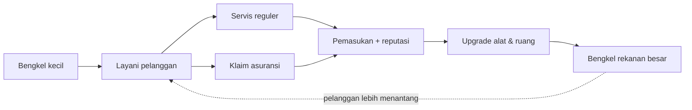

## 2. Latar Belakang & Peluang

- Genre mechanic simulator dan tycoon punya basis pemain besar.
- Belum banyak game bengkel dengan **konteks lokal Indonesia** dan **alur klaim asuransi** yang realistis.
- Sistem asuransi sudah tersedia, sehingga fitur ini bisa dibangun lebih cepat dan datanya konsisten.
- Berbasis web: tanpa instalasi, mudah dibagikan lewat link.

## 3. Tujuan & Non-Tujuan

### Tujuan
1. Game loop yang adiktif: *terima mobil → diagnosa → estimasi/klaim → perbaiki → bayar → upgrade*.
2. Alur klaim asuransi yang edukatif sekaligus seru (bukan sekadar administrasi).
3. Integrasi mulus dengan sistem asuransi yang sudah ada.
4. Berjalan lancar di HP Android menengah (target 30 FPS) dan desktop.
5. MVP playable dalam ±3–4 bulan oleh tim kecil.

### Non-Tujuan (MVP)
- Multiplayer / PvP.
- Simulasi fisika mesin yang realistis penuh.
- Lisensi merek mobil asli (gunakan merek fiktif atau generik).
- Motor, truk, dan kendaraan lain.
- Transaksi asuransi sungguhan (game bersifat simulasi, kecuali diputuskan lain, lihat Pertanyaan Terbuka).

## 4. Target Pengguna

| Persona | Deskripsi | Kebutuhan |
|---|---|---|
| **Casual Gamer** | 15–30 th, main di HP | Sesi pendek, kontrol mudah |
| **Penggemar Otomotif** | 18–40 th | Kedalaman komponen, rasa autentik |
| **Fans Tycoon/Management** | 20–40 th | Ekonomi, optimasi, progres |
| **Pemain Edukasi Asuransi** (opsional) | Agen, karyawan, atau calon nasabah | Memahami alur klaim lewat simulasi |

## 5. Game Loop Inti

### 5.1 Loop makro (ringkas)

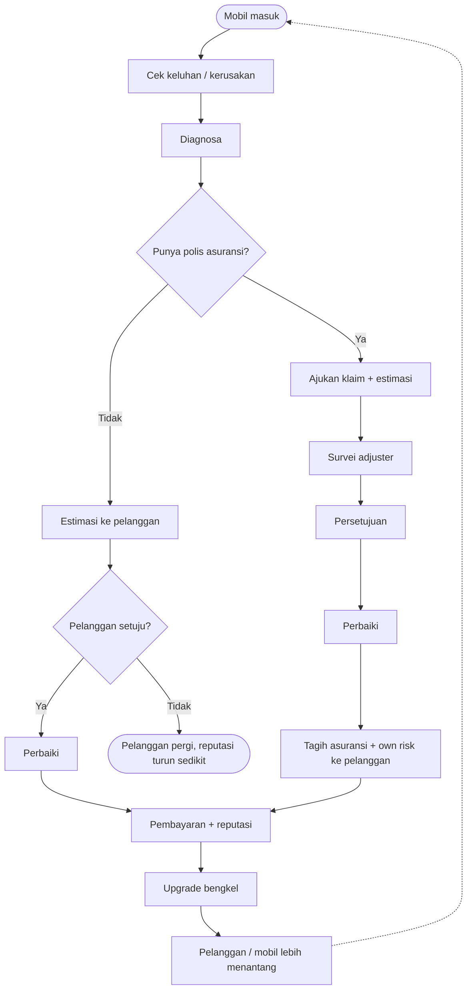

### 5.2 Loop mikro (satu sesi bermain, ±8 menit)

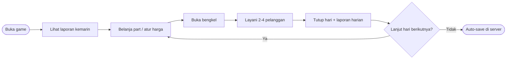

## 6. Fitur & Requirement

Prioritas: **P0** = wajib MVP, **P1** = penting, **P2** = nanti.

### 6.1 Sistem Pelanggan & Mobil (P0)
- Pelanggan datang dengan mobil dan keluhan acak (AC tidak dingin, rem bunyi, mesin brebet, bodi penyok, aki soak).
- Atribut pelanggan: kesabaran, budget, status polis (ada/tidak, jenis cakupan).
- Mobil punya kondisi per sistem (mesin, rem, kelistrikan, bodi, suspensi).
- MVP: 3–4 model mobil fiktif (city car, sedan, MPV, SUV kecil).

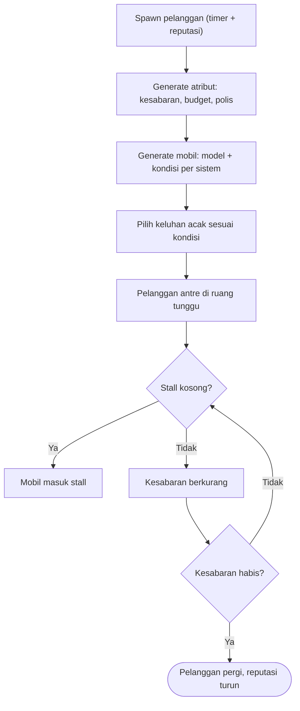

### 6.2 Diagnosa (P0)
- Pilih alat/tes untuk menemukan penyebab (scanner OBD, cek kompresi, tes rem, multimeter).
- Tiap tes memakan waktu dan/atau biaya.
- Diagnosa salah → perbaikan sia-sia dan pelanggan kecewa.

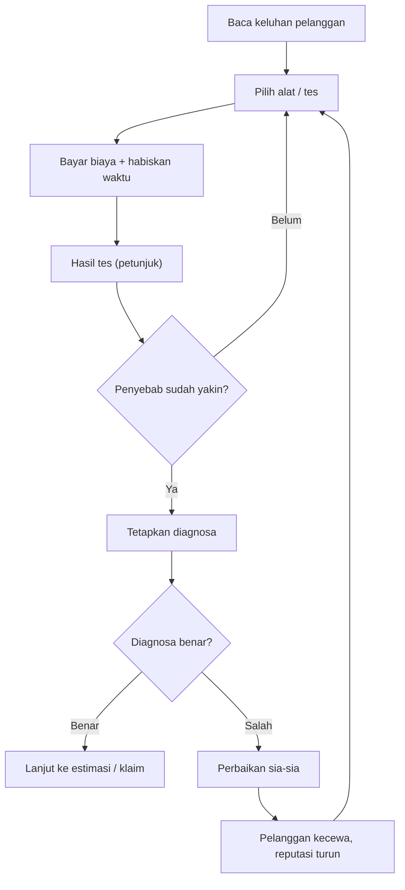

### 6.3 Perbaikan Interaktif (P0)
- Mini-game: ganti oli & filter, kampas rem, busi, aki, ketok magic/dempul ringan (bodi), AC dasar.
- Pilih alat yang benar; urutan kerja benar memberi bonus kualitas/kecepatan.
- Part yang dilepas harus dikelola (opsional sebagai tantangan).
- Mobil naik dongkrak/lift: kamera fokus ke area kerja.

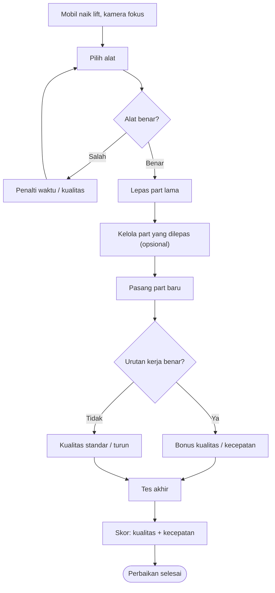

### 6.4 Modul Asuransi (P0, terintegrasi sistem yang sudah ada)

**Alur klaim dalam game:**
1. Pelanggan menunjukkan polis (nomor polis, jenis: All Risk / TLO, own risk, limit).
2. Pemain memeriksa kerusakan dan membuat **estimasi perbaikan** (part + jasa).
3. Estimasi diajukan ke sistem asuransi → **survei/adjuster** (otomatis dari sistem atau simulasi).
4. Hasil: disetujui penuh, disetujui sebagian (item dicoret), ditolak, atau butuh dokumen tambahan.
5. Perbaikan dilakukan sesuai estimasi yang disetujui.
6. Penagihan: **sisa klaim ke asuransi**, **own risk ke pelanggan**.
7. Asuransi membayar dengan jeda waktu (SLA) → memengaruhi arus kas bengkel.

#### Flowchart alur klaim end-to-end

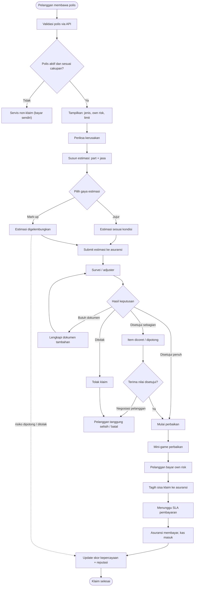

#### Sequence diagram interaksi sistem

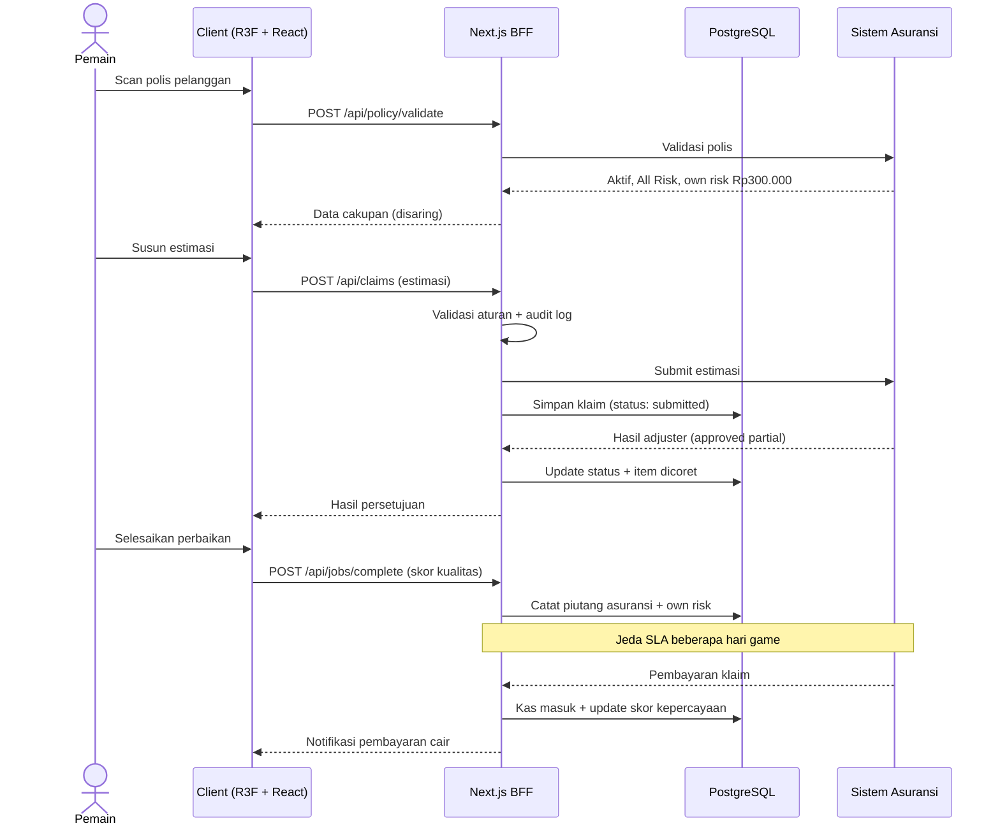

#### State machine status klaim

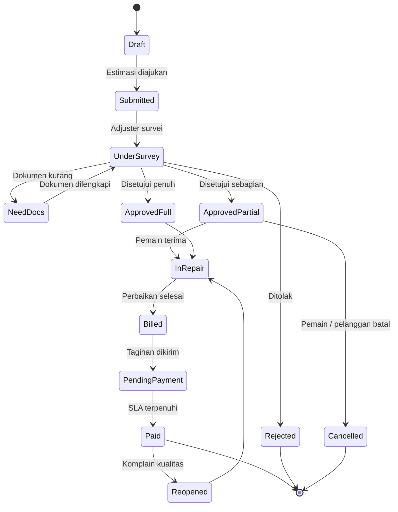

**Mekanik gameplay dari asuransi:**
- **Estimasi jujur vs menggelembung (mark-up):** estimasi terlalu tinggi berisiko ditolak/dipotong dan menurunkan skor kepercayaan.
- **Rekanan asuransi:** skor kepercayaan tinggi membuka status rekanan resmi → volume klaim lebih besar, tapi syarat lebih ketat.
- **Fraud/anomali:** kasus mencurigakan (kerusakan tidak sesuai kronologi); pemain bisa melapor atau mengabaikan dengan konsekuensi.
- **Kualitas & garansi:** hasil perbaikan buruk → klaim ulang/komplain, memengaruhi reputasi.
- **Arus kas:** pembayaran asuransi tertunda, pemain harus mengelola modal kerja.

#### Flowchart keputusan: estimasi jujur vs mark-up

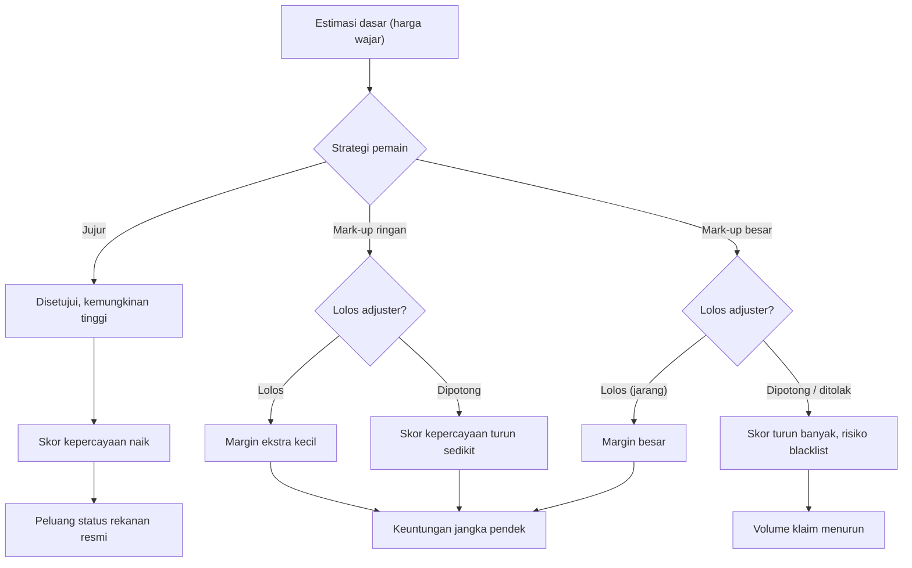

#### Flowchart fraud / anomali (P1)

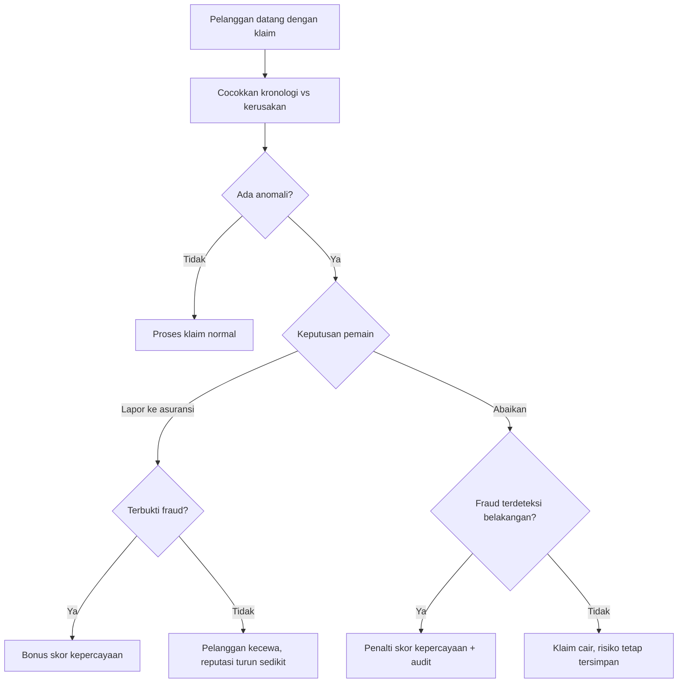

**Integrasi teknis (asumsi, perlu konfirmasi):**
- Sistem asuransi diakses lewat **REST API** (atau modul internal) dari backend Next.js.
- Data yang dibutuhkan: validasi polis, cakupan & own risk, submit estimasi/klaim, status klaim, hasil persetujuan, riwayat pembayaran.
- Backend Next.js bertindak sebagai **lapisan penengah (BFF)**; client tidak pernah memanggil sistem asuransi langsung.
- Mode **Sandbox/Mock** untuk pengembangan dan demo agar tidak bergantung pada data produksi.

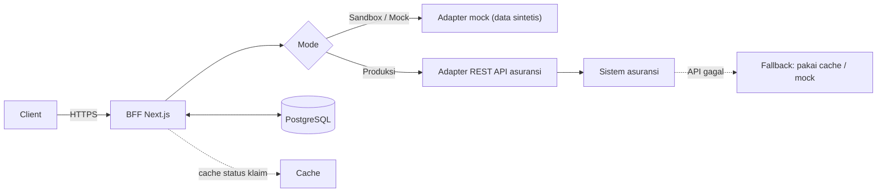

### 6.5 Ekonomi & Inventori (P0)
- Beli sparepart dari supplier (harga dinamis ringan).
- Harga jasa ditentukan pemain dalam batas wajar; tarif klaim mengikuti aturan asuransi.
- Pengeluaran: sewa, listrik, gaji karyawan, stok.
- Laporan harian: pemasukan, piutang asuransi, pengeluaran, laba.

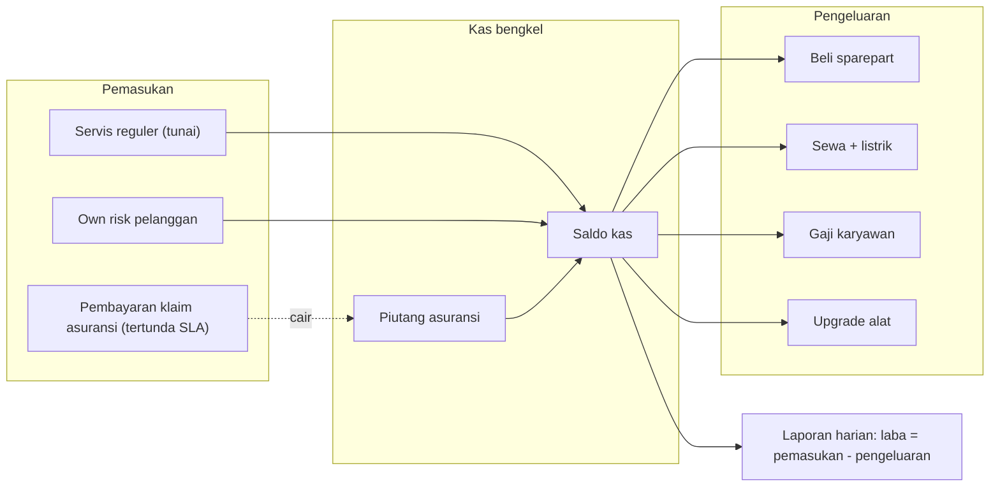

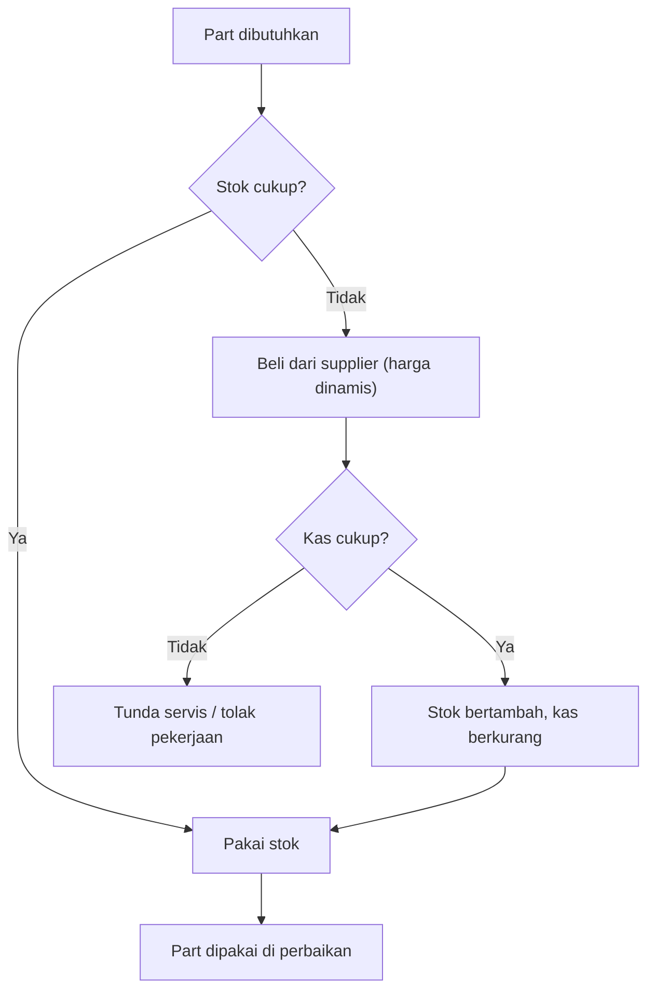

### 6.6 Progres & Upgrade (P0/P1)
- **P0:** Upgrade alat (lift, scanner OBD, kompresor, alat ketok bodi) membuka jenis servis baru.
- **P1:** Perluasan ruang, tambah stall, spooring/balancing, booth cat.
- **P1:** Rekrut mekanik dan staf admin klaim (AI).
- **P1:** Skill tree pemain (diagnosa, kecepatan, negosiasi, administrasi klaim).

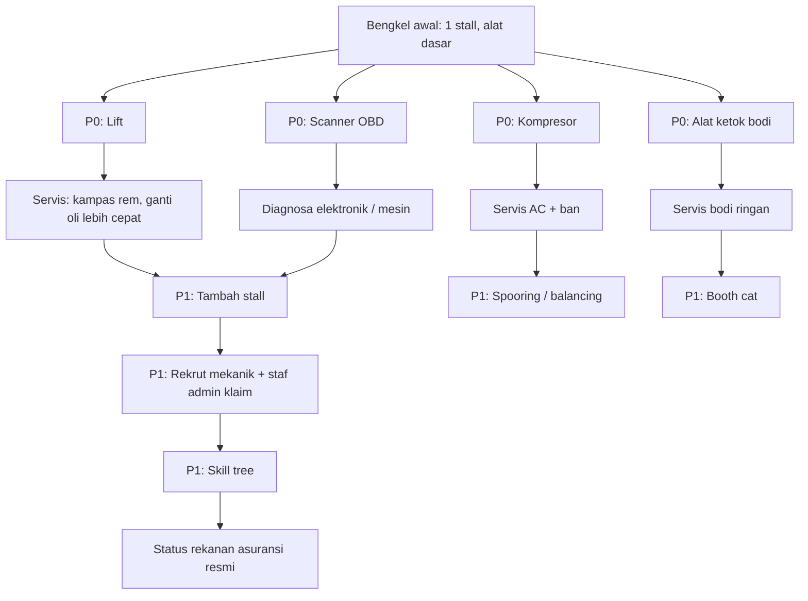

### 6.7 Reputasi & Misi (P1)
- Reputasi pelanggan umum dan **skor kepercayaan asuransi** (terpisah).
- Misi harian/mingguan (mis. "Selesaikan 3 klaim tanpa dicoret").
- Pelanggan VIP, kasus langka, dan event (mis. musim hujan, banyak mobil banjir).

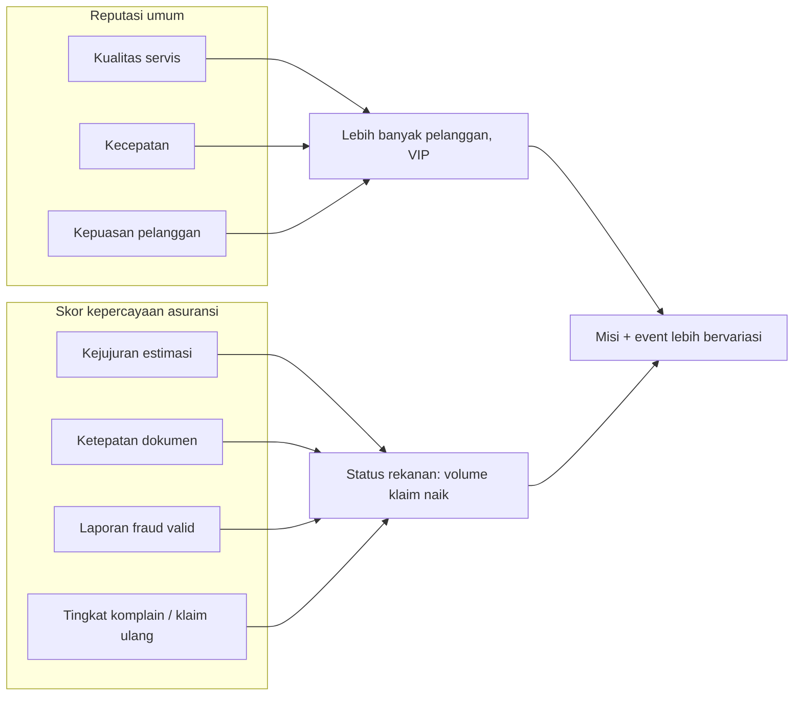

### 6.8 Kustomisasi (P2)
- Modifikasi mobil (cat, velg, audio) sebagai servis premium.
- Kustomisasi tampilan bengkel.

### 6.9 Akun, Save & Admin (P0/P1)
- **P0:** Autentikasi (login) dan simpan progres di server.
- **P1:** Dashboard admin (konten, parameter ekonomi, kasus klaim, analitik).
- **P1:** Leaderboard (laba, skor kepercayaan).

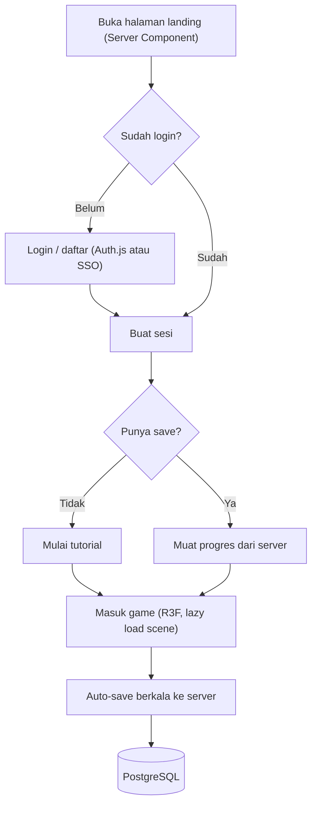

## 7. Pengalaman Pengguna (UX)

- **Kamera:** orbit terbatas + zoom area kerja; mode fokus saat memperbaiki.
- **Desktop:** mouse + shortcut keyboard. **Mobile:** tap, drag, pinch; tombol besar.
- **Layar klaim:** UI bergaya formulir/dokumen yang ringkas dan jelas (HTML overlay, bukan di dalam canvas).
- **Tutorial:** onboarding 5 menit: servis pertama (ganti oli) lalu klaim asuransi pertama yang sederhana.
- **Bahasa:** Indonesia (default), English (P1).
- **Audio:** suara alat, mesin, ambience; musik bisa dimatikan.

### 7.1 Alur onboarding (±5 menit)

```mermaid
flowchart LR
    A(["Pemain baru"]) --> B["Sambutan + pilih nama bengkel"]
    B --> C["Pelanggan 1: ganti oli"]
    C --> D["Tutorial kontrol: kamera, alat, mini-game"]
    D --> E["Dapat bayaran pertama"]
    E --> F["Pelanggan 2: punya polis"]
    F --> G["Tutorial klaim: validasi, estimasi, submit"]
    G --> H["Hasil adjuster (kasus sederhana, disetujui)"]
    H --> I["Perbaikan + penagihan"]
    I --> J["Penjelasan piutang + SLA"]
    J --> K(["Tutorial selesai, bebas bermain"])
```

### 7.2 Peta layar & navigasi

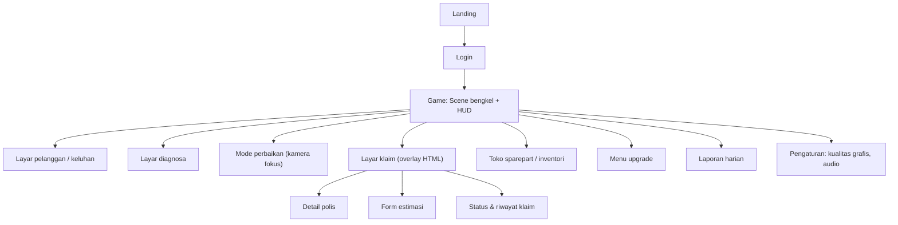

## 8. Arah Visual

- **Gaya:** low-poly / stylized, warna hangat, ceria.
- Poligon rendah, tekstur atlas kecil, pencahayaan sederhana.
- Suasana bengkel Indonesia modern-sederhana (papan nama, ruang tunggu dengan kopi, banner asuransi rekanan).

## 9. Arsitektur & Spesifikasi Teknis

### 9.1 Stack

| Area | Pilihan | Catatan |
|---|---|---|
| Framework | **Next.js (App Router)** + TypeScript | Halaman, routing, API, auth dalam satu proyek |
| 3D | **Three.js via React Three Fiber** + drei | Komponen 3D deklaratif, cocok dengan React |
| UI/HUD | React + Tailwind (+ shadcn/ui) | Overlay HTML di atas canvas |
| State game | Zustand + state machine (XState opsional) | Alur servis dan klaim yang jelas |
| Fisika | Rapier (minimal) | Hanya interaksi sederhana |
| Database | PostgreSQL + Prisma/Drizzle | Progres pemain, ekonomi, riwayat klaim |
| Auth | Auth.js / NextAuth atau sistem SSO yang sudah ada | Menyesuaikan sistem asuransi |
| API | Next.js Route Handlers / Server Actions | Lapisan penengah ke sistem asuransi |
| Aset 3D | glTF/GLB + Draco/Meshopt, tekstur KTX2 | File kecil |
| Hosting | Vercel atau self-host (container) | Sesuaikan kebijakan data perusahaan |

### 9.2 Catatan Penting Next.js + Three.js
- Canvas 3D hanya berjalan di **client**: komponen ditandai `"use client"` dan di-*load* dengan `dynamic(..., { ssr: false })`.
- Halaman non-3D (landing, login, dashboard, laporan) memanfaatkan **Server Components** agar cepat dan SEO-friendly.
- Pisahkan jelas: **logika game** (client, deterministik) vs **otoritas data** (server: ekonomi, hasil klaim, penyimpanan progres) agar sulit dicurangi.
- Aset 3D disajikan statis lewat CDN dengan cache panjang; gunakan *lazy loading* per scene.

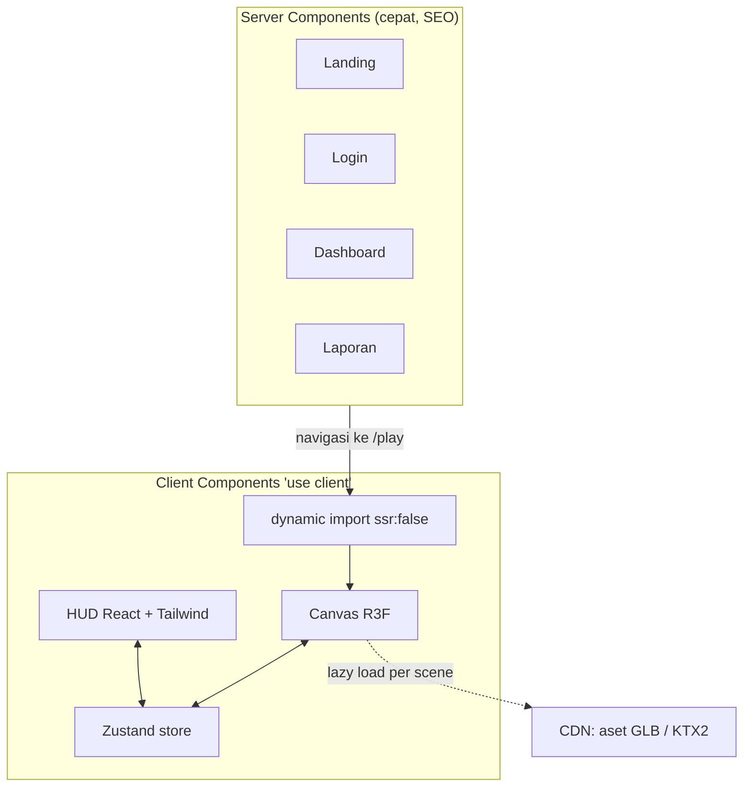

### 9.3 Arsitektur Tingkat Tinggi

```mermaid
flowchart TD
    subgraph BR["Browser"]
        UI["Next.js client: React UI + R3F canvas + Zustand"]
    end
    subgraph SV["Next.js Server / Route Handlers"]
        AUTH["Auth + sesi"]
        VAL["Validasi input + rate limit"]
        ECO["Aturan ekonomi (otoritas server)"]
        AUD["Audit log aksi klaim"]
    end
    DB[("PostgreSQL")]
    INS["Sistem Asuransi (API / modul): polis, klaim, SLA"]
    CDN["CDN aset 3D"]
    UI -->|"HTTPS"| AUTH
    AUTH --> VAL
    VAL --> ECO
    VAL --> AUD
    ECO --> DB
    AUD --> DB
    ECO --> INS
    UI -.->|"GLB, KTX2"| CDN
```

### 9.3.1 Pembagian otoritas client vs server

```mermaid
flowchart LR
    subgraph CL["Client (tidak dipercaya)"]
        C1["Gameplay + mini-game"]
        C2["Animasi + UI"]
        C3["Skor kualitas (dilaporkan)"]
    end
    subgraph SR["Server (otoritas)"]
        S1["Validasi skor wajar"]
        S2["Hitung ekonomi + kas"]
        S3["Hasil klaim + status"]
        S4["Simpan progres"]
    end
    C3 --> S1
    S1 --> S2
    S2 --> S4
    C1 --> S3
    S3 --> C2
```

### 9.4 Target Performa
- 30 FPS stabil di Android menengah (RAM 4 GB).
- Muat awal **< 15 MB**, aset lain lazy load; interaktif **< 5 detik** di 4G.
- Budget: < 100 draw call dan < 150k triangle per scene.

```mermaid
flowchart TD
    A["Mulai game"] --> B["Deteksi perangkat / benchmark singkat"]
    B --> C{"FPS rata-rata?"}
    C -->|">= 45"| D["Kualitas Tinggi"]
    C -->|"30-44"| E["Kualitas Sedang"]
    C -->|"< 30"| F["Kualitas Rendah: kurangi bayangan, resolusi, efek"]
    D --> G["Monitor FPS berkala"]
    E --> G
    F --> G
    G --> H{"FPS turun?"}
    H -->|"Ya"| I["Turunkan level kualitas otomatis"]
    H -->|"Tidak"| G
    I --> G
```

### 9.5 Keamanan & Data
- Data polis dan klaim diperlakukan sebagai data sensitif: akses lewat server, tanpa ekspos langsung ke client.
- Gunakan **data sintetis** untuk gameplay kecuali ada izin dan kebutuhan eksplisit memakai data nyata (patuhi UU PDP).
- Rate limiting, validasi input server-side, dan audit log pada aksi klaim.

```mermaid
flowchart TD
    A["Request dari client"] --> B{"Terautentikasi?"}
    B -->|"Tidak"| X1["401 Unauthorized"]
    B -->|"Ya"| C{"Lolos rate limit?"}
    C -->|"Tidak"| X2["429 Too Many Requests"]
    C -->|"Ya"| D{"Input valid (skema)?"}
    D -->|"Tidak"| X3["400 Bad Request"]
    D -->|"Ya"| E{"Aksi sesuai aturan game / ekonomi?"}
    E -->|"Tidak"| X4["403 / 422 Ditolak"]
    E -->|"Ya"| F["Eksekusi + catat audit log"]
    F --> G["Filter data sebelum dikirim ke client"]
    G --> H["Response"]
```

### 9.6 Risiko Teknis
- Performa di HP lama → pengaturan kualitas (rendah/sedang/tinggi).
- Drag part 3D di layar sentuh → prototyping awal.
- Ketergantungan pada ketersediaan API asuransi → mode mock/fallback dan caching status klaim.
- Memory leak aset 3D → disiplin `dispose` dan profiling berkala.

### 9.7 Model data tingkat tinggi (ERD)

```mermaid
erDiagram
    USER ||--o{ SHOP : memiliki
    SHOP ||--o{ JOB : mengerjakan
    SHOP ||--o{ INVENTORY_ITEM : menyimpan
    SHOP ||--o{ UPGRADE : memiliki
    SHOP ||--o{ DAILY_REPORT : menghasilkan
    CUSTOMER ||--o{ CAR : membawa
    CAR ||--o{ JOB : diservis
    JOB ||--o| CLAIM : "dapat memiliki"
    CLAIM ||--|{ CLAIM_ITEM : berisi
    CLAIM ||--o{ CLAIM_EVENT : "riwayat status"
    CLAIM ||--o{ PAYMENT : "dibayar lewat"
    CUSTOMER ||--o| POLICY : "dapat memiliki"
    POLICY ||--o{ CLAIM : mendasari
    USER {
        string id
        string email
    }
    SHOP {
        string id
        int cash
        int reputation
        int trust_score
    }
    JOB {
        string id
        string status
        int quality_score
    }
    CLAIM {
        string id
        string status
        int estimate_total
        int approved_total
    }
    POLICY {
        string policy_no
        string type
        int own_risk
        int limit
    }
    PAYMENT {
        string id
        int amount
        string payer
        date due_date
    }
```

## 10. Metrik Keberhasilan

| Metrik | Target MVP |
|---|---|
| Penyelesaian tutorial | ≥ 70% |
| Retensi D1 / D7 | ≥ 35% / ≥ 12% |
| Durasi sesi rata-rata | ≥ 8 menit |
| Pemain yang menyelesaikan ≥ 1 klaim asuransi | ≥ 60% |
| Rata-rata FPS di perangkat target | ≥ 30 |
| Error rate API klaim | < 1% |
| Crash / error rate sesi | < 1% |

```mermaid
flowchart LR
    A["Kunjungan"] --> B["Mulai tutorial"]
    B --> C["Selesai tutorial (target >= 70%)"]
    C --> D["Klaim pertama selesai (target >= 60%)"]
    D --> E["Retensi D1 (target >= 35%)"]
    E --> F["Retensi D7 (target >= 12%)"]
```

## 11. Monetisasi / Nilai Bisnis (Opsi, Belum Final)

Tergantung tujuan proyek (lihat Pertanyaan Terbuka):
- **Produk komersial:** gratis + iklan rewarded, IAP kosmetik, atau premium.
- **Edukasi/engagement asuransi:** gratis untuk nasabah/agen; nilai bisnis dari literasi asuransi, akuisisi, atau pelatihan.
- Hindari *pay-to-win*.

```mermaid
flowchart TD
    A{"Tujuan proyek?"} -->|"Produk komersial"| B["Gratis + iklan rewarded"]
    A -->|"Produk komersial"| C["IAP kosmetik / premium"]
    A -->|"Edukasi / engagement"| D["Gratis untuk nasabah / agen"]
    D --> E["Nilai: literasi, akuisisi, pelatihan"]
    B --> F["Aturan: tanpa pay-to-win"]
    C --> F
    E --> G["Realisme klaim lebih tinggi"]
```

## 12. Cakupan MVP

**Termasuk:**
- 1 bengkel, mobil (3–4 model fiktif).
- 5–6 jenis servis (ganti oli, busi, kampas rem, aki, AC dasar, ketok bodi ringan).
- Pelanggan, diagnosa sederhana, ekonomi dasar.
- **Alur klaim asuransi dasar**: validasi polis, estimasi, persetujuan/penolakan, own risk, pembayaran tertunda.
- 5–8 upgrade, tutorial, auth + save di server, audio dasar.
- Mode Sandbox/Mock untuk sistem asuransi.

**Tidak termasuk:** karyawan AI, misi, kustomisasi, fraud detection lanjutan, status rekanan resmi, multi-bahasa, leaderboard.

```mermaid
flowchart LR
    subgraph MVP["MVP (P0)"]
        M1["Pelanggan + mobil"]
        M2["Diagnosa sederhana"]
        M3["5-6 mini-game servis"]
        M4["Klaim dasar + own risk + SLA"]
        M5["Ekonomi + inventori"]
        M6["Upgrade alat"]
        M7["Auth + save server"]
        M8["Tutorial + audio"]
        M9["Mode Sandbox/Mock"]
    end
    subgraph LATER["Pasca-MVP (P1/P2)"]
        L1["Karyawan + staf klaim"]
        L2["Misi + event"]
        L3["Fraud detection lanjutan"]
        L4["Status rekanan resmi"]
        L5["Leaderboard + admin dashboard"]
        L6["Multi-bahasa"]
        L7["Kustomisasi mobil / bengkel"]
    end
    MVP --> LATER
```

## 13. Roadmap

| Fase | Durasi | Deliverable |
|---|---|---|
| **0. Prototipe** | 2–3 minggu | Next.js + R3F: 1 servis playable, uji kontrol mobile, spike integrasi API asuransi |
| **1. Vertical Slice** | 4 minggu | Loop penuh 1 pelanggan + 1 klaim, ekonomi dasar, gaya visual final |
| **2. MVP** | 5–6 minggu | Semua fitur P0, auth + DB, tutorial, optimasi |
| **3. Beta Tertutup** | 3 minggu | Uji ke 50–100 pemain, perbaikan dari data |
| **4. Rilis & Live-ops** | Berlanjut | Fitur P1 (karyawan, misi, rekanan, fraud), konten rutin |

```mermaid
gantt
    title Roadmap Bengkel Juara (mulai Nov 2026, estimasi)
    dateFormat  YYYY-MM-DD
    axisFormat  %d %b
    section Fase 0
    Prototipe (1 servis + spike API)   :f0, 2026-11-02, 21d
    section Fase 1
    Vertical Slice (1 pelanggan + 1 klaim) :f1, after f0, 28d
    section Fase 2
    MVP (semua P0)                     :f2, after f1, 42d
    section Fase 3
    Beta Tertutup (50-100 pemain)      :f3, after f2, 21d
    section Fase 4
    Rilis & Live-ops (P1)              :f4, after f3, 30d
```

> Tanggal pada Gantt hanya ilustrasi; sesuaikan dengan tanggal mulai proyek sebenarnya.

## 14. Risiko & Mitigasi

| Risiko | Dampak | Mitigasi |
|---|---|---|
| Biaya aset 3D mobil membengkak | Tinggi | Low-poly, modular part, kit aset berlisensi |
| Alur klaim terasa membosankan seperti pekerjaan administrasi | Tinggi | Jadikan keputusan (jujur vs mark-up, risiko) sebagai inti, bukan formulir |
| Loop game kurang seru | Tinggi | Playtest sejak prototipe |
| Integrasi API asuransi lambat/berubah | Sedang | Lapisan penengah + mock + kontrak API terdokumentasi |
| Isu privasi data | Tinggi | Data sintetis, akses server-side, audit |
| Performa di HP lama | Sedang | Pengaturan kualitas, budget aset ketat |
| Scope creep | Tinggi | Patuhi daftar MVP |

```mermaid
quadrantChart
    title Matriks Risiko (dampak vs kemungkinan, estimasi awal)
    x-axis "Kemungkinan rendah" --> "Kemungkinan tinggi"
    y-axis "Dampak rendah" --> "Dampak tinggi"
    quadrant-1 "Prioritas mitigasi"
    quadrant-2 "Pantau ketat"
    quadrant-3 "Terima"
    quadrant-4 "Kelola rutin"
    "Biaya aset 3D": [0.65, 0.8]
    "Klaim membosankan": [0.6, 0.85]
    "Loop kurang seru": [0.5, 0.9]
    "Integrasi API": [0.55, 0.55]
    "Isu privasi": [0.35, 0.9]
    "Performa HP lama": [0.7, 0.5]
    "Scope creep": [0.8, 0.8]
```

> Posisi pada matriks adalah penilaian awal untuk diskusi tim, bukan hasil pengukuran.

## 15. Pertanyaan Terbuka

1. **Sistem asuransi yang ada:** bentuknya apa (REST API, database, modul internal)? Ada dokumentasi, auth, dan environment sandbox?
2. **Data:** pakai data nyata atau sintetis? Apakah ada polis/klaim nyata yang boleh terlihat di game?
3. **Tujuan proyek:** produk game komersial, alat edukasi/pelatihan, atau engagement nasabah? Ini memengaruhi desain, monetisasi, dan tingkat realisme klaim.
4. **Apakah transaksi nyata dimungkinkan** (mis. hadiah/benefit asli) atau murni simulasi?
5. **Target utama:** HP atau desktop?
6. **Aset 3D:** buat sendiri, outsource, atau beli?
7. **Hosting:** Vercel atau infrastruktur sendiri (terkait kebijakan data)?
8. **Auth:** akun game sendiri atau SSO dari sistem yang sudah ada?

```mermaid
flowchart TD
    Q1["Q1: Bentuk sistem asuransi?"] --> D1["Menentukan desain adapter API"]
    Q2["Q2: Data nyata atau sintetis?"] --> D2["Menentukan kebijakan privasi (UU PDP)"]
    Q3["Q3: Tujuan proyek?"] --> D3["Menentukan monetisasi + tingkat realisme"]
    Q4["Q4: Transaksi nyata?"] --> D3
    Q5["Q5: Target HP / desktop?"] --> D4["Menentukan UI + budget performa"]
    Q6["Q6: Sumber aset 3D?"] --> D5["Menentukan biaya + jadwal"]
    Q7["Q7: Hosting?"] --> D6["Menentukan deployment"]
    Q8["Q8: Auth sendiri atau SSO?"] --> D1
    D1 --> GO(["Keputusan sebelum Fase 0 selesai"])
    D2 --> GO
    D3 --> GO
    D4 --> GO
    D5 --> GO
    D6 --> GO
```

## 16. Lampiran: Contoh Alur Satu Klaim

1. Pelanggan datang: "Bumper depan penyok, kena tabrak di parkiran. Ada asuransi All Risk."
2. Pemain memvalidasi polis → aktif, own risk Rp300.000.
3. Pemain memeriksa kerusakan dan menyusun estimasi: bumper, cat, jasa ketok.
4. Estimasi diajukan → adjuster menyetujui sebagian (jasa cat dipotong, estimasi dianggap terlalu tinggi).
5. Pemain memutuskan: lanjut dengan nilai disetujui atau bernegosiasi dengan pelanggan.
6. Mini-game: lepas bumper, ketok/dempul, cat, pasang kembali.
7. Pelanggan bayar own risk; sisa klaim ditagih ke asuransi, cair setelah beberapa hari game.
8. Skor kualitas, kecepatan, dan kejujuran estimasi memengaruhi reputasi dan skor kepercayaan asuransi.

```mermaid
flowchart TD
    A["1. Pelanggan: bumper penyok, punya All Risk"] --> B["2. Validasi polis: aktif, own risk Rp300.000"]
    B --> C["3. Periksa kerusakan, estimasi: bumper + cat + jasa ketok"]
    C --> D["4. Adjuster: disetujui sebagian, jasa cat dipotong"]
    D --> E{"5. Keputusan pemain"}
    E -->|"Lanjut dengan nilai disetujui"| F["6. Mini-game: lepas bumper, ketok / dempul, cat, pasang"]
    E -->|"Negosiasi pelanggan"| G["Pelanggan tanggung selisih atau batal"]
    G --> F
    F --> H["7a. Pelanggan bayar own risk Rp300.000"]
    F --> I["7b. Sisa klaim ditagih ke asuransi"]
    I --> J["Cair setelah beberapa hari game"]
    H --> K["8. Skor kualitas + kecepatan + kejujuran estimasi"]
    J --> K
    K --> L(["Update reputasi + skor kepercayaan asuransi"])
```

---

*Akhir dokumen: PRD v0.3 (dengan flowchart). Jika diagram tidak tampil di editor Anda, salin blok `mermaid` ke [mermaid.live](https://mermaid.live) untuk melihat atau mengekspornya ke PNG/SVG.*
