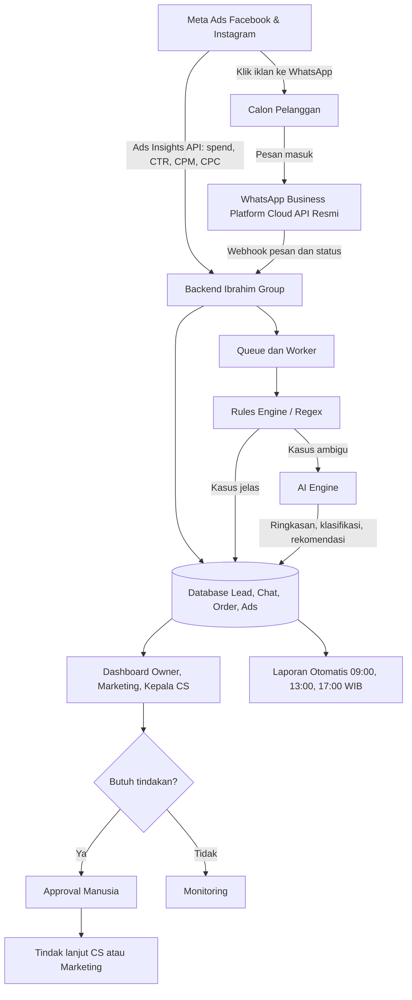
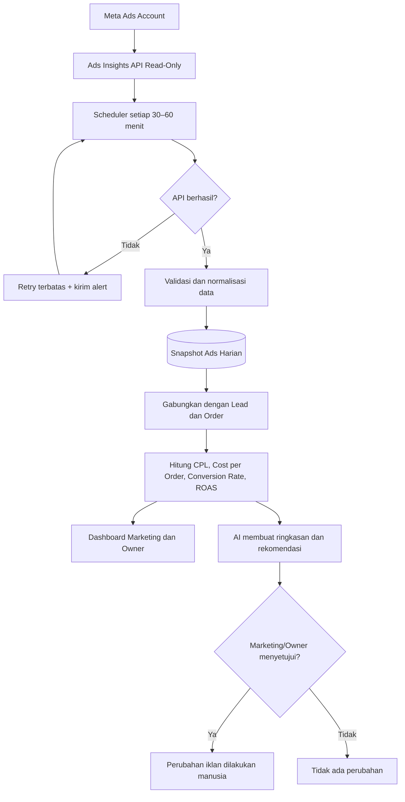
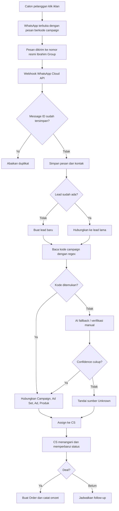
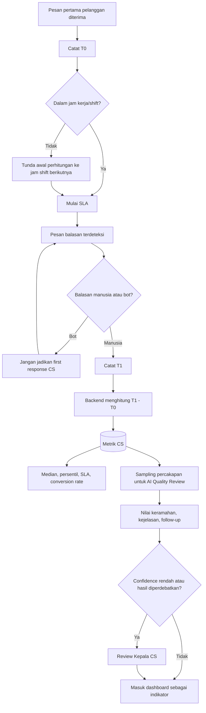
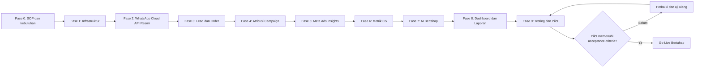
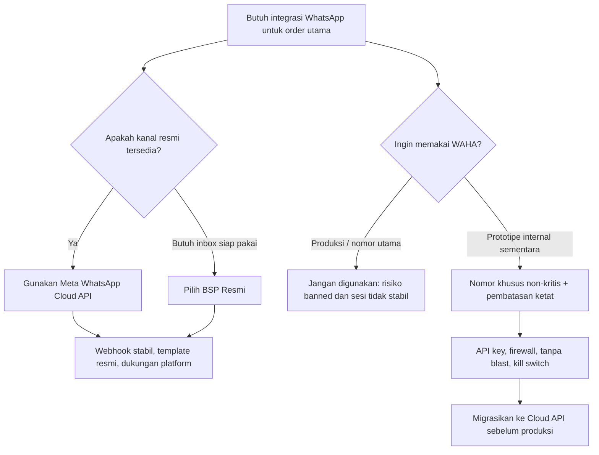

# Roadmap Implementasi Sistem AI Manajemen Order Ibrahim Group

**Dokumen kerja:** versi 1.0  
**Tujuan:** membuat sistem yang menghubungkan iklan Meta, WhatsApp resmi, order, performa CS, dan laporan manajemen dalam satu dashboard.  
**Prinsip utama:** mulai dari pencatatan data yang akurat, baru menambahkan AI. AI memberi ringkasan dan rekomendasi; keputusan mematikan iklan, menaikkan anggaran, atau menilai karyawan tetap memerlukan persetujuan manusia.

---

## 1. Hasil Akhir yang Ingin Dicapai

Sistem nantinya dapat:

1. Mengambil biaya dan performa iklan Facebook/Instagram.
2. Mengetahui iklan, campaign, atau produk yang menghasilkan lead WhatsApp.
3. Membuat data calon pelanggan dan order secara otomatis dari percakapan.
4. Mengukur kecepatan balasan pertama CS secara adil.
5. Mencatat status lead: baru, dihubungi, follow-up, deal, batal, atau tidak valid.
6. Menghitung hasil bisnis seperti jumlah lead, conversion rate, omzet, dan biaya per order.
7. Mengirim laporan manajemen pagi, siang, dan sore.
8. Menggunakan AI untuk merangkum percakapan, membantu klasifikasi, dan memberi rekomendasi.

### Alur sederhananya

```text
Meta Ads
   │
   ├── data biaya/performa ───────────────┐
   │                                      │
Calon pelanggan klik iklan                │
   │                                      │
   ▼                                      │
WhatsApp Business Platform resmi          │
   │ webhook pesan                        │
   ▼                                      ▼
Backend Ibrahim Group ─────────────── Database
   │                                      │
   ├── pencatatan lead dan order           │
   ├── penghitungan response time          │
   ├── atribusi campaign                   │
   └── pemanggilan AI bila dibutuhkan      │
                     │                     │
                     └──────────┬──────────┘
                                ▼
                    Dashboard + laporan otomatis
```

## 1.1 Flowchart Arsitektur Utama



## 1.2 Flowchart Meta Ads dan Pelaporan



> Pada tahap awal, AI hanya memberi rekomendasi. AI tidak boleh otomatis mematikan iklan atau menaikkan anggaran.

## 1.3 Flowchart Lead WhatsApp dan Atribusi Iklan



## 1.4 Flowchart Pengukuran Kecepatan dan Kualitas CS



> Skor AI hanya indikator pendukung. Keputusan HR tetap memerlukan pemeriksaan manusia dan bukti percakapan.

## 1.5 Flowchart Implementasi Bertahap



## 1.6 Flowchart Keputusan WAHA vs API Resmi



---

## 2. Keputusan Penting Sebelum Mulai

Sebelum programmer melakukan setup, manajemen perlu menetapkan hal berikut:

- Nomor WhatsApp mana yang akan dijadikan nomor bisnis utama.
- Apakah nomor tersebut sudah digunakan di aplikasi WhatsApp Business.
- Jumlah CS dan pembagian antrean chat.
- Daftar produk/paket Ibrahim Group.
- Tahapan penjualan yang digunakan semua CS.
- Jam kerja dan jadwal shift CS.
- Target waktu balasan pertama, misalnya maksimal 5 menit pada jam kerja.
- Definisi lead valid, deal, batal, duplikat, dan spam.
- Sumber omzet yang dianggap benar: nominal order, invoice, atau pembayaran masuk.
- Siapa yang boleh melihat chat, laporan CS, biaya iklan, dan laporan manajemen.
- Siapa yang menyetujui perubahan budget atau penghentian iklan.

**Output tahap ini:** satu dokumen SOP bisnis yang sudah disetujui owner, marketing, kepala CS, dan programmer.

---

## 3. Pilihan Integrasi WhatsApp: Gunakan yang Resmi

## 3.1 Rekomendasi untuk produksi

Gunakan **WhatsApp Business Platform – Cloud API resmi dari Meta**, baik:

- langsung ke Meta Cloud API; atau
- melalui BSP resmi bila Ibrahim Group membutuhkan inbox multi-CS siap pakai, onboarding, dan dukungan vendor.

Cloud API menggunakan Graph API untuk mengirim pesan dan webhook untuk menerima event. Meta menyediakan alur resmi mulai dari membuat Meta App, menghubungkan WhatsApp Business Account, menguji pesan, memasang webhook, sampai membuat system-user token permanen.[2][3]

## 3.2 Mengapa WAHA tidak direkomendasikan untuk nomor utama

WAHA mengendalikan sesi WhatsApp Web dan bukan kanal resmi WhatsApp Business Platform. Situs WAHA sendiri menyatakan bahwa WhatsApp tidak mengizinkan bot atau klien tidak resmi sehingga solusi tersebut tidak dapat dianggap sepenuhnya aman.[7]

WhatsApp juga memperingatkan bahwa menautkan akun melalui aplikasi atau situs tidak resmi dapat menempatkan akun dalam risiko dan dapat menyebabkan pemblokiran sementara atau permanen.[1]

### Kesimpulan risiko WAHA

- Ada risiko nomor logout, sesi putus, atau QR harus dipindai ulang.
- Ada risiko perubahan WhatsApp Web membuat integrasi berhenti.
- Ada risiko keamanan bila API WAHA terbuka ke internet.
- Ada risiko nomor utama terkena pembatasan atau banned sementara/permanen.
- Tidak ada konfigurasi yang dapat menjamin nomor bebas banned.

**Keputusan:**

- Jangan memakai WAHA untuk nomor order utama Ibrahim Group.
- Jangan menghubungkan nomor penting perusahaan ke otomatisasi tidak resmi.
- Jika WAHA dipakai hanya untuk prototipe internal sementara, gunakan nomor khusus yang bukan nomor utama, jangan blast, jangan hubungi orang tanpa persetujuan, batasi jaringan, pasang API key, dan siapkan penghentian total. Namun, target produksi tetap harus Cloud API resmi.

---

## 4. Step-by-Step Implementasi

## Fase 0 — Persiapan Bisnis dan Data

**Estimasi waktu:** 2–4 hari kerja.

### Langkah

1. Tunjuk satu Product Owner dari Ibrahim Group.
2. Daftarkan seluruh nomor WhatsApp, akun iklan, produk, cabang, dan CS.
3. Tetapkan tahapan lead yang seragam:
   - `baru`
   - `dibalas`
   - `qualified`
   - `follow_up`
   - `deal`
   - `batal`
   - `spam/tidak_valid`
4. Tentukan data minimal order:
   - nama pelanggan;
   - nomor telepon;
   - sumber/campaign;
   - produk/paket;
   - tanggal acara atau pengiriman;
   - area;
   - nilai order;
   - CS penanggung jawab;
   - status pembayaran.
5. Tentukan SLA respons berdasarkan jam kerja dan shift.
6. Tentukan laporan yang dibutuhkan owner setiap hari.
7. Tentukan masa simpan chat dan aturan akses data pribadi.

### Selesai jika

- SOP lead dan order sudah tertulis.
- Semua CS menggunakan definisi status yang sama.
- Pemilik setiap data dan metrik sudah jelas.

---

## Fase 1 — Siapkan Infrastruktur Dasar

**Estimasi waktu:** 2–4 hari kerja.

### Setup teknis

1. Gunakan server aplikasi yang sudah dimiliki Ibrahim Group bila kapasitasnya cukup.
2. Siapkan subdomain, misalnya:
   - `order.ibrahimgroup.id` untuk dashboard;
   - `api-order.ibrahimgroup.id` untuk API/webhook.
3. Pasang HTTPS dan Cloudflare.
4. Siapkan database PostgreSQL atau MySQL.
5. Siapkan Redis untuk queue dan cache.
6. Jalankan worker queue untuk proses webhook, laporan, dan AI.
7. Buat environment terpisah:
   - development;
   - staging;
   - production.
8. Siapkan backup database harian dan lakukan uji restore.
9. Tambahkan monitoring:
   - status server;
   - worker mati;
   - webhook gagal;
   - antrean menumpuk;
   - disk hampir penuh;
   - error aplikasi.

### Pengamanan minimum

- Rahasia API tidak disimpan di source code atau chat.
- Gunakan secret manager atau file environment dengan izin terbatas.
- Dashboard memakai login, role, dan audit log.
- Endpoint webhook memakai signature verification.
- Data chat hanya dapat dibaca oleh role yang berwenang.
- Log tidak boleh mencetak access token atau isi chat lengkap tanpa kebutuhan.

### Selesai jika

- Staging dapat dibuka melalui HTTPS.
- Backup berhasil dibuat dan benar-benar dapat dipulihkan.
- Alert pengujian diterima oleh tim teknis.

---

## Fase 2 — Setup WhatsApp Cloud API Resmi

**Estimasi waktu:** 3–7 hari kerja, di luar waktu verifikasi Meta bila ada.

### Yang harus disiapkan

- Meta Business Portfolio milik Ibrahim Group.
- Data legal bisnis yang konsisten.
- Nomor telepon yang akan didaftarkan.
- Akses admin Meta Business.
- Meta App milik perusahaan, bukan milik akun pribadi vendor/programmer.

### Langkah setup

1. Pastikan Business Portfolio Ibrahim Group dapat diakses owner.
2. Selesaikan verifikasi bisnis jika diwajibkan Meta.
3. Buat Meta App dan tambahkan produk WhatsApp.
4. Hubungkan atau buat WhatsApp Business Account (WABA).
5. Tambahkan nomor telepon bisnis.
6. Simpan dengan aman:
   - `WABA_ID`;
   - `PHONE_NUMBER_ID`;
   - `APP_ID`;
   - access token.
7. Buat system user dan token produksi dengan permission minimum yang diperlukan.
8. Buat endpoint webhook HTTPS.
9. Verifikasi webhook dan subscribe event pesan/status.
10. Uji alur:
    - pelanggan mengirim pesan;
    - sistem menerima webhook;
    - CS membalas;
    - sistem menerima status sent/delivered/read;
    - semua event tersimpan sekali saja.
11. Buat template resmi untuk pesan di luar customer-service window, misalnya:
    - konfirmasi order;
    - pengingat pembayaran;
    - pengingat jadwal;
    - follow-up yang memiliki dasar persetujuan pelanggan.
12. Catat opt-in dan permintaan opt-out pelanggan.

Meta menjelaskan bahwa setelah pelanggan merespons, terbuka customer-service window 24 jam untuk pesan non-template. Di luar jendela yang berlaku, penggunaan template dan aturan platform harus dipatuhi.[3]

### Selesai jika

- Pesan masuk dan keluar tercatat end-to-end.
- Status pesan dapat dilihat.
- Token produksi tidak memakai token sementara.
- Nomor resmi dapat dioperasikan tanpa WAHA.

---

## Fase 3 — Bangun Modul Lead dan Order

**Estimasi waktu:** 1–2 minggu.

### Data utama yang dibangun

- `contacts`: pelanggan/nomor telepon.
- `conversations`: sesi percakapan.
- `messages`: metadata pesan masuk/keluar.
- `leads`: sumber, produk, status, owner CS.
- `orders`: paket, nilai, tanggal, status pembayaran.
- `cs_users` dan `shifts`: data CS dan jam kerja.
- `lead_status_history`: riwayat perubahan status.
- `audit_logs`: siapa melakukan apa dan kapan.

### Aturan penting

1. Setiap webhook harus memiliki unique event/message ID agar retry tidak membuat data ganda.
2. Nomor telepon dinormalisasi ke format internasional.
3. Pesan pertama pelanggan membuat atau menghubungkan lead.
4. Balasan pertama CS dicatat otomatis.
5. Order harus dapat dibuat dari lead tanpa menyalin data secara manual.
6. Perubahan status dan nilai order wajib masuk audit log.
7. Data yang sudah ada dari ERP/CRM Ibrahim Group sebaiknya diintegrasikan, bukan dibuat duplikat.

### Selesai jika

- Satu lead dapat ditelusuri dari pesan pertama sampai order.
- Retry webhook tidak menggandakan pesan.
- Riwayat perubahan order dan status terlihat jelas.

---

## Fase 4 — Atribusi Iklan ke Lead WhatsApp

**Estimasi waktu:** 4–7 hari kerja.

### Cara paling sederhana

1. Buat link WhatsApp berbeda untuk setiap iklan/ad set/campaign.
2. Isi pesan awal dengan kode singkat, misalnya:

```text
Halo Ibrahim Aqiqah, saya tertarik Paket Premium. Kode: CMP-AQ-PREM-01
```

3. Backend membaca kode dengan aturan biasa/regex, bukan AI.
4. Simpan relasi kode dengan:
   - account;
   - campaign;
   - ad set;
   - ad;
   - creative;
   - produk;
   - cabang.
5. Jika pelanggan menghapus atau mengubah kode, AI boleh membantu sebagai fallback dengan confidence score.
6. Jika confidence rendah, masukkan ke antrean verifikasi manual.

### Mengapa tidak semuanya memakai AI

Kode deterministik lebih murah, lebih mudah diaudit, dan lebih akurat. AI hanya dipakai ketika teks tidak cocok dengan pola.

### Selesai jika

- Tim dapat melihat lead berasal dari campaign/ad mana.
- Lead tanpa sumber diberi label `unknown`, bukan ditebak.
- Persentase lead yang teratribusi tampil di dashboard.

---

## Fase 5 — Integrasi Meta Ads Insights

**Estimasi waktu:** 4–7 hari kerja.

Ads Insights API menyediakan data performa iklan dan dapat dipanggil pada level akun iklan, campaign, ad set, atau ad.[5]

### Langkah

1. Buat/konfigurasi Meta App yang dikuasai Ibrahim Group.
2. Hubungkan ad account Ibrahim Group.
3. Minta permission dan akses yang benar untuk membaca data iklan.
4. Simpan token secara aman dan buat prosedur rotasi/token expiry.
5. Ambil data berkala, misalnya setiap 30–60 menit:
   - spend;
   - impressions;
   - reach;
   - clicks/link clicks;
   - CTR;
   - CPM;
   - CPC;
   - actions/conversions yang tersedia.
6. Simpan snapshot harian per campaign/ad set/ad.
7. Gabungkan data Ads dengan lead dan order internal.
8. Hitung metrik bisnis di backend:
   - cost per lead = spend / lead valid;
   - cost per order = spend / order deal;
   - conversion rate = order deal / lead valid;
   - ROAS = omzet teratribusi / spend.
9. Tampilkan status data terakhir diperbarui.

### Pengaman

Pada versi pertama, akses Meta Ads **read-only**. Jangan mengizinkan AI mematikan iklan atau menaikkan budget otomatis. AI hanya menulis rekomendasi; marketing/owner menyetujui tindakan.

### Selesai jika

- Angka spend dashboard sesuai dengan Ads Manager untuk periode uji.
- Selisih attribution window dijelaskan, bukan dianggap bug.
- Semua rekomendasi dapat ditelusuri ke data sumber.

---

## Fase 6 — Pengukuran Kinerja CS

**Estimasi waktu:** 4–7 hari kerja.

### Metrik yang dihitung backend

- waktu pesan pertama pelanggan (`T0`);
- waktu balasan manusia pertama (`T1`);
- first response time = `T1 - T0`;
- median dan persentil waktu respons;
- jumlah lead yang ditangani;
- follow-up yang jatuh tempo;
- conversion rate per CS;
- omzet/order yang ditangani.

### Aturan agar adil

1. Hitung SLA hanya pada jam shift yang ditetapkan.
2. Bedakan balasan bot dan balasan manusia.
3. Jangan menghukum CS atas pesan di luar jam kerja.
4. Lead pindah CS harus punya riwayat assignment.
5. Gunakan median/persentil selain rata-rata agar outlier tidak menyesatkan.
6. Penilaian AI atas kualitas chat bukan satu-satunya dasar sanksi atau keputusan HR.
7. Sediakan sampel percakapan dan proses review manusia.

### Selesai jika

- Hasil pengukuran dari sampel chat cocok dengan perhitungan manual.
- Kepala CS dapat membuka alasan di balik setiap angka.

---

## Fase 7 — Tambahkan AI Secara Bertahap

**Estimasi waktu:** 1–2 minggu.

### Gunakan AI untuk

- ringkasan percakapan panjang;
- klasifikasi intent ketika aturan biasa gagal;
- ekstraksi kebutuhan pelanggan dengan format JSON;
- saran follow-up untuk CS;
- evaluasi kualitas berdasarkan rubrik;
- laporan eksekutif pagi, siang, dan sore;
- rekomendasi iklan berdasarkan data yang sudah dihitung backend.

### Jangan gunakan AI untuk

- menghitung response time;
- menghitung omzet, CPL, conversion rate, atau ROAS;
- mengubah transaksi tanpa approval;
- mematikan/menyalakan iklan otomatis pada tahap awal;
- menjatuhkan sanksi HR otomatis;
- mengarang sumber lead jika datanya tidak ada.

### Strategi hemat biaya

1. Aturan/regex terlebih dahulu.
2. Model hemat untuk klasifikasi dan ringkasan chat.
3. Model lebih kuat hanya untuk laporan eksekutif atau kasus ambigu.
4. Jangan mengirim seluruh riwayat chat jika beberapa pesan terakhir sudah cukup.
5. Hapus/masking data pribadi yang tidak diperlukan sebelum dikirim ke penyedia AI.
6. Simpan pemakaian token dan biaya per fitur.
7. Tetapkan batas biaya harian/bulanan dan kill switch AI.
8. Gunakan batch untuk laporan yang tidak harus real-time; Anthropic menyatakan Message Batches API mendapat diskon 50% dibanding harga standar.[6]

Harga API AI berbasis jumlah token input/output dan model yang dipakai, sehingga anggaran final harus dihitung dari uji pemakaian nyata, bukan dari jumlah chat saja.[6]

### Selesai jika

- Output AI memakai format terstruktur dan divalidasi backend.
- Confidence rendah dikirim untuk review manusia.
- Sistem tetap berfungsi bila API AI mati atau batas biaya tercapai.

---

## Fase 8 — Dashboard dan Laporan 3x Sehari

**Estimasi waktu:** 1–2 minggu.

### Dashboard owner

- spend hari ini/bulan berjalan;
- lead masuk dan lead valid;
- order deal dan omzet;
- CPL, cost per order, conversion rate, ROAS;
- campaign/ad terbaik dan perlu diperiksa;
- status data terakhir diperbarui;
- masalah integrasi atau data parsial.

### Dashboard kepala CS

- antrean lead baru;
- follow-up jatuh tempo;
- response time per shift/CS;
- lead tanpa owner;
- status funnel;
- quality-review queue.

### Laporan otomatis

Kirim pukul yang disepakati, contoh:

- **09:00 WIB:** kondisi pagi dan sisa follow-up kemarin;
- **13:00 WIB:** progres siang;
- **17:00 WIB:** rekap harian sementara/final.

Isi laporan maksimal:

1. jumlah lead;
2. lead valid;
3. order deal;
4. omzet;
5. spend;
6. CPL dan cost per order;
7. response time;
8. anomali;
9. 3 tindakan prioritas.

### Selesai jika

- Angka laporan sama dengan dashboard pada timestamp yang sama.
- Bila data Meta/WhatsApp terlambat, laporan menandai `data parsial`.
- Laporan tidak mengirim data pribadi pelanggan ke grup umum.

---

## Fase 9 — Testing, Pilot, dan Go-Live

**Estimasi waktu:** 1–2 minggu.

### Pengujian wajib

1. Webhook yang sama dikirim dua kali tidak membuat pesan ganda.
2. Pesan pelanggan tercatat dengan timestamp benar.
3. Balasan bot tidak dianggap balasan pertama CS.
4. Lead dapat dipindahkan ke CS lain dengan audit trail.
5. Kode campaign terbaca dengan benar.
6. Lead tanpa kode tidak diberi sumber palsu.
7. Spend dan metrik Meta sesuai sampel Ads Manager.
8. Kalkulasi CPL, conversion rate, dan ROAS sesuai hitungan manual.
9. API AI timeout tidak menghambat pesan/order.
10. Kill switch AI bekerja.
11. Backup dapat direstore.
12. Role CS tidak dapat melihat data biaya iklan bila tidak berhak.
13. Token/API key tidak muncul di log.
14. Monitoring mendeteksi worker/webhook gagal.

### Pilot yang disarankan

- Minggu pertama: 1 nomor resmi, 2–3 CS, 1 cabang/produk.
- Jalankan berdampingan dengan proses lama.
- Cocokkan data setiap hari.
- Perbaiki SOP dan mapping.
- Setelah stabil 7–14 hari, tambah CS/cabang secara bertahap.

### Go-live dianggap berhasil bila

- Tidak ada kehilangan pesan pada sampel audit.
- Tidak ada order ganda akibat webhook/retry.
- Data dashboard konsisten dengan sumber.
- CS sudah dilatih.
- Owner menyetujui hasil pilot.
- Ada rollback dan PIC insiden.

---

## 5. Urutan Prioritas yang Paling Aman

Jangan membangun semuanya sekaligus. Gunakan urutan berikut:

### MVP 1 — Pencatatan lead dan kinerja CS

- WhatsApp Cloud API resmi;
- webhook pesan;
- inbox/assignment CS;
- lead dan order;
- response time;
- dashboard dasar;
- laporan harian.

### MVP 2 — Atribusi iklan

- kode campaign pada link WhatsApp;
- mapping lead ke iklan;
- integrasi Ads Insights read-only;
- CPL, cost per order, dan ROAS.

### MVP 3 — AI

- ringkasan chat;
- klasifikasi fallback;
- quality review;
- executive report;
- rekomendasi iklan dengan approval manusia.

Urutan ini mengurangi risiko membuat AI di atas data yang belum akurat.

---

## 6. Estimasi Budget Operasional

> Angka di bawah adalah **budget planning**, bukan quotation final. Biaya aktual dipengaruhi volume pesan, jumlah nomor/CS, pilihan BSP, traffic dashboard, kurs USD, pajak, model AI, dan harga Meta yang dapat berubah.

## 6.1 Pilihan A — Direct Meta Cloud API (direkomendasikan bila ada tim developer)

| Komponen | Estimasi per bulan | Catatan |
|---|---:|---|
| Server aplikasi + database + Redis | Rp600.000–Rp1.500.000 | Dapat lebih rendah bila memakai server Ibrahim Group yang kapasitas dan isolasinya mencukupi |
| Backup/object storage | Rp100.000–Rp300.000 | Wajib termasuk retensi dan uji restore |
| Domain, SSL, Cloudflare | Rp0–Rp250.000 | SSL/Cloudflare dasar dapat gratis; domain biasanya dibayar tahunan |
| WhatsApp Cloud API | Sesuai pemakaian pesan Meta | Direct Cloud API tidak membutuhkan biaya hosting WAHA; pesan berbayar mengikuti kategori, negara tujuan, dan rate card Meta |
| Allowance pesan WhatsApp | Rp250.000–Rp1.500.000 | Anggaran awal, harus dikalibrasi dari jumlah template yang benar-benar terkirim |
| AI API | Rp150.000–Rp1.000.000 | Gunakan model hemat, batching, limit, dan pengukuran token |
| Monitoring/email/log storage | Rp0–Rp300.000 | Bisa mulai dari paket gratis/self-hosted |
| **Total planning** | **Rp1.100.000–Rp4.850.000/bulan** | Belum termasuk biaya development dan iklan Meta |

Meta menyatakan tarif WhatsApp berbeda menurut kategori template dan negara/region penerima; rate card IDR resmi perlu diperiksa ketika membuat anggaran dan sebelum go-live.[4]

## 6.2 Pilihan B — BSP Resmi + Inbox Multi-CS

| Komponen | Estimasi per bulan | Catatan |
|---|---:|---|
| Paket BSP/inbox multi-CS | Rp500.000–Rp3.000.000+ | Sangat bergantung jumlah agent, nomor, fitur, dan markup vendor |
| Biaya pesan Meta | Sesuai pemakaian | Bisa ditagihkan langsung atau melalui BSP |
| Server/backend integrasi | Rp600.000–Rp1.500.000 | Tetap dibutuhkan untuk database, order, ads, dan AI |
| Backup + monitoring + domain | Rp100.000–Rp550.000 | Tergantung stack |
| AI API | Rp150.000–Rp1.000.000 | Berdasarkan token/model |
| **Total planning** | **Rp1.600.000–Rp7.550.000+/bulan** | Belum termasuk biaya development dan iklan Meta |

### Kapan memakai BSP?

Pilih BSP bila Ibrahim Group ingin:

- inbox multi-CS siap pakai;
- onboarding nomor dibantu vendor;
- dukungan operasional lokal;
- template management dan reporting siap pakai;
- lebih sedikit fitur chat yang perlu dibangun sendiri.

Sebelum memilih, minta proposal tertulis minimal dari 2–3 BSP resmi dan tanyakan:

- biaya per agent dan per nomor;
- markup biaya pesan Meta;
- biaya setup;
- akses webhook/API;
- kepemilikan WABA dan nomor;
- cara ekspor data;
- SLA support;
- mekanisme pindah vendor;
- lokasi penyimpanan data;
- biaya fitur AI/automation tambahan.

**WABA, Meta App, nomor, dan data harus tetap dimiliki Ibrahim Group**, bukan dikunci di akun vendor.

## 6.3 Biaya Development

Belum termasuk dalam biaya bulanan di atas. Estimasi development baru dapat dikunci setelah discovery dan pemilihan antara:

- membangun inbox multi-CS sendiri;
- memakai inbox BSP lalu mengintegrasikan backend;
- mengintegrasikan dengan ERP/order Ibrahim Group yang sudah ada.

Untuk pengendalian risiko, quotation development sebaiknya dibagi per milestone:

1. Discovery dan desain teknis.
2. WhatsApp resmi + lead/order MVP.
3. Meta Ads + attribution.
4. AI + report.
5. Pilot, hardening, dan handover.

Pembayaran milestone dilakukan setelah acceptance criteria tiap fase lolos.

---

## 7. Contoh Perhitungan Budget WhatsApp yang Benar

Karena tarif Meta dapat berubah dan bergantung kategori/negara, jangan memakai satu angka tetap per chat.

Gunakan rumus:

```text
Biaya WhatsApp bulanan
= jumlah pesan template marketing terkirim × tarif marketing Indonesia
+ jumlah pesan template utility terkirim × tarif utility Indonesia
+ jumlah pesan authentication terkirim × tarif authentication yang berlaku
+ markup BSP (jika ada)
+ pajak
```

### Data yang harus dicatat selama pilot

- jumlah pesan customer-initiated;
- jumlah pesan template per kategori;
- jumlah pesan terkirim/gagal;
- jumlah pelanggan unik;
- jumlah pesan di luar jendela layanan;
- total biaya Meta;
- markup BSP;
- biaya per lead dan per order.

Setelah 30 hari, ganti allowance pada budget dengan angka aktual ditambah cadangan 20–30%.

---

## 8. Tim dan Tanggung Jawab

### Owner/Product Owner

- menyetujui SOP, metrik, budget, dan perubahan ruang lingkup;
- menyetujui tindakan terhadap iklan;
- memastikan akun Meta dimiliki perusahaan.

### Marketing

- menjaga mapping campaign/ad/link WhatsApp;
- memeriksa insight dan rekomendasi;
- memastikan attribution setting dipahami.

### Kepala CS

- mengatur shift dan assignment;
- mengawasi follow-up;
- meninjau quality score dan sengketa penilaian.

### Developer/Lead Engineer

- arsitektur, integrasi, keamanan, idempotensi, audit log;
- deployment, backup, monitoring, dan incident response;
- memastikan sistem tidak bergantung pada AI untuk fungsi inti.

### Data/AI

- prompt, rubrik, evaluasi hasil, biaya token;
- monitoring confidence, error, dan bias;
- tidak mengubah data transaksi langsung.

---

## 9. Risiko dan Pengendalian

| Risiko | Dampak | Pengendalian |
|---|---|---|
| WAHA/unofficial client terkena banned | Nomor order tidak dapat dipakai | Gunakan Cloud API resmi untuk produksi |
| Token Meta bocor | Akses pesan/akun disalahgunakan | Secret storage, minimum permission, rotasi, audit |
| Webhook dikirim ulang | Pesan/order ganda | Unique event ID dan idempotency |
| AI salah klasifikasi | Lead/order salah | Confidence score dan human review |
| AI/layanan eksternal down | Proses berhenti | Core system tetap berjalan tanpa AI, queue + retry |
| Biaya AI membengkak | Over-budget | Limit harian/bulanan, model routing, token log, kill switch |
| Attribution tidak lengkap | CPL/ROAS menyesatkan | Tampilkan coverage dan label `unknown` |
| Angka Meta berbeda dengan internal | Keputusan salah | Jelaskan attribution window dan timestamp data |
| Penilaian CS tidak adil | Konflik internal | Shift-aware SLA, bukti percakapan, human appeal |
| Data pelanggan tersebar | Risiko privasi | Role-based access, masking, retention, audit log |
| Vendor menguasai WABA | Sulit pindah vendor | Semua aset atas nama Ibrahim Group dan akses owner |

---

## 10. Checklist Sebelum Menunjuk Vendor atau Programmer

- [ ] Arsitektur memakai WhatsApp Business Platform resmi untuk produksi.
- [ ] WAHA tidak dipakai pada nomor order utama.
- [ ] Meta Business, WABA, App, nomor, dan data dimiliki Ibrahim Group.
- [ ] Biaya Meta dipisahkan dari fee BSP/vendor.
- [ ] Scope development dan biaya operasional dipisahkan.
- [ ] Ada staging sebelum production.
- [ ] Webhook idempotent dan memakai signature verification.
- [ ] Ada backup serta bukti uji restore.
- [ ] Ada role, audit log, monitoring, dan incident alert.
- [ ] Meta Ads dimulai dengan read-only.
- [ ] AI memiliki budget cap dan kill switch.
- [ ] AI tidak menjadi satu-satunya dasar sanksi CS atau perubahan budget iklan.
- [ ] Ada dokumentasi handover dan akses owner.
- [ ] Ada acceptance criteria per milestone.
- [ ] Ada prosedur ekspor data dan pindah vendor.

---

## 11. Rencana Eksekusi 8 Minggu

### Minggu 1

- discovery bisnis;
- finalisasi SOP;
- inventaris akun, nomor, CS, produk;
- keputusan direct Cloud API atau BSP resmi.

### Minggu 2

- staging, database, queue, backup, monitoring;
- setup Meta Business/WABA/App;
- webhook WhatsApp awal.

### Minggu 3

- penyimpanan pesan;
- kontak, lead, assignment CS;
- response time dasar.

### Minggu 4

- modul order dan status pipeline;
- dashboard operasional CS;
- audit log dan role.

### Minggu 5

- kode attribution pada link WhatsApp;
- mapping campaign/ad;
- integrasi Ads Insights read-only.

### Minggu 6

- dashboard owner;
- CPL, conversion rate, cost per order, ROAS;
- laporan otomatis 3x sehari.

### Minggu 7

- ringkasan AI;
- klasifikasi fallback;
- executive report;
- budget cap dan kill switch.

### Minggu 8

- security test;
- restore test;
- user acceptance test;
- pilot terbatas;
- pelatihan dan handover.

> Waktu dapat bertambah bila verifikasi Meta, migrasi nomor, approval template, atau integrasi ERP memerlukan proses tambahan.

---

## 12. Langkah Pertama yang Harus Dilakukan Ibrahim Group

1. Tunjuk Product Owner dan PIC teknis.
2. Pilih satu nomor untuk pilot resmi.
3. Pastikan akses owner ke Meta Business Portfolio dan ad account.
4. Putuskan **direct Meta Cloud API** atau **BSP resmi**.
5. Dokumentasikan SOP lead/order dan jam shift CS.
6. Hitung volume 30 hari terakhir:
   - jumlah chat masuk;
   - jumlah CS;
   - jumlah order;
   - jumlah follow-up/template;
   - biaya iklan.
7. Baru setelah itu buat scope final, timeline, dan quotation development.

---

## Sources

[1] https://faq.whatsapp.com/378279804439436/?helpref=hc_fnav&cms_platform=android — WhatsApp Help Center — About linked devices
[2] https://developers.facebook.com/docs/whatsapp/cloud-api/overview — Meta — WhatsApp Cloud API Overview
[3] https://developers.facebook.com/docs/whatsapp/cloud-api/get-started — Meta — WhatsApp Cloud API Get Started
[4] https://developers.facebook.com/docs/whatsapp/pricing — Meta — WhatsApp Business Platform Pricing
[5] https://developers.facebook.com/docs/marketing-api/insights — Meta — Ads Insights API
[6] https://docs.anthropic.com/en/about-claude/pricing — Anthropic — Claude API Pricing
[7] https://waha.devlike.pro — WAHA — WhatsApp HTTP API
