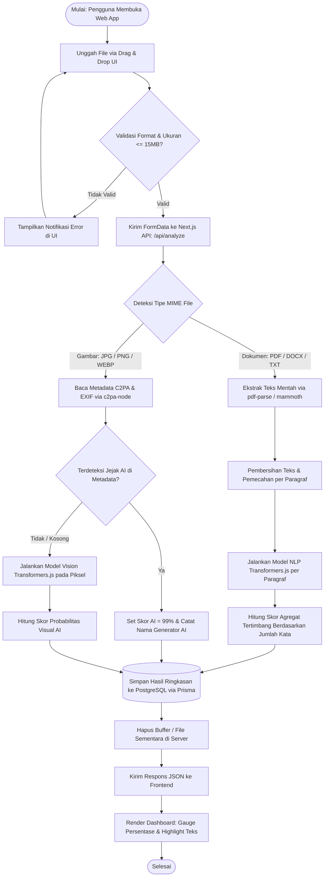

# Product Requirements Document (PRD)
## Sistem Deteksi Konten & Dokumen Buatan AI (AI-AuthVerifier)

| Informasi Dokumen | Detail |
| :--- | :--- |
| **Nama Produk** | AI-AuthVerifier (Sistem Deteksi Keaslian Dokumen & Media) |
| **Versi Dokumen** | 1.0 |
| **Tanggal** | 19 November 2026 |
| **Tech Stack Utama** | Next.js (App Router), TypeScript, Transformers.js, C2PA-Node, PostgreSQL |
| **Status** | Siap Dikembangkan (*Ready for Development*) |

---

## 1. Ringkasan Eksekutif (Executive Summary)

### 1.1 Latar Belakang
Meningkatnya penggunaan *Generative AI* (seperti ChatGPT, Claude, Midjourney, dan DALL-E) menciptakan kebutuhan mendesak bagi institusi pendidikan, tim editorial, dan perusahaan untuk memverifikasi orisinalitas file yang masuk. 

### 1.2 Tujuan Produk
Membangun aplikasi web *full-stack* mandiri menggunakan **Next.js** tanpa ketergantungan pada server Python eksternal, yang mampu:
1. Membaca dan mengekstrak konten dari file dokumen (`.pdf`, `.docx`, `.txt`) serta gambar (`.jpg`, `.png`, `.webp`).
2. Menganalisis probabilitas campur tangan AI dalam skala persentase ($0\% - 100\%$).
3. Memberikan transparansi analisis melalui sorotan warna (*highlighting*) per paragraf dan inspeksi metadata kriptografi.

### 1.3 Target Pengguna
* **Akademisi & Pengajar:** Memeriksa esai, makalah, atau tugas akhir mahasiswa.
* **Editor & Penerbit:** Memvalidasi keaslian naskah artikel dan aset visual sebelum publikasi.
* **Tim Rekrutmen & HR:** Memverifikasi portofolio tulisan atau desain kandidat.

---

## 2. Spesifikasi Arsitektur & Tech Stack

Sistem ini dirancang berjalan di atas lingkungan **Node.js Runtime** agar dapat mengeksekusi pustaka *Machine Learning* berbasis ONNX dan pembaca biner kriptografi secara langsung.

| Lapisan Sistem | Teknologi / Pustaka | Deskripsi & Alasan Pemilihan |
| :--- | :--- | :--- |
| **Frontend & Backend** | Next.js 15 (App Router) + TypeScript | Menyatukan antarmuka pengguna dan API pemrosesan file dalam satu repositori (*monolith*). |
| **UI & Styling** | Tailwind CSS + shadcn/ui + Lucide React | Membangun komponen *dropzone*, grafik *gauge* skor, dan tampilan dokumen beranotasi secara cepat. |
| **Ekstraksi Dokumen** | `pdf-parse` & `mammoth` | Mengekstrak teks mentah dari file PDF dan Microsoft Word (`.docx`) di memori server. |
| **AI Inference Engine** | `@huggingface/transformers` | Menjalankan model klasifikasi NLP dan *Computer Vision* berformat ONNX langsung di Node.js tanpa Python. |
| **Metadata & Kriptografi** | `c2pa-node` & `exifreader` | Membaca tanda tangan digital standar C2PA (*Content Credentials*) dan tag EXIF pada gambar. |
| **Database & ORM** | PostgreSQL + Prisma ORM | Menyimpan riwayat pemindaian, log skor per segmen, dan metadata laporan. |
| **Deployment** | Docker Container / VPS (Min. 2GB RAM) | Dibutuhkan memori persisten untuk menyimpan *cache* model ONNX di RAM (*Singleton*). |

---

## 3. Kebutuhan Fungsional (Functional Requirements)

| ID | Fitur | Deskripsi Kebutuhan | Kriteria Penerimaan (*Acceptance Criteria*) | Prioritas |
| :--- | :--- | :--- | :--- | :--- |
| **FR-01** | **Unggah File Multi-Format** | Pengguna dapat mengunggah file melalui antarmuka *drag-and-drop* atau pemilih file standar. | Sistem menerima `.pdf`, `.docx`, `.txt`, `.jpg`, `.png`, `.webp` dengan batas maksimal **15 MB** dan menolak format lain dengan pesan error yang jelas. | Tinggi |
| **FR-02** | **Ekstraksi & Segmentasi Teks** | Sistem mengekstrak teks dari dokumen dan memecahnya menjadi segmen paragraf. | Karakter *whitespace* berlebih dibersihkan; paragraf dengan panjang $< 25$ kata (seperti judul/header) dilewati dari penilaian agar tidak menimbulkan bias. | Tinggi |
| **FR-03** | **Deteksi Probabilitas Teks AI** | Setiap paragraf dianalisis menggunakan model klasifikasi teks untuk mendapatkan skor probabilitas AI. | Sistem mengembalikan nilai probabilitas antara $0.00$ hingga $1.00$ untuk setiap paragraf beserta skor agregat total dokumen. | Tinggi |
| **FR-04** | **Inspeksi Metadata C2PA & EXIF** | Untuk file gambar, sistem memeriksa tanda tangan kriptografi C2PA dan metadata EXIF sebelum analisis visual. | Jika ditemukan klaim pembuatan oleh generator AI (misal: *Adobe Firefly*, *DALL-E*, *Imagen*), sistem langsung menandai skor AI $\ge 99\%$ beserta detail penerbit sertifikatnya. | Tinggi |
| **FR-05** | **Deteksi Visual AI (Fallback)** | Jika file gambar tidak memiliki metadata (sudah terhapus/di-*screenshot*), sistem menganalisis pola piksel. | Model *Vision Transformer* (ONNX) mengevaluasi artefak difusi gambar dan mengeluarkan skor probabilitas AI ($0\% - 100\%$). | Sedang |
| **FR-06** | **Visualisasi Hasil & Highlighting** | Menampilkan dashboard hasil pemindaian yang interaktif dan mudah dipahami. | Teks ditampilkan ulang dengan sorotan warna: **Merah** ($> 75\%$ AI), **Kuning** ($40\% - 75\%$ AI), dan **Netral/Hijau** ($< 40\%$ AI). | Tinggi |
| **FR-07** | **Riwayat & Ekspor Laporan** | Pengguna dapat melihat riwayat pemindaian sebelumnya dan mengunduh ringkasan hasil. | Laporan tersimpan di database PostgreSQL dan dapat diekspor ke format PDF atau JSON. | Sedang |

---

## 4. Kebutuhan Non-Fungsional (Non-Functional Requirements)

1. **Performa & Manajemen Memori (NFR-01):**
   * Model AI pada `@huggingface/transformers` wajib diinisialisasi menggunakan pola **Singleton** (`globalThis`) pada Node.js agar tidak diunduh atau dimuat ulang setiap kali ada *request* baru.
   * Waktu pemrosesan dokumen teks (maksimal 5.000 kata) harus selesai di bawah **5 detik** setelah model termuat di memori.
2. **Keamanan & Privasi Data (NFR-02):**
   * File yang diunggah tidak boleh disimpan secara permanen di server. Seluruh pemrosesan dilakukan di *buffer* memori atau folder `/tmp` yang langsung dihapus (`fs.unlink`) begitu respons dikirimkan.
3. **Konfigurasi Runtime Next.js (NFR-03):**
   * Seluruh API Route pemrosesan file wajib mendeklarasikan `export const runtime = 'nodejs';` karena pustaka biner seperti `c2pa-node` dan `pdf-parse` tidak kompatibel dengan *Edge Runtime*.
4. **Disclaimer Akurasi (NFR-04):**
   * Antarmuka hasil wajib menampilkan catatan bahwa persentase merupakan **indikator probabilitas statistik**, bukan bukti mutlak 100%, untuk mencegah kesalahan pengambilan keputusan akibat *false positive*.

---

## 5. Flowchart Alur Kerja Sistem

Berikut adalah diagram alur pemrosesan sistem dari ujung ke ujung (*end-to-end*):



---

## 6. Logika Perhitungan Skor (Scoring Algorithm)

Untuk mencegah paragraf pendek (seperti subjudul atau kutipan singkat) merusak akurasi persentase dokumen secara keseluruhan, sistem menggunakan **Rata-Rata Tertimbang Berdasarkan Jumlah Kata (*Word-Weighted Average*)**:

$$\text{Total Skor AI (\%)} = \left( \frac{\sum_{i=1}^{n} (S_i \times W_i)}{\sum_{i=1}^{n} W_i} \right) \times 100$$

**Keterangan Variabel:**
* $n$: Total segmen paragraf valid yang dianalisis.
* $S_i$: Skor probabilitas AI pada paragraf ke-$i$ (rentang nilai $0.0$ hingga $1.0$).
* $W_i$: Jumlah kata (*word count*) pada paragraf ke-$i$.

### Kategori Klasifikasi Skor Akhir:
* **$0\% - 39\%$:** Kemungkinan Besar Ditulis Manusia (*Likely Human-Written*)
* **$40\% - 74\%$:** Indikasi Campuran / Terbantu AI (*Mixed / AI-Assisted*)
* **$75\% - 100\%$:** Kemungkinan Besar Dihasilkan AI (*Likely AI-Generated*)

---

## 7. Struktur Proyek & Skema Database

### 7.1 Struktur Direktori Next.js (App Router)
```text
ai-auth-verifier/
├── prisma/
│   └── schema.prisma               # Definisi skema tabel database
├── src/
│   ├── app/
│   │   ├── layout.tsx              # Layout utama aplikasi
│   │   ├── page.tsx                # Halaman utama (Upload & Hasil Analisis)
│   │   ├── history/
│   │   │   └── page.tsx            # Halaman riwayat pemindaian
│   │   └── api/
│   │       └── analyze/
│   │           └── route.ts        # Endpoint pemrosesan file (Node.js Runtime)
│   ├── components/
│   │   ├── FileDropzone.tsx        # Komponen drag-and-drop upload
│   │   ├── ScoreGauge.tsx          # Visualisasi grafik persentase 0-100%
│   │   ├── DocumentViewer.tsx      # Penampil teks dengan highlight warna
│   │   └── MetadataCard.tsx        # Penampil informasi sertifikat C2PA/EXIF
│   └── lib/
│       ├── ai-pipeline.ts          # Singleton instance untuk Transformers.js
│       ├── text-extractor.ts       # Fungsi pembaca PDF, DOCX, dan TXT
│       ├── image-inspector.ts      # Fungsi pembaca C2PA & EXIF gambar
│       └── prisma.ts               # Koneksi singleton Prisma Client
├── next.config.ts                  # Konfigurasi serverExternalPackages untuk ONNX
└── package.json
```

### 7.2 Skema Database (`prisma/schema.prisma`)
```prisma
generator client {
  provider = "prisma-client-js"
}

datasource db {
  provider = "postgresql"
  url      = env("DATABASE_URL")
}

model ScanReport {
  id              String   @id @default(cuid())
  fileName        String
  fileType        String   // "DOCUMENT" | "IMAGE"
  mimeType        String
  fileSize        Int
  overallAiScore  Float    // Nilai 0.0 - 100.0
  detectionMethod String   // "NLP_TRANSFORMER" | "C2PA_METADATA" | "VISION_MODEL"
  wordCount       Int?     // Khusus untuk dokumen teks
  analysisDetail  Json     // Menyimpan array paragraf atau detail manifest C2PA
  createdAt       DateTime @default(now())
}
```

### 7.3 Kontrak API (`POST /api/analyze`)
* **Request:** `multipart/form-data` dengan field `file`.
* **Response (`200 OK` - Contoh Dokumen):**
```json
{
  "success": true,
  "reportId": "cm3x9abc00001xyz",
  "data": {
    "fileName": "proposal_penelitian.pdf",
    "fileType": "DOCUMENT",
    "overallAiScore": 64.5,
    "classification": "MIXED_AI_ASSISTED",
    "totalWords": 620,
    "segments": [
      {
        "index": 1,
        "text": "Transformasi digital dalam sektor pendidikan menuntut adaptasi kurikulum yang komprehensif...",
        "wordCount": 140,
        "aiProbability": 0.91,
        "riskLevel": "HIGH"
      },
      {
        "index": 2,
        "text": "Wawancara dilakukan secara tatap muka bersama tiga kepala sekolah di Jakarta Barat pada...",
        "wordCount": 180,
        "aiProbability": 0.14,
        "riskLevel": "LOW"
      }
    ]
  }
}
```

---

## 8. Tahapan Pengembangan (Roadmap)

* **Fase 1 (Minggu 1) — Fondasi & Ekstraksi File:**
  * Inisialisasi proyek Next.js (TypeScript + Tailwind + shadcn/ui).
  * Konfigurasi `next.config.ts` (`serverExternalPackages: ['@huggingface/transformers', 'c2pa-node', 'pdf-parse']`).
  * Implementasi endpoint ekstraksi file PDF, DOCX, dan TXT menjadi struktur array paragraf bersih.
* **Fase 2 (Minggu 2) — Integrasi Mesin AI & C2PA:**
  * Membangun modul *Singleton* untuk memuat model deteksi teks dan gambar ONNX di server.
  * Mengintegrasikan pembaca metadata `c2pa-node` dan algoritma *Word-Weighted Average*.
* **Fase 3 (Minggu 3) — Antarmuka Pengguna & Visualisasi:**
  * Membangun UI unggah file, indikator progres (*loading state*), grafik *gauge* skor AI, dan komponen *DocumentViewer* dengan fitur *highlight* warna serta *tooltip* skor per paragraf.
* **Fase 4 (Minggu 4) — Persistensi Data, Pengujian & Deployment:**
  * Menghubungkan Prisma ORM ke PostgreSQL untuk fitur riwayat pemindaian dan ekspor laporan PDF.
  * Kalibrasi *threshold* skor dengan dataset uji (tulisan manusia murni vs hasil AI), lalu *deployment* menggunakan Docker ke VPS.