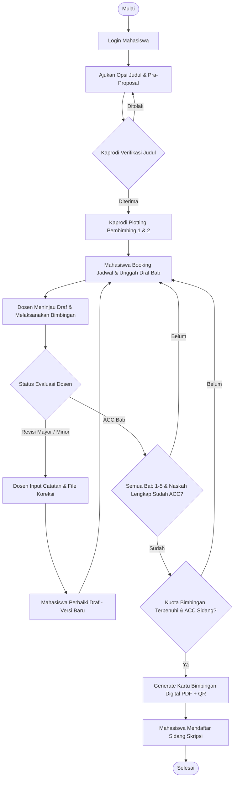
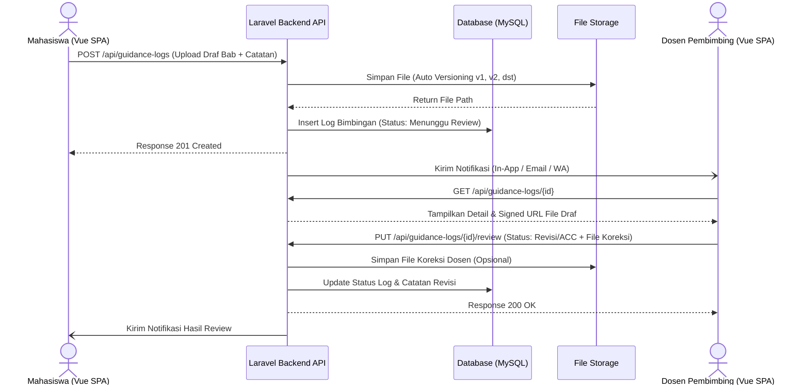
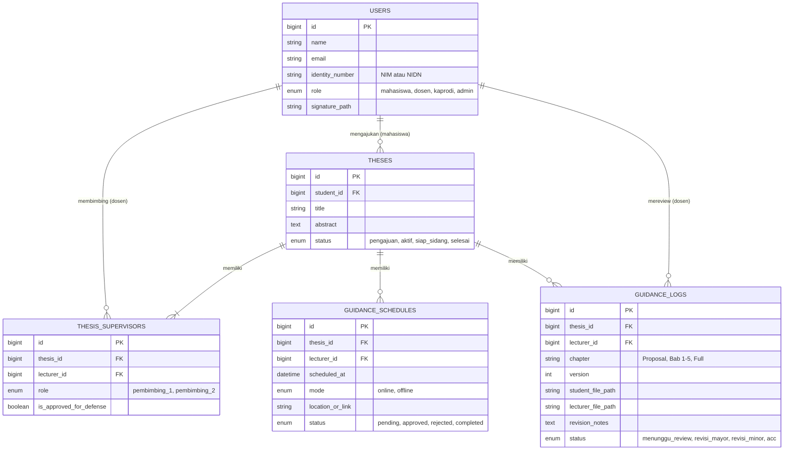

# Product Requirements Document (PRD)
**Nama Produk:** Sistem Informasi Pembimbingan Skripsi (SIPS)  
**Tech Stack:** Laravel 11 (Backend API) & Vue 3 (Frontend SPA)  
**Versi Dokumen:** 1.0  
**Status:** Draft Final  

---

## 1. Ringkasan Eksekutif & Tujuan Produk

### 1.1 Latar Belakang
Proses pembimbingan skripsi konvensional sering menghadapi kendala komunikasi yang tersebar di berbagai platform (WhatsApp, email), kesulitan melacak riwayat revisi file dokumen, penjadwalan tatap muka yang tidak terstruktur, serta kurangnya pemantauan secara *real-time* oleh Koordinator Skripsi/Kaprodi terhadap progres mahasiswa.

### 1.2 Tujuan Utama
* **Sentralisasi:** Menggabungkan pengajuan judul, penjadwalan bimbingan, unggah draf, dan catatan revisi dalam satu platform terpadu.
* **Transparansi & Akuntabilitas:** Mencatat setiap log bimbingan dan status persetujuan (*ACC*) secara digital sebagai syarat administratif pendaftaran sidang.
* **Efisiensi Pemantauan:** Menyediakan *dashboard* analitik bagi Kaprodi untuk memantau distribusi beban dosen pembimbing serta tingkat progres mahasiswa.

---

## 2. Peran Pengguna (*User Roles*)

| Peran | Deskripsi & Tanggung Jawab Utama |
| :--- | :--- |
| **Mahasiswa** | Mengajukan judul/proposal, memilih jadwal bimbingan, mengunggah draf bab (Bab 1–5), melihat catatan revisi, dan mengunduh Kartu Kendali Bimbingan Digital. |
| **Dosen Pembimbing (1 & 2)** | Meninjau pengajuan judul, mengatur ketersediaan jadwal, menyetujui/menolak sesi bimbingan, memberikan catatan revisi pada draf, serta memberikan status *ACC* per bab maupun *ACC* sidang. |
| **Koordinator Skripsi / Kaprodi** | Memverifikasi kelayakan proposal, memetakan (*plotting*) dosen pembimbing, memantau progres keseluruhan mahasiswa, dan memvalidasi kelayakan sidang. |
| **Admin Akademik** | Mengelola data master (mahasiswa, dosen, tahun akademik, kuota bimbingan) serta mencetak rekapitulasi berita acara dan SK Pembimbing. |

---

## 3. Kebutuhan Fungsional (*Functional Requirements*)

### 3.1 Modul Autentikasi & Profil
* **FR-01:** Login tunggal menggunakan NIM/NIDN atau email institusi menggunakan autentikasi berbasis token (Laravel Sanctum).
* **FR-02:** Manajemen profil pengguna, termasuk unggah spesimen tanda tangan digital (PNG transparan) atau pembuatan QR Code verifikasi otomatis untuk pengesahan dokumen.

### 3.2 Modul Pengajuan Judul & Plotting Pembimbing
* **FR-03:** Mahasiswa dapat mengajukan maksimal 3 opsi judul beserta latar belakang singkat dan dokumen pra-proposal (PDF).
* **FR-04:** Sistem melakukan pengecekan kemiripan judul (*similarity check*) terhadap arsip judul skripsi terdahulu di database.
* **FR-05:** Kaprodi meninjau proposal dan menetapkan Dosen Pembimbing 1 dan Dosen Pembimbing 2 berdasarkan kuota dan bidang keahlian.

### 3.3 Modul Penjadwalan Bimbingan
* **FR-06:** Dosen dapat mengatur slot waktu ketersediaan bimbingan mingguan (Daring via tautan *meeting* atau Luring di ruang dosen).
* **FR-07:** Mahasiswa memilih slot jadwal yang tersedia untuk mengajukan sesi bimbingan; dosen dapat menyetujui atau menjadwalkan ulang (*reschedule*).

### 3.4 Modul Manajemen Draf & Log Revisi (Core Feature)
* **FR-08:** Unggah dokumen terstruktur per tahapan (`Proposal`, `Bab 1`, `Bab 2`, `Bab 3`, `Bab 4`, `Bab 5`, `Naskah Lengkap`) dengan batasan ukuran maks. 15 MB (format PDF/DOCX).
* **FR-09:** *Versioning Control* otomatis pada penamaan file (contoh: `NIM_Bab1_v1.pdf`, `NIM_Bab1_v2.pdf`) agar riwayat perbaikan tidak tertimpa.
* **FR-10:** Dosen dapat menulis catatan revisi terstruktur, melampirkan file yang telah dicoret/dikoreksi, dan mengubah status dokumen menjadi:
  * `Menunggu Review`
  * `Revisi Mayor`
  * `Revisi Minor`
  * `ACC`

### 3.5 Modul Pelaporan & Syarat Sidang
* **FR-11:** Sistem menghitung jumlah pertemuan bimbingan yang sah secara otomatis (contoh: minimal 8x bimbingan dengan Pembimbing 1 dan 4x dengan Pembimbing 2).
* **FR-12:** Generate otomatis **Kartu Bimbingan Digital** dalam format PDF dilengkapi QR Code validasi apabila jumlah minimal bimbingan terpenuhi dan kedua pembimbing telah memberikan status `ACC Sidang`.

---

## 4. Alur Pengguna (*Flowchart*)

### 4.1 Flowchart Utama Proses Bimbingan Skripsi

### 4.2 Sequence Diagram: Siklus Unggah Draf & Revisi

---

## 5. Kebutuhan Non-Fungsional (*Non-Functional Requirements*)

* **Keamanan:** Implementasi *Role-Based Access Control* (RBAC), enkripsi password, proteksi CSRF/XSS, dan penggunaan *Temporary Signed URLs* agar file skripsi hanya dapat diakses oleh mahasiswa dan dosen pembimbing terkait.
* **Performa:** Waktu muat antarmuka SPA di bawah 1,5 detik; proses unggah dokumen besar dilengkapi indikator progres (*progress bar*) asinkron.
* **Notifikasi:** Notifikasi *real-time* di dalam aplikasi (*in-app notification*) serta integrasi antrean (*queue*) untuk pengiriman email atau WhatsApp Gateway saat ada pembaruan status bimbingan.
* **Responsivitas:** Tampilan responsif berbasis Tailwind CSS yang nyaman diakses melalui desktop (untuk meninjau dokumen) maupun perangkat seluler (untuk mengecek jadwal dan notifikasi).

---

## 6. Spesifikasi Teknis & Skema Database

### 6.1 Tech Stack
* **Backend:** Laravel 11.x (PHP 8.3+), RESTful API dengan Laravel Sanctum.
* **Frontend:** Vue 3 (Composition API), Vite, Pinia (State Management), Vue Router, Tailwind CSS.
* **Database:** MySQL 8.0 atau PostgreSQL.
* **Storage & Queue:** Local Storage / S3 Compatible (MinIO), Redis untuk *background job* notifikasi.
* **PDF Generator:** `barryvdh/laravel-dompdf` + `simplesoftwareio/simple-qrcode`.

### 6.2 Entity Relationship Diagram (ERD)

---

## 7. Metrik Keberhasilan (*KPIs*) & Tahapan Pengembangan

### 7.1 Metrik Keberhasilan
* **100%** riwayat bimbingan terdokumentasi secara digital tanpa bergantung pada kartu fisik.
* Rata-rata waktu umpan balik (*turnaround time*) dosen terhadap draf mahasiswa kurang dari **4 hari kerja**.
* Penurunan kendala administratif saat pendaftaran sidang hingga **80%**.

### 7.2 Roadmap Pengembangan (8 Minggu)
1. **Minggu 1–2:** Inisialisasi proyek Laravel & Vue, migrasi database, modul autentikasi (Sanctum), dan manajemen data master.
2. **Minggu 3–4:** Pengembangan modul pengajuan judul, pengecekan kemiripan judul, *plotting* pembimbing, dan penjadwalan.
3. **Minggu 5–6:** Pengembangan modul unggah draf (*auto-versioning*), alur revisi dosen, dan sistem notifikasi asinkron.
4. **Minggu 7–8:** Pembuatan generator PDF Kartu Bimbingan dengan QR Code, *dashboard* analitik Kaprodi, pengujian (UAT), dan *deployment*.